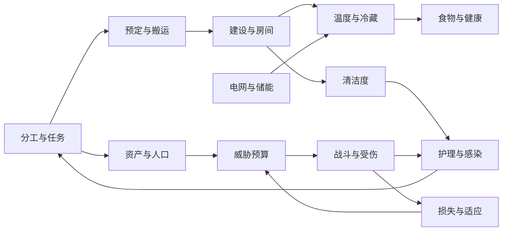

# 从逆向结论到 Emberfield 的下一轮设计

当前按“机制闭环 → 操作反馈与异常恢复 → 参数平衡”的顺序推进。先让玩家命令影响真实作业、空间与物资，验证中断、恢复和存档，再集中调整成本、效率、概率和节奏。原版数值保留为研究参考，不作为每个功能完成的前置条件。

v45把物品使用权限接入现有经营：单堆／当前层框选 → 自动工作和需求筛选 → 中途禁止释放预约 → 已携带物资及未完成品保留 → 允许后续作 → 保存继续。装备／穿戴、家畜／野生动物、自动收纳／物理合堆分别明确语义，库存与贸易不因旗标凭空删物。见[133玩法与验证](133-item-forbidden-gameplay.md)。按用户最新约束暂停原版和浏览器交互，本轮依据静态证据、无界面模型测试、类型检查与构建，界面手感和实际渲染仍待后续验证。

v43连接选址、地形与交通：相邻地区河网 → 营地水道与浅滩 → 涉水或连续规划木桥 → 正常搬料施工 → 轻型承载／拆除恢复水面 → 存读继续。原版普通桥的地基、深水限制与实际施工分别记录；Web 使用独立的三维水体和排水网络。河宽、成本和移动惩罚集中定义，后续调整。见[126原版机制](126-river-bridge-mechanisms.md)、[127玩法与验证](127-river-bridge-gameplay.md)、[128原版实机](128-native-river-bridge-runtime.md)。动态流体、重型桥、船只和跨营地旅行继续留待后续。

v42接通成品去向：制作完成后就地放下、由制作者送往最佳仓库，或送往指定区域／货架／联动储存组。地面仓库支持稳定身份、命名和扩展；成品配送不依赖搬运分工，途中保存和目标失效保留实物，完成次数只结算一次。继续先搭机制闭环，数值后调。见[124原版机制](124-production-output-mechanisms.md)、[125玩法与验证](125-production-output-gameplay.md)。

v41接入独立未完成品：13条裁缝、武器和护甲配方保存实物材料、作者与加工进度；暂停和删除账单保留物品，可搬运入库、跨兼容工作台由原作者续作，单独取消才退料。见[122原版机制](122-unfinished-production-mechanisms.md)、[123玩法与验证](123-unfinished-production-gameplay.md)。继续先搭玩法闭环，退料比例、耐久和工作速度等数值后续统一调整。

本篇是**本项目设计建议**，不是 RimWorld 的静态事实，也不是已实现功能承诺。依据前四篇2026-11-02研究，目标是在现有 PixiJS 8 + 权威模拟Worker架构下，逐步获得有因果关系、可诊断的殖民地模拟。

## 当前开发取向（2026-11-04更新）

v38接通[储存组联动](117-storage-groups-gameplay.md)：已有货架与蓝图共享规则 → 正常施工 → 实际分类转运 → 打包期间编辑 → 携带中保存并重装 → 解除后独立。玩家按组维护仓储，物资仍经过真实路线；静态依据与原版普通操作分别记录。仅扩展规则与操作连接，成本和效率暂不精调。

[115 通行成本与绕行](115-weighted-navigation-gameplay.md)连接空间布局与出行选择：人物比较货架/积雪/障碍/门成本，堵路优先保留任务重规划，普通移动读档保留目的地；多层净空、梯子和牢房约束继续生效。原版实机观察了一次货架绕行。牵引成对路线、火焰感知和会车仍待扩展，暂定成本继续后调。

[114 实体货架](114-shelves-gameplay.md)在[113物资预约基础](113-storage-reservations-foundation.md)上接通建造 → 整架筛选/优先级 → 实际搬入多堆 → 邻接取用 → 满架卸下、散货和重装 → 读档继续。原版依据见[111静态机制](111-shelf-storage-mechanisms.md)与[112原版实机](112-native-shelves-runtime.md)。货架没有品质，保护环境劣化而不阻止食物温度腐坏。

主动卸装在无落点时等待；火毁且地面完好时保留可序列化的应急散货。这是 Web 守恒适配，原版极端拥堵时未作同等保证。下一轮继续从实际游玩暴露的操作和系统衔接问题出发；更多建筑类型与毁坏后自动重建尚未完成，加权寻路进展见 115，储存组联动见 117。**初期以可操作、可中断、可恢复且有资源因果的玩法链为验收目标；成本、效率与概率数值后续集中调整。**

地下探索已补充[110原版实机对照](110-native-exploration-runtime.md)：正常未知采矿、挖通、清除空地标记与重新载入结果成立。

v36连接地下开凿与探索：地表梯井 → 未知采矿规划 → 到场挖通 → 连通洞室揭示 → 矿藏检查/采集/回运 → 保存继续。洞室为实际三维空腔，显示和选择均遵守发现状态；旧营地不重生成，地区身份保留生成版本。先搭完整操作闭环，洞穴密度和劳动节奏后调，见[109玩法与验证](109-caves-exploration-gameplay.md)。天然地表洞口、水体、岩层坍塌和洞穴事件仍待扩展。

v35连接世界与营地：固定世界种子 → 地区条件 → 多地点比较 → 实际局部预览 → 带地区身份的新营地 → 保存继续。只创建当前营地的模拟；旧地形不重生成，自定义地图保留。世界分布使用暂定参数和独立算法版本，后续改分布不能破坏原有地区身份。见[107玩法与验证](107-world-site-selection-gameplay.md)。河流、洞穴、世界旅行和多地图仍待扩展。

v34把家具改造接入现有经营：卸下原家具 → 保持品质/耐久的单件实物 → 仓储或跨层搬运 → 新朝向重装 → 继续睡眠/用餐。取消、人员打断、满地面和火灾中保留实体状态，先让房间布局可以调整，见[105玩法与验证](105-furniture-relocation-gameplay.md)。下一轮仍优先尚缺的机制连接，不把精细数值校准当作交付前置条件。

v33把建造分工连接到家具使用：实际完工者技能 → 床桌椅品质 → 睡眠/舒适/房间评价与财富 → 家具检查和床位安排。品质不影响家具最大耐久，旧档按普通品质延续；继续保留暂定经济参数，见[102玩法与验证](102-furniture-quality-gameplay.md)。

v32连接生活空间与人际关系：桌椅及共同作息 → 实际到座休闲 → 自然即时互动 → 有方向的意见与独立心情 → 来源检查及存档延续。优先确保玩家安排可影响居民相遇，关系有可解释的来源；亲属、恋爱、性格和社交打架继续扩展，见[99玩法与验证](99-social-colony-gameplay.md)。

v31把房间与居民生活接起来：建设餐桌/椅 → 实际取食和就座 → 持续进食 → 营养与记忆；睡眠接入舒适和卧室/宿舍体验。优先验收状态与物资守恒，不把参数拟合当成交付门槛，见[96玩法与验证](96-living-dining-gameplay.md)。

用户已明确：**初期优先搭好玩法和机制，数值可以后续逐步调整。** 下文保留早期研究路线；当前二维入口使用PixiJS 8，多层体素入口使用Three.js，下一阶段优先补体素模式可操作的玩法闭环。

v30连接动物与空间经营：实际材料建围栏/栏门 → 三维连通判圈 → 接纳筛选 → 到场挂绳与成对移动 → 动物进圈后解绳；兔使用活动范围并自主返回。支持取消、门状态、火灾破圈和存读，见[93玩法与验证](93-animal-pens-gameplay.md)。畜产品、训练、完整动物伤病与长期放牧平衡仍待扩展，继续优先机制。下列版本的“后续”指当时边界。

v29接通动物经营：种田取得实际饲料 → 驯养员拿取、靠近和喂食 → 驯服尝试 → 有限草与实物进食 → 配偶接触、怀孕、出生和成长 → 放归或宰杀与尸体加工（[90玩法与验证](90-animal-husbandry-gameplay.md)）。同一份营地中的资源与生命状态持续推进。完整圈栏、牵引、允许区域、畜产品和动物医疗仍是后续机制，参数平衡继续后调。

v28连接天气与生活、仓储：淋雨记忆与避雨消退 → 户外散步条件 → 雨洗露天污物 → 地面物资真实 HP → 搭棚或封闭仓库 → 搬运、混堆、施工退料和交易保留状态（[87玩法与验证](87-environment-storage-gameplay.md)）。仓储标记不等于保护，棚下与室内也有区别；先保证玩家操作会产生稳定、可观察的结果，概率分布和经济节奏后调。

v26连接灾害与恢复：正常火灾事件 → 独立火焰与实际燃料损失 → 家园灭火分工与到场拍打 → 幸存建筑耐久损伤 → 施工修理或烧毁后重建（[81玩法与验证](81-fire-gameplay.md)）。火灾同时影响房间热量、电网和多层支撑。优先确认可观察的因果链与存档连续性，后续再校准火势增长、蔓延频率、灾害间隔与修理速度。

v27连接天气与户外经营：正常天气过渡 → 真实屋顶暴露 → 降水压制火势、露天移动/射击变化 → 多层积雪与通行 → 局部温度融雪（[84玩法与验证](84-weather-gameplay.md)）。保持普通雨雾不额外削减太阳能的原版区别，频率和效果速度之后校准。

v25接通卫生反馈：泥土、血迹、屠宰与呕吐产生格子污物 → 家园范围与清洁分工 → 真实走到并逐层清扫 → 厨房生产污染与实际进食 → 三阶段食物中毒及恢复（[78玩法与验证](78-sanitation-gameplay.md)）。污染保留在真实食品批次中，不能通过搬运、混堆或存读抹掉；房间卫生也影响既有护理环境。范围先覆盖普通简餐与人物，进一步的食材来源风险、更多疾病及卫生设施仍待扩展。

机制研究主要确认角色行为、触发条件、状态变化、物品流向和玩家干预方式。先选量级合理、集中定义的参数，不要求每个小数、概率分布和原版tick边界都校准后才能交付。已有数值证据继续保留，平衡和精确对齐作为后续独立工作。

v24把战斗、住房、医疗和人口连在一起：倒地袭击者 → 实体搬入囚犯床 → 护理与进食/休息 → 看守交谈降低抵抗 → 归零后下一次交谈招募，或由看守当面释放后步行离图（[75玩法与验证](75-prisoners-gameplay.md)）。首版不继续追求完整招募数值拟合，先确保人物身份、伤情、实际食物、预约、中断与回读都能衔接。后续再扩展越狱、关系与更丰富的社会事件。

v23进一步接通心情与娱乐：思想原因 → 心情目标与渐变 → 真实到场娱乐/作息/厌倦 → 持续低落预警 → 有限期失落游荡 → 恢复后重新工作（[72玩法与验证](72-voxel-mood-gameplay.md)）。当前仅包含有限思想与两类娱乐，关系、性格、完整房间印象和其他精神状态仍待扩展。

v22已接通的首条闭环是（[实现与边界](70-voxel-wildlife-gameplay.md)）：地图动物活动与检查 → 标记狩猎 → 猎人实际追踪/攻击 → 动物遗体落地 → 搬运/屠宰 → 肉类进入烹饪、冷藏与进食。交互中要能看见当前行为、失败原因和实际产物，并能取消任务、解除受困和保存继续。随后再接驯养、畜牧及其他社会玩法；不把这一顺序写成已经实现。

验收以普通操作完成闭环为主，配合少量针对卡死、重复结算、物资丢失和旧档破坏的测试。规则测试、浏览器操作及必要经营验证均在本地运行；Pages只安装依赖、类型检查、构建与部署。

## 1. 先把互相影响的规则连接起来

这些反馈比单独增加更多建筑更值得优先实现：房间布局影响护理、护理影响恢复时间、恢复时间影响劳动与产量，产量和人口又影响后续威胁。每条箭头都需要能追踪的中间值，方便发现数值失衡。

## 2. 保持时间单位显式

原版研究以60,000 tick/游戏日计；当前Web版 `src/sim/types.ts` 为 **DAY=12,000、HOUR=500、TPS=20**。TPS是正常调度每现实秒推进多少步，不等于一天有多少步。

以每天的变化率存基础参数：`delta = ratePerDay × simulatedTicks / DAY`。若保留相同游戏日比例，原版150 tick间隔映射为Web30步，30,000 tick映射为6,000步；这不保证现实墙钟时长相同。对于概率事件，使用明确的概率过程/累计危险率，不要把“平均4日一次”写成每4日必发生。

渲染插值只消费显示快照。暂停不推进模拟，倍速改变推进步数，切换渲染后端不能改变事件顺序。对同一初始状态、命令序列与随机种子，权威状态应可重放。

## 3. 系统边界与需要持久化的数据

| 模块 | 权威状态/数据 | 不应直接混合的概念 |
|---|---|---|
| 工作调度 | 工作设置、Job ID、目标、步骤、失败原因、重试时间、预定表 | 玩家手动命令、普通AI扫描、紧急插队 |
| 房间 | cell→room索引、屋顶数、边界/邻居、面积、温度、脏标记、属性缓存 | 温度室外、心理室外、作业室外 |
| 电网 | 连接拓扑、网络ID、设备需求与实际启用、电池能量与效率 | 有发电机、有连线、供需够用、当前开机 |
| 健康 | 部位伤口、严重度、护理到期、实际质量、出血、免疫、感染资格与计划时间 | 医生基础质量与单伤口最终质量，伤害与总健康 |
| 叙事者 | 资产分项、人口贡献、适应值、周期状态、既往事件、预算明细 | 财富、市值、售价、威胁点、最终敌人数量 |
| 贸易 | 商品估值、报价修正、会话库存、交易数量、银币差额 | UI展示价格与最终事务结算 |

随机实例因子、感染检查时间、任务预定、当前电池储量等必须进存档；载入后重新抽取会改变同一个世界。缓存可在读取时重建，但先明确缓存和权威状态的区别。

## 4. 建议交付顺序与验收场景

| 阶段 | 具体交付 | 有区分力的验收 |
|---|---|---|
| A 工作与物流诊断 | 可显示任务拒绝原因；统一预定/取消/中断释放；分开玩家强制指令 | 两人抢同堆、目标被拆除、搬运途中中断、仓储优先级改变；无幽灵预定或物品复制 |
| B 房间与热力 | 房间/屋顶索引；封闭房间温度；墙/屋顶交换；冷气机双侧 | 拆墙/补墙/开顶；扩大房间后温变变慢；制冷端与排热端位置交换；切断供电后停止主动制冷 |
| C 电网与健康深化 | 能量守恒口径、充放电效率；护理质量/出血/单一感染模型 | 电池空/满及净负载；同一伤口不同护理和免疫速度；存档重放不重抽感染资格 |
| D 叙事者 | 财富分项、人口点、适应状态、调度与组队四阶段 | 同市值建筑/库存替换的风险不同；同tick倒地死亡不重复降压；低预算不会产生空袭击 |
| E 贸易/品质/社交 | 逐项研究后单独扩展 | 先有可复核的报价与提交，再扩商人类型；不把未核对的维基数字直接塞进平衡表 |

当前首版已有预定、伤口、电池、普通袭击等简化系统；阶段A/C是对其深化与一致性检查，B/D含更多新模型。本轮只提交研究，不扩大现有游戏实现范围。

## 5. 内存与CPU设计约束

不能用“网页固定只有4GB”作为所有对象的统一容量模型。JS堆、ArrayBuffer、Worker进程、GPU资源的实际限制由浏览器/架构决定，仍需测量；但本项目应主动控制峰值。

- 房间用格网索引+房间聚合，不为每格保存一套完整房间对象；只在建筑/屋顶变化处更新拓扑，属性使用失效缓存。
- 任务查询按工作类别、区域和候选集分级；不要让每人每步重扫全图所有物品。先保留可靠回退，再优化候选索引。
- 模拟Worker拥有完整世界；UI只取摘要，渲染只取显示字段。不要把疾病列表、任务历史、Def全文每帧复制给两端。
- 研究JSON是离线设计资料，不打包为运行时原版全Def数据库。独立定义表只收录实际实现的参数。
- 预定/路径缓存/尸体/日志要有明确失效或保留规则。做固定种子长跑，分别量JS堆、可转移缓冲池、GPU纹理和保存瞬时峰值。

这些是工程预算建议，不能从原版反编译结论推断Web版性能已达标。当前实际性能与已有验证见项目 [首版验证](../../validation.md)。

## 6. 从静态证据转向运行验证

每个将要实现的机制先挑2–4个能区分竞争解释的小场景。例如仅改变屋顶比例、只改变医生质量、只替换等价资产类型。需要测原版时固定版本/配置、控制初始状态，记录输入、游戏tick、事件与结果；概率机制需要重复样本，单次截图不能证明概率公式。

复刻的目标是保留清晰因果与可玩的取舍。对已确认但实现成本较高的机制，可以保留显式简化开关及差异说明；对尚未确认的机制则先列为未知，避免为追求“完全一致”把猜测固化为测试。
