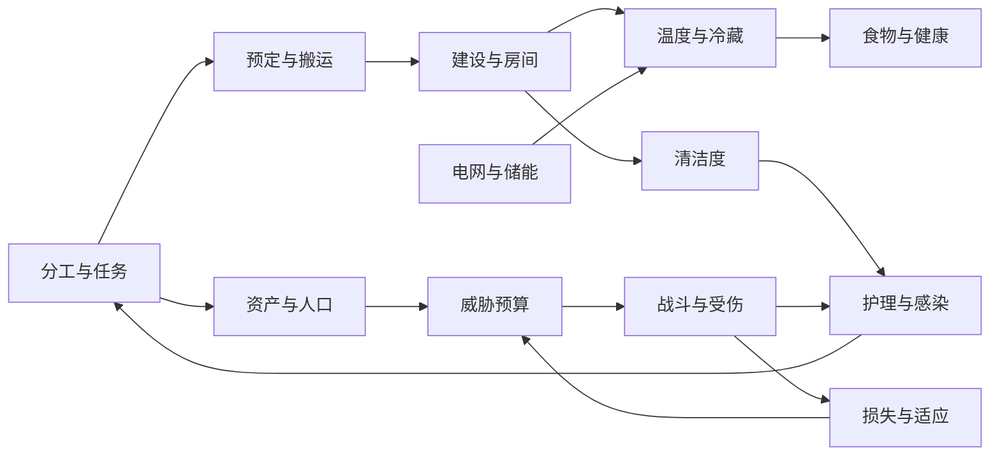

# 从逆向结论到 Emberfield 的下一轮设计

本篇是**本项目设计建议**，不是 RimWorld 的静态事实，也不是已实现功能承诺。依据前四篇2026-11-02研究，目标是在现有 PixiJS 8 + 权威模拟Worker架构下，逐步获得有因果关系、可诊断的殖民地模拟。

## 当前开发取向（2026-11-04更新）

用户已明确：**初期优先搭好玩法和机制，数值可以后续逐步调整。** 下文保留早期研究路线；当前二维入口使用PixiJS 8，多层体素入口使用Three.js，下一阶段优先补体素模式可操作的玩法闭环。

机制研究主要确认角色行为、触发条件、状态变化、物品流向和玩家干预方式。先选量级合理、集中定义的参数，不要求每个小数、概率分布和原版tick边界都校准后才能交付。已有数值证据继续保留，平衡和精确对齐作为后续独立工作。

v24把战斗、住房、医疗和人口连在一起：倒地袭击者 → 实体搬入囚犯床 → 护理与进食/休息 → 看守交谈降低抵抗 → 归零后下一次交谈招募，或由看守当面释放后步行离图（[75玩法与验证](75-prisoners-gameplay.md)）。首版不继续追求完整招募数值拟合，先确保人物身份、伤情、实际食物、预约、中断与回读都能衔接。后续再扩展越狱、关系与更丰富的社会事件。

v23进一步接通心情与娱乐：思想原因 → 心情目标与渐变 → 真实到场娱乐/作息/厌倦 → 持续低落预警 → 有限期失落游荡 → 恢复后重新工作（[72玩法与验证](72-voxel-mood-gameplay.md)）。当前仅包含有限思想与两类娱乐，关系、性格、完整房间印象和其他精神状态仍待扩展。

v22已接通的首条闭环是（[实现与边界](70-voxel-wildlife-gameplay.md)）：地图动物活动与检查 → 标记狩猎 → 猎人实际追踪/攻击 → 动物遗体落地 → 搬运/屠宰 → 肉类进入烹饪、冷藏与进食。交互中要能看见当前行为、失败原因和实际产物，并能取消任务、解除受困和保存继续。随后再接驯养、畜牧及其他社会玩法；不把这一顺序写成已经实现。

验收以普通操作完成闭环为主，配合少量针对卡死、重复结算、物资丢失和旧档破坏的测试。规则测试、浏览器操作及必要经营验证均在本地运行；Pages只安装依赖、类型检查、构建与部署。

## 1. 先把互相影响的规则连接起来

这些反馈比单独增加更多建筑更值得优先实现：房间布局影响护理、护理影响恢复时间、恢复时间影响劳动与产量，产量和人口又影响后续威胁。每条箭头都需要能追踪的中间值，方便发现数值失衡。

## 2. 保持时间单位显式

原版研究以60,000 tick/游戏日计；当前Web版 `src/sim/types.ts` 为 **DAY=12,000、HOUR=500、TPS=20**。TPS是正常调度每现实秒推进多少步，不等于一天有多少步。

以每天的变化率存基础参数：`delta = ratePerDay × simulatedTicks / DAY`。若保留相同游戏日比例，原版150 tick间隔映射为Web30步，30,000 tick映射为6,000步；这不保证现实墙钟时长相同。对于概率事件，使用明确的概率过程/累计危险率，不要把“平均4日一次”写成每4日必发生。

渲染插值只消费显示快照。暂停不推进模拟，倍速改变推进步数，切换渲染后端不能改变事件顺序。对同一初始状态、命令序列与随机种子，权威状态应可重放。

## 3. 系统边界与需要持久化的数据

| 模块 | 权威状态/数据 | 不应直接混合的概念 |
|---|---|---|
| 工作调度 | 工作设置、Job ID、目标、步骤、失败原因、重试时间、预定表 | 玩家手动命令、普通AI扫描、紧急插队 |
| 房间 | cell→room索引、屋顶数、边界/邻居、面积、温度、脏标记、属性缓存 | 温度室外、心理室外、作业室外 |
| 电网 | 连接拓扑、网络ID、设备需求与实际启用、电池能量与效率 | 有发电机、有连线、供需够用、当前开机 |
| 健康 | 部位伤口、严重度、护理到期、实际质量、出血、免疫、感染资格与计划时间 | 医生基础质量与单伤口最终质量，伤害与总健康 |
| 叙事者 | 资产分项、人口贡献、适应值、周期状态、既往事件、预算明细 | 财富、市值、售价、威胁点、最终敌人数量 |
| 贸易 | 商品估值、报价修正、会话库存、交易数量、银币差额 | UI展示价格与最终事务结算 |

随机实例因子、感染检查时间、任务预定、当前电池储量等必须进存档；载入后重新抽取会改变同一个世界。缓存可在读取时重建，但先明确缓存和权威状态的区别。

## 4. 建议交付顺序与验收场景

| 阶段 | 具体交付 | 有区分力的验收 |
|---|---|---|
| A 工作与物流诊断 | 可显示任务拒绝原因；统一预定/取消/中断释放；分开玩家强制指令 | 两人抢同堆、目标被拆除、搬运途中中断、仓储优先级改变；无幽灵预定或物品复制 |
| B 房间与热力 | 房间/屋顶索引；封闭房间温度；墙/屋顶交换；冷气机双侧 | 拆墙/补墙/开顶；扩大房间后温变变慢；制冷端与排热端位置交换；切断供电后停止主动制冷 |
| C 电网与健康深化 | 能量守恒口径、充放电效率；护理质量/出血/单一感染模型 | 电池空/满及净负载；同一伤口不同护理和免疫速度；存档重放不重抽感染资格 |
| D 叙事者 | 财富分项、人口点、适应状态、调度与组队四阶段 | 同市值建筑/库存替换的风险不同；同tick倒地死亡不重复降压；低预算不会产生空袭击 |
| E 贸易/品质/社交 | 逐项研究后单独扩展 | 先有可复核的报价与提交，再扩商人类型；不把未核对的维基数字直接塞进平衡表 |

当前首版已有预定、伤口、电池、普通袭击等简化系统；阶段A/C是对其深化与一致性检查，B/D含更多新模型。本轮只提交研究，不扩大现有游戏实现范围。

## 5. 内存与CPU设计约束

不能用“网页固定只有4GB”作为所有对象的统一容量模型。JS堆、ArrayBuffer、Worker进程、GPU资源的实际限制由浏览器/架构决定，仍需测量；但本项目应主动控制峰值。

- 房间用格网索引+房间聚合，不为每格保存一套完整房间对象；只在建筑/屋顶变化处更新拓扑，属性使用失效缓存。
- 任务查询按工作类别、区域和候选集分级；不要让每人每步重扫全图所有物品。先保留可靠回退，再优化候选索引。
- 模拟Worker拥有完整世界；UI只取摘要，渲染只取显示字段。不要把疾病列表、任务历史、Def全文每帧复制给两端。
- 研究JSON是离线设计资料，不打包为运行时原版全Def数据库。独立定义表只收录实际实现的参数。
- 预定/路径缓存/尸体/日志要有明确失效或保留规则。做固定种子长跑，分别量JS堆、可转移缓冲池、GPU纹理和保存瞬时峰值。

这些是工程预算建议，不能从原版反编译结论推断Web版性能已达标。当前实际性能与已有验证见项目 [首版验证](../../validation.md)。

## 6. 从静态证据转向运行验证

每个将要实现的机制先挑2–4个能区分竞争解释的小场景。例如仅改变屋顶比例、只改变医生质量、只替换等价资产类型。需要测原版时固定版本/配置、控制初始状态，记录输入、游戏tick、事件与结果；概率机制需要重复样本，单次截图不能证明概率公式。

复刻的目标是保留清晰因果与可玩的取舍。对已确认但实现成本较高的机制，可以保留显式简化开关及差异说明；对尚未确认的机制则先列为未知，避免为追求“完全一致”把猜测固化为测试。
