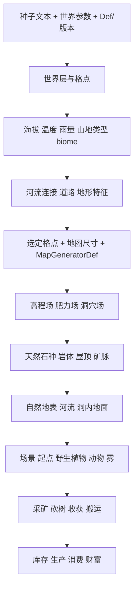

# 06 世界生成、地形与资源闭环

本章解释本地 **RimWorld 1.7.4980 rev60** 的一条主要链：世界格点 → 局部生成步骤 → 岩体/矿脉/地表/河流 → 植物与动物 → 采矿和采收物品。它用于 Emberfield 的规则设计，不代表 Emberfield 已实现这些规则，也不代表已复现原版地图。

## 证据范围与复核入口

- 原件：游戏根目录 `Assembly-CSharp.dll`，SHA-256 `eff7d97949f919fb2b151ebfb906e9be749b63410b7dbda78eeebb7972b245c3`。这是本地 1.7 包装结构，不能套用旧 Unity 版本的 Managed 子目录路径。
- 静态派生：ILSpy `11.2.0.10050`，35 个类型；每份派生文本的完整哈希、行数见 [generation-manifest.json](evidence/generation-manifest.json)。派生代码不是原始源码，本组没有执行目标代码。
- [generation-claims.json](evidence/generation-claims.json)：GN01–GN34，逐项关联类型/成员/行号，或 XML 的相对原件路径、XPath、整文件 SHA-256。
- [generation-xml.json](evidence/generation-xml.json)：14 个 Core XML 文件中 94 个选定节点的直接声明；保留 ParentName、MayRequire、Inherit 等属性。**不是完成继承、补丁和 DLC 过滤后的有效 Def 数据库**。
- [generation-cases.json](evidence/generation-cases.json)：8 个可手算的输入/结果例子。它们是公式的独立解释，不是原版运行记录。
- [generation-validation.json](evidence/generation-validation.json)：独立脚本复核原件/派生哈希、全部引用范围、XML叶值及8个算例的记录；不证明算法语义完全等价。
- 本章只研究与这条链相关的 Core 分支；涉及 DLC 的分支会注明。读取到了 DLC 文件或类名，不等于当前启动时启用了该 DLC。

复提取命令在项目根目录执行：

```powershell
$manifest = Get-Content -Raw docs/research/rimworld/evidence/generation-manifest.json | ConvertFrom-Json
./scripts/research/extract-rimworld.ps1 -GameRoot 'F:\SteamLibrary\steamapps\common\RimWorld' `
  -DecompilerPath '../../tools/ilspy/lib/netstandard2.0/ICSharpCode.Decompiler.dll' `
  -Group generation -Types $manifest.types.type
./scripts/research/collect-generation-xml.ps1 -GameRoot 'F:\SteamLibrary\steamapps\common\RimWorld'
./scripts/research/verify-generation-evidence.ps1 -GameRoot 'F:\SteamLibrary\steamapps\common\RimWorld'
```

## 1. 生成系统的职责划分



世界格点是一个地区的气候、地质、生态和交通输入；局部地图是该地区的一次详细展开。局部 `Elevation` 是生成用标量，不能直接理解成海拔米数或可行走的三维地形高度。`Fertility` 也是选地表的噪声场；后续植物实际使用的是地图肥力查询结果，常由最终 TerrainDef 的 fertility 决定。[GN03、GN07、GN09、GN13、GN14]

## 2. 世界层：气候、山地与生态区

### 2.1 种子和阶段

`WorldGenerator.GetSeedFromSeedString` 使用 `GenText.StableStringHash`。世界 setup 步骤和每个世界层的步骤分别组合世界种子与 `SeedPart`；遇到重复 `SeedPart`，用此前重复次数作偏移。局部地图还会再组合格点身份。[GN01]

Core `Surface` 的声明包含 Terrain、Lakes、Rivers、AncientSites、AncientRoads、Factions、Roads、Mutators、Features，以及有 MayRequire 的 DLC 步骤。定义中的关键 order 为：Terrain 0、Lakes 150、Rivers 200、AncientSites 300、AncientRoads 400、Factions 500、Roads 600、Mutators 700、Features 1000。通用的 `Tiles` 步骤虽然有定义，但 **Surface 列表没有它**；Surface 的 Terrain 类自身继承并调用格点生成逻辑。[GN01、GN02]

本组没有展开球面网格的细分/邻接构造，也没有追完所有 biome worker 的得分函数。可以确认气候到 biome 采用候选评分与最高分选择，不能据此给出所有生态区的精确边界表。[GN03]

### 2.2 温度

在总体温度曲线尚未变换前：

```text
T = latitudeCurve(abs(latitude)/90)
    - 40 * clamp01((elevation - 250)/4750)
    + temperatureNoise
```

纬度曲线控制点为 `(0,30)、(0.1,29)、(0.5,7)、(1,-37)`，温度噪声频率约 0.018、6 层，输出乘 4。低于 250 米没有这项海拔降温；5000 米达到 40 度降温。之后还可能通过世界设置的总体温度曲线。[GN03]

例：纬度 45°、海拔 1200、噪声偏移 0、总体曲线恒等时，基线 `7 - 8 = -1°C`。这是世界格点温度参数，不是当天室外温度，也不是房间温度。[G01]

### 2.3 降雨与山地

降雨有独立 Perlin 场，乘纬度湿度曲线和海拔衰减，经过低值修正后取 1.5 次方、乘 4000，再经总体雨量曲线。湿度纬度点为 0°→1.12、25°→0.94、45°→0.7、70°→0.3、80°/90°→0.05；500–5000 米区间逐渐压低降雨。**不是仅按温度查表决定降雨。**[GN04]

山地类型也不是只按海拔划档。`GenerateTileFor` 同时看 mountain-line 噪声和微观/宏观丘陵噪声：mountain-line 值在 0.235、0.12、0.0363 附近分支，部分分支随机选择山地类型。biome 以海拔、温度、降雨等已有参数交给 worker 打分。[GN03]

### 2.4 地形特征 mutator

世界阶段会为山地/不可通行山地尝试加入 Mountain；Mountainous 有 0.5 概率、LargeHills 有 0.25 概率尝试加入 Caves。这里是“尝试”，还要通过有效地块与重复检查。河流、海岸另有匹配条件。Odyssey 的湖岸、三角洲、源头、汇流和混合生态区分支不作为本章 Core 最小实现要求。[GN06]

Core 声明的 mutator `genOrder`：Mountain -200、Caves -100、River 50、Coast 100。本组确认了这些声明及阶段回调，但没有展开 Tile 内部如何维护 mutator 排序，不能只凭此表声称运行时列表已被验证。[GN06、GN12]

## 3. 世界河流与局部河道

世界河流先从沿海海水格建立带代价的树结构。代价参考相邻格的“隐含海拔”：实际海拔加丘陵补偿，SmallHills +15、LargeHills +250、Mountainous +500、Impassable +1000。然后递归累计降雨并扣除蒸发，形成用于选 RiverDef 的流量。[GN05]

```text
flow = max(0, localRainfall + sum(upstreamFlows) - evaporation)
evaporation = 250 * sqrt(flowBeforeEvaporation) * k(T)
k(T) = 0.61121 * exp((18.678 - T/234.5) * T/(257.14+T)) / (T+273)
```

它是生成期的规则，不是运行时三维水动力模拟。Core 河流声明：[GN05]

| RiverDef | 可独立生成的流量阈值 | 生成概率 | 退化阈值 | 局部 widthOnMap |
|---|---:|---:|---:|---:|
| HugeRiver | 1,000,000 | 1 | 500,000 | 30 |
| LargeRiver | 500,000 | 0.75 | 250,000 | 14 |
| River | 100,000 | 0.5 | 50,000 | 6 |
| Creek | 本节点未声明 | 本节点未声明 | 20,000 | 4 |

Creek 可作为退化/分支子河流。生成时选择不超过目标流量的最高 `spawnFlowThreshold`，再抽生成概率；继续沿最大流量方向扩展，必要时退化，并按另外的分支表添加支流。流量阈值不能当成真实立方米/秒。[GN05]

局部 River mutator 在 Terrain 后工作，利用世界河流连接决定大方向；中心在地图宽高各 30%–70% 区域取值。中心线使用噪声位移，基础频率约 0.007、幅度 40；宽度有约 0.02 频率的扰动。代码的 `depth` 是“局部半宽减距中心线的距离”，不是垂直水深。`depth>4` 且浅滩噪声大于 0.2 时使用深流地形，否则 `depth>0` 使用浅流地形。[GN15]

该阶段会移除河道及部分河岸带中的岩体，河水格把生成高程改成 -1；宽河（原 width 参数大于 20）有移除屋顶的分支。因此生成完矿脉后还可能被河流等后续步骤修改，不能把矿脉尝试数直接当最终可挖资源量。[GN15、GN17]

## 4. 局部地图的实际生成顺序

普通局部图的种子是 `HashCombineInt(worldSeed, tile.GetHashCode())`；pocket map 另用 parent ID。生成器、biome、mutator、额外场景共同贡献步骤，并可禁用步骤。`GenerateContentsIntoMap` 按 `order, index` 排序，移除被其他步骤阻止的项，再对每一步派生 RNG。[GN07]

下表是 Core `Base_Player` 与父定义的主要声明组合；不包含完整 DLC/Mod 补丁结果。[GN08]

| order | 阶段 | 数据或作用 |
|---:|---|---|
| 10 | ElevationFertility | 高程场、肥力场 |
| 20 | MutatorPostElevationFertility | 山地/洞穴等对底层场的调整 |
| 200 | RocksFromGrid | 天然石块、岩顶、内部矿脉散布 |
| 210 | Terrain | 生物群系 patch 与地表选择 |
| 220 | MutatorPostTerrain | 河流、洞内浅水/碎石等 |
| 390 | Roads | 道路 |
| 500 / 700 | MutatorCriticalStructures / NonCriticalStructures | 地形特征中的结构 |
| 750 | ScatterRuinsSimple / ScatterShrines | 废墟和古代设施 |
| 850 / 875 | FindPlayerStartSpot / ScenParts | 玩家起点与场景 |
| 900 | Plants | 野生植被 |
| 950 / 970 | SteamGeysers / RockChunks | 间歇泉和散石 |
| 1120 / 1150 | CaveHives / Snow | 洞穴虫巢和雪 |
| 1200 | Animals | 野生动物 |
| 1500 / 1600 | Fog / MutatorFinal | 雾及地形特征最终处理 |

不能给每个小操作随意重置种子。例如这里的矿脉散布由 RocksFromGrid 内部直接调用；尽管矿脉类型有自己的 SeedPart，这条调用路径没有单独经过 MapGenerator 的逐步重置入口。[GN16、GN34]

## 5. 高程、岩石、洞穴与屋顶

局部高程用 3 层 Perlin 起形，频率随机在 0.015–0.0225，叠加细节位移、拉伸旋转、较低频扭曲、再次拉伸旋转，最后缩放偏置。山地系数如下；洞穴、山地 mutator 还可继续修改此场。[GN09]

| 山地类型 | 高程倍数 | 每万格矿脉基率 |
|---|---:|---:|
| Flat | 0.8 | 4 |
| SmallHills | 0.9 | 8 |
| LargeHills | 1 | 11 |
| Mountainous | 1.1 | 15 |
| Impassable | 1.2 | 16 |

天然石种优先用 biome 的强制列表；否则以格点 hash 作为临时 RNG 种子，抽取 2–3 种适用的非资源天然岩石。每种石头建立频率约 0.005、6 层噪声，逐格选最高分石种。因此一块区域的地质有连贯分区，而不是每格独立抽砂岩/花岗岩。[GN10]

岩体和屋顶规则：[GN11]

- 高程 `e>0.7` 且洞穴场 `c<=0` 才放天然岩体。
- 同一高程场中，`e>0.7*1.14`（约 0.798）放厚岩顶，否则 `e>0.7*1.04`（约 0.728）放薄岩顶。
- 洞穴可没有实心岩体却保留岩顶；这正是山洞与普通空地的差别。
- 小于 20 格的自然岩顶连通区会被清除。后续河流/地表变化还可能清理会坍塌的屋顶。

基础洞穴参数已经确认：方向噪声约 0.00205；分叉机会 0.02；允许分叉前先走 10 格；每格宽度偏移 0.034；最小通道宽度 1.4。洞穴格在 Terrain 后可按噪声改成浅水（>0.93）或碎石（另一噪声>0.55）。**洞穴中心选择、通道游走、宽度分布和连通性仍依赖未展开的 `MapGenCavesUtility`，本章没有完整洞穴生成器。**[GN12]

## 6. 自然地表与实际肥力

在 `TerrainFrom` 中，顺序会影响结果：[GN13]

1. 尝试 biome 的 terrain patch makers；它们可生成池塘、泥地等，也可被 mutator 禁用。
2. 没有 patch 时，`0.55<e<0.61` 且允许碎石，选 Gravel；`e>=0.61` 选当地石种的天然地表。
3. 还没有结果时，查 biome 的 `terrainsByFertility`。
4. 仍无结果则回退 Sand。
5. 实心遮挡物或洞穴使 `preferRock=true`；如果已有结果支持岩石，再改成当地石地。

温带森林的肥力阈值声明：Soil `[-999,0.87]`，SoilRich `[0.87,999]`。查找是**包含端点、首个匹配优先**，所以在未被其他分支覆盖时，生成肥力恰为 0.87 仍是 Soil。温带森林还声明了独立 patch，含肥沃土、泥地、浅水；它们先于这张基础土壤阈值表。[GN13、G03]

最终地表的 fertility：[GN14]

| 地表 | fertility | 对设计的含义 |
|---|---:|---|
| Soil | 1.0 | 基准农田 |
| SoilRich / Riverbank | 1.4 | 生长速度更高，但是否能播种仍需其他条件 |
| Gravel | 0.7 | 可支持最低肥力不高于此值的植物 |
| Sand | 0.1 | 多数普通作物不能播种 |
| Mud | 0 | 地表障碍/湿地选择，不是普通农田 |

生成肥力噪声 0.9 不意味着作物按 90% 肥力生长：它可能先选出 SoilRich，后续作物看到 1.4。运行中还有地形、建筑、特殊条件对肥力查询的影响，本章没有展开整个 fertilityGrid 实现。

## 7. 矿脉数量、矿种和形状

矿脉数量不是直接 `round(area/10000*rate)`。静态路径是：[GN16]

```text
r = hillinessRate
if nonStartingMap and useNomadicMineables:
    r *= difficulty.nomadicMineableResourcesFactor
divisor = RoundToInt(10000 / r)
count = RoundToInt(mapSizeX * mapSizeX / divisor)
count = RoundToInt(count * placementFactor)
```

原函数默认使用 **x 边长平方**，不能替换为矩形地图 x*z 后仍称逐项复刻。此处内部新建的普通矿脉散布器没有设为 isJunk，基础 GetPlacementFactor 返回1；上式保留完整调用结构。250×250、所有额外系数为 1 时，五种山地基率分别给出 25、50、69、94、100 次尝试。[G02]

中心点必须已有天然岩体，基础间距 5（经 placementFactor 换算）。找不到可用中心会立即退出整个剩余循环；教程还有跳过分支。选矿按 `mineableScatterCommonality` 权重，`maxValue` 可以过滤产物市场价过高的矿种。随后抽取矿脉大小，用 `IrregularLump` 生成不规则形状并避免 UsedRects、生成期洞穴格。[GN17]

**只确认中心点需为自然岩体，不能据此声称形状中每一格都逐格验证了“原来是岩体”。**本组未展开 GridShapeMaker 和 GenSpawn 的所有替换边界。没有“每图保底若干钢矿”的证据。

本地七种资源矿的直接 XML 声明如下；这些数值属于所审计的 1.7 构建，不应混用旧 Wiki 表。[GN18]

| 矿物 | 产物 | 基础单格产量 | HP | 矿脉格数范围 | 抽签权重 |
|---|---|---:|---:|---:|---:|
| MineableSteel | Steel | 40 | 1500 | 30–40 | 1 |
| MineableSilver | Silver | 40 | 1500 | 4–12 | 0.10 |
| MineableGold | Gold | 40 | 1500 | 2–8 | 0.07 |
| MineableUranium | Uranium | 40 | 4000 | 6–12 | 0.12 |
| MineablePlasteel | Plasteel | 40 | 8000 | 2–8 | 0.05 |
| MineableJade | Jade | 40 | 1500 | 2–8 | 0.065 |
| MineableComponentsIndustrial | ComponentIndustrial | 2 | 2000 | 3–6 | 1 |

如果候选只有这七种且没有价格过滤，权重和为 2.405，钢与组件的单次选中概率均为约 41.58%，但组件矿脉小得多。这个概率不是地图拥有该资源的概率，更不是整张图资源格的比例。[G04]

## 8. 挖掘：时间、贡献和实际掉落

每次击打的间隔为 `Round(100/MiningSpeed)` tick；天然岩石每击基础伤害 80，非天然岩石 40。非玩家矿工的速度因子有 0.6 下限。最后一击用目标剩余 HP 计入贡献，再走专门的 `DestroyMined`。[GN19]

对可损耗产量的矿物，积累：

```text
yieldPct += min(thisMiningDamage, remainingHP) / maxHP * miner.MiningYield
effectiveBase = RoundToInt(baseMineableYield * difficulty.mineYieldFactor)
baseOutput = max(1, effectiveBase)
if mineableYieldWasteable:
    output = max(1, RoundRandom(baseOutput * yieldPct))
else:
    output = baseOutput
```

先检查 `mineableThing` 和 `mineableDropChance`，通过后才实际产物。`RoundRandom(x)` 对非负 x 为整数部分，加上按小数部分概率出现的 1。多个矿工接力按伤害占比累计，并非最后一人的技能决定整块矿产量。[GN20]

例：满 HP 1000 的抽象矿，前 600 伤害由产量属性 0.6 的矿工完成，后 400 伤害由属性 1 的矿工完成，`yieldPct=.76`；基础产量40、难度1时，产出30（60%）或31（40%），期望30.4。[G05]

不要把 MiningYield 理解成“挖矿成功概率”。它参与累计产量；普通石头则另有矿石块掉落概率。砂岩/花岗岩/石灰岩/板岩/大理石的基础 HP 分别为 400/900/700/500/450；它们声明 25% 掉落对应 Chunk，继承非 wasteable，基础产量类默认1。默认产量难度下，挖一格不保证掉一块石头。[GN21]

`mineableNonMinedEfficiency=0.7` 字段仍在类中，但本次 `Mineable.TrySpawnYield` 路径没有读取它；不能只凭字段名就宣称非采矿破坏固定掉70%。其他破坏原因如何到达 DestroyMode、产物禁用和事件路径，需要另做专项验证。

## 9. 野生植被与动物生态

### 9.1 植物不是每格独立同概率散点

初始植物生成随机遍历地图，0.001 概率跳过格子，其余交给 WildPlantSpawner。已有植物、掩体、建筑、无法支持植物的肥力、积雪/沙层等会阻止生成。再检查饱和度、适生候选、全局比例、附近群落和部分局部分布修正后才选物种。[GN22]

普通、正肥力、非洞穴、无特殊覆盖曲线的格子，其期望容量为：

```text
desiredPlants(cell) = min(biome.plantDensity * plantDensityFactor * fertility^2, 1)
```

这里出现 **肥力平方**，因为基础期望与额外密度项各乘了一次肥力。洞穴把基础项乘 0.5；特殊忽略肥力的水生植物有单独分支。这个容量不是该格最终必定有植物的概率保证，也没有绕过可生长条件。[GN23]

温带森林声明 plantDensity=0.65、wildPlantRegrowDays=20。普通格肥力0.7/1/1.4时，容量为0.3185/0.65/1。初始生长值为 `clamp01(U(0.15,1.5))`，不是均匀分布0–1；在理想连续均匀抽样下约37.0%会被截到完全成熟。[GN22、GN23、G08]

植物再生采取分摊扫描：每次内部tick检查约 `ceil(area*0.0001)` 格，使用密度概率、MTB事件、屋顶和适生条件。洞穴再生参数为130天；普通格用 biome 参数。20天不是“砍掉后恰好20天必再生”。[GN24]

温带森林直接声明的部分 commonality：草5、高草2、荆棘1、蒲公英0.5、灌木0.6、橡树0.5、白杨0.5、浆果0.05、野生药草0.05；带 MayRequire 的植物不能无条件计入 Core 有效候选。commonality 还会被群落和数量偏置修改，不能直接当全图占比。[GN22、GN23]

### 9.2 动物按生态权重填充

目标不是“生成 N 只动物”：

```text
desiredDensity = tileAnimalDensity
                 * seasonSuitableCommonality / allCommonality
                 * gameConditionDensityFactor
                 * optionalPollutionFactor
desiredWeight = mapArea * desiredDensity / 10000
currentWeight = sum(kind.ecoSystemWeight for factionless spawned pawns)
```

初始生成循环直到达到目标、生成失败或迭代上限；一次可生成整群，因此可能超目标。代码累计的是无阵营 pawn 的生态权重，不能把它简写成所有地图动物数量。[GN24]

物种先通过季节适宜检查，其当前选择权重最终除以 `wildGroupSize.Average`，缓解群居物种因“一次出一群”带来的数量偏差。岸边、水需求、mutator、污染另有修正。运行期每1213 tick，在生态未满时，以 `0.026955556*desiredDensity` 概率尝试找到可达的边缘入口补充。[GN25]

温带森林 animalDensity 声明为3.7。假设季节/事件等修正后仍为3.7，250×250地图目标是 **23.125生态权重**，不是23只动物。[G08]

本章只闭合生成与补充。动物个体饥饿、食草/捕猎、驯养、繁殖、屠宰肉量和皮革量并未由此证明，不能拿生成的 ecoSystemWeight 当肉量或体重。

## 10. 生长、收获与可用资源

### 10.1 生长率

```text
growthPerTick = GrowthRate / (60000 * growDays)
GrowthRate = fertilityFactor * temperatureFactor * lightFactor
             * noxiousHazeFactor * droughtFactor
fertilityFactor = fertility * sensitivity + (1-sensitivity)
```

病害、非生长季、休眠、非生长期以及真空条件等可使增长为零。普通 Plant 的休眠为本地日比例 `<.25` 或 `>.8`；长tick更新把理论增量按2000tick批量结算。因此 growDays 是基准生长工作量，不能直接标成实际成熟日数。[GN26]

PlantProperties 的类默认：最低/最佳光照0.51/1，温度生长界限0/58°C，最佳温区6–42°C；具体植物可覆盖。光照和温度在各自区间作 clamp 插值。与部分旧资料的温度数值不同，迁移时应锁定本版本并验证有效 Def。[GN27]

普通植物敏感度1时，70%/140%肥力对应70%/140%增速；土豆敏感度0.4时则为88%/116%。如果只在每日55%非休眠时段保持其他因素1，从0开始的稻米理论连续成熟时间约 `3/.55=5.45` 天；实际还受初始苗龄、日照曲线和离散更新影响。[G06]

### 10.2 Core作物表

下表给直接声明或明确父链声明；产量是满成长、满生命、难度1且正常采收前的基数。普通农作物经 PlantBaseNonEdible 继承肥力敏感度1，表中列出覆盖项。[GN31]

| 植物 | growDays | 基础收获 | 产物 | 敏感度覆盖/技能 |
|---|---:|---:|---|---|
| 稻米 | 3 | 6 | RawRice | — |
| 土豆 | 5.8 | 11 | RawPotatoes | 敏感度0.4 |
| 玉米 | 11.3 | 22 | RawCorn | — |
| 草莓 | 4.6 | 8 | RawBerries | 播种技能5 |
| 干草 | 7 | 18 | Hay | 敏感度0.6 |
| 棉花 | 8 | 10 | Cloth | — |
| 恶魔素 | 22.5 | 6 | DevilstrandCloth | 播种技能10、研究门槛 |
| 药草 | 7 | 1（父级） | MedicineHerbal（父级） | 播种技能8 |

种植工作、采收工作、最低肥力、作物可用地面标签也参与实际生产成本。以“产量/growDays”给出一个数字并不足以比较口粮经济：还缺营养、劳动时间、搬运、腐败和土地占用。

### 10.3 收成公式与失败

必须满足 `growth > harvestMinGrowth`，不是大于等于；此外要有收获产物、正产量且没有 blight。基础产量计算：[GN28]

```text
gFactor = .5 + .5 * clamp01((growth-harvestMinGrowth)/(1-harvestMinGrowth))
hpFactor = .5 + .5 * hp/maxHP
yield0 = RoundRandom(baseHarvestYield * gFactor * hpFactor * cropDifficultyFactor)
```

人类、harvestFailable 且未 blighted 时，`Rand.Value>harvestStat` 则整次采收失败；stat 在0–1之间时，成功后的产量不会再乘该值。stat>1 才对 `yield0*stat` 再随机取整。药物/被视作药物的植物使用 DrugHarvestYield，其他用 PlantHarvestYield。[GN29]

例如基数6、成长0.825、门槛0.65、半血、难度1，`yield0` 的取整前值为3.375。采收属性0.8的人类会出现20%掉0、50%掉3、30%掉4，期望2.7。直接每次把收成乘0.8虽可碰巧得到同一期望，却丢失了失败分布和植物消耗风险。[G07]

失败后也会进入 PlantCollected。`harvestAfterGrowth<=0` 的植物被销毁；可重复采收植物重置成长到 harvestAfterGrowth。[GN30]

### 10.4 野生采集和木材

| 植物 | growDays | 基础产量 | 采后处理/继承 |
|---|---:|---:|---|
| 野生浆果 | 6 | 10浆果 | 成长重置0.3；肥力敏感度0.5 |
| 野生药草 | 10（父级） | 1草药（父级） | 继承HealrootBase |
| 橡树 | 30 | 46木材 | TreeBase产物；采收门槛0.4；harvestFailable=false |
| 白杨 | 15.05 | 27木材 | 同树父链；采收工作800，橡树1400 |

上述树木的不可失败来自 TreeBase，但仍受成熟度和HP的产量折减。树桩、砍树历史事件和后续清理工作另有路径，不能把整个过程当成“按一下立即入库”。[GN30、GN32]

## 11. 对 Emberfield 的数据和模块建议

以下是原创实现建议，不是反编译获得的原版类布局。

```ts
type GenerationSpec = {
  seedText: string; generatorVersion: string; rulesetHash: string;
  regionId: string; width: number; depth: number;
  biomeId: string; hilliness: string; mutators: string[];
};
type RegionClimate = {
  elevationMeters: number; meanTemperature: number; rainfall: number;
  biomeId: string; geology: string[]; rivers: RiverLink[];
};
type MapFields = {
  elevationNoise: Float32Array; fertilityNoise: Float32Array;
  caveMask: Uint8Array; terrainId: Uint16Array; roofType: Uint8Array;
  rockId: Uint16Array; mineralId: Uint16Array;
};
type ResourceDef = {
  id: string; hitPoints: number; veinWeight: number; veinSize: [number, number];
  productId: string; baseYield: number; dropChance: number; wasteable: boolean;
};
type PlantDef = {
  id: string; growDays: number; fertilityMin: number; fertilitySensitivity: number;
  harvestMinGrowth: number; harvestAfterGrowth: number;
  harvestWork: number; productId: string; baseYield: number; harvestFailable: boolean;
};
```

建议按以下依赖实现：

1. `worldgen/climate` 先生成一个可选地区数据集；最小版可先用有限预设地区，不必立即做球面星球。
2. `mapgen/pipeline` 记录输入、generatorVersion、各阶段seed和结果统计；明确阶段先后及可修改的场。
3. `mapgen/geology` 输出岩体/矿脉；`mapgen/terrain` 输出实际地表与屋顶；适生条件读取最终地表。
4. `ecology/plants` / `ecology/animals` 管初始生成与低频补充；所有随机抽样由可保存状态的 RNG 提供。
5. `jobs/mining` / `jobs/harvest` 分别提交劳动和产出事件，产物出现在空间中，再接现有搬运/库存链。
6. 提供调试覆盖层：生成高程、噪声肥力、实际肥力、洞穴/岩顶、矿种、生态目标/当前值。否则很难解释为什么同一格不能种或不长植物。

玩法可选择加入“开局附近资源保障”，但应定义为 Emberfield 自己的规则。推荐先生成，再做可达性检查、保障半径和补点，记录补点原因；不能宣称这是本章已确认的 RimWorld 行为。

## 12. 改为三维体素时，哪些能沿用

| 可沿用的规则思想 | 必须重新设计的部分 |
|---|---|
| 世界地区提供气候/生态/地质输入 | region到三维chunk的连续性与流式加载 |
| 分阶段生成、稳定seed、可配置Def | 多层地表高度、体素密度场与LOD |
| 地质区控制石种，矿脉按权重/簇生成 | 三维矿脉形状、埋深、覆盖体积和资源总量 |
| 肥力/温度/光照共同影响植物 | 日照遮挡、树冠体积、坡面/平台可种植判定 |
| 每次劳动累积进度，生成实物资源 | 多层寻路、上下移动、挖掘站位、洞穴跌落 |
| 洞穴可有顶、河道影响通行 | 支撑/坍塌、体积房间、气密性、真实水体选择 |

不要把本章的二维 Elevation 乘一个高度系数，就当成已经重建原版三维世界。RimWorld 的岩顶是单独标记，局部河道 `depth` 是二维距离量，矿脉大小是格数；换成体素后这三项都需要新单位和新平衡。

可先保持“一个主要行走层 + 立体展示/有限高度”，打通同一套工作、物流、建造、采收规则，再扩多层通行。若直接做 Minecraft 式完整体素，应另外立项验证挖掘后路径更新、跨chunk矿脉一致性、3D房间与屋顶、遮挡选择、存档差分等，不应把三维渲染完成当作殖民地模拟完成。

## 13. 已确认、部分确认与未知

| 项目 | 状态 | 当前能支持的结论/下一步 |
|---|---|---|
| 世界/局部种子派生、阶段顺序 | 已确认静态路径 | 锁版本与Def；不保证跨语言逐格一致 |
| 世界温度/降雨/山地参数 | 已确认主要路径 | 噪声库和所有world设置曲线尚未逐项复刻 |
| biome评分 | 部分确认 | 最高分选择已见；每个worker评分未闭合 |
| 星球网格和邻接 | 未展开 | 不从截图或类名推导几何算法 |
| 世界河流→局部河道 | 主要路径确认 | 图路径器、噪声精确实现与所有DLC河型未复现 |
| 天然石种/岩体/屋顶阈值 | 已确认 | 屋顶支撑运行时后果另见房间/建造研究 |
| 洞穴 | 部分确认 | hooks和参数已见；MapGenCavesUtility未展开 |
| 矿脉权重/数量与矿产出 | 已确认主要路径 | IrregularLump形状和所有GenSpawn边界未展开 |
| Soil/Gravel/Stone优先级 | 已确认 | patch具体噪声工具及fertilityGrid运行修正未全部展开 |
| 植物密度/适生/初始成长 | 已确认主要路径 | 群落权重所有分支未移植，也无原版地图统计样本 |
| 动物初始生态与补充 | 已确认 | 个体AI/屠宰肉皮/繁殖不在本组 |
| 农作物生长与采收 | 已确认主要路径 | 最终属性统计链、所有疾病/天气覆盖另查 |
| 有效Def、DLC、Mod加载结果 | 未运行验证 | 本章XML是原件直接声明和明确父链，不是有效DB导出 |
| 同seed逐格复现/固定样本地图 | 未验证 | 需要隔离存档的原版样本及阶段/数量/可达性对照 |
| 三维体素玩法 | 设计建议 | 不是RimWorld现有实现证据 |

## 14. 下一轮最有价值的验证

1. 在隔离存档环境固定版本、启用包、世界参数、seed、tile与地图尺寸，采集普通温带平原/山地/河流三组地图。首先核对生成器、地图面积、资源计数、肥力地表比例，不先追求截图像素一致。
2. 每组至少记录矿脉尝试数/最终资源格、资源可达性、天然石种、肥沃土比例、动物生态权重。后续阶段可能移除早先生成物，需比较最终结果。
3. 两名矿工接力挖同一矿，改变 MiningYield，比较公式预期与掉落；普通石头需多次重复以验证25%分布，单次掉或不掉都不构成概率验证。
4. 在成长阈值、满血/半血、harvestStat低于/高于1的条件下验证作物收成与失败后植物处理。
5. 最后再验证稳定seed和跨版本行为；不得用“同一seed能运行”代替同图、同资源、同阶段随机序列的证据。[GN34]

隔离存档参数的静态证据：`savedatafolder=<path>` 或 `-savedatafolder=<path>`，需要作为一个完整参数传入；键不区分大小写，值不能包含额外等号。Config、Saves、Scenarios、ModLists及Prefs/ModsConfig都从该根目录派生。日志和Steam Cloud是否另行写入不由这一参数单独保证。本组未启动原版。[GN33]
