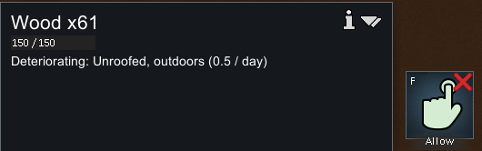
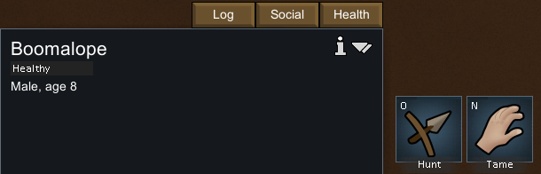
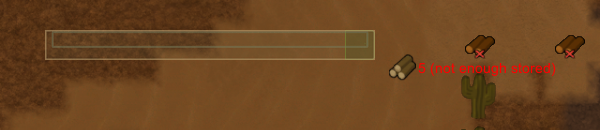
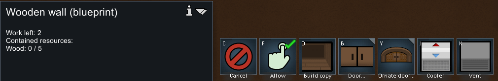
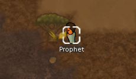
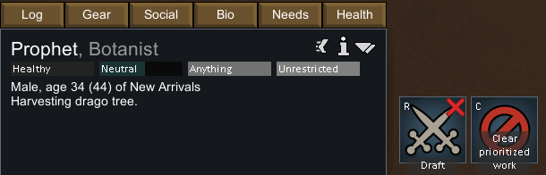
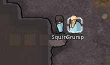
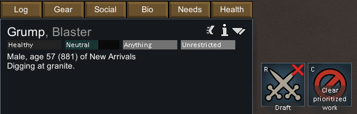

# 原版实机与 Web 基础交互对照

观察日期：2026-11-02。证据类型：**runtime-observed**。这是一次实际启动、创建殖民地并输入操作的记录；不会把这次短程操作扩大为全部机制或概率的运行验证。

## 场景与复核边界

- 原版：1.7.4980 rev60；程序集身份与本目录静态研究相同。
- 通过 `-savedatafolder=<独立目录>` 创建研究配置与存档，运行中核对 `ModsConfig.xml` 为 **Core + Odyssey**，不是纯 Core。原有用户存档目录未用于本次实验。
- Crashlanded、Cassandra、Strive to survive（存档值 `Rough`）、可随时重载；世界种子 `whip`，覆盖50%，250×250地图。
- 世界选址显示 temperate forest / mountainous / hollow / mixed biome / coast；落点附近出现沙地、仙人掌与 Drago tree。这里含 Odyssey 与混合群系条件，不能用这一屏反证纯温带森林的生成规则。
- 输入由自编 [Windows窗口探针](../../../scripts/research/native-window.ps1) 完成。只定位本次启动的 RimWorld 进程，激活并核实前台窗口后才发送鼠标/键盘；画面取该窗口客户区。没有调用游戏内部控制 API。
- 为记录配置和场景，另外读取了本次新建的研究存档，确认版本、种子、难度、地图尺寸及 `ticksGame=10459`；这不是纯屏幕实验。

[证据索引](evidence/runtime-interactions.json) 记录截图时间、原图/裁剪哈希、裁剪范围、版本、配置和研究存档哈希。完整截图、输入记录与 `New Arrivals1.rws` 保留在本地 `.local-research/runtime/`，不上传。公开图片仅保留说明交互所需的局部。

## 实际观察及修复

| 操作 | 原版实际观察 | 本轮 Web 实现 | 尚存差异 |
|---|---|---|---|
| 单击地面木材 | Wood ×61、150/150、未盖顶露天损耗0.5/day、允许/禁用按钮 | 可选择物品堆，显示数量、预留、可用量与存放时间 | 未实现全部材质耐久、屋顶损耗及禁用系统 |
| 单击野生动物 | Boomalope、Healthy、雄性/8岁、日志/社交/健康、Hunt/Tame | 动物可选，显示行为/休息/受困、血液与伤口；不允许征召野生动物 | 动物种类、寿命、觅食、狩猎和驯养尚未完整实现 |
| 单击植物 | Drago tree、200/200、Ready to harvest、Chop wood/Extract tree | 可检查自然资源的剩余量及工作标记，也可检查农作物生长 | 自然植物生长、成熟与移栽仍需深化 |
| 木墙拖建 | 选择材质后拖出连续蓝图；存储木材为0也可规划；单格蓝图Wood 0/5，Work left 2 | 墙/导线按主方向拖建，逐格预览与材料总额；材料不足仍可放蓝图，随后搬料施工 | 目前仅直线，不含矩形房间工具；无门闭合显示建议但不禁止 |
| 退出建造工具 | 本次右键取消工具后，单击可检查蓝图 | 右键/Esc退出；提交后保留工具可继续规划 | 原版不同菜单层的Esc行为未全部穷举 |
| 强制砍树 | 选殖民者→右键树→Prioritize harvesting；走到树旁，检查面板显示Harvesting drago tree，之后树消失 | 工作效果依据真实执行阶段与目标位置播放 | 本轮未提供原版动画的逐帧测量，Web挥动工具/粒子是自制反馈 |
| 强制挖掘 | 拖标记花岗岩→选殖民者→右键Prioritize mining granite；抵达后面板显示Digging at granite | 挖矿现场有镐、碎屑、进度；走路不挥工具，暂停冻结 | 未验证原版完整采矿周期、产量分布、音效与帧节奏一致 |
| 动物活动 | 同一群Boomalope在运行前后位置改变，暂停时位置保持 | 可达范围内闲逛，短暂休息；受困说明并定期重试 | 这里只观察了短程活动，未测原版休息分布或完整ThinkTree |

### 选中对象的信息





### 连续蓝图及材料需求





### 劳动目标与当前任务









截图证明目标、选中状态和所显示任务，不能单独证明连续动画或精确时序。后续机制校验需进一步建立固定场景和多次采样。

## Web 修复验证

旧逻辑只向固定偏移位置寻路，无路也等待200 tick；移动任务抵达后还进入通用完成阶段。两种子（73129、12345）各运行18,000 tick时，曾出现863 tick连续静止，**没有复现永久停止**。新逻辑使用有上限的局部可达搜索，抵达后休息30–80 tick，受困后重新检查；同组24只动物最长连续静止均为79 tick，即正常20 TPS下约3.95秒。该结果来自纯模拟，不是原版行为统计，也不保证任何地图/障碍下永远不停。

本轮验证：36项单测、11项专项浏览器检查、原有完整浏览器回归、生产构建、10日殖民地流程胜利通过。专项检查通过实际文件导入与鼠标/键盘完成，包含物品/动物/敌人/资源点选、同格切换、只框选殖民者、墙与导线拖建、非法占地拒绝、无门围墙警告后可提交、右键退出、四种劳动动画与暂停逐像素稳定性。详情按单个选中ID更新，未把全图对象复制进每次UI摘要。

```powershell
npm test
npm run test:animals
npm run test:campaign
npm run build
# 在另一终端启动 npm run preview，专项脚本默认5181，显式切换到标准预览端口：
$env:COLONY_TEST_URL='http://127.0.0.1:4178'
npm run test:interactions
npm run test:browser
```

原始 Web 报告位于本地 `test-results/interactions/report.json` 和 `animal-motion-after.json`，截图由同脚本重建。修复维持 **20 TPS 与存档版本1**；60 TPS迁移以及真正多层体素世界尚未实现，分别需要时间/存档迁移与三维拓扑改造。
