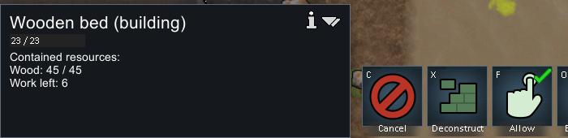
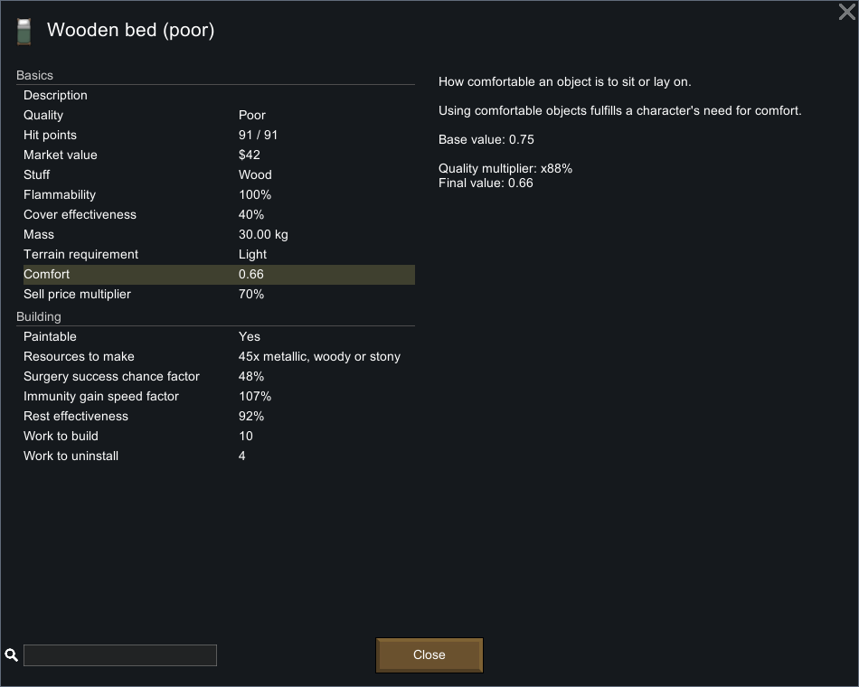
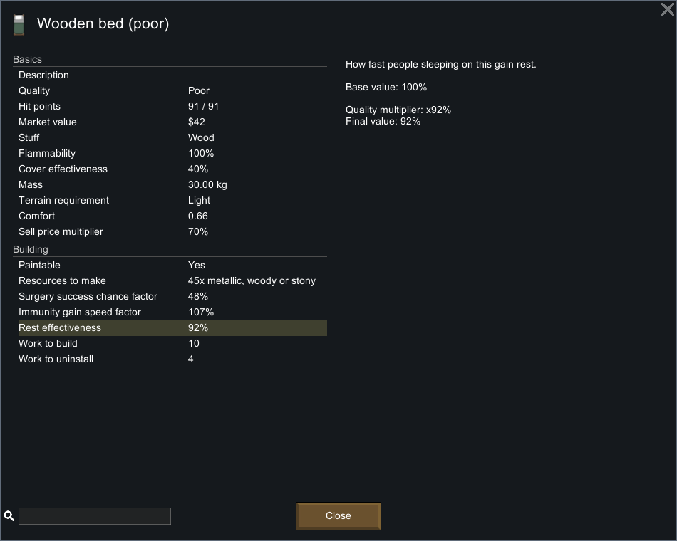
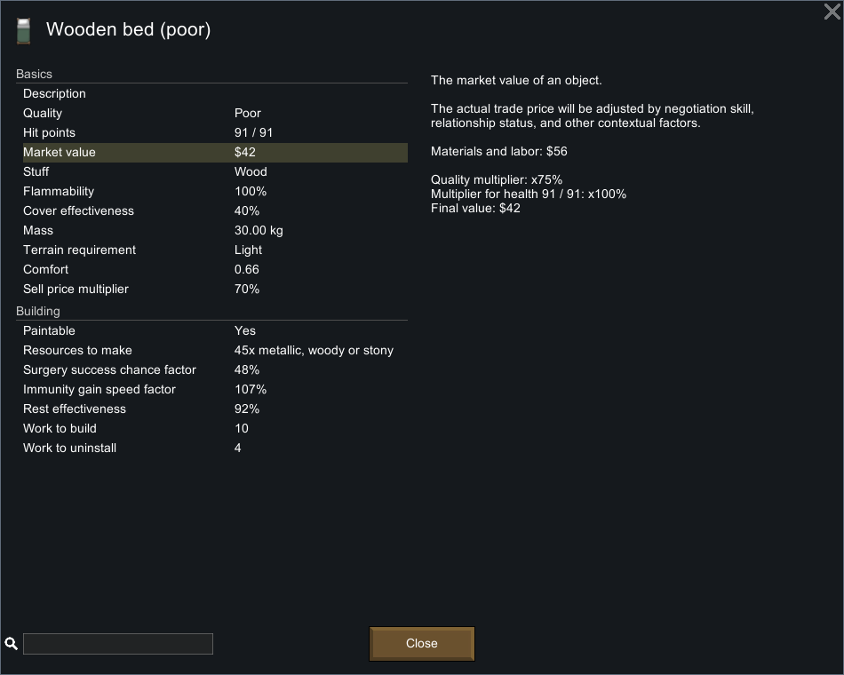
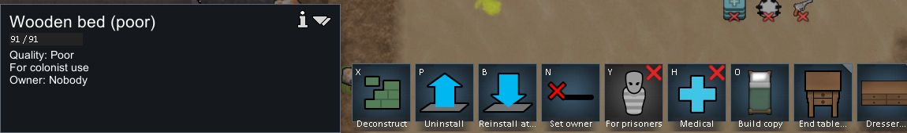

# 101 原版家具品质：普通施工、属性界面与读档

2026-11-04，原版 **1.7.4980 rev60，Core + Odyssey**，使用隔离 profile 完成一次普通木床施工。结果为 **Poor 木床，91/91 HP，Comfort .66，Rest effectiveness 92%，显示市值 $42**。没有通过 God、生成成品、修改技能或注入品质来取得这个结果。

[完整观察记录与精确 XPath](evidence/furniture-quality-runtime-evidence.json)保留 5 份存档投影、40 个成功操作记录和 6 张裁图。与之相连的[机制说明](100-furniture-quality-mechanisms.md)分开标记静态分支和运行观察。

## 场景来源与隔离

从上一轮社交试验最终存档复制为 `quality-baseline.rws`，复制前后 SHA 相同。该历史场景包含先前开发工具准备的桌椅等对象；本轮只把它作为已有殖民地背景，并未声称整个场景从零普通游玩生成。开发模式配置仍启用，但本轮没有执行开发操作。

新进程 PID 35364 使用独立 `profile-furniture-quality-20261104`，启动记录包含基线、Prefs、Mods 哈希。原版窗口的输入脚本先检查进程路径、隔离 profile 与前台窗口，不注入游戏代码。新木床通过 Architect 家具菜单放普通蓝图，再让 Prophet 右键 **Prioritize working on wooden bed**；材料由居民实际搬运，品质由普通 FinishFrame 完成路径产生。

## 连续存档证据

| 存档 | tick | 关键状态 |
| --- | ---: | --- |
| quality-baseline | 79055 | 目标 Frame 和成品均不存在；Prophet 建造 3，XP 114.974823 |
| New Arrivals1 | 79638 | Prophet 的 FinishFrame53929 指向 Frame_Bed221082；工作量 152.617462，45 木材，23 HP |
| New Arrivals2 | 80357 | 框架消失；Bed221087 出现在相同坐标 (115,0,132)，WoodLog，Poor，91 HP，spawnedTick 80086 |
| New Arrivals3 | 80357 | 暂停重复保存，选定节点与上档相同 |
| New Arrivals4 | 80358 | 普通加载上一档再保存；前进 1 tick，床身份、位置、品质、HP 和生成 tick 不变 |

施工前档保存了 `playerForced=True` 的 **普通玩家优先命令**，不是开发强制完成。Prophet 完工后仍是建造 3，XP 169.049194，并回到 SocialRelax。记录数组第 26 项由 11 变 12，与 CompleteConstruction 的记录增量一致；本轮没有独立恢复整个 RecordDef 序号映射，因此不把数组序号单独宣称为命名字段。

施工中界面显示木材 45/45、框架 23/23 和剩余工作：

完成后的选择面板：

## 属性详细解释与公式对照

原版属性界面给出 `.75 × 88% = .66` 的舒适度计算；这是本次自然产生的 Poor 品质实例。

休息效率显示 `100% × 92% = 92%`：

市值显示材料与劳动 `$56`、品质倍率 75%、耐久 91/91 倍率 100%、最终 `$42`。静态公式计算的未格式化基础值 56.016 和最终 42.012 不是直接从这个四舍五入后的 UI 读出的精确数值。

本次 Poor 床的 Beauty 静态计算为 `roundToEven(1 × .5)=0`；界面未显示独立的 Beauty 行，因此本轮不把它写成直接 UI 测量值。床未受损，本次图也不能验证损伤曲线或殖民地财富的耐久口径；这些来自第 100 章的独立代码证据。

## 品质持久化与完工者归属

成品原节点明确保存 `<quality>Poor</quality>`，没有 `authorName`。其最低艺术品质为 Excellent，符合 CompArt 的静态条件。不能以此伪造普通家具通用作者 ID；本次归属依据施工前 Prophet 的 FinishFrame 任务、目标对应、施工 UI、前后经验与记录增量及代码调用链。它不是逐 tick 跟踪，也未测试其他居民接力完成。

普通读档后的面板仍为 Poor、91/91：

读档后保存比暂停档前进 1 tick，故只宣称床的相关持久化状态相同；没有宣称整个世界字节不变。

## 结束与可复核范围

最终通过菜单 **Quit to OS** 正常退出，随后新的 CIM 查询确认没有 RimWorld 进程。退出后截图调用因前台守卫失去目标而失败，因此没有伪造第 041 张截图或完成动作记录。保留的成功操作为 001–040，退出另有独立记录。第 010 次点击发生在设计器退出过程中的已占位置，没有增加第二个成功建筑；第 013/014 次才是成功的普通优先施工菜单与命令。

可用 `node scripts/research/verify-furniture-quality-evidence.mjs` 检查仓库记录，添加 `--local` 核对本地原始文件。收集脚本只读存档并裁图，不会再次操作原版。原图、完整原档和派生代码均留在被忽略的 `.local-research`；公开 JSON 保存选定原节点、来源路径和哈希。

这一个样本验证普通材料→框架→成品、Poor 属性解释及品质读档保存；没有验证完整品质分布、灵感/艺术分支、建造失败、多施工者交接、受损框架继承或高价品质增值上限。
