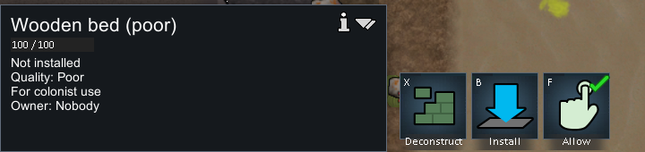
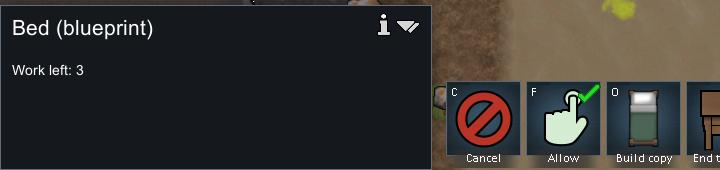
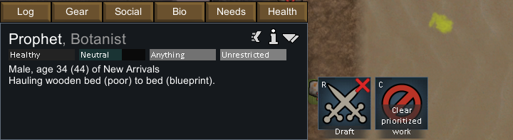
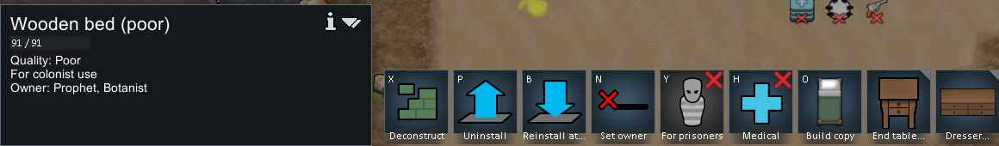
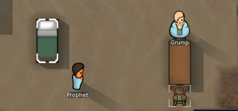

# 原版实机：Poor 木床卸下、搬移与重装

2026-11-04，RimWorld **1.7.4980 rev60**，Core + Odyssey。继续使用 [101 普通建造试验](101-native-furniture-quality-runtime.md) 自然建成的 `Bed221087`：木材、Poor 品质、91 HP。复制上轮最终存档到隔离 profile，通过游戏内普通设床主、Uninstall、Install、右键优先工作完成一次移动。没有修改存档，没有生成结果或调整品质、技能，也没有使用 God mode。

完整 [运行证据](evidence/furniture-reinstall-runtime-evidence.json) 含六份原存档 SHA、精确 XPath 与选定原节点、46 次完整 UI 操作记录、六张裁图和退出回执。完整原图与存档留在本地。对应静态推导见 [103 机制](103-furniture-reinstall-mechanisms.md)。

## 观察到的身份链

| 原生存档 | ticksGame | 床及容器状态 | 床主状态 |
|---|---:|---|---|
| reinstall-baseline | 80358 | `Bed221087`，原点 `(115,0,132)`，Poor / 91 HP | 本轮分配前 |
| New Arrivals1 | 80359 | 同一床，木材，rot=2 | `Human958` Prophet 拥有该床 |
| New Arrivals2 | 80703 | 包装 `MinifiedThing292600` **100 HP**；内层仍 `Bed221087` **91 HP / Poor** | assigned 为空，uninstalledAssigned 中有 Human958，pawn ownedBed=null |
| New Arrivals3 | 80703 | 新蓝图 `Blueprint_Install_Bed292601` 位于 `(113,0,134)`，指向上述包装 | 待恢复成员仍在内床 |
| New Arrivals4 | 80847 | 包装和蓝图都消失；同一 `Bed221087` 在新位置，Poor / 91 HP | Prophet 自动恢复拥有床 |
| New Arrivals5 | 80847 | 暂停重复存档；tick与选定节点相同，全档SHA不同 | 同上 |

原床 `despawnedTick=80638`，与包装 `spawnedTick=80638` 对应；重装后床 `spawnedTick=80833`。所有原档中该床 ID 只出现为一个实体节点，打包阶段只是从地图层进入包装 `innerContainer/innerList`，没有复制出第二张床。完成后位置改变而材质、品质、HP 和实体 ID 保留。




**包装 100/100 HP 与内床 91/91 HP 是两个字段，双方均为满耐久。** 打包界面的同一名称不能证明床被修到100HP；原档内层仍是91。此次没有让包装受伤、燃烧或经历长期劣化，因此也没有证明伤害在两层之间如何转发。Web 当前打包家具直接扣内家具 HP，是独立的实现简化。

## 安装任务和界面

`New Arrivals3` 保存 Prophet 的 `playerForced HaulToContainer60136`：`targetA=Thing_MinifiedThing292600`，`targetB=Thing_Blueprint_Install_Bed292601`，`count=1`，工作提供器为 `ConstructDeliverResourcesToBlueprints`。蓝图原节点 `miniToInstall` 引用原包装，`buildingToReinstall=null`。这是正常安装已有打包家具的任务，未创建建造 Frame。





图中 `Work left: 3` 是原生面板显示，不据此推出安装等待3秒；代码中的 `WorkTotal150` 与该 driver 的 Duration=0 解释见103。操作039是走向源物体的阶段；操作040的画面已经安装完成。**没有保留“手上正在携带包装”的中间存档**，不把文件名 `040-install-carry.png` 当作画面内容的证据。全程 Construction3、XP `169.049194`，与卸下/安装任务没有主动奖励建造XP一致。





## 试验边界与操作纠正

- 开发模式配置保持开启，但本轮没有开发命令；更早基线含研究准备的其他建筑，本床在v33中按普通流程建成。
- 初次加载/导航后比复制基线多1tick；不声称加载全程零tick。重装后只做暂停重复保存，没有再次加载重装存档。
- 004/005发生在加载画面。009设床主后窗口已关闭，010误点取消了床选择；015的卸下点击因此落空，017也没有优先卸下菜单。019才成功下达卸下，022才成功优先执行。失败导航完整保留，未编造成功动作。
- 只验证一张完好普通殖民者床。医疗/囚犯用途重置、桌聚会开关、破损家具、占位阻挡、取消、抢预约及伤害劣化分支未实机执行。静态机制与这个单样本严格区分。最终重复档的realPlayTimeInteracting与nextMessageID有变化，因此不声称全档字节相同。
- 原档 records 数组有槽位变化，但没有仅靠序号给它们命名；`ThingsUninstalled` / `ThingsInstalled` 名称来自静态调用链。
- 输入脚本只使用窗口守卫、前台键鼠与截图；没有注入游戏代码。存档仅在保存后只读解析。

游戏经普通 **Menu → Quit to OS** 退出，PID30368；`2026-11-04T01:38:40.3156218Z` 的 fresh CIM 观察为0个 RimWorld 进程。047点击后目标窗口已退出，随后截图守卫报 `Game did not become foreground; no input sent.`，所以不存在047截图或完成动作日志；该句属于后置截图守卫，不能用来否认前面已发送的退出点击。

## 复核入口

```powershell
& scripts/research/collect-native-furniture-reinstall-runtime.ps1
node scripts/research/verify-furniture-reinstall-evidence.mjs
node scripts/research/verify-furniture-reinstall-evidence.mjs --local
```

[输入工具](../../../scripts/research/furniture-reinstall-runtime-input.ps1) 限定原版可执行文件、隔离 profile 与前台窗口，pulse限制40–4000ms。[采集器](../../../scripts/research/collect-native-furniture-reinstall-runtime.ps1) 只读提取原存档与裁图；[校验器](../../../scripts/research/verify-furniture-reinstall-evidence.mjs) 验证证据一致性，不重放游戏，也不声称统计校准或包装伤害验证。
