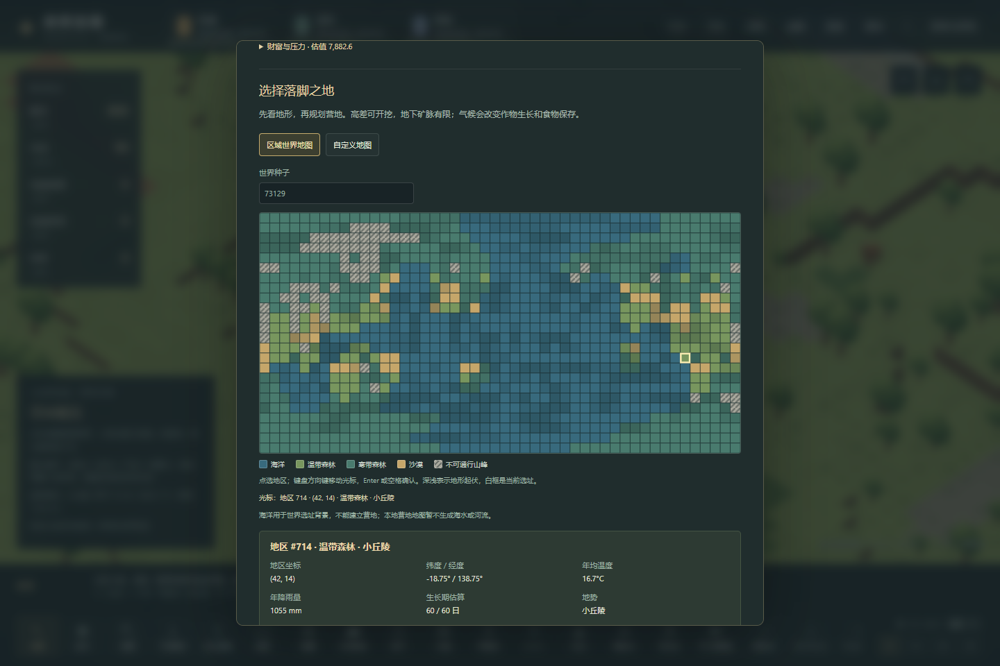
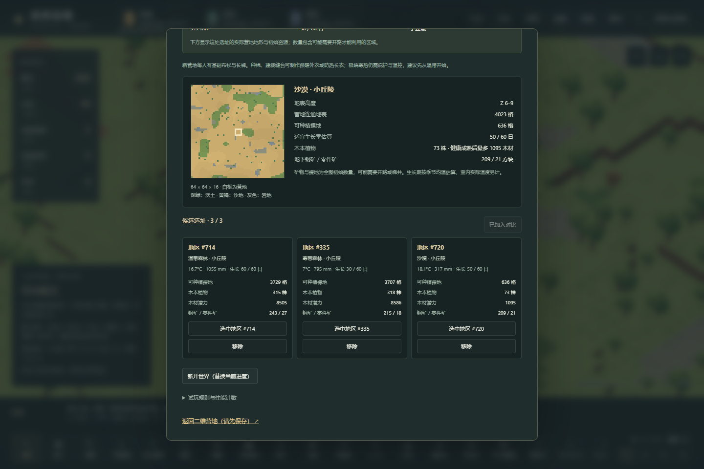

# 107 世界地图与营地选址

v35继续按“玩法和机制优先、数值后调”推进。玩家先比较地区，再决定当地的经营路线：温带的可耕地与林木、寒带的短生长期与供暖需求、干旱地区的有限木材和可种植土壤。这些条件会进入现有体素模拟。

原版规则与观察边界见[106机制对照](106-world-site-selection-mechanisms.md)。本篇描述Emberfield的独立实现，不声称生成相同的RimWorld世界。

## 操作流程

1. 打开菜单，进入世界地图选址，输入世界种子。
2. 点选地区，或使用地图的键盘操作，查看生态、山地、气候和当地地形预览。海洋及不可通行高峰给出不能建立营地的原因。
3. 收藏候选地区进行比较。可耕裸地、林木及钢矿/零件矿来自实际的局部生成结果；地图预览不会改变当前营地。
4. 确定后新开世界。原进度会被替换，地图以所选地区的独立种子与条件生成，时间暂停，随后可按现有方式采伐、种植、采矿和建造。
5. 保存时保留世界种子及地区身份；读取时恢复实际保存的地形、物资、任务和角色状态。

“自定义地图”继续提供直接配置生态、起伏、温度、降雨与纬度的入口。这类营地没有世界地区身份；旧营地也不虚构一处世界坐标。

## 数据与状态链

`WorldSite { version, worldSeed, tileId }` → 地区生成规则 → 独立局部地图种子 + `WorldSettings` → `previewWorld` / `VoxelSimulation` → 当地生态、季节、可耕地和有限资源。

- 世界地图为48×24经纬度投影，共1,152个地区。噪声采样在球面上进行，以连续连接经度方向；图上矩形不是原版的球面多边形，也不是等面积格网。
- 大洲、山脊和气候场相互独立。年均温度结合纬度、海拔及温度场；降雨使用自己的场，并受纬度和海拔影响。三类生态按当前支持范围做简化分类。
- 单一世界内各地区的局部种子不同。输入种子使用安全整数的高低两部分，避免仅截取32位导致相隔2^32的常见种子重合。不同世界之间不承诺数学上的全局无碰撞。
- 推荐地点只根据既有条件排序，不会为推荐地点额外平地、增加材料或调暖气候。
- 预览与开局经过同一个地区解析入口，Worker只接受地区身份，不能另外覆盖地图种子或气候。
- 世界地图只保留少量元数据；不会同时创建1,152份体素世界或模拟殖民地。仅为所选地点和有限对比项生成局部预览。

地区规则的版本与存档版本分开。`WorldSite.version=1`锁定当前生成算法和参数；之后改变世界分布时应增加地区算法版本，并继续保留旧版本解析，避免旧档因种子/气候校验而失效。玩法数值可以迭代，但已有世界身份不能随更新悄悄漂移。

## 保存与失败处理

存档版本升至35，新增`worldSite`。v34及更早版本迁移为`null`，保留其原始地图，不重新生成。旧版本若夹带新字段会被拒绝；v35拒绝不合法的地区编号、海洋/禁入峰、错误算法版本，以及与地区不一致的局部种子、气候或生成器。

新建和载入先完成校验并构造候选模拟，成功后才替换当前局。预览失败、过期的异步预览和无效开局请求均不能覆盖现有进度。保存不包含候选收藏列表；收藏属于选址过程，不是另一个运行中的殖民地。

## 当前边界

已经接入的是世界选址到单营地经营。世界图上的海洋用于限制选址，本地体素地图仍没有河流或海水。没有旅行、商队世界路径、多营地同时模拟、世界派系据点或地球地理数据。只有当前支持的三种生态，不能把三类简化分类当成完整的原版生态评分。

海拔是选址气候和地形分类的输入；局部Z高度仍由现有64×64×16生成器决定，不按真实海拔米数堆砌方块。预览的全图矿量不等于已经开采或可立即拿取的物资，生长期是季节均温估算，实际生产仍受地形可达性、天气、温度、工作分配等条件影响。

## 本地验证入口

```text
npx vitest run --maxWorkers=1
npm run research:regions
node scripts/research/verify-world-site-selection-evidence.mjs --local
npm run test:voxel:regions
npm run build
npm run test:voxel:regions:browser
```

测试在本地执行。GitHub Pages继续只安装锁定依赖、类型检查、构建与部署。原版106章与Web实际运行分别记录，不把既有世界地图查看截图称作本轮原版新开局验证。

2026-11-04最终本地结果：94个测试文件、1,197项测试在一次完整运行中全部通过；构建成功。三地区新开局API经营验证8项通过，普通页面在Worker与主线程渲染各12项通过，无页面错误，实际JS/CSS均匹配本地构建。页面操作覆盖禁入地区、键盘选择、三候选上限/删除补位/重复选中、换种子失效、进入所选营地、实际砍树、任务中及完工后的导出导入、手动存读、自定义入口与900px布局。

温带#714、寒带#335和沙漠#720实际产生不同地图，并分别在510、576、191tick完成选定树木的采伐，产出27、27、15木材；这是三个有界开局案例，不是长期生存或平衡结论。v34迁移使用旧版本实际运行产生的带家具搬运任务、货物与55格地形改动的保存样本。

完整方法、源文件哈希、报告摘要、失败尝试边界和截图身份保存在[Web验证记录](evidence/voxel-regions-validation.json)。首轮页面失败来自测试误以为构建文件名以`voxel-`开头；修正后两路径通过，游戏源码未为此修改。首次局部持久化测试只遇到已有读档行为重建`pawn.reason`解释文字，最终完整测试保留了全部实体与任务检查。




