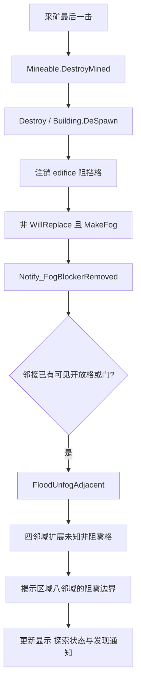

# 洞穴生成、永久探索与未知区域操作

核对日期：2026-11-04；目标 **RimWorld 1.7.4980 rev60**。本章补完 [06 世界生成](06-world-generation-resources.md) 当时尚未展开的 `MapGenCavesUtility`，继续追踪初始雾、挖矿打通、开门、计划与选择的调用链。本轮新增提取 **14 个类型**，复用已有 generation / energy / housing / skills / work / stonecutting 派生记录，**没有启动原版，也没有新增实机样本**。

原件 `Assembly-CSharp.dll` 的 SHA-256 为 `eff7d97949f919fb2b151ebfb906e9be749b63410b7dbda78eeebb7972b245c3`；ILSpy `11.2.0.10050` 的 SHA-256 为 `587a18e18e13acfc7fd8783a44c24c7da0781dadf6b9fb9dd5e2e38a9cdfae78`。完整派生代码仅留在 `.local-research/`，不是原始源码或执行观测。两个提取清单分别为 [主组 manifest](evidence/caves-exploration-manifest.json) 和 [补充组 manifest](evidence/caves-exploration-extra-manifest.json)；[证据索引](evidence/caves-exploration-evidence.json) 将 CE01–CE16 连接到类型、文件哈希、行号和选段哈希。

## 1. 本轮回答了什么

| 问题 | 结论及证据范围 |
| --- | --- |
| 洞穴怎样从岩体中生成？ | 已追到岩体分组、裁整、数量抽样、入口选择、隧道游走、分叉及停止条件；形态学和噪声底层未完整展开。CE01–CE05 |
| 雾是否是人物实时视野？ | 这条机制是保存于地图的探索状态；初始从起点/边缘/额外根扩展。CE06–CE07 |
| 挖穿墙后何时显示洞穴？ | 破坏阻雾建筑，经移除通知与可见邻格检查，再揭示相连未知区域和边界。CE08 |
| 未知区域可否画矿线、建造或选中物品？ | 三种操作条件不同；不能复用单一“雾中全部禁止”规则。CE10–CE13 |
| 是否证明 Web 与原版生成完全相同？ | 没有；本章是静态机制证据，Web 三维洞室是项目改编。CE16 |

## 2. 普通 Caves 调用的参数

`CaveGenParms.Default` 是工具类默认值；普通 `TileMutatorWorker_Caves` 取得它后再次覆盖部分字段。特别是 **分叉机会最终为 0.02，不能直接引用工具类中的 0.1**。普通 caller 以地图内且 `Elevation > 0.7` 判为可雕刻岩体；这是生成期标量，不能直接解释成三维高度。[CE01]

| 项目 | 工具类默认 | 普通 Caves 实际传入/使用 | 意义 |
| --- | ---: | ---: | --- |
| 每万格开放隧道系数 | 5.8 | 5.8 | 数量抽样系数，不是保证数量 |
| 每万格封闭隧道系数 | 2.5 | 2.5 | 与开放隧道分别抽样 |
| 每岩组开放/封闭上限 | 3 / 1 | 3 / 1 | 限制起始隧道数量，不能当总分支数 |
| 允许生成的岩组最小格数 | 300 | 300 | 裁整/过滤后检查 |
| 分叉机会 | 0.1 | **0.02** | 每侧独立检查；每条 Dig 左右各最多触发一次尝试 |
| 分叉前已推进格数 | 未显式赋值，结构体初值 0 | **10** | 还要满足宽度条件 |
| 宽度每推进格缩减 | 0.034 | 0.034 | 按进入新格推进，不是每 0.5 连续步长都减 |
| 最小宽度 | 1.4 | 1.4 | 缩减后小于此值即停止 |
| 分支宽度减量 | 0.2–0.4 | 0.2–0.4 | 从主隧道当前宽度扣除 |
| 方向变化系数 | 8 | 8 | 乘方向噪声后修正角度 |
| 方向 Perlin 频率 / 层数 | caller 提供 | 约 0.00205 / 4 | 不保证跨噪声实现、版本、随机序列同图 |
| 宽度噪声频率 / 幅度 | 0.05 / 0 | 0.05 / 0 | 普通分支中生成噪声模块，但幅度为零 |

岩组格数到基准宽度的曲线控制点为 `(100,2)、(300,4)、(3000,5.5)`；实际起始宽度在基准的 `0.8–1.0` 倍之间抽取。这里记录曲线控制点和调用，没有重新验证 `SimpleCurve` 的全部边界外插行为。[CE01、CE04]

### 2.1 岩组筛选与隧道数量

先对 `isRock` 的格子做四邻域 flood fill，再 `GenMorphology.Open(group, 6, map)`。本章没有展开这个形态学函数，不能把参数 6 简写成“统一侵蚀六格”。随后重新检查连通子组：小于 300 格，或小于当时整个裁整组格数的 5%，都会移除；最后保留组总格数仍需至少 300。[CE02]

令 `N` 为过滤后组格数；开放与封闭各自抽取 `U(0.9,1.1)`：

```text
开放候选上限 a = min(RoundRandom(N × U(0.9,1.1) × 5.8 / 10000), 3)
开放起始条数   = a > 0 时在整数 [1,a] 取值，否则 0

封闭候选上限 b = min(RoundRandom(N × U(0.9,1.1) × 2.5 / 10000), 1)
封闭起始条数   = b > 0 时在整数 [0,b] 取值，否则 0
```

`RoundRandom` 不是普通四舍五入。以扰动为 1、300 格为例，开放的取整输入是 0.174，封闭是 0.075；可能两者都取到零。封闭即使候选上限成为 1，最终仍能选择 0。达到岩组阈值、存在 Caves mutator，都不构成“每座山必有封闭洞穴”的保证。[CE03；RoundRandom 语义复用 GN20]

### 2.2 入口与游走

开放隧道每次比较 10 个岩组边缘候选：优先离已有洞穴更远，距离搜索上限 40；并列时偏向可深入岩体更远的方向。该距离模式不把组外空地当旧洞穴。边缘候选排除离地图边界小于 3 格及已是洞穴的格子；没有候选时有随机岩组格回退。初始方向从八向深入距离组合评分中选择，同分随机。[CE04]

封闭隧道比较 7 个随机岩组格，选择离已有洞穴或组外空地更远者，搜索上限 30；初始角度在 0–360° 抽取。实际进入 `Dig` 后仍可能立即被净距条件拒绝，起始次数不等于最终有效洞穴数。[CE04–CE05]

`Dig` 的主要规则是：[CE05]

1. 连续位置按 0.5 格前进，到达新格后更新方向和宽度；按当前宽度一半的半径，把符合 `isRock` 的格子写入洞穴场，值取已有值和通道宽度的较大者。
2. 封闭模式在当前位置检查 `width / 2 + 1.5` 半径：不属于本次 visited 的格子，只要在组外或已有洞穴，就终止。这是避免碰到外界/旧洞的条件，不是全图连通保证。
3. 推进至少 10 格且 `width > 1.4 + 0.4` 才尝试分叉；左右角偏移分别为 40–90°、−90 至 −40°。每侧触发尝试后即记已尝试，即使没有成功雕刻分支也不会同侧无限重试。
4. 分支尝试比较 6 个角度；只有最佳方向至少可深入 18 格，才递归挖掘。分支共享 visited，用以区分本次挖掘和已有洞穴。
5. 进入新格时 `width -= 0.034`；宽度不足、走出组、碰到不属于本次 visited 的旧洞穴等条件会终止。格间另补 `(旧x, 新z)`，减少连续斜线离散后只有角接触的断口。

洞穴场存的是生成用宽度/占据标量，**不是洞高、水深或多楼层空间**。地表浅水/碎石、岩顶和天然石种仍沿用 06 的生成链，本轮没有宣称重建了完整生成器。

## 3. 初始迷雾与持久记录

`GenStep_Fog` 的 `SeedPart=1568957891`。它先把全图置为未知，再从玩家起点做连通揭示。如果起点正被 MakeFog 建筑占据，会尝试附近 5 格内无顶且可站立的格子。没有玩家起点时，从满足“可站立、无顶、按 NoPassClosedDoorsOrWater 可达地图边缘”的格子中选根，依次尝试地图中心附近 30 格、边缘、全图随机候选。额外 `rootsToUnfog` 也逐个扩展并单格揭示。[CE06]

探索位存于 `FogGrid.NativeBitArray`，一格一位，通过 `LookBitArray(..., "fogGrid")` 进入存档。这里的未知状态与人物当前视线、摄像机切层、寻路可达性是不同概念。已读普通揭示路径不会因人物离开而重新加雾；不过代码明确存在 `Refog(CellRect)` 和调试全图重置入口，本轮没有枚举全部调用者，不能声称游戏绝无重新变雾机制。[CE06、CE15]

按纯位数据计算，250×250 地图需要 `ceil(62500/8)=7813` 字节，项目 64×64×16 体素图需要 8192 字节；若用 `Uint8Array`，后者为 65536 字节。这只是状态载荷的理论量级，**不含实际分配对齐、序列化、索引、渲染网格、队列或对象内存**，也不是内存占用实测。[CE15]

## 4. 挖通之后为什么整片洞穴一起出现



采矿的 `DestroyMined` 本身没有直接调用 Flood；它通过建筑生命周期触发。`ThingDef.MakeFog` 对应 `Fillage == Full`。`Building.DeSpawn` 注销 edifice 后，在非 `WillReplace` 且 MakeFog 时调用移除通知。[CE08]

移除通知仅在 Playing 状态处理，并要求物体八邻域至少存在一个**已经可见**且无阻雾建筑的格子；门是额外允许的邻格情况。因此完全未知、与已知空间隔离的位置发生破坏，不会凭空揭示全图。[CE08]

`FloodUnfogAdjacent` 先揭示原格，再从四邻未知且没有 MakeFog edifice 的格子分别扩展；阻雾格只揭示其边界。`FloodFillerFog` 的传播条件是“仍未知、没有 MakeFog edifice”，**不检查 Walkable 或 Standable**。它用四邻域 BFS，而不是八邻域寻路；扩展完成后，再将新区域八邻域中阻挡传播的未知边界揭示出来。两个开放格只有对角接触时，不因此传播到另一格；岩石边界可出现，并不意味着穿过岩体看到了后面的空洞。[CE07]

普通扩展参数为 `int.MaxValue`；代码中的 500 与 `testMode` 调试分支有关，不能当普通探索容量限制。水面等不满足人物站立条件的格子也不应仅凭这一点被排除出揭雾连通性。[CE07]

### 4.1 开门和发现副作用

`Building_Door` 的门更新路径在 `OpenPct >= 0.4` 且有 approachingPawn 时调用进入通知；`FogGrid` 仅接受玩家阵营或 HostFaction 为玩家的 pawn，调用相邻揭示且 `sendLetters=false`。这不是“任何 NPC 开任意门都给玩家显示整个地下”的规则。[CE09]

揭示会调用 `Thing.Notify_Unfogged`：有 `beenRevealed` guard、隐藏物品/Anomaly 发现分支、任务信号和可能的 CompLetterOnRevealed。区域处理还将 pawn 的 mindState.Active 设为 true，并支持延后唤醒 SleepThenAssaultColony 的 lord。静态链说明探索会改变玩法状态；本轮没有验证具体遗迹、虫巢、古代危险或 DLC 的运行触发概率。[CE09]

区域提示信在发现机械族时优先用 ThreatBig；否则当新区域不全在屏幕内或 `cellsUnfogged >= 600` 时用普通提示。**600 是提示门槛，不是区域大小上限**。计数来自扩展处理器，不包含之后仅揭示的阻挡边界；一次相邻揭示若分别扩展多个区域，局部结果变量会覆盖，不能误读成累加所有区域的新格总数。[CE14]

## 5. 未知区域里的四类操作

| 操作 | 原版静态规则 | 设计含义 |
| --- | --- | --- |
| 开采格标记 | 先查地图内/无重复 Mine；未知格直接接受；已知格才要求实际 Mineable | 可以预画深入山体的矿线，但标记不保证那里有矿石或可执行工作。CE10 |
| 抽象 Plan | 检查地图内、非禁止建造边界，没有 fog 判断 | 可以规划未探索空间；Plan 不是建筑蓝图或材料订单。CE12 |
| 建筑 Blueprint | 正常 Build 路径进入 GenConstruct，`center.Fogged` 返回 CannotPlaceInUndiscovered | 不能把 Plan 可画等同于未知处可开工；该 fog 条件只检查 center，不宜扩写为每个占格。CE12 |
| 地图点击选实体 | selectable、pawn 非隐藏、存在 spawned parent；单格要可见，多格至少一占格可见 | 普通地图点击不能直接选择完全埋在未知区中的实体。CE13 |

`SelectableByHotkey` 只检查 selectable 和 Spawned，没有同样的 fog 条件；已读调用包括殖民者切换。因此上表的限制明确针对地图点击/使用该筛选器的框选，不能推广成所有选择 API 的统一限制。[CE13]

当未知格首次被 `UnfogWorker` 揭示，如果已有 Mine 标记而格内并无 Mineable，就删除该标记。它不会因此证明这片未知空间在标记时可供矿工开采，也不允许 UI 先把隐藏矿种或物品信息透出。[CE10]

### 5.1 标记如何成为矿工任务

`WorkGiver_Miner` 委托 `MineAIUtility`，使用 Touch 作为路径终点，最大路径危险为 Deadly。候选来自 Mine / MineVein 标记：八邻至少存在一个 Walkable 格，并且目标格实际存在 Mineable，才 yield 候选。[CE11]

`JobOnThing` 再检查 mineable、有标记、能预约、Mined 历史事件许可，以及邻接可站立且能 Immediate Touch 接触目标的工作位置。无法找到 Standable 格时，还可能针对可通行但不可站立格中的可搬障碍生成搬开任务；满足回退条件也可继续创建 Mine job。普通扫描器默认不允许不可达目标，通用 `JobGiver_Work` 还筛 forbidden，并选择可达目标。矿工 job 的 expiry 参数是 **20000 ticks**，不是每格矿石所需固定工时。[CE11]

本轮检查的 MineAIUtility、WorkGiver_Miner、WorkGiver_Scanner 和 JobGiver_Work 没有直接的 fog 条件；**不能据此编造“必须先揭雾才能执行矿工工作”的原版规则**。也不能仅凭这些类没有该条件，就宣称所有相关路径、DLC 或 Mod 都无其它限制。

## 6. Web 三维改编的落点

本章提供原版依据和设计建议；Web 实际实现与验证由 [109 洞穴与探索玩法](109-caves-exploration-gameplay.md) 另行记录。[CE16]

- 世界真实内容、玩家已知状态、摄像机可见层分别存储。未知状态不能依赖是否渲染过某个 mesh，切层或读档也不应自动泄露整片地下。
- 渲染、点击命中、详情、资源覆盖层、地图预览与公开状态接口使用一致的知识边界。模拟层可保留真实隐藏内容；自动任务是否受探索约束是明确的项目规则，不伪称原版已采用同样门禁。
- 允许保留抽象矿线/计划，随后根据真实岩体和可达工作面产生任务；发现空洞时清除无效开采标记。
- 原版这里是二维四邻域传播。三维中采用六面连通或站立节点图都需要额外设计；不能把“换到地下层”当作已发现，也不能把楼板上下的体素仅因投影重叠当作连通。
- 当前 Web 方向是保留原地表、生成地下密封洞室与水平相连隧道、三格净空及真实楼层/地板/顶棚；这是项目适配。天然地表洞口、河海、天然石种分区和支撑坍塌未纳入这次改编，不声称逐格复现 MapGenCavesUtility。

## 7. 复核入口与剩余边界

```powershell
# 在 experiments/rimworld-like 执行；读取文件，重新生成本章证据索引。
./scripts/research/collect-caves-exploration-evidence.ps1
node scripts/research/verify-caves-exploration-evidence.mjs
node scripts/research/verify-caves-exploration-evidence.mjs --local
```

portable 模式检查已提交记录的文件哈希、类型映射、来源范围、参数表、六个独立小图解释和算例；`--local` 再核对游戏原 DLL、工具 DLL、派生代码与选段哈希，并检查关键源码锚点。小图包含封闭双室、挖穿后连通揭示、隔离区破坏、只对角相连、非可站立水格及盲采标记清理。**这是独立规则解释，不是运行原版方法，也不是导入 Web 实现来证明原版正确。**

本轮没有重放原版种子，没有验证各 DLC/Mod 的有效 Def，没有执行完整洞穴生成，也没有验证内存或性能。形态学、噪声/RNG、全部 Refog 调用者、复杂多格建筑/门的边缘几何，以及发现后敌对 AI 的完整状态转换仍是后续研究边界。06 中“MapGenCavesUtility 尚未展开”是当时范围，本章补上其主要流程，不将所有这些剩余项标为完成。
