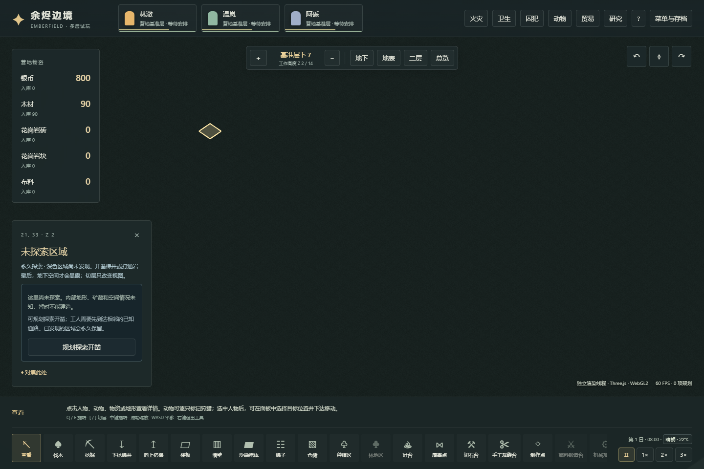
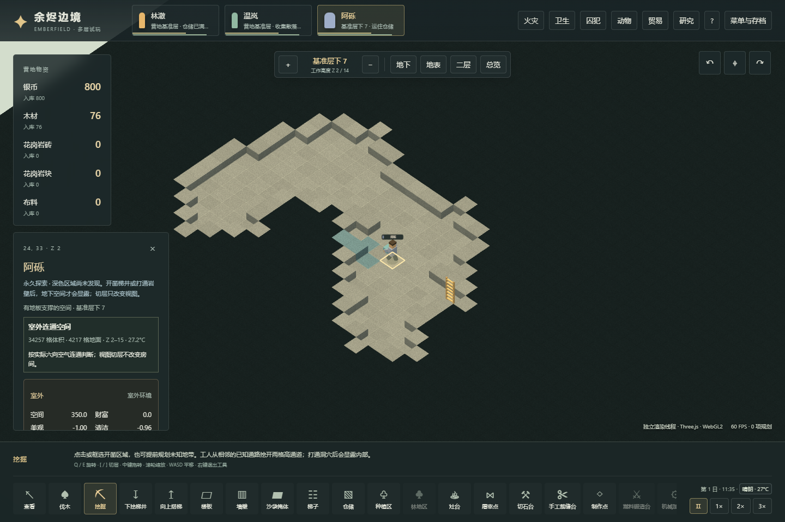

# 109 地下洞室、开采规划与永久探索

v36把地下开凿接入实际探索：从地表开梯井，在未知岩层预画采矿线，矿工到场挖通封堵，发现连通洞室，再把开采所得带回营地。洞穴形状、数量与劳动时间仍用暂定参数，先验证玩家操作能形成完整的状态变化。原版事实见[108机制研究](108-caves-exploration-mechanisms.md)；本篇为Emberfield的三维适配。

## 玩家操作

1. 在菜单中新建地区营地或自定义地图。新地图使用生成器3；加载已有营地不会额外生成洞穴。
2. 从地表的可站立位置使用“向下开凿梯井”。矿工实际搭梯、逐层开凿，材料、工作分配与跨层通行沿用现有规则。
3. 降低剖切层查看地下。深色区域表示未探索，不能据此判断内部是岩石还是空气，也不能提前检查矿种或房间。
4. 在已到达的楼层拖出采矿线，可穿过未知格。标记只表达开采意图，不能远程揭开地形；矿工需要从已知、可达的工作位置实际施工。
5. 挖通与洞室的连接后，连通空气与邻接岩面永久显露。标记落在空洞里的部分自动清除，剩余矿石继续按实际开采任务处理。
6. 已发现区域可检查、建设和进行物流。保存、导出或读档保留发现状态；盖墙封住入口不会让已发现区域重新变黑。

## 世界生成与版本

生成顺序是地表高度与土壤 → 地下洞室/隧道 → 有限矿脉 → 树木。矿脉只替换实际岩石，不会把空气重新填成悬浮矿块。每条洞穴主隧道保持同一楼层，相连格采用四方向水平步进；不同洞群可处于不同高度。洞室有三格净空、实体地板和顶棚，避开出生区，不挖穿基岩。

当前生成的是**密封的地下洞室**，需要玩家开凿入口。没有天然地表洞口、地下河、溶洞生态、古代遗迹、虫巢或岩层坍塌。保持地表轮廓和树木布局，使新机制主要改变地下探索，不借此次更新重新设计所有开局条件。常量集中在`src/voxel/caves.ts`，并不宣称等于RimWorld的二维洞穴算法或参数。

`WorldSite.version=1`继续解析为原有生成器2，`version=2`使用同一地区分布与气候、配合生成器3。菜单新建地区使用v2。生成器2的四个种子地形/树木哈希在修改代码前留样，并用于兼容性检查。之后若更改洞穴规则，也需要新的生成版本，避免同一已保存选址被重新解释。

## 探索状态与显示

每个体素保存一个永久的0/1发现位。新地图从天空和地图侧边空气开始，以六邻接连通传播，并标出接触的岩面；密封空气保留为未知。开凿改变拓扑时再扩展发现范围，不在每个逻辑tick重复扫描全图。这里的六邻接三维传播是适配规则，不是原版二维网格邻接的逐字复现。

64×64×16地图的发现位图为65,536字节，即64KiB。修改时随受影响的chunk传递；渲染Worker和主线程路径使用同一遮罩。未知空气和未知实体方块呈现相同的不透明深色几何，降低剖切层不能看出隐藏洞穴形状。选中信息、矿物统计及实体快照同样遵守发现状态，不能只有画面变黑而侧栏继续透视。

探索与天气雾不同：天气雾会随天气改变画面，地下发现记录永久保留。探索也不是逐帧视线系统，不要求角色一直站在洞室旁才保留其信息。

## 存档与事务

存档版本36新增`explored`。v35及更早地图保持原有真实方块、梯子、任务和物资，发现位统一为已知，延续更新前的全图可见体验。不会从旧种子重生成地形，也不会给旧矿井补洞。

当前格式严格验证发现数组的长度与0/1内容，以及地区算法、局部种子、气候和生成器的一致性。失败的载入先报错，不能替换正在运行的殖民地。原始v35样本在本轮修改代码前由旧版本实际执行梯井与开采任务取得，避免用新数据改个版本号代替迁移证据。

存档仍包含实际世界方块；探索遮罩约束正常游戏显示和交互，不是存档加密。开发验收中为选择一条有界路线而读取真实地下地形，也与只通过屏幕探索的玩家过程分开说明。

## 验证范围

生成测试覆盖固定种子与三个生态、四种起伏，检查基岩、地表、出生地保护、洞穴净空、未知矿量和旧生成器兼容性。核心测试针对未知采矿、连通揭示、不可达计划、取消、保存与失败原子性。实际经营验证使用新生成地形上的正常指令完成梯井、打通和资源回运；页面验证分别走渲染Worker和主线程，并检查切层遮罩与选中信息。

2026-11-04最终本地结果：99个测试文件、1,240项测试在一次完整运行中全部通过；类型检查与构建通过。新局API经营流程10项通过，浏览器的Worker与主线程渲染各8项通过、无页面错误，实际加载的11个资源记录均与最终构建一致。116个源码文件逐一核对哈希。

实际路线从地区#714的地表`(29,33,8)`连续开梯井至Z2，再向西挖通洞室。发现的37单位钢由工人实际携带经过Z2–Z9运回地表仓储；API在1841tick完成，两个页面流程分别在1900/1895tick完成。规划中、携带中和完成后都进行了实际文件导出/导入；v7/gen1及v35/gen2原始旧档保持原地形与全图可见。路线选择使用只读内部地形检查，后续页面更改均使用可见控件，这不是仅看屏幕自行发现洞穴的实验。

完整方法、结果、源文件哈希、旧档身份和截图见[Web验证记录](evidence/voxel-exploration-validation.json)。最初开发回归有6项旧格式断言失败，保留了原始报告；更新当前存档/生成器期望后，以上最终完整运行全部通过。没有通过删掉实体、产物或存档状态断言来回避失败。

可在本地执行：

```text
npm run research:exploration
npx vitest run --maxWorkers=1 --testTimeout=15000
npm run test:voxel:exploration
npm run build
npm run test:voxel:exploration:browser
```

浏览器脚本默认检查4182端口，需先启动对应预览。经营与浏览器脚本保留已有报告，重跑时请用`VOXEL_EXPLORATION_OUT`和`VOXEL_EXPLORATION_BROWSER_OUT`指定新目录，并用`VOXEL_EXPLORATION_FIXTURES`指向本次经营结果。Pages流水线继续只安装锁定依赖、类型检查、构建和部署，不执行测试。这里只覆盖本轮探索机制，不意味着长期经营平衡、全部原版洞穴事件或所有模块已经完成。




