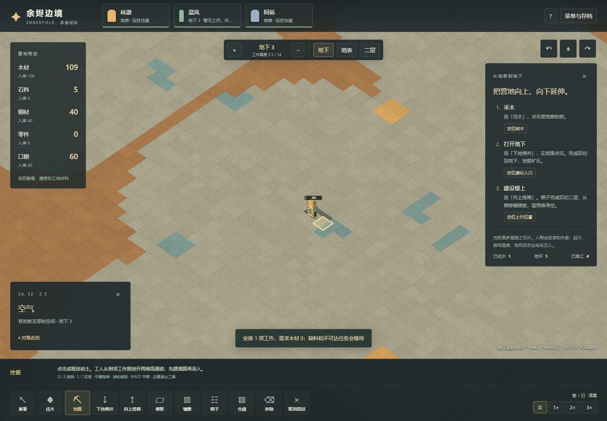
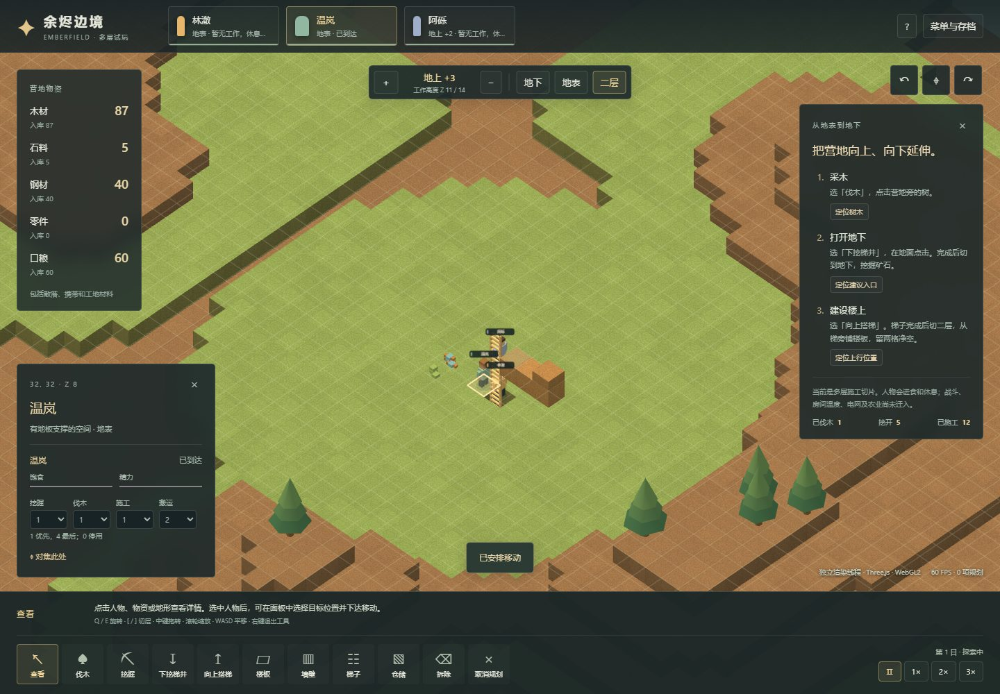

# 11 多层体素施工切片：实现与验收

日期：2026-11-02。入口为 [`?world=voxel`](https://sqchenxiyuan.github.io/emberfield-web/?world=voxel)，原二维营地继续使用首页。这里已实现真实多层坐标、地下开凿、上下行梯子、楼板/墙体和跨层物流，不是给原二维地图加厚的渲染效果。**目前交付的是多层施工试玩，不是完整三维殖民地游戏。** 农业、房间热交换、电网、战斗、医疗、叙事事件尚未迁入此入口。

## 实现边界

| 模块 | 当前实现 |
|---|---|
| 世界 | 64×64×16、16³ chunk；水平 x/y、高度 z；同水平坐标可以同时存在地下与二层的人和物 |
| 生成 | 固定种子平滑噪声地形、营地平台、肥力平方影响树密度、有限三维矿簇、启动树木与地下钢矿保障 |
| 站立与移动 | 脚部和头部两格净空；下方实体或梯子支撑；自然一格台阶；梯子逐格竖向连接；每一步重新验证通路 |
| 施工 | 每格独立任务、工作面可达性、携带建材、已送材料和施工进度；墙连续轴向拖建，楼板可框选规划 |
| 地下入口 | 从可站立位置逐格向下开凿三格梯井，每格先工作再实际移除方块并安装梯子；不预先打通地下 |
| 上层建筑 | 向上逐格搭梯，工人携木材爬到上层后从梯旁扩建楼板；墙占两格高度 |
| 搬运 | 物品堆、人物携带、工地材料分别记录；物品实际到达后领取，避免多人重复取物；送到最近可达仓储 |
| 分工与需求 | 挖掘/伐木/施工/搬运 0–4 级优先级；0停用；饱食下降后取口粮、精力低时原地休息；尚无完整饥饿健康/心情系统 |
| 交互 | 对象检查、人物指挥、Q/E旋转、滚轮缩放、WASD平移、工作层切换；编辑平面锁定层，剖切不改权威地形 |
| 存档 | 独立 `emberfield-voxel` 格式v1与IndexedDB库；地形RLE、实体/背包/施工进度保存；回读重新分配任务与路径 |

地表脚部 z=8、地下示例 z=5、二层脚部 z=11。z并非建筑层数：中间梯子格仍是真实可站立空间。矿道一次开两格高，泥土不产生石料；钢矿每个实心矿格40钢、机械矿2零件、天然石每格5石料、成熟树整棵27木材。前两个矿物产量与树产量参考原版声明；**石料恒定掉落、两格开挖、三维分布和工作时间是自定规则**。石料、钢和零件当前能采掘/运输/存储，尚未接入进一步生产消费。

生成器目前进行44组三维随机游走，每组最多8步，部分步重叠或不在石层内，不等于44个互不重叠的完整矿脉；每9组中1组为机械矿。营地旁另保证6棵成熟树与6格钢矿。它并未采用[10参数建议](10-voxel-resource-mapping.md)的“只启用木/钢、固定两簇”全部方案，也不是[06原版生成](06-world-generation-resources.md)的等价实现。

## 成本与时间单位

逻辑仍为20 TPS。下表是此试玩的独立平衡，不是原版耗时；不计步行、缺材和等待支撑。

| 工作 | 木材成本 | 工作tick | 单倍工作秒 |
|---|---:|---:|---:|
| 伐木 | 0 | 60 | 3 |
| 两格高矿道 | 0 | 70 | 3.5 |
| 一格楼板 | 3 | 45 | 2.25 |
| 两格高墙 | 6 | 80 | 4 |
| 一格梯子 | 2 | 40 | 2 |
| 向下开凿并装一格梯子 | 2 | 90 | 4.5 |
| 拆除 | 0 | 40 | 2 |

完整上行/下行通路通常包含入口和3格延伸，共8木材；已存在入口梯子时不重复收费。缺料/待支撑的合法蓝图可以提前规划。无支撑的远处蓝图会等待，不能隔空完工。与现有实体或规划冲突的施工笔划整体拒绝；自然资源框选跳过空格。

木结构暂无连锁坍塌。拆掉正在支撑人物的结构会等待人物移开；已断开的梯子不会继续允许穿越，重新接通后恢复规划。楼板需要邻接实心或梯子支撑，墙需要下方实心支撑。梯子允许携货；这些规则均为本项目设计。

## 架构与内存口径

- [`world.ts`](../../../src/voxel/world.ts) 是独立纯TypeScript模拟，不依赖Three；可在Node中重放正常命令。
- [`sim.worker.ts`](../../../src/voxel/sim.worker.ts) 固定步进，每200ms发布对象摘要，修改过的chunk独立发送；不逐帧发送整个世界。
- [`renderer.ts`](../../../src/voxel/renderer.ts) 使用 Three.js 0.180.0，当前后端是 **WebGL2**。默认OffscreenCanvas Worker；`?world=voxel&render=main`验证主线程兼容。尚未将此入口切换为WebGPU。
- 地形采用chunk露面网格，内部面剔除；每渲染帧最多重建3个chunk且受时间预算约束。树、物资和梯子实例化；角色是少量低模组件。未实现贪心面合并、无限世界或远距LOD。
- React HUD和输入在主线程。初始chunk缓存及增量有主线程/渲染侧副本，规模有界；模拟到主线程使用可转移数组，主线程向渲染Worker发送保留缓存的克隆。不能把“存在Transferable”说成全链路零复制。
- 存档只编码小切片全量地形的RLE，再经IndexedDB结构化存储或导出JSON。尚未采用大地图“种子+修改chunk”二进制方案，也没有二维v1自动升维迁移。

实际实现数组为两份Uint8（block、ladder），权威格网 **128 KiB**；一套距离/父节点/队列Int32寻路工作区 **768 KiB**。这是比08建议12字节/cell更少的字段，因为还没有房间、灯光、区域和完整导航缓存。不能将两者当成同一完成度的内存对比。

默认种子初始地形渲染缓冲约 **2,067,248字节**、16个chunk、4张纹理；这属于应用内部CPU几何/纹理数量，不包括完整GPU副本、驱动、画布和浏览器。帧率受硬件、分辨率、后台负载影响；不以本次短程数字宣称大地图容量。生命周期检查另记录反复新开/回读时的资源收敛。

## 可复现验收

```powershell
npm test
npm run test:voxel
npm run build
# 另一个终端运行 npm run preview
$env:VOXEL_TEST_URL='http://127.0.0.1:4178/?world=voxel'
npm run test:voxel:browser
npm run test:voxel:lifecycle
```

测试不会通过修改地图、注入物资或传送人物来代替流程。规则测试可使用隔离边界fixture；完整campaign只调用正常command/step/save/load。浏览器验证使用真实按钮、拖动和文件/IndexedDB存档入口；只读诊断接口用于获得投影和核对状态，**不属于纯截图黑盒测试**。

| 08验收编号 | 本次证据与边界 |
|---|---|
| V01 地表采集 | 正常指令与浏览器：一棵树产27木，并搬回仓储 |
| V02 地下入口 | 四个逐格完成的梯子单元连通8→5；角色真正走到地下 |
| V03 地下采矿 | 原封闭矿格采出40钢，人物携带跨层后到达地表仓储；每tick守恒检查 |
| V04 上层施工 | 人物携木到11层，铺三格楼板、建两格高墙，并划上层仓储 |
| V05 竞争与中断 | 单测：3工人抢8木材、途中取消、材料送达后取消、预定释放；尚非完整RimWorld任务优先级系统 |
| V06 断路恢复 | 单测与浏览器：拆掉唯一梯子后移动命令返回无通路，重建后人物实际下楼；携带物不丢失，占用支撑不能直接拆除 |
| V07 旋转与剖切 | 浏览器四方位点击同格，地下/地表/二层切换后权威存档不变 |
| V08 中途回读 | 搬建材/施工时保存，页面刷新后读回继续；材料、改动、任务进度不重复结算 |
| V09 时间/拒绝 | 暂停冻结权威tick与画面动作；加速逐步校验路径；无效施工返回原因且不扣材料 |

当前规则集 **51项单测（其中15项新增体素测试）**通过。三层正常指令campaign在种子73129、2718、8675309通过；对每个tick核对库存+消耗=初始+产出，并检查所有人物的支撑/净空。正式构建13项浏览器流程检查、6轮同页保存/新开/读档，以及1280×720与900×700下75项关键控件检查通过；同地图回读后的geometry、texture、chunk与地形缓冲计数均回到基线。暂停截图比较允许每颜色通道2/255的GPU舍入差异，不允许继续动作。

浏览器检查与生命周期结果保存在 `test-results/voxel-browser/`、`test-results/voxel-lifecycle/`，公开摘要及产物哈希见[体素验证记录](evidence/voxel-implementation-validation.json)。运行 `node scripts/research/record-voxel-validation.mjs` 可从这些通过的报告重新生成摘要；脚本会核对报告对应的正式构建哈希。





## 下一步

此切片建立了三维空间、施工与物流基础。下一步需要把原二维营地的农业/生产账单、床与作息、房间和电力逐项迁入；三维空气连通、层间热交换、垂直电网和视线都必须有自己的规则与回归。工作面寻路目前为整张小地图BFS，小人口可用，扩大人口和地图前需要测量并改成有界/分层搜索。触屏交互、移动浏览器、大地图、长期生存和大人口没有在本轮验收范围内。
