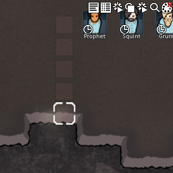
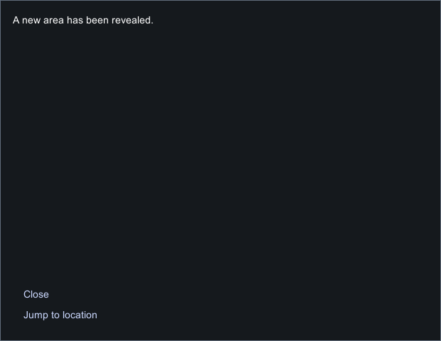
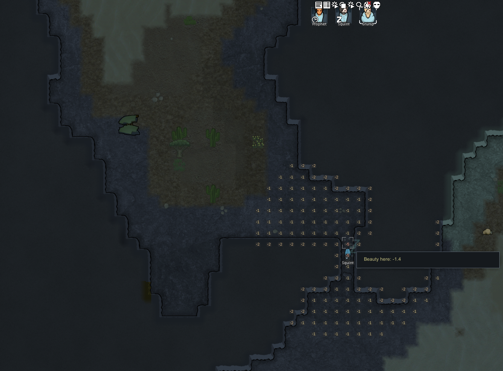

# 原版实机：未知采矿、区域揭示与读档

2026-11-04，在本地 **RimWorld 1.7.4980 rev60，Core + Odyssey** 中完成一次普通采矿探索。先在未知区域尝试检查与建墙，再画穿过四格花岗岩的采矿线，由殖民者实际挖通，打开原生“Area revealed”通知，最后保存、重新载入并再次保存。此次补充的是 [108 静态机制研究](108-caves-exploration-mechanisms.md) 的运行证据；Web 三维适配及此前已发布的验证见 [109 地下探索玩法](109-caves-exploration-gameplay.md)。

本轮优先验证操作与状态变化。下面的 tick、耐久和格数用于辨认实际过程，不作为挖掘速度、产量或洞穴密度的平衡目标。

## 操作实际产生了什么

| 普通操作 | 实际观察 | 对玩法的含义 |
|---|---|---|
| 点击未知格 | 地形读数为 `Undiscovered`，没有选中内部实体的信息面板 | 不能通过普通地图点击提前查看隐藏内容 |
| 在未知区域放木墙 | 显示 `Cannot place in undiscovered areas.`，没有成功放下蓝图 | 规划采矿与建设不是同一种权限 |
| 拖出五格 Mine 标记 | 已知入口与后续未知格都被标记，其中最后一格在原档中实际为空地 | 标记表达探索意图，不保证该处有可采实体 |
| 让 Prophet 优先采矿 | 菜单显示 `Cannot mine granite: Not assigned to mining` | 手动优先任务仍受工作分配限制 |
| 让已分配采矿的 Grump 优先工作 | 产生真实 Mine 任务，角色到达入口，岩石耐久下降，随后移除 | 需要实际工作与可达入口 |
| 继续推进模拟 | Grump 后来去进食，后续画面出现 Squint 在通道工作；入口最终贯通 | 工作会被生活需求打断，也可由另一名工人继续 |
| 打通入口 | 隐藏空间显露，出现原生 `Area revealed` 通知；五个标记全部消失 | 揭示也清理落在空地上的无效采矿计划 |
| 载入完成档，再保存 | 已知区域、已挖通路线、空的采矿标记列表保留 | 探索状态跨存档延续 |




没有改变三人的工作分配；Prophet 的拒绝分支保留在操作记录中。首次工作由玩家明确优先指定，后续接替由原生调度发生。因此不能把全程描述为“全自动”，也不能说一名殖民者挖完了全部岩石。终点存档本身不能确定最后一击由谁完成。

## 原生存档中的状态链

地图为 250×250，入口前的已知站立格为 `(89,0,195)`；`(89,0,196..199)` 原为四格花岗岩，`(89,0,200)` 原为未知空地。RimWorld 此处使用 x/z 水平坐标，y=0，不是 Web 的楼层 z 坐标。

| 本地原生档 | ticksGame | 路线与任务状态 |
|---|---:|---|
| exploration-baseline | 80847 | 从上一轮隔离研究档原样复制；无本轮采矿标记 |
| New Arrivals1 / 2 | 80848 | 载入后保存、移动相机后保存；均未规划 |
| New Arrivals3 | 80848 | 五个 Mine 标记；Grump 的 `playerForced Mine74906` 指向入口岩石 |
| New Arrivals4 | 83832 | Grump 站在入口前；同一任务，入口岩石由 900 降至 580 HP |
| New Arrivals5 | 88206 | 前两格岩石消失；第三、第四及空地格仍有标记 |
| New Arrivals6 | 94044 | 四格岩石与五个标记全部消失；通知已到达；Grump 进食、Squint 躺卧 |
| New Arrivals7 | 94045 | **实际重新载入 6 后**保存；探索位图、路线与标记结果保留 |

初始雾位计数 35,748，挖掉前两格后为 35,742，贯通后为 34,753。累计 995 个格子变为已知，包含路线及边界等变化；这不是“洞穴面积”，也不是原版提示逻辑中 `cellsUnfogged` 参数的运行读取。

原档中的通知 `arrivalTick=92988`，目标为 `Map_0` 的 `(89,0,199)`。通知内容是“A new area has been revealed.”，可点击 Jump to location。仅凭通知到达时间不反推每块岩石的工时。





## 对照 Web 的含义

| 机制 | 原版证据 | Web v36 的当前处理 |
|---|---|---|
| 未知区预画采矿线 | 本次实际操作成立 | 已支持；必须从已知可达的工作位置施工 |
| 揭示后清理空地标记 | 完成档中五个标记全消失，其中一个原为空地 | 已支持；两格高开采占格都已知后再处理，避免规划透视 |
| 发现范围传播 | 静态证据为开放格四邻域、阻挡边界八邻域；本次观察到区域整体显露 | 三维六邻接传播，是项目适配 |
| 保存发现状态 | 本次重新载入后仍保留；载入操作推进了 1 tick | `explored` 随 v36 存档保存，旧档保留原来的全图可见状态 |
| 发现后的反馈 | 原生通知与跳转按钮已实际操作 | 地形显露、检查面板和探索说明已接入；尚无对应的发现通知及位置跳转 |
| 空间性质 | 本次目标是被岩壁封住的**露天空地** | 当前生成器创建有顶的三维地下洞室 |

Web 的状态传播与空标记清理在 `src/voxel/world.ts` 的 `changed` 中处理，界面说明与未知格检查在 `src/voxel/main.tsx`。本次只补充研究与对照，没有改动游戏运行逻辑，也不意味着两个生成器已实现相同形态。

## 证据取得方式与边界

使用独立 `profile-exploration-20261104`。基线来自此前家具搬装研究的最终存档，包含更早的开发准备；本轮继承了开启的开发模式设置，但未使用开发命令、God mode、生成物体、修改需求或技能，也未编辑游戏存档或注入游戏代码。

为选择一条可在有限时间内完成的路线，事先**只读解码原存档**，据地形与相机位置确定入口和点击坐标。后续状态变更都来自游戏前台的普通鼠标、键盘操作。这不是仅靠屏幕盲探的实验。预先识别的连通空地为 813 格、无顶，不能把本次当成有顶洞穴生成或洞穴事件的实机验证。

完整 [运行证据](evidence/native-exploration-runtime.json) 包含 8 份原档身份、73 条完成动作、7 张公开裁图，并保留选定 XML 节点、压缩雾/物体数据、解码结果和退出记录。原始完整存档、完整截图与派生 C# 只留在本地。公开截图裁到相关游戏区域，排除无关桌面通知。

解码时，雾为 raw-deflate 后的 LSB 位图，格索引为 `x + 250*z`；压缩物体图为 uint16 little-endian。必须同时检查显式 XML 物体：被任务引用或已受伤的岩石可移入显式节点，不能因为压缩图中缺少石块短哈希就宣称它已挖掉。石块掉落物也不能当成仍阻挡入口的天然岩壁。

操作记录中的导航失误没有删去：039 的推进操作发生在保存后仍打开的主菜单里，没有推进模拟；040 关闭菜单，041 才开始实际行走/工作。每次有界推进最多四秒，以 Space 结束；实际经过的游戏时间以存档为准，不按墙钟时长推算。

本次空地超过 600 格且伸出相机视野，不能单独检验静态代码中的 600 格提示门槛。没有测试重新封墙、开门揭示、水域、远处破坏、古代危险、虫巢、隐藏敌人或全部选择入口。长期概率、采矿效率与产物平衡也不属于此次结论。

完成后通过普通 **Menu → Quit to OS** 退出 PID 21304。`2026-11-04T04:14:37.0877460Z` 的 fresh CIM 查询确认目标进程不存在且无 RimWorld 进程。074 的工具调用已发送退出点击，但后置截图因焦点变化而被守卫拒绝；输入脚本在截图之后才写动作记录，因此该步既无截图，也无动作 sidecar。退出回执单独保留这一缺口，没有截取退出后的桌面，也没有强制终止其他进程。

## 本地复核

```powershell
node scripts/research/verify-native-exploration-runtime.mjs
node scripts/research/verify-native-exploration-runtime.mjs --local
```

默认校验公开记录的内部一致性、图像与工具哈希，并独立解压重算探索状态；`--local` 额外对照本地原档、精确 XPath 节点与安装文件。它们不重放游戏，也不把保存的记录变成第二次运行证据。[采集器](../../../scripts/research/collect-native-exploration-runtime.ps1) 只读采集，[输入工具](../../../scripts/research/exploration-runtime-input.ps1) 限定可执行文件、隔离 profile 和前台窗口。
