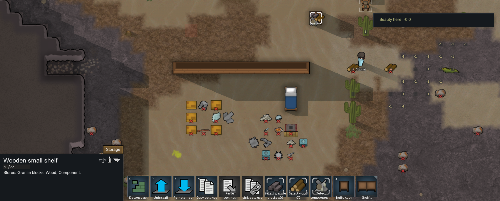
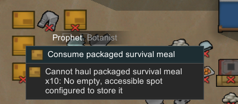
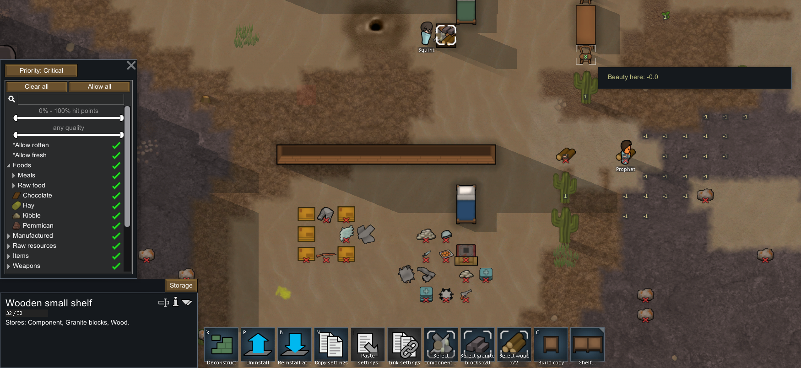

# 原版实机：货架入库、满架卸装与读档

2026-11-04，在本地 **RimWorld 1.7.4980 rev60，Core + Odyssey** 中，使用普通操作完成小货架的建造、三种物资入库、满架拒收、修改优先级、卸下、旋转重装和重新载入。静态机制见 [111 货架研究](111-shelf-storage-mechanisms.md)，可复核记录见 [运行证据](evidence/native-shelves-runtime.json)。

最关键的设计修正：**满货架可以直接卸下；物资留在地图上，包装只带原来的货架。** 此前路线中的“清空后卸下”不能作为原版要求。Web 目前仍为 v36，尚未实现实体货架；本次完成的是机制核对和实现边界，不是货架玩法发布。

## 普通操作与实际结果

| 操作 | 观察到的结果 | 实现含义 |
|---|---|---|
| Furniture 中放置 Wooden small shelf | 居民自动送材并建成；随后自动搬入花岗岩砖 | 建造和储存使用同一件实体家具 |
| 允许室外的零件堆 | 居民自动搬运；最终石砖、木材、零件三堆同格 | 每格多堆，不能用提高单堆数量上限代替 |
| 从货架面板选择零件 | 上架前的 `Deteriorating: Unroofed, outdoors (2/day)` 提示消失，原有耐久损伤保留 | 架面保护不等于修复物品；这也不是长期腐坏试验 |
| 允许外部生存餐，选人右击搬运 | 提示 `No empty, accessible spot configured to store it.` | 当前满架配置无法新增第四类型；没有实际执行这次搬运 |
| 将 Preferred 改为 Critical | 保持暂停并另存，三堆仍在架上 | 用非默认设置检查后续搬迁是否重置配置 |
| 满架点击 Uninstall，推进模拟 | 普通任务完成，出现打包架子；物资留在地图或继续被搬运 | 无须玩家预先清空；物资不是包装的附带内容 |
| Install、旋转、选另一格 | 原架在新地点重装，随后三堆原物资重新搬入 | 搬装身份和普通物流是两条状态链 |
| 保存、实际 Load、再保存 | 原架身份、位置、朝向、设置和三堆货物保留 | 需要跨读档延续家具与逐堆状态 |

建造和搬运没有使用手动优先工作指令，也没有改工作分配。玩家只规划建筑、允许既有物品、修改储存优先级和下达卸装指令；工人由原版调度。右击生存餐的失败菜单保留在记录里。





## 原生存档中的状态链

以下 tick 与数量用来辨认事件和检查守恒，**不作为 Web 的成本、工速或耐久平衡目标**。原版坐标使用 x/z 水平轴、y=0，与 Web 楼层坐标的含义不同。

| 原生存档 | ticksGame | 状态 |
|---|---:|---|
| shelves-baseline | 80847 | 上一轮家具搬装档的原样副本；没有本轮货架 |
| New Arrivals1 | 80848 | `Blueprint_ShelfSmall328353`，木材，小架计划在 `(115,0,130)`，默认 Preferred |
| New Arrivals2 | 83697 | `ShelfSmall328366` 已建成；32 HP、朝向 2；石砖 20 在架格，木材尚在 Squint 携带容器中 |
| New Arrivals3 | 85160 | 同一架格有石砖 20、木材 72、零件 30；Preferred |
| New Arrivals4 | 85160 | 三堆不变；改为 Critical 后的暂停保存 |
| New Arrivals5 | 86077 | 原货架进入 minified 包装；零件留原格，石砖在相邻格，木材已在旧地面储存区 |
| New Arrivals6 | 87183 | 同一货架重装到 `(112,0,132)`，朝向 3、32 HP、Critical；三堆重新搬入 |
| New Arrivals7 | 87184 | **实际载入 6 后**再保存；位置、朝向、HP、设置、货物 ID 和数量延续 |

三批货物分别是 `BlocksGranite42147 ×20`、`WoodLog42142 ×72`、`ComponentIndustrial38567 ×30`。零件在本轮上架前已有损伤；完成与读档后仍为 68 HP，没有被货架恢复到满值。打包界面中的 100/100 是外层包装耐久，不能替代内部货架的 32 HP。



卸下后的最终暂停档中，零件仍在 `(115,0,130)`，石砖在 `(116,0,130)`，木材在 `(105,0,129)`。木材已继续经普通搬运到旧储存区；不能把这个较远的最终位置当成 `TryPlaceThing Near` 的直接落点。重装后同一批物资重新上架也包含自动搬运时间，不能说物资随包装瞬移。

从建造计划到建成，所追踪的全图木材实体总量减少 10，随后卸装与重装没有额外消耗木材。全图计数同时涵盖地面、手持、背包和施工容器；其中也有禁止或封存的物资，**并不是殖民地可用库存**。例如全图零件 40 中，10 在古代休眠舱人物背包，本次实际搬入的只有地面那堆 30。只统计地面会把正在手持的物品误报为消失。

## 如何落到 Web 玩法

现有 Web 有地面仓储、筛选、有限堆、搬运预约，以及床桌椅的实体卸装；同格多堆不能只在渲染上画三个图标。实现顺序如下，均为**待实现设计**：

1. **统一放置与预约。** 保持单堆上限，按格枚举全部物品堆；先向兼容堆补货，再占新槽。同一个预演算法处理实际放置和预约，避免两个工人同时占掉最后一位。失败时不扣物、不增加幽灵堆。
2. **按物品身份取用。** 普通生产、吃饭、照护、装备、动物取食和贸易都指向具体 Stack ID。源堆被卖掉、耗尽或烧毁后应取消或重新规划，不能偷换成同格的另一堆。目标物品格与人物交互站位分开，人物能靠近架子取放。
3. **货架规则与界面。** 大小架共享整架设置，每占一格三堆；逐堆可检查。固定接纳规则和玩家筛选分开，打包家具与岩块不能上架，小尸体还需体型判定。架上仍能通行，但不能当普通停留点；路径与读档必须允许正在通过的人物。
4. **环境后果。** 架面提供环境劣化保护，食物继续按温度腐坏。改筛选后，原有不合规货物仍占槽并保留物理状态，交给普通搬运转移；没有其他位置时留在原处，不删掉货物。
5. **满架搬迁与破坏。** 卸下时将货物和家具包装分别安置，重装保持原架 ID、HP、朝向和储存设置。Web 可先规划全部落点，空间不足就等待；火毁等不可撤销移除需要可保存的溢出物资状态。这是项目守恒设计，不声称原版极端拥堵时具有同样保证。
6. **存档与实际经营验收。** 旧档不重排物品 ID；多堆、预约、搬迁途中和溢出都需可恢复。验证建造→入库→吃饭/生产取料→改筛选转运→满架搬迁→读档继续这一整条链，再做 Worker 与主线程画面检查。

货架不具有普通床桌椅的品质组件；共享搬装代码时需要区分“可搬迁建筑”和“有品质家具”。容量是玩法规则，先用已确认的三堆结构；建材成本、劳动速度、价格、基础耐久和长期经济效率继续采用可调整参数。当前四档 Web 储存优先级也不能直接改成原版枚举数字，否则会改变旧档含义。

验收优先覆盖真实失败情形：同格不同批次不串货、满架部分补堆、多个搬运者争最后槽位、改筛选时仍有预约、原堆消失、背包满时取食、货架拆除/火毁、家具搬迁途中读档。详细原版边界见 111 章；此次没有宣布这些 Web 行为已经实现。

## 证据取得与未覆盖范围

使用独立 `profile-shelves-20261104`，基线从 `profile-furniture-reinstall-20261104/Saves/New Arrivals5.rws` 原样复制，SHA-256 为 `f840f08861236c29e63064f31f8671d90455bfc25956efa34598a05f3d469054`。基线带有此前实验的准备状态，并继承开启的开发模式设置；本轮未使用开发命令、God mode、生成物体、修改需求/技能、编辑存档或注入游戏代码。

屏幕观察与只读存档解析共同用于核对身份、数量、坐标和设置；点击坐标还参考了存档相机参数，因此不是仅凭屏幕盲操作。状态修改均来自普通鼠标键盘输入，记录包含 8 份存档、73 条完成动作、8 张公开裁图和 440 个精确 XML 节点。本地校验核对 170 个文件哈希、逐字复算原档投影，并从完整原图重新裁剪比对。完整原档、完整截图及派生 C# 留在本地忽略目录；公开图片仅裁出相关区域。

本轮只验证一个木制小货架。没有验证双格大架、同类未满堆补货、过滤更改后的转运、尸体体型限制、储存组联动、跨地图重装、极端无落点、火灾、长期劣化率或食品腐坏曲线。这些静态规则和待测行为不能由一次顺利搬迁推导为全覆盖。

039 打开优先级菜单后，指针移开导致浮动菜单关闭；040 保持指针在菜单内后成功选择。各次有界运行以 Space 结束，真实时间推进由保存的 ticksGame 判定。重新读取导致 1 tick 差值，没有将两份原档称为逐字节相同。

完成后从普通菜单 **Quit to OS** 退出 PID 36588。`2026-11-04T05:00:05.2924101Z` 的 fresh CIM 查询确认目标不存在且没有 RimWorld 进程。074 退出点击已发送，但后置截图因焦点变化被守卫拒绝；脚本在截图成功后才写动作 sidecar，故这一步无截图和 sidecar，缺口由独立退出回执说明。没有截取退出后的桌面或强制终止其他进程。

## 本地复核

```powershell
node scripts/research/verify-shelf-storage-evidence.mjs
node scripts/research/verify-shelf-storage-evidence.mjs --local
node scripts/research/verify-native-shelves-runtime.mjs
node scripts/research/verify-native-shelves-runtime.mjs --local
```

静态校验核对 111 章的程序集身份、XML、派生引文和记录；运行记录校验独立重算选定存档的 XML、物资总量、逐堆身份与配置延续。local 模式另外对照原始本地文件。它们不重放原游戏，也不替代 Web 玩法测试。检查在本地执行，Pages 发布流水线继续只安装依赖、类型检查/构建和部署。
