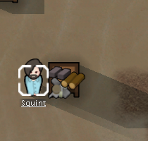
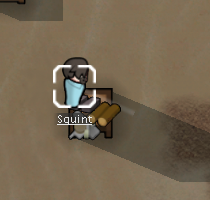
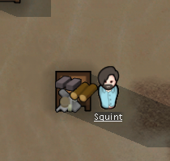

# 通行成本、绕行与移动恢复

2026-11-04。先让营地布局影响人物行为，成本和节奏继续后调。本轮把体素模式的实际路线从最少步数改为累计通行成本，并用本地 RimWorld 的货架绕行场景进行对照。没有增加存档字段，仍使用 v37。

## 玩家能观察到的变化

- 人物会比较走开阔通道和穿过货架、沙袋、围栏、积雪、自动门的成本。稍远的路可能更快；没有替代通路时仍能穿过允许通行的障碍。
- 负重、衣物、移动能力和踉跄会进入路线估计。慢速人物不一定值得为一次障碍绕很远。
- 自动门按规划时的开启状态估计等待；移动仍执行原有开门过程。门锁上或前方通路改变时，有替代路线便保留原任务和目的地重新规划，真正无路时才释放任务，携带物继续保留。
- 人物以错开的固定间隔重新比较剩余路线，适应天气、积雪与门的变化。动物觅食、求偶路线使用自己的速度与通行限制。
- 普通手动移动的目的地现在也能在读档后恢复；此前只恢复了征召移动等专门状态，普通移动会被通用重置逻辑清掉。

工作目标的筛选与实际走法是两层：工作优先级、取餐座位范围等仍使用原来的距离/资格规则，选定目的地后再规划路径。因此本轮不会把“找更快的路”隐式改成“所有任务都按最短出行时间排名”。

## 原版静态依据

安装程序集 SHA-256 为 `eff7d97949f919fb2b151ebfb906e9be749b63410b7dbda78eeebb7972b245c3`，与已有 [work-manifest](evidence/work-manifest.json) 相符；本轮重新核对四个派生类型的实际文件哈希。完整 C# 派生留在本地，不作为原始源码发布。

| 依据 | 机制与边界 |
|---|---|
| `PathFinder.ParameterizePathJob`，派生 642–672；RW17-WORK-22 | 角色的正交/斜向移动 ticks 进入路径参数，还设定启发强度。原版不是单位成本 BFS。 |
| `PathFinderJob`，派生 90–208；RW17-WORK-23 | 累加格子与移动成本，再结合启发估计维护 frontier；斜向还检查夹角阻挡。不能据此声称永远得到严格最短实际耗时。 |
| `PathGrid.CalculatedCostAt`，派生 120–205；RW17-WORK-24 | 地形、物体及积雪成本有取较大值与重复障碍规则；静态感知还有火焰罚分。它不同于实际逐格耗时。 |
| `Pawn_PathFollower.CostToMoveIntoCell`，派生 746–808；RW17-WORK-25 | 实际移动另外处理建筑、地形标签、速度上限及行动紧迫程度。 |
| [111 货架](111-shelf-storage-mechanisms.md) | 可穿过但不可停留，货架 `pathCost=50`；50 不能单独换算成完整穿格秒数。 |

对应规则记录在 [work-claims](evidence/work-claims.json)。本次 REA 成员读取触及元数据表示预算，返回 unavailable；[原始结果](evidence/navigation-rea-members.json)明确保留这一限制。具体方法结论使用匹配程序集的既有 ILSpy 派生，没有把空集合解释成类型不存在，也没有把静态结果写成运行观察。

## 原版实机对照

使用独立 `profile-navigation-20261104`，Core + Odyssey，原样复制上一轮实际建成并存满的小货架存档。基线继承早期准备状态和开启的开发模式，本轮只用普通选择、征召、右键移动、时间控制和保存菜单，未生成物资、修改角色或编辑存档。

目标是 `ShelfSmall328366`，位于 `(115,0,130)`；同一名征召居民 `Human961` 从西侧前往东侧。三份原始保存的投影如下：

| 阶段 | 实际坐标 | 目标与结果 |
|---|---|---|
| 出发准备 | `(114,0,130)` | 正常走到西侧后保存 |
| 绕行途中 | `(115,0,131)` | 当前 `Goto` 与 `pather.nextCell` 均指向 `(116,0,130)` |
| 到达 | `(116,0,130)` | 到达货架东侧，货架身份与位置不变 |





[运行证据](evidence/native-navigation-runtime.json)保留 3 份保存的精确 XML 投影、3 张裁图来源和裁剪范围、25 条完成操作记录，以及启动/退出回执。点击同时参考了只读存档中的相机坐标，不属于纯屏幕盲操作。画面包含移动插值，格子状态以保存中的 `pos` 核对。结束后从普通菜单 Quit to OS 退出，fresh CIM 查询确认目标进程已不存在；退出后的截图被焦点守卫拒绝，未截取桌面。

这个场景证明了一次真实的绕行选择，不能证明全部中间 tick、严格最优耗时、门/积雪/动物路径或极端拥堵行为。原版采用二维斜向移动，Web 使用四邻方向、可改变一格高度的台阶和垂直梯子，两者不会产生相同的节点序列。

## Web 实现与约束

[navigation.ts](../../../src/voxel/navigation.ts)使用复用 typed arrays 和带位置索引的堆。指定目标用一致的三维下界做 A*；动物多个食物/配偶候选使用零启发的 Dijkstra。等价成本以稳定发现顺序打破平局。每格最多一个堆槽，工作空间固定为地图格数，不按尝试路径数量增长。

人物路径使用与实际移动共用的基础速度和障碍成本。天气按离开格、积雪按进入格计算，雪和障碍取较大值；门等待是规划时的估计，途中可能因其他角色开关门而变化。每 80 个模拟 tick 按人物 ID 错开复评，前方边失效时立即尝试绕行。牢房内重新规划继续受牢房格集合约束，牵引动物的成对步进不被单人重规划拆散。

全部导航数组在正常经营样本中为 **3,473,408 字节（3.3125 MiB）**，新增工作区占 2.25 MiB；这只统计导航数组，不是浏览器总内存测试。固定模拟步与渲染分离保持不变。

保留边界：牵引中的成对路线仍使用既有搜索；无斜向步、原版火焰感知罚分、动态会车与角色占位避让，也没有新增各地表材质的速度规则。原有野生游荡/逃离的局部行为不等于长距离加权目标寻路。工作对象排序仍是距离与资格策略。保持这些差异明确，继续补机制，不为拟合全部原版常数阻塞交付。

## 验证

新增 12 项机制测试，包括与独立松弛算法对照的有向随机图、重复搜索、目标集合、绕架与必经慢路、角色速度差异、门、积雪、跨层、范围约束、动物路线以及移动中保存。旧的门/沙袋计时测试改为必须经过待测格，避免新绕行行为跳过被测对象；护理无路测试改为真正封闭全部出口，继续保留物资守恒断言。

全量 102 文件、1,283 用例中 1,279 项直接通过；两项超时在独立完整文件复跑中通过，另两项旧场景按上述语义更新并复跑通过。对应复跑覆盖住房、基础体素、制作、生存护理、天气和新增导航。生产构建通过。测试只在本地运行，Pages 不增加测试步骤。

正常经营验证从未修改的历史开局完成货架施工、搬运与搬装，再从实际存满的检查点让人物绕架、途中保存并抵达。所有变化来自普通命令与步进，逐步核对资源总量；没有注入地形、物资或速度。浏览器验证再通过文件导入、鼠标选格和可见移动按钮，在 Worker/main 两种模式检查同一流程，桥接接口只读。

```powershell
& scripts/research/collect-native-navigation-runtime.ps1 -Check
npx vitest run tests/voxel-navigation.test.ts --maxWorkers=1
$env:VOXEL_SHELVES_OUT='test-results/navigation-shelves-campaign'
node scripts/voxel-shelves-campaign-verify.mjs
node scripts/voxel-navigation-campaign-verify.mjs
node scripts/voxel-navigation-browser-verify.mjs
```

普通经营与浏览器报告分别写入 `test-results/voxel-navigation-campaign` 和 `test-results/voxel-navigation-browser`；原档和完整截图仍在忽略目录。采集器 `-Check` 重新读取本地原始来源并复算投影、哈希和裁图，它不重放原游戏。
