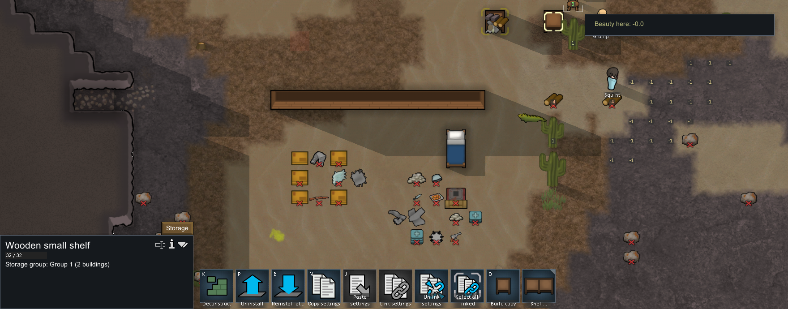
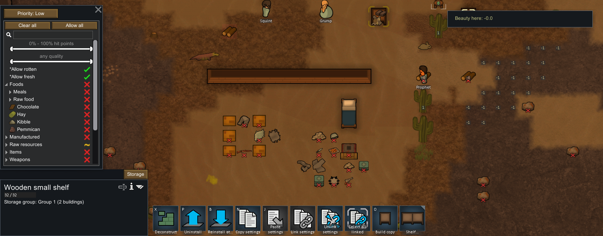

# 储存组：蓝图、实体货架与搬装之间的共享设置

更新：2026-11-04。继续按“玩法与机制优先，数值后调”实施。本轮让玩家维护一组仓储规则，并让建造、实际搬运和房间改造遵守同一规则。原版静态依据见 [116 储存组机制](116-storage-groups-mechanisms.md)。

## 原版普通操作验证

目标为本地 RimWorld 1.7.4980 rev60，Core + Odyssey，独立保存目录。原样复制前一轮货架导航实验的存档；基线继承早期开发准备与开启的开发模式。本轮仅使用选择、Build copy、联动/筛选菜单、工作分配、正常劳动、卸装、安装和保存菜单，没有生成物资、注入状态或改写存档。操作参考截图和只读 XML，不属于纯屏幕操作。

| 保存 | 操作与观察 |
|---|---|
| 1 | 旧架 `ShelfSmall328366` 与 `Blueprint_ShelfSmall399889` 联动；组内为 Critical、只收 WoodLog |
| 2 | 工人实际运送材料并建成 `ShelfSmall399893`，组成员由蓝图转为成品，继续共享规则 |
| 3 | 正常卸下后，`MinifiedThing399903` 内仍是同一个 `ShelfSmall399893`，保留组引用 |
| 4 | 同伴打包期间从旧架把组优先级改为 Low，再安装到 `(121,0,130)`；原身份和 Low/WoodLog 组规则保留 |
| 5 | 从新架解除联动；组解散，两座货架的独立设置均为 Low/WoodLog |

阶段 4 的货架本地 `settings` 仍是 Critical，而组内有效设置已为 Low。应读取 `storageGroup` 指向的规则，不能把旧的本地副本当作实际行为。解除后，当前组设置才复制到独立设置。[运行证据](evidence/native-storage-groups-runtime.json)保留 5 份原档的投影与 SHA256、74 条完成操作与捕获回执、6 张裁图及 8 个匹配派生类型。




原版正常退出后，独立进程查询确认目标 PID 30400 已不存在；退出后的截图被焦点守卫拒绝，未截取其他窗口。这里没有复测本轮新存档的重新载入，没有独立 Frame 快照，也没有跨地图、自动重建、蓝图显式解除的全部分支或所有中间 tick。打包时改 Low 由操作/截图及重装后的保存确认，没有单独的中间保存。

## Web 玩法与状态

- 选择一座货架，在“联动其他货架”中勾选同伴，采用当前来源货架的有效规则。可以包含大/小货架、施工蓝图及已打包货架。
- 从任一成员修改优先级或物品筛选，整组立即采用该规则；现有货物保持原地，通过真实搬运转入可用仓位。搬运中的失效目标会释放预约并重新寻找位置。
- 可改组名、查看成员状态和楼层、定位成员、加入已有组。转组只移动选中的成员。
- 蓝图完成和货架卸装、携带、送达、重装保持成员身份。蓝图和打包物不提供仓位，跨层存取仍需要实际路线和劳动。
- 解除联动保留当前规则；成员取消或毁坏后清除引用，少于两座时自动解散。剩余货架恢复独立设置，物资损失继续走既有账本。

[storageGroups.ts](../../../src/voxel/storageGroups.ts)集中管理组与成员生命周期；物流读取组内有效设置，不逐架同步副本。[ShelfPanel.tsx](../../../src/voxel/ShelfPanel.tsx)提供设置和成员操作。全局对象编号也用于组，加载时拒绝身份冲突、重复成员、悬空引用、无效设置和新版字段伪装旧版。

存档升级 **v38**。v37 及之前版本保留原地形、库存、货架和人物，补空储存组及独立蓝图默认设置；真实 v37 原档及 SHA256 随测试保存。对历史测试中“当前空世界转为旧格式”的构造只移除确认未使用的新字段，不修改历史 fixture 原始字节。

Web 有意保留这些适配：蓝图到成品使用稳定 ID，原版是在不同对象间转移关系；Web 统一保证蓝图解除时保留有效设置；只有货架可联动，地面仓位不能加入；没有跨地图联动、毁坏后自动重建或多种货架标签。优先级档数、成本与劳动节奏仍为 Web 暂定参数。

## 本地验收

13 项新增机制测试覆盖共享规则下实际搬运、搬运中筛选变化、选定成员转组、解除、蓝图完工、跨层、搬装读档、毁坏/取消、真实 v37 迁移及错误数据拒绝。普通经营脚本从原始 v37 检查点继续，通过普通命令完成建造联动、转运、打包编辑、携带中保存、重装和解除，逐 tick 核对资源账本及物理堆位。

全量回归 103 文件、1,295 用例全部通过。随后补齐“命令不能建立超过存档成员上限的组”这一边界，并在最终代码上完整复跑储存组文件，13/13 通过；没有把这次单文件复跑表述为另一轮全量测试。生产构建和最终类型检查通过。

普通经营验证通过 10 项检查、16 次命令和 7 个保存检查点；浏览器 Worker/main 各 13 项通过，包括可见文件导入导出、蓝图选择与建成、从另一成员编辑、实体转运、打包/携带读档、重装和解除后的独立规则。两种模式无浏览器错误，所加载的资源字节与最终 dist 一致；1440×960 与 980×720 截图经人工检查，侧栏可滚动且无页面横向溢出。

```powershell
& scripts/research/extract-storage-groups.ps1 -Check
& scripts/research/collect-storage-groups-evidence.ps1 -Check
& scripts/research/collect-native-storage-groups-runtime.ps1 -Check
npx vitest run tests/voxel-storage-groups.test.ts tests/voxel-shelves.test.ts --maxWorkers=2
node scripts/voxel-storage-groups-campaign-verify.mjs
node scripts/voxel-storage-groups-browser-verify.mjs
```

普通经营报告和浏览器报告分别写到 `test-results/voxel-storage-groups-campaign`、`test-results/voxel-storage-groups-browser`。浏览器脚本以可见文件导入、选择、表单和时间控制执行，bridge 仅用于读取状态、坐标投影和导出比较。发布 CI 仍只安装依赖、类型检查/构建和部署，测试在本地完成。
