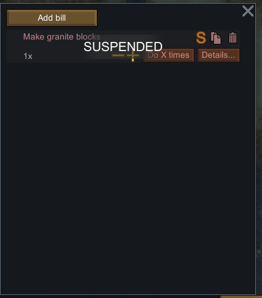
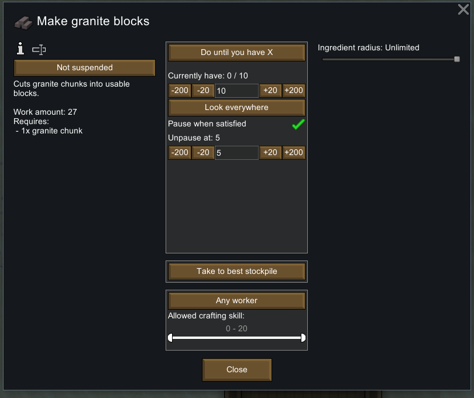
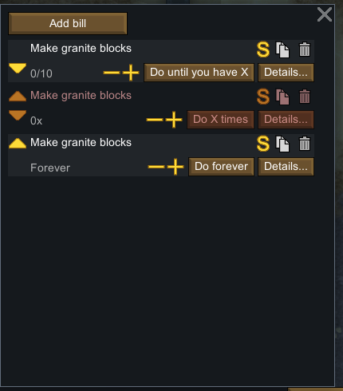

# 生产账单：队列、库存目标、暂停与在制品

核对日期：2026-11-04。目标为本机 RimWorld **1.7.4980 rev60**。第 1–8 节记录发行程序集的静态派生结果与 Core XML；第 9 节补充本轮有限范围的原版实机验证，不宣称 Web 已实现所有机制。按“玩法机制优先、数值后调”的方向，核心是让账单成为可管理的生产计划：它决定接下来做什么，具体角色仍要搬原料、到工作台加工、产生真实物品并运走。

主要结论：**账单次数表示配方批次，目标库存表示已存在的合格成品；手动暂停、自动暂停、缺料和完成是不同状态。** 队首账单不可做时，会继续寻找后面的可执行账单。删除账单会使当前作业失败，但不会等价于取消地图上的在制品。

证据入口：[PB01–PB20](evidence/production-bills-evidence.json)、[新增类型 manifest](evidence/production-bills-manifest.json)、[REA 身份记录](evidence/production-bills-rea-managed.json)、[本轮原版运行记录](evidence/native-production-bills-runtime.json)。基础烹饪见 [12](12-farming-cooking-food.md)，切石见 [24](24-stonecutting-mechanisms.md)，装备制作见 [42](42-weapons-crafting-equipment-mechanisms.md)。

## 1. 来源与复核

| 项目 | 身份 |
|---|---|
| 原文件 | `F:\SteamLibrary\steamapps\common\RimWorld\Assembly-CSharp.dll` |
| Assembly SHA-256 | `eff7d97949f919fb2b151ebfb906e9be749b63410b7dbda78eeebb7972b245c3` |
| MVID | `8e962ecc-7ac7-42d2-8f3b-1b16cd24d2cd` |
| 静态工具 | ILSpy `ICSharpCode.Decompiler 11.2.0.10050` |
| 工具 SHA-256 | `587a18e18e13acfc7fd8783a44c24c7da0781dadf6b9fb9dd5e2e38a9cdfae78` |

本轮 REA `inspect_managed_artifact` 成功返回 metadata coverage=complete。原样保留的元数据带有 `.NETCoreApp,Version=v10.0` TargetFrameworkAttribute；这仅是文件元数据，不用它推断实际启动的游戏运行时。REA 未运行游戏，也不承担 C# 反编译；行为证据来自同一 DLL 的 ILSpy 派生文件和原始 XML。

新增四个类型：`BillStack`、`Dialog_BillConfig`、`BillRepeatModeUtility`、`Bill_ProductionWithUft`。复用同 DLL/工具哈希的 `food / work / stonecutting / weapons` 派生类型。完整派生 C# 留在忽略的 `.local-research`，公开文件仅保留规则、哈希、行范围、范围哈希和相关 XML 字段投影。未解析依赖由工具容忍；这些文件不是开发者原始源码，也不是 Mod/DLC patch 后的有效 Def 数据库。

项目根复核：

```powershell
pwsh -NoProfile -File scripts/research/extract-production-bills.ps1 -Check
pwsh -NoProfile -File scripts/research/collect-production-bills-evidence.ps1 -Check
```

第一条重新静态提取新增类型并比对文件/manifest；第二条重核全部复用来源、范围与 XML，重建 JSON 精确比对。省略 `-Check` 才写入对应证据。两者均不启动游戏或执行游戏代码。

## 2. 账单与配方是两层对象（PB01、PB02、PB19）

配方描述产物、原料和工作量；账单引用配方，并保存重复模式、当前剩余次数、库存目标、筛选、执行者限制和存放策略。同一个配方可以对应不同的账单对象，作业引用的是具体 Bill，而不是仅凭配方名反查“唯一那条”。

`Bill_Production` 的构造字段为次数模式、剩余 1 次、目标 10、自动恢复阈值 5；它们属于原版初始值，不是 Web 必须采用的经济平衡。`repeatCount` 只在 `Notify_IterationCompleted` 中递减，完成一次后变 0 时发出消息，**账单仍留在列表中**。

一次迭代可以产生多个物品。Core 的 `CookMealSimpleBulk` 一次产出 4 份简单餐，次数设 3 表示 3 批，不是做 3 份。`FinishRecipeAndStartStoringProduct` 先生成配方产物、消费原料，再通知账单完成；开始搬料或加工时不应先扣完次数。

| 模式 | 是否允许开始下一次 |
|---|---|
| 做若干次 `RepeatCount` | 没有手动暂停且 `repeatCount > 0` |
| 一直做 `Forever` | 没有手动暂停；仍受角色、原料、工作台等限制 |
| 做到库存目标 `TargetCount` | 没有手动暂停、没有自动暂停，且计数小于目标 |

目标模式可用性由 `recipe.WorkerCounter.CanCountProducts` 决定。通用计数器仅支持一个普通产品、没有 specialProducts 的配方；切石等专用计数器可以覆盖。不能为所有配方无条件提供一个看似统一的“目标库存”。

列表以深序列化保存顺序，加载后恢复每条 Bill 的 stack 引用。普通 Bill 保存身份、配方、手动暂停和各项限制；Production 保存模式、次数、目标、迟滞状态、统计/存放组引用；带在制品的子类另存 UFT 引用。字段存在不是实机读档成功的证明，仍需完整往返实验。

## 3. 两种暂停与迟滞补货（PB03、PB04）

`suspended` 是玩家主动暂停；`paused` 是目标库存的自动暂停状态。`ShouldDoNow` 的判定顺序是：

1. 如果当前不是目标模式，清除自动 `paused`。
2. 如果手动 `suspended`，直接返回不可执行。
3. 处理无限/次数模式。
4. 目标模式读取当前计数；开启“满足时暂停”且计数达到目标时，设置 `paused=true`。
5. 计数小于等于恢复阈值，或关闭“满足时暂停”时，清除 `paused`。
6. 自动暂停返回不可执行，否则仍要求计数小于目标。

例如目标 20、恢复阈值 8：库存到 20 后自动暂停；降到 19、12 时继续等；降到 8 才恢复，随后持续补货直到再次达到目标。只实现 `stock < target` 会在每次消耗后立刻补一批，丢掉原版的迟滞控制。

手动暂停不会因库存降低而自行解除。它还会使目标判定提前返回，因此不能假定在手动暂停期间自动状态每次都会刷新。切回非目标模式则会清掉自动暂停。

详情面板调整目标时同步移动恢复阈值，并在恢复阈值不低于目标时压到 `target - 1`。本条 UI 路径对目标 0 可能产生 -1，不能据此宣称原版全局保证非负；Web 若选择正目标和合法区间约束，应明确这是输入规则。

自动暂停的状态行有 Unpause 动作，直接清除 `paused`；库存仍达到目标时，下次判定会再次暂停。手动暂停按钮切换的是另一个字段，二者不应在状态显示和存档里混为一个布尔值。

## 4. 队列优先级与重排（PB05、PB06、PB08）

`BillStack` 维护列表。新增在末尾；上下移是在原列表中移走并重新插入同一个对象，不生成新 Bill。普通列表 UI 在 15 条时不再提供 Add，单条 UI 隐藏越界的上下移按钮；底层 `AddBill` 自身没有 15 条校验，`Reorder` 也不防任意越界正偏移。因此这里确认的是玩家界面的限制，不是任意脚本都无法突破。

`WorkGiver_DoBill` 按列表顺序尝试，在以下情况下继续后面的账单：

- 当前模式/暂停状态不需要生产。
- 工作类型、角色限制或技能不满足。
- 缺原料，或还处于缺料重查冷却期。
- 在制品绑定其他工人，当前人无法接续。
- 其他该分支的资格限制。

因此队列是**按序挑选当前可执行项**，不是“第一项缺料就整台停机”。无限账单只要一直可做，会持续优先于后面的账单，这也是玩家需要排序和暂停控制的原因。

重排函数本身只改顺序，没有中止当前作业。但长时间制作在制品时，代码在开始超过 3000 ticks 后按 1000 tick 哈希间隔调用 `CheckForJobOverride`。这不支持“重排永远不影响当前工作”的绝对说法：直接重排不会在此函数里取消，后续 AI 是否切换还受作业检查影响，具体时机需实机验证。

## 5. 目标库存究竟统计什么（PB09–PB13）

目标库存调用配方的 WorkerCounter。它不是统一的“地图所有同名物品数量”，也不是“已经生产的历史累计量”。

| 计数路径 | 已确认的统计范围 |
|---|---|
| 通用快速路径 | ResourceCounter 中的产品数，加玩家阵营已生成角色手持的有效成品 |
| 通用慢路径，无指定统计区 | 地图同 Def 实物、打包物、手持物、搬运来源容器的直接内容；另加可选已装备物品 |
| 通用慢路径，指定统计区/组 | 该 `ISlotGroup.HeldThings` 的有效产品；另加可选已装备物品 |
| 任意石砖专用计数 | 所有 StoneBlocks 子 Def 的 ResourceCounter 合计；不调用通用手持计数 |

**快速路径前提**是产品 CountAsResource、未勾选装备计数、没有统计组、耐久和品质为全范围、未限允许材质，并满足污损服装条件。ResourceCounter 扫描地图所有 SlotGroup 的 HeldThings，累计新鲜、非迷雾的资源堆数量。货架和储存格会进入；地图上任意散落资源不因此进入。它不在这个路径中检查禁止搬运或可达性，所以“能统计到”和“当前工人能取到”不同。

ResourceCounter 有 204 ticks 的周期更新；目标模式制作结束还会显式刷新它。不能把读取到的数字说成每帧实时数据库。通用手持计数遍历玩家阵营的 spawned pawns，读取 `carryTracker.CarriedThing`，不是扫描所有人的背包；解包后用 `CountValidThing` 过滤。该过滤没有 ResourceCounter 的 `IsNotFresh` 检查，两条路径的过滤也不完全相同。

通用慢路径会检查精确产品 Def、尸体穿过的服装、耐久、品质、允许材质和迷雾。一个值得保留的边界是：派生代码的 `CountValidThings(List<Thing>)` 每个有效对象只 `num++`，而 ThingOwner、指定统计区等路径加 `stackCount`。本章不把这处不对称擅自修正为原版事实，也不要求 Web 复制可能有问题的计数行为；必须用堆叠物品实机对照才能确认影响。

`includeEquipped` 默认 false。启用后遍历本地图已生成自由殖民者的武器、穿戴和背包；**即使已经指定统计组，也会额外加入这些装备/背包物**。装备计数不是在统计区范围内筛选人物，也不等于通用手持计数。

`Make_StoneBlocksAny` 在 Core XML 指定 `RecipeWorkerCounter_MakeStoneBlocks`。它汇总所有石砖类型的已储存资源，完全不读取通用的统计组、装备、耐久、品质或材质参数，也不额外算手持石砖。不能把“任意石砖”的规则推广到所有其他配方。

所有以上计数路径都读取现存实物或资源统计；**未完成的未来产量不作为目标库存预留**。几台工作台已经开工、或一批产出跨过阈值时，目标可能超出。目标是决定是否再开工的阈值，不是到达 N 的瞬间截断当前一批产品的硬上限。

## 6. 当前作业如何受修改影响（PB07、PB08、PB16–PB18）

| 操作 | 静态确认 | 仍需实机确认的范围 |
|---|---|---|
| 手动暂停 | `DoRecipeWork` 的 FailOn 直接检查 suspended，中断加工阶段 | 搬料阶段没有相同全局检查；输入到停止的时机 |
| 删除账单 | deleted 置 true 并移出列表；JobDriver 全局检查 DeletedOrDereferenced | 搬运中的物品落点、预留释放、其他工作接续时机 |
| 重排账单 | 同一 Bill 身份保留，排序函数本身不取消当前作业 | 长时在制品任务随后触发 AI override 的行为 |
| 次数改 0、降低目标或外部补入库存 | 禁止后续调度；所查工作/完成路径没有每 tick 调用 ShouldDoNow | 当前批次是否在其他作业切换点被打断 |
| 改回无限/次数模式 | ShouldDoNow 清掉自动暂停，手动暂停仍独立存在 | 当前作业与新模式下剩余次数变化的组合 |

JobDriver 还有工作台消失、着火、不可用等失败条件；它会预留一个工作台。暂停不是冻结一个进度 UI，删除也不是只删掉面板上一行，需要处理真实角色、材料、作业引用与物品生命周期。

带 UFT 的配方在开始加工时创建 `UnfinishedThing`：把实际原料放入其 ingredients，保存 creator、recipe、bound bill、workLeft。加工持续写回剩余工作量，后续恢复时读取它。没有 UFT 的配方，新的 `DoRecipeWork` 初始化回完整配方工作量；不应仅因存在账单就宣称所有配方都能保留中途进度。

绑定的在制品优先由绑定工人接续；当前账单没有绑定对象时的搜索仍要求同配方、同 creator、原料符合当前允许规则、可预留且未禁止。绑定工人倒地、不在地图、工作关闭等情况可能清掉账单内部绑定，但这不意味着任意人都可以接着做，后续搜索仍有 creator 限制。

`BillStack.Delete` 调用的普通 `Building_WorkTable.Notify_BillDeleted` 为空。在制品读取 BoundBill 或保存时会清除无效绑定，但本身的原料、剩余工作和配方仍有独立存储。**删除账单不等于取消在制品。** 后者是选中在制品执行 Cancel，进入 `DestroyMode.Cancel`，按每份原料数量的 75% 随机舍入退回，并解除绑定。这里保留 75% 是解释生命周期差异，不是本轮要求 Web 对齐的平衡数值。

## 7. 统计范围与产出目的地是两个设置（PB14、PB15）

`includeGroup` 决定目标库存从哪里统计；`storeGroup` 决定完成后优先送到哪里。它们需要分别存储，不能选了“送往 A”就悄悄把计数范围也改成 A。

产出存放模式包括最佳储存区、指定储存区/联动组、放地上。详情面板对联动组去重，按配方计数器的存放兼容性生成可选项；目标区域失效时，指定产出存放回退为放地上，失效的统计区引用则单独清理。

完成时，放地上模式在角色附近放置产物；其他模式为第一条产品寻找储存格，超出携带能力的部分落地，其他产品条目也先落地，然后启动真实 HaulToCellStorageJob。找不到格子仍会放附近，不应吞掉产品，也不要求产物瞬移入库。配方完成和最终搬运入库是两个阶段。

## 8. 实现与实机验收边界

面向 Web，首先需要独立账单 ID 与有序列表，把“账单的长期生产策略”和“工人当前一次作业”分开。状态展示至少区分手动暂停、达到目标自动等待、次数完成、缺原料、无法使用工作台和加工中。计数应说明范围，当前批次与预计输出可独立显示，但不能混入“已有库存”制造虚假的完成。

可复用下列普通 UI 实验，所有实验都应保留保存文件、前后截图、动作记录和实际源文件哈希：

1. 同台创建两条同配方账单，分别设次数与目标，重排后检查身份、顺序与执行选择。
2. 做完一批多产物配方，确认只扣 1 次；归零后账单仍存在。
3. 目标达到后自动暂停，消耗至中间值仍暂停，再降至恢复阈值才重新生产。
4. 对加工中的无 UFT 与有 UFT 配方分别暂停，检查原料、进度和恢复；另测搬料途中暂停。
5. 删除在制品关联账单，检查在制品保留，再通过普通账单接续；单独取消在制品检查退料。
6. 交换同一成品在地面、货架、手持、穿戴/背包和指定组中的位置，核对各路径计数差异。
7. 在当前一批尚未完成时降低目标或由外部补货，观察超额与下一次派工。
8. 暂停、迟滞、排队、绑定在制品等状态分别存档/读档，核对身份、顺序和物品总量。

本章的 PB 规则是静态证据；第 9 节报告本轮实际覆盖的部分。UI 阈值边界、通用慢路径堆叠计数、Mod/DLC 专用 counter 和长时重排抢占尚未在此确认。Web 如采用更统一的计数、非负输入或更即时的中断规则，应在实现文档明确记录，不能归因为原版已验证行为。

## 9. 原版实机：暂停、完成一次、同配方排队与重排

本轮运行 Core + Odyssey 原版进程 PID `24752`，使用独立 `profile-production-bills-20261104`，复制并加载 [25 的切石实验](25-native-stonecutting-runtime.md) 中原始 `stonecutting-working.rws`。原始文件和副本 SHA-256 均为 `41c9cbbac0909b8804450eaca7a2c8d32cd023f6348676a4af02d027edc17233`。历史基线用开发者/God 模式放置木制切石台、花岗岩块并恢复 Squint 的需求；本轮继承已启用的开发者模式，但只通过普通账单、优先工作、时间控制、存档和退出 UI 操作，没有生成物品、注入代码或修改存档 XML。

实验使用截图与只读原始存档 XML 辅助观察，因此不是 screen-only。角色为 `Human961 / Squint`，工作台为 `TableStonecutter42144`，配方均为 `Make_StoneBlocksGranite`。本轮实际创建三份新存档，保存了原始哈希、账单 XML、当前作业 XML、物品/储存区投影、54 份动作与截图回执、9 张有边界的公开截图裁剪。

| 快照 | 游戏 tick | 账单与角色状态 | 能证明的内容 |
|---|---:|---|---|
| 加载基线 | 47518 | Bill0 剩余 1 次；Squint 正在 DoBill，`workLeft=1195.07764` | 暂停前确实处于加工阶段 |
| New Arrivals1 | 47541 | Bill0 `suspended=true`、仍剩 1 次；Squint 已改为搬木头，新作业从 tick 47520 开始 | 手动暂停打断正在加工的作业，不提前扣批次 |
| New Arrivals2 | 47569 | 取消手动暂停并点普通“优先切石”后，角色处于 `playerForced` 的花岗岩搬运作业，work giver 为 `DoBillsStonecut` | 重新下达的生产指令进入了中间搬运阶段；不能据此判断加工进度保留或重置 |
| New Arrivals3 | 51573 | 新的 `BlocksGranite77898` 共 20 单位，生成 tick 50208；Bill0 留在列表且次数为 0；三条账单顺序为 `[2,0,1]` | 一批产出多件只扣 1 次；归零不删除账单；同配方不同账单可共存并重排 |

UI 也出现了 `Bill complete: Make granite blocks.`，并将原账单显示为 `0x`。原存档中 Bill0 的 `loadID` 与最终 `repeatCount` 字段省略；这里按同哈希派生代码的 Scribe 默认值解释为 0，并记录 `*FieldAbsent`，没有把构造器的默认次数 1 当作反序列化默认值。



完成后，通过 Add bill 再添加两条相同配方，分别设为 Forever 和 TargetCount。目标账单设置为目标 10、开启 Pause when satisfied、Unpause at 5。存档确认三个独立 ID 的模式与配置。依次两次点击目标账单的上移箭头，截图顺序从 `[次数0,无限,目标]` 变为 `[次数0,目标,无限]`，最后变为 `[目标,次数0,无限]`；最终存档对应 `[Bill2,Bill0,Bill1]`。





目标账单此时显示 `0/10`，而新产出的 20 块花岗岩砖位于 `(113,0,137)` 地面。唯一存档储存区位于 `(105,0,129)`，只允许 WoodLog。这与本设置下“任意地面成品不自动计入默认库存”的静态路径相符；本轮没有交换地面、货架、手持、装备和指定组做完整对照，不能把此结果推广到全部 counter 路径。

**本轮没有运行库存迟滞循环。** 目标/恢复阈值只是通过界面设置并保存，未补货到目标、消耗到中间值及恢复阈值来观察自动暂停/恢复。也未验证加工中重排抢占、搬料中暂停、UFT 删除/取消/接续、批次超额和新存档读回。只加载了基线，三份新存档是保存证据，不是完整的存读档往返验证。

动作记录还有两个需保留的边界：`030/031` 的时间脉冲发生在菜单尚未关闭时，不能作为游戏推进或 TPS 性能证据；`025/029` 文件名虽然带 restart/restarted，实际画面和快照记录的是搬花岗岩，不是已重新加工。采集器明确标注这两类情况。原始全屏截图中的无关通知和菜单账号区域没有进入公开裁图，原始截图与完整存档仅留在忽略目录。采集器没有解码 `compressedThingMapDeflate`，因此某个对象缺少显式 XML 匹配本身不证明它全局不存在。

最终通过普通菜单 Quit to OS 正常退出。退出点击后进程已结束，随后截图因前台校验失败而没有生成；不存在 `055` 截图/动作回执。`2026-11-04T09:17:13Z` 的新 CIM 记录确认 PID `24752` 不再存在、没有剩余 RimWorld 进程；没有把截图失败描述成退出截图。

复核脚本：[只读运行证据采集器](../../../scripts/research/collect-native-production-bills-runtime.ps1)、[受目标进程/独立 profile/前台与客户区边界约束的输入 helper](../../../scripts/research/production-bills-runtime-input.ps1)。在项目根运行：

```powershell
pwsh -NoProfile -File scripts/research/collect-native-production-bills-runtime.ps1 -Check
```

它核对 DLL、未改动的基线/副本、三个原始新存档、配置、静态默认值来源、动作/捕获回执及全部截图哈希，重新裁图并逐字比较公开 JSON；不启动游戏、不发送输入、不修改存档。实际原始存档和 `.local-research` 资料齐全时才能执行这一复核，公开投影本身不能替代未公开的原始输入。
