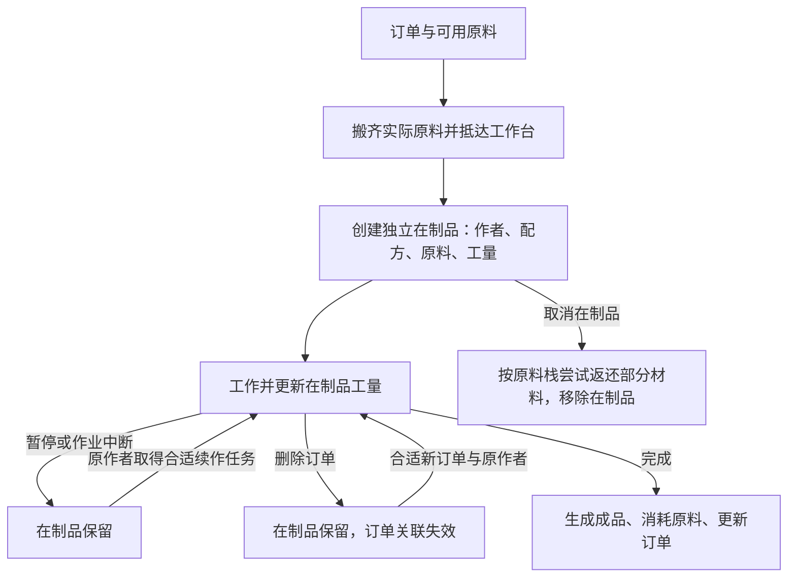

# 122. 独立在制品：原料、作者、续作与存档

本章关注生产机制：工人中断后留下什么、谁能继续、删除订单是否退料、读档后进度属于谁。工量、耐久和损耗比例只保留来源，后续可调。Web 实现及其主动适配见 [123](123-unfinished-production-gameplay.md)。

**在制品（UnfinishedThing，简称 UFT）是独立物品，不是订单里的一个进度字段。** 它保留作者、配方、实际原料对象及剩余工量，可以与订单解除关联。暂停订单、删除订单、取消在制品、完成生产分别有不同结果。

本轮同时纠正 [120](120-production-policies-mechanisms.md) 的一处范围表述：`ClosestUnfinishedThingForBill` **并不要求候选 `BoundBill == null`**。准确说法是“没有自身绑定在制品的订单，搜索合适在制品”，候选可能仍绑定另一订单。详见 UFT06；不能把旧文的“寻找未绑定 UFT”当作原版硬条件。

## 1. 证据边界与复核

| 项目 | 本轮依据 |
|---|---|
| 本地版本 | RimWorld `1.7.4980 rev60` |
| DLL SHA-256 | `eff7d97949f919fb2b151ebfb906e9be749b63410b7dbda78eeebb7972b245c3` |
| MVID | `8e962ecc-7ac7-42d2-8f3b-1b16cd24d2cd` |
| 元数据身份 | [已有 REA managed 记录](evidence/production-bills-rea-managed.json)，metadata coverage complete |
| 静态工具 | ILSpy `11.2.0.10050`；派生 C#，不是原始源码，也不等于实机验证 |
| 新增派生类型 | BillUtility、GenLeaving、StatPart_UnfinishedThingIngredientsMass、StatWorker_MarketValue |
| 复用证据 | food、work、weapons、production-bills、stonecutting、apparel 的匹配哈希派生文件 |
| XML | Core 内 12 个文件的选定节点与显式继承链；没有宣称重建完整已加载 Def 数据库 |
| 实机 | Core + Odyssey；一位作者、一处 crafting spot、一个未完成木棍，基线加 4 个新存档 |

静态记录：[manifest](evidence/unfinished-production-manifest.json)、[16 条机制及配方映射](evidence/unfinished-production-evidence.json)。实机记录：[原始存档投影、42 组回执与 8 张裁剪](evidence/native-unfinished-production-runtime.json)。完整反编译文本、存档及全屏截图保留在忽略目录；公开证据保存哈希、字段和有限裁剪。

从 `experiments/rimworld-like` 运行：

```powershell
pwsh -NoProfile -File scripts/research/extract-unfinished-production.ps1 -Check
pwsh -NoProfile -File scripts/research/collect-unfinished-production-evidence.ps1 -Check
pwsh -NoProfile -File scripts/research/collect-native-unfinished-production-runtime.ps1 -Check
```

三个脚本均不执行目标游戏代码。第三个只读取已经完成的实验，不启动游戏、不输入、不重写存档；`-Check` 还会重生成截图裁剪并比较哈希。REA 的 TargetFramework 字段仅是程序集元数据，不用它推断原版实际运行时。Windows 原版输入和截图由带 PID/profile/前台检查的普通 Win32 helper 完成，不宣称运行了 REA 原生 UI provider。

## 2. 哪些配方产生在制品（UFT01）

`RecipeDef.UsesUnfinishedThing` 取决于 `unfinishedThingDef != null`。`BillUtility.MakeNewBill` 据此选择 `Bill_ProductionWithUft`。装备的自动生成配方会从 ThingDef 的 `recipeMaker.unfinishedThingDef` 复制这一信息；不能仅按“装备/食物”类型猜测。

本轮检查当前 Web 的 13 个装备配方对应的 Core 继承链：

| Web recipe | 原版产品 Def | 原版在制品 Def |
|---|---|---|
| tuque | Apparel_Tuque | UnfinishedApparel |
| parka | Apparel_Parka | UnfinishedApparel |
| duster | Apparel_Duster | UnfinishedApparel |
| shirt | Apparel_BasicShirt | UnfinishedApparel |
| pants | Apparel_Pants | UnfinishedApparel |
| simpleHelmet | Apparel_SimpleHelmet | UnfinishedArmor |
| plateArmor | Apparel_PlateArmor | **UnfinishedMetallicTechArmor** |
| woodClub | MeleeWeapon_Club | UnfinishedWeapon |
| steelKnife | MeleeWeapon_Knife | UnfinishedWeapon |
| steelLongsword | MeleeWeapon_LongSword | UnfinishedWeapon |
| shortBow | Bow_Short | UnfinishedWeapon |
| revolver | Gun_Revolver | UnfinishedGun |
| machinePistol | Gun_MachinePistol | UnfinishedGun |

PlateArmor 有自己的覆盖，不能直接采用 ArmorSmithableBase 的在制品类型。采集器记录每一层的文件/节点哈希、Name、ParentName、字段是否存在及 Inherit 属性；选定链中的局部解析不等同于所有模组补丁生效后的值。

对照检查 `CookMealSimple → CookMealBase`、`ButcherCorpseFlesh`、`Make_StoneBlocksAny → MakeStoneBlocksBase`，这些选定节点及祖先没有 `unfinishedThingDef` 声明。单一石材配方由代码生成，不把 Make_StoneBlocksGranite 写成 XML 中存在的字面节点。

## 3. 实体生命周期（UFT02–UFT05、UFT09–UFT12）



### 3.1 创建时转移的是实际原料

收料和前往工作台之后，JobDriver 才调用 `MakeUnfinishedThingIfNeeded`，接着进入 `DoRecipeWork`。新建流程会从已经放好的材料栈中拆出实际使用数量，清除相应 designation，将原料从地图移除，放入在制品的 `List<Thing> ingredients`。原料不是仍可供第二份订单使用的地面库存。

随后设置作者、订单双向关联、配方、工量以及主材/颜色，在目标工作台格生成 UFT，将它设为 Job 的 targetB 并预留。targetB 已经是 UFT 时跳过创建，避免续作再扣一套原料。

`UnfinishedThing` 继承 `ThingWithComps`；本次检查到的声明没有实现 `IThingHolder`。因此可用“原料封存在独立物品中”描述玩法，但不能据此宣称原版使用了某种通用容器接口。实际保存采用 `LookMode.Deep` 保存原料列表。

### 3.2 剩余工作量跟随物品

工作开始时，已初始化的 UFT 把 `workLeft` 传给新的 JobDriver；工作 interval 把扣减后的剩余量同步回 UFT。初始化 sentinel 是 `-10000`，`Initialized` 判断为 `> -5000`。这些是实现细节，不能暴露为玩家正常进度。

不使用 UFT 的配方在**重新开始工作**时采用完整工作量。但 `JobDriver_DoBill.ExposeData` 也保存 `workLeft`、`billStartTick` 和 `ticksSpentDoingRecipeWork`；**同一个活动任务的存读档，与取消任务后重新派工不是一回事**。不能笼统写成“非 UFT 配方读档一定丢进度”。

### 3.3 暂停、删除、取消、完成必须分开

| 操作 | 已核对的原版行为 |
|---|---|
| 手动暂停订单 | 工作阶段检查 suspended 并失败；UFT 保留 |
| 删除订单 | BillStack 标记并移除订单，普通工作台删除回调为空；UFT 保留配方/作者/原料/工量，关联延迟清理或在保存时清理 |
| 工作台失效或销毁 | 当前作业可因目标/账单失效而失败；无效绑定不等于主动 Cancel UFT |
| 取消在制品 | UFT 自身 Cancel 按钮调用 `Destroy(Cancel)`；逐原料栈以 `RoundRandom(count × 0.75)` 计算返还，尝试放在附近，清空原料、销毁物品并解除绑定 |
| 正常完成 | 取出已有原料列表并消费 UFT；默认 RecipeWorker 用 Vanish 销毁它。随后按原料及主材生成产品、消耗材料并通知订单迭代完成 |
| 普通毁坏 | 不进入 UFT 的 Cancel 返还分支；不能把火烧/打碎当作取消返料 |

取消比例是原版常量，暂不作为 Web 平衡目标。它使用**逐栈随机舍入**，不是对所有原料数量求和后向下取整；附近放置是尝试，也不是任意地图条件下必然成功的保证。

`GenLeaving` 的建筑资源返还排除非 Building，UFT 的 Core 类别为 Item；Vanish/QuestLogic 直接退出通用掉落路径。选定 UFT 及祖先没有声明 killedLeavings。这能解释本次范围内为何不能复用“建筑框架返料”，但不证明任何模组在制品都绝不会产生其自定义掉落。

正常完成会清除订单的 boundUft；复制订单不复制在制品。不能用复制订单复制已投入原料和既有进度。

## 4. 作者、订单与工作台并非同一限制（UFT06–UFT08）

`FinishUftJob` 明确要求工人就是原作者。它可能先安排清理工作台阻挡物，真正续作 Job 则以 UFT 为唯一原料目标、数量为 1，在 Job 初始化时绑定到所选订单，再搬运和继续工作。

| 派工路径 | 主要条件 | 需要避免的误解 |
|---|---|---|
| 订单已经绑定 UFT | BoundWorker 为当前工人，UFT 可达/可预留、未禁止；此分支接触可达检查使用 Danger.Deadly | 不重复执行搜索分支的原料 Def 筛选 |
| 订单没有自己的绑定 UFT | 同配方、同作者、每个原料 Def 都 fixed-or-allowed、可预留、未禁止、可达；从工人位置搜索，范围 9999 | 没有 `BoundBill == null` 条件，也不按账单取原料半径搜索 |
| 两条路径之前 | 订单应执行、工人限制、配方硬性技能等仍需通过 | 有在制品不代表绕过所有工作条件 |

因此，合适的新订单可以选中仍绑定其他订单的同作者在制品；双向 setter 会清理旧关联。这条路径支持在**兼容的另一个工作台**续作，不能把 UFT 永久锁死在创建工作台。完整可执行性仍受工作台配方、工人、预留与寻路等限制；本轮没有跨台实机测试。

指定新工人只改变订单限制，不改 UFT 作者。若 A 的在制品仍绑定该订单，将订单改成只允许 B，外围限制可能挡住 A，而作者限制挡住 B；不能偷偷把作者换成 B 来“修复”。

`BoundWorker` 在作者引用缺失、倒地、被其他阵营托管、已销毁、未生成于地图，或相应工作类型未启用时会清除订单侧指针。UFT 的 `BoundBill` getter 也会清理已删除/失效或反向指针不匹配的关联。这些是解除绑定，不是把旧成果转交给任意工人。作者引用和缓存的作者名字分别保存。

## 5. 地图、查看、物流与数值边界（UFT13–UFT16）

Core UnfinishedBase 可选择、可搬运、使用耐久，有禁止组件。检查面板显示缓存的 Author 与 WorkLeft；选中时可画线指向当前绑定工作台。独立物品应拥有可定位、可选中、可解释状态的入口。

普通自动搬运的一条分支会保护：绑定在工作台第一个当前应执行订单上、且位于该建筑占地扩展 1 格内的 UFT；非建筑 bill giver 也有保护分支。搬开阻挡物时还避免把 UFT 放到其绑定工作台的交互格或占地内。这些是有条件的物流规则，不是“在制品永远不能被搬动”。

| 数值或属性 | 本轮证据与适用边界 |
|---|---|
| 基础耐久 | UnfinishedBase 声明 MaxHitPoints 50；材质/Stat 可以修改最终值，实机木制品显示 32/32 |
| 恶化 | 基类声明 DeteriorationRate 2；本次露天未盖顶木制品面板显示 2/day |
| 基础美观/质量 | Beauty −8、Mass 1 是 XML 基础声明 |
| 原料质量 | Mass 的 `StatPart_UnfinishedThingIngredientsMass` 加上每份原料的 `GetStatValue(Mass) × stackCount` |
| 枪械在制品 | UnfinishedGun 声明 Flammability 0.5，并用 `Inherit="false"` 清除 stuffCategories |
| 市场价值/殖民地财富 | 本轮未闭合原版公式。检查一般 StatWorker_MarketValue 不能推出“UFT 价值等于原料总价值”；Web 如按原料成本估算应标为适配 |

这些数值不是机制完备性的验收标准。应先保证原料不会重复计数，实体身份稳定，暂停/销毁不会误触发退款，进度能被保存，阻塞原因可解释。

## 6. 原版有限实机：暂停 → 续作 → 删单 → 读档

使用 [43 武器制作实验](43-native-weapons-runtime.md) 的 `weapons-crafting.rws` 原始基线，原样复制到独立 profile。源与副本 SHA-256 均为 `6323d1c9c32c5330a7dcb011a36726f689c139642d43d7480641061b4c0d81a2`。历史该次制作使用普通建造/材料流程、God 模式关闭；殖民地继承更早的开发者准备。本轮 devMode 仍开启，但只操作普通 UI，没有生成物品、注入或修改 XML。

读取存档参与观察，故不宣称是纯屏幕实验。固定对象：

| 对象 | 身份 |
|---|---|
| 工作台 | CraftingSpot78052，位置 `(108,0,130)` |
| 在制品 | UnfinishedWeapon78056，Stuff=WoodLog，health=32 |
| 作者 | Human961 / Squint，Crafting 3 |
| 配方与订单 | Make_MeleeWeapon_Club；Bill_ProductionWithUft，loadID=2 |
| 已封存原料 | WoodLog78055 × 40，原料 health=150，despawnedTick=78384 |

### 6.1 暂停不清除进度，恢复使用新 Job

| 状态 | tick | 当前任务 | UFT 剩余工量 |
|---|---:|---|---:|
| 基线 | 79302 | DoBill 59462，已工作 921 ticks | 471.596252 |
| 暂停后 save1 | 79315 | HaulToCell 62948 | **471.596252** |
| 恢复并优先制作后 save2 | 79406 | **新 DoBill 62954**，该次已工作 36 ticks | **457.196106** |

普通 S 按钮暂停订单后，[008](evidence/unfinished-production-runtime/008-suspended.png) 显示 SUSPENDED。150 ms 有限时间脉冲后保存，**save1 的整个 UFT XML 与基线逐字相同**，包括作者、配方、原料、工量、绑定和位置；旧制作任务已变为搬运另一堆木材。

解除暂停，选择原作者并打开 [019 的优先制作菜单](evidence/unfinished-production-runtime/019-resume-menu.png)，本次实际点击命令，再执行 1500 ms 时间脉冲。[021](evidence/unfinished-production-runtime/021-resumed-work.png) 显示 Making club；save2 证明新 Job 62954 的 targetB 仍是 UFT78056，工量降低至 457.196106，原料 ID/数量和整个原料 XML 均未变。这是实际续作，不仅是菜单中出现可执行命令。

UFT 的 spawnedTick 由 78384 变成 79370，身份 ID 保持不变，符合续作搬起/重新放置物品的流程。不能把生成时间变化误读成“重新扣料并创建另一个在制品”。

查看裁剪 [005](evidence/unfinished-production-runtime/005-select-spot.png)、[014](evidence/unfinished-production-runtime/014-uft-retained.png)、[026](evidence/unfinished-production-runtime/026-uft-resumed.png) 都显示 Author: Squint、Work left: 8。**UI 的格式化显示不足以证明这次小幅进度变化，具体减少由存档字段确认。** 005 文件名来自原本点选 crafting spot 的意图，实际选中的是 UFT；006 的再次点击才切到工作台。

### 6.2 删除订单不取消在制品

点击订单垃圾桶后，[029](evidence/unfinished-production-runtime/029-bill-deleted.png) 的队列为空。再运行 150 ms 并保存：

- save3 的 tick 为 79419，工作台 `billStack` 为空。
- UFT78056 仍在同一位置，作者、配方、health、WoodLog78055 × 40 和 workLeft 457.196106 保留。
- UFT 的 `bill` 变为 `null`；没有进入取消在制品的部分退料路径。
- 工人改做 HaulToCell 71314，开始 tick 为 79407。

### 6.3 实际读档回环

[036 存档列表](evidence/unfinished-production-runtime/036-load-dialog.png) 中选择 New Arrivals3，普通 Load 完成后再普通 Save 得到 New Arrivals4：

| 比较项 | save3 → save4 |
|---|---|
| 世界 tick | 79419 → 79420 |
| UFT 完整 OuterXml | **逐字相同** |
| 空 billStack 完整 OuterXml | **逐字相同** |
| 工人 jobs 完整 OuterXml | 不同，搬运 JobDriver 随那 1 tick 推进 |

这验证的是“失去订单绑定的独立在制品”能真实存读档，不能扩大为整世界字节一致，也没有在本轮重新载入 save2 的活动制作任务。

实验保留 001–042 共 42 组输入/截图回执，只有 009/021/030 是有限时间脉冲，时长分别 150/1500/150 ms。它们不是 TPS 测试，比较以实际存档 tick 为准。最后普通 Quit to OS 后，043 的尾随截图因前台守卫失败而没有生成，未虚构截图或动作回执；随后 fresh CIM 确认 PID 30744 不存在且无剩余 RimWorld 进程。既有 4178 Web 预览未停止或替换。

本轮没有实机验证主动取消返料、火焰/战斗/恶化摧毁、更换作者、绑定失效、跨工作台再绑定或筛选策略差异，也没有跑完整成品或完整自主生产。两次活动制作都为 playerForced。上述未覆盖情形只按静态机制或 [123 的 Web 适配](123-unfinished-production-gameplay.md) 记录，不混入实机结论。
