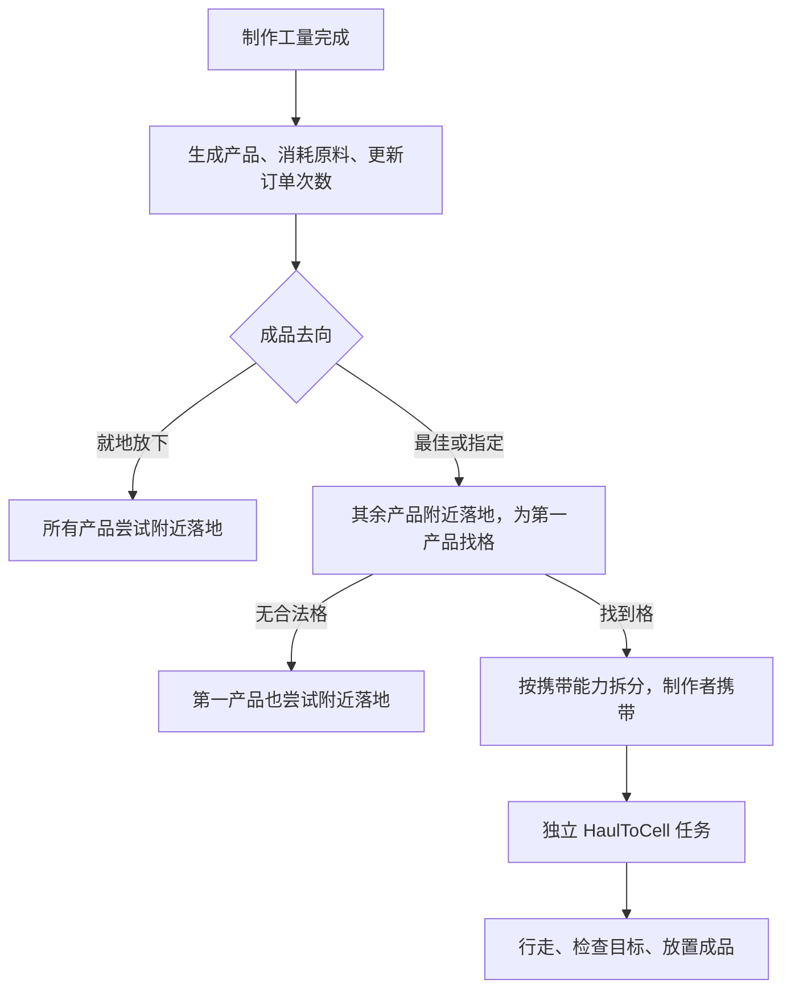

# 124. 生产完成后的去向：落地、仓储与独立送货

本章先闭合玩法机制：产品何时生成，订单何时算完成，谁负责运输，指定仓库失效后如何处理。工量、携带容量和移动速度只记录现有证据，不作为当前平衡目标。Web 实现和主动适配见 [125](125-production-output-gameplay.md)。

**生产结算先于入库。** 原版先生成产品、消耗原料、通知订单完成，再决定就地放下或由制作者搬运。产品已经在人物手里时，这一轮订单已经完成；运输失败不能据此再生产一份。

## 1. 证据与复核

| 项目 | 本轮依据 |
|---|---|
| 本地版本 | RimWorld `1.7.4980 rev60` |
| DLL SHA-256 | `eff7d97949f919fb2b151ebfb906e9be749b63410b7dbda78eeebb7972b245c3` |
| MVID | `8e962ecc-7ac7-42d2-8f3b-1b16cd24d2cd` |
| REA 身份 | [已有 managed 记录](evidence/production-bills-rea-managed.json)，metadata coverage complete |
| 静态来源 | 匹配该 DLL 的已有 ILSpy `11.2.0.10050` 派生文件；本轮没有新增反编译类型 |
| XML | Core `BillStoreModeDefs.xml` 的三个字面定义 |
| 实机 | 单次独立 profile 启动，Core + Odyssey；同一木棍在制品基线的 Best/Drop 对照，Specific 设置与删除回退 |

[静态收据](evidence/production-output-evidence.json) 记录 OUT01–OUT18 的派生类型、manifest、全文与片段哈希、准确行号，以及三个模式的 XML 节点。[实机收据](evidence/native-production-output-runtime.json) 记录原始基线、7 个新存档的字段投影、77 组输入/截图回执和 8 张公开裁剪。

从 `experiments/rimworld-like` 复核：

```powershell
pwsh -NoProfile -File scripts/research/collect-production-output-evidence.ps1 -Check
pwsh -NoProfile -File scripts/research/collect-native-production-output-runtime.ps1 -Check
```

两个采集器只读已存在的源文件、存档和回执，不启动目标游戏、不输入、不修改存档。第二个会在内存重新生成裁剪并核对哈希。完整派生代码、全屏截图及原版存档保留在忽略目录，不在公开仓库分发。

派生 C# 不是原始源码，也不自动构成实机证明。Windows 原版操作采用带 PID、独立 profile 和前台检查的普通 Win32 helper；没有把不支持的 REA 原生 UI provider 说成已运行。读取存档参与观察，因此不是纯屏幕实验。

## 2. 三种策略与结算顺序（OUT01–OUT05）

| 策略 | 生产刚完成后的行为 | 不是哪一种保证 |
|---|---|---|
| `DropOnFloor` | 每个产品尝试放到制作者位置附近，结束制作 Job | 不保证所有地形都放得下，也不保证普通搬运工以后不会搬走 |
| `BestStockpile` | 其余产品先落地；为第一个产品搜索合适仓储，由制作者携带 | 不会把本次所有产物瞬间传入最佳仓库 |
| `SpecificStockpile` | 其余产品先落地；只在指定 ISlotGroup 内为第一个产品寻找初始目的格 | 不保证途中或最终放置的所有失败分支都永远局限于该组 |

新 `Bill_Production` 默认 BestStockpile。模式、输出目的组 `storeGroup`、库存统计范围 `includeGroup` 是独立字段。指定输出仓库不会把它顺带改成原料来源、指定工人或库存计数范围。



`Toils_Recipe.FinishRecipeAndStartStoringProduct` 的顺序是：取得原料 → 生成产品列表 → 消耗原料 → `Notify_IterationCompleted` → 记录完成 → 输出分支。RepeatCount 在通知中减一，送达不再减一次。使用在制品的配方在这一流程中消费 UFT 并清除绑定，详见 [122](122-unfinished-production-mechanisms.md)。运输失败不回滚已完成的原料消耗。

### 2.1 “第一产品”是一个实际 Thing

普通产品按配方 `products` 顺序生成；特殊产物例程也可能返回多个 Thing。Best/Specific 对列表 `list[1..]` 一律尝试在制作者附近放下，只对 `list[0]` 寻找目的地。它不是“最值钱的产品”，也不是“把第一种资源的全部堆栈一起搬走”。

生成的 Thing 可以暂时包含超过普通栈上限的数量；随后拆分和放置处理堆栈。找到仓位后，原版按人物的 `MaxStackSpaceEver` 拆下第一产品超出的部分并附近落地，其值取产品栈上限与 `RoundToInt(CarryingCapacity / VolumePerUnit)` 的较小值。容量为零则结束；容量非零则尝试携带并启动运输。

这一步不先把携带量限制为“目标单格当前空位”。目的地放不下的剩余部分交给后续放置逻辑处理。多产物、超大栈和零容量在本轮只完成静态核对，没有原版实机矩阵。

### 2.2 制作者送货与普通搬运分工

制作收尾直接创建 `HaulToCellStorageJob`，并通过 `keepCarryingThingOverride=true` 切换任务。该路径没有先询问普通 Haul 分工的优先级。因此关闭搬运工作，不会阻止本次已完成产品的直接交接；本轮实机对此有正面证据。

这不等于无视全部人物能力：携带容量仍生效，`TryStartCarry` 也拒绝死亡或倒地等情况。工作优先级为零与身体不能携带不是同一个条件。

## 3. 找目的地：最佳与指定并不完全共用规则（OUT06–OUT09）

| 层次 | 已核对条件 |
|---|---|
| Best 外层 | 按储存优先级遍历已注册 SlotGroup；优先级高于 Unstored，且不能低于已找到结果；Thing 类型父对象的阵营匹配，HaulDestinationEnabled 为真 |
| Specific 外层 | 直接把选定 ISlotGroup 交给组内搜索；**不经过 Best 的上述外层循环** |
| 共同组内检查 | 引用非空，设置接纳实际产品 Thing，再检查实际成员格 |
| 可用成员格 | 容量及堆叠阻挡、禁止、目的地预留、静态火焰、施工阻挡与人物可达性等 |

实际产品筛选可以考虑品质、耐久和材料等信息。UI 中出现目的地只说明它在选择范围内，不证明这一刻有空位、路径畅通或接受这件具体成品。

原版组内用水平距离平方比较候选，并允许在扫描一小段随机比例后提前结束。它不保证全图最近，也不保证按实际寻路成本最短。Web 如按路径成本选择，应记录为选择算法的适配。

生产用的是 **store-cell/slot-group** 搜索，不是能够接纳其他非格子容器的所有存储目的地通用搜索，不能由 StoreUtility 存在其他接口推断生产已支持全部容器。

首次选择目标失败时：

- Best 没有合法仓位：第一产品也尝试附近落地，制作结束。
- Specific 引用有效，但满仓、拒收或不可达：第一产品附近落地；**不会在这一分支自动改搜 Best**，订单的指定策略保留。
- Specific 引用在设置校验时失效：清空该引用并回退 DropOnFloor。引用失效与暂时无格是不同事件。

## 4. 运输开始后的失败与中断（OUT10–OUT12）

运输 Job 指向实际产品和目标格，不保留制作账单指针。修改或删除订单不会通过“这个 Job 属于该 Bill”的关联取消已生成货物；更不能把现有货物当成尚未完成的配方再结算。

新运输 Job 的 `count` 按目标组容量等信息计算，可能与人物手里的实际栈数不同。本轮 Job.count 为 **4**，实际携带木棍只有 **1**。库存与物资账本应读取物品，不读取 Job 的计划量当作已有资源。

原版将 `haulOpportunisticDuplicates=true`，保留顺带搬运同类物资的机会。当前已经携带 targetA 时，JobDriver 可以跳过重新拾取；随后执行搬运、最小任务时长检查和放置。

| 失败发生点 | 原版已核对路径 | 设计上必须保持的区分 |
|---|---|---|
| 生产收尾还未选到格 | 附近落地，制作成功结束 | 不是中断未完成品，也不是等待订单重新生产 |
| 运输途中目标不再有效 | 搬运 Toil 检查 `IsValidStorageFor` 等并可失败 | 清理 Job 释放预留；是否落下携带物由任务清理规则与 override 决定 |
| 最终 Direct 放置失败或未放完 | 可再找 Best 仓位，之后尝试搬到旁边；默认并不强制留在最初 Specific 组 | 不能把初始 Specific 搜索范围扩展成所有余量处理的永久约束 |
| 极端无处可放 | 原版该分支记录 warning 并销毁仍携带物 | Web 保留 cargo 等待落地属于主动适配 |

`Pawn_JobTracker.CleanupCurrentJob` 清除目的地、一般及物理交互预留，并按条件把携带物放在附近；`carryThingAfterJob` 或明确 override 可以保留携带物。生产转送货明确使用保留 override。

本轮没有实机注入“半路删除仓库”“放置途中占满”“征召中断”等情形。以上来自匹配哈希的静态分支；Web 应分别验证自己的预留、cargo 守恒及中断恢复。

## 5. 仓库身份、UI 与卸下货架（OUT13–OUT15、OUT17）

RimWorld 1.7 使用 `ISlotGroup`：地面储存区、单个储存建筑的 SlotGroup、联动 StorageGroup 不是完全相同的引用。保存时使用可加载引用，或保存 SlotGroup 的父对象，再解析回组。

输出菜单会按注册的 SlotGroup 收集目标，联动组去重；未联动的储存建筑还受是否实现可命名接口的菜单条件约束。不能简单概括为每个储存建筑都一定独立出现在列表里。

`CanPossiblyStore` 仅对可计数配方检查第一产品 **Def** 能否被接纳；不可计数配方直接返回 true。不兼容目标的选项没有可执行 action；已经选定、后来变得不兼容的目标会显示 `(incompatible)`，不会仅因此执行删除式回退。本轮普通 UI 中，只有 WoodLog 的旧储存区确实显示不兼容，见 [053](evidence/production-output-runtime/053-output-options-held.png)。

### 5.1 不同引用的有效性

| 引用 | ValidateSettings 核对什么 | 临时没有可用格 |
|---|---|---|
| 地面储存区 | 对应 zone 是否仍属于地图 zone manager | 过滤或满仓不等于删除区域 |
| 单个储存建筑 | 其 slotGroup 是否仍在地图 haul destination manager 中 | 卸下导致移出该注册表时，引用会在校验中失效 |
| 联动储存组 | 组是否仍在 storage group manager 中 | **没有检查“至少存在一格”**；身份仍在而全部成员收起时，可保留指定组 |

卸下先通过 MinifyUtility 让建筑 DeSpawn；Thing.DeSpawn 解除 haul destination 注册。Building_Storage.DeSpawn 清理缓存，但不移除联动成员；Destroy 才执行移除成员。未 Spawn 的建筑 `AllSlotCells` 为空，联动组的 CellsList 聚合成员格。

所以，**仍注册且仅有 packed 货架成员的联动组，引用可以有效但成员格为空**。首次输出搜索失败后附近落地，不应只因没有 physical cells 就重置策略。单独指定一座已卸下货架则适用另一条注册检查。销毁或真正移除成员还可能导致联动组解散。

这一结论是多个匹配静态路径的组合（OUT17），本轮没有新增原版卸下货架实验。不能把它写成现场观察。

### 5.2 保存与复制

`storeMode`、`storeGroup`、`includeGroup` 各自保存；缺少模式时原版回退 BestStockpile。复制订单复制模式和组引用，不复制一座新仓库。改变名字与改变实体引用必须分开处理，Web 的区域身份实现见 [125](125-production-output-gameplay.md)。

## 6. 库存计数和运输存档（OUT16、OUT18）

“做到 N 件”读取的是独立 `includeGroup`。没有指定计数组时，原版存在资源计数、地图、携带物、其他 haul source 等分支；指定计数组时则从该组 HeldThings 计数，并受其他计数选项影响。携带物计数与某些 List 计数重载采用不同的累加方式，不能把一处公式套用到所有路径。已有数量策略见 [118](118-production-bills-mechanisms.md)。

设计上，**成品在运输中但尚未到计数区域**与“订单没完成”必须分开。送达后库存更新可以让下一次调度停止，不应再次减制作次数或再次消耗原料。

运输存档也不只保存去向选项。`Pawn_JobTracker` 深度保存当前 Job、Driver 和队列，载入时恢复 Driver 的人物/Job 关联；`Pawn_CarryTracker` 则独立深度保存携带容器。真正的续送需要同时保留产品身份、数量、Job 目标与进度，不能靠模式字段存在就宣称恢复成功。

## 7. 有限原版实机：同基线的 Best/Drop 对照

继承 [122](122-unfinished-production-mechanisms.md) 的实际续作 Save2，原样复制为独立 profile 的 `ProductionOutputBaseline.rws`。源与副本 SHA-256 均为 `40f642539f3036f525f75496d20ff425dfcbe1cf94ec6a7636e405492d716afa`。

历史殖民地继承较早的开发者准备，43 章制作流程采用普通 UI、God 模式关闭。本轮 profile 的 devMode 仍开启，但没有生成物品、注入代码、改写 XML 或使用开发者命令；全程为普通 UI，读取存档仅用于核对。

### 7.1 共同准备

- 制作者 Squint / Human961，CraftingSpot78052 位于 `(108,0,130)`。
- 在制品 UnfinishedWeapon78056，原料仍为 WoodLog78055 × 40。
- 普通 Work 页面关闭 Squint 的 Haul；[007 裁剪](evidence/production-output-runtime/007-haul-disabled.png) 中三位殖民者的 Haul 均为空。
- 普通拖动创建四格 Stockpile zone 2，实际 ID=3，Normal，接纳木棍；旧 zone0 仅接纳木材。
- 准备后的 Save1 tick=80254，在制品剩余工量 `117.834442`，订单 RepeatCount=1，BestStockpile。

存档 priorities 数组只有从零计数的第 17 槽从 3 改成 0；这里以 UI 的 Haul 列和同 profile 前后变化共同核对，不把这个数组槽号宣称为所有版本通用 WorkTypeDef 编号。

### 7.2 完工、携带、读档、送达

| 阶段 | tick | 订单 | 实际产品与任务 |
|---|---:|---|---|
| Save1 准备 | 80254 | Best，剩余 1 次，绑定 UFT | 继续制作同一未完成木棍 |
| Save2 正在送货 | 80643 | 剩余 0 次，boundUft=null | 携带 Club149571 × 1，HaulToCell71537 → `(126,0,134)` |
| Load Save2 后再 Save3 | 80644 | 与 Save2 的完整 billStack XML 相同 | carryTracker 与 curJob XML 逐字相同；Driver 随 1 tick 推进 |
| Save4 已送达 | 81502 | 仍为 0 次 | 同一 Club149571 × 1 在 `(126,0,134)`，carry 为空 |

[025 携带面板](evidence/production-output-runtime/025-best-carrying.png) 明确显示 `Carrying: Wooden club`、`Hauling wooden club to Stockpile zone 2`；[035 读档后面板](evidence/production-output-runtime/035-carrying-restored.png) 保留这一状态。

Save2 的运输 Job 开始 tick=80550，`bill=null`，没有 playerForced 或 workGiverDef；它的 `count=4`，实际携带栈只有 1。此前制作 Job 是从旧基线继承的 playerForced DoBill，不能由这一个例子宣称全套自主派工已覆盖。

Save4 的成品位置是 zone3 的成员格；[042 成品检查](evidence/production-output-runtime/042-delivered-product.png) 显示 Wooden club。正面存档字段证明同一物品真实送达，没有用“动画走到附近”替代入库证据。

### 7.3 从共同 Save1 分支改为 Drop

通过普通 Load 重新载入 Save1，再在完工前把模式改为 DropOnFloor。推进后，[056 订单面板](evidence/production-output-runtime/056-drop-completed.png) 显示 0x。

Save5 tick=80970：新分支成品 Club185324 × 1 留在 `(108,0,129)`，即原作者的制作交互格；carry 为空，订单 repeatCount 省略而按序列化默认值解释为 0，绑定已清空。它没有被送往远处 zone3。

两条分支在同一次游戏进程中从同一已保存状态开始，成品 ID 不同是两个独立制作结果；没有宣称随机状态和所有全局 ID 计数器会跨载入完全一致。

### 7.4 Specific 只验证设置和删除，不冒充第三次生产

在 Drop 已完成、游戏暂停时，设置 Specific 到 zone3：

| 存档 | tick | storeMode | storeGroup | includeGroup |
|---|---:|---|---|---|
| Save6 | 80970 | SpecificStockpile | Zone_3 | null |
| 普通删除 zone3 后 Save7 | 80970 | DropOnFloor | null | null |

[063 设置面板](evidence/production-output-runtime/063-specific-selected.png) 显示 `Take to Stockpile zone 2`；普通 Delete 后重新打开，[073](evidence/production-output-runtime/073-details-after-delete.png) 显示 `Drop on floor`。两次保存间没有模拟推进，也没有再做一份产品。这仅验证引用保存、独立计数范围及删除回退，不能写成已经跑过 Specific 的完整生产运输。

### 7.5 失败尝试、退出与范围

001–077 保留完整回执，包含没有达到预期的尝试：019/020 的键盘脉冲没有建立“已完成”的证据，022 仍能查看在制品剩余工量；039 文件名虽然为 delivered，但当时主菜单仍开着，实际送达来自关闭菜单后的 041。文件名只是操作意图，结论依据可见状态与存档。

八个有界时间脉冲不是 TPS 性能测试。最终普通 Quit to OS 的 078 输入后窗口退出，尾随截图因前台检查失败，没有虚构 078 截图或动作回执。`2026-11-04T12:21:37.4855671Z` 的 fresh CIM 确认 PID 18100 不存在，RimWorld.exe 列表为空。本轮没有停止或替换既有 Web 预览。

本轮未解码整张压缩 Thing map，也不用“原始 XML 搜索不到”直接证明物品绝对不存在。完成结论依赖实际成品、携带容器、Job 及订单字段的正面证据。满仓、筛选更改、不可达、途中删除、人物中断、多产物、超容量和 packed 货架分支均未增加原版实机案例；相应机制按静态证据保留，Web 的可执行验证在 [125](125-production-output-gameplay.md)。

当前机制验收重点是：产品只生成一次、原料只消耗一次、运输不重新结算订单、cargo 与仓储不重复记账、目的地引用和计数范围独立、无位时有解释与守恒处理、途中存档可恢复。数值校准可以在这些行为稳定后逐步进行。
