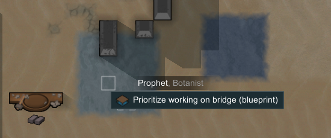
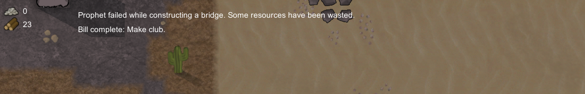
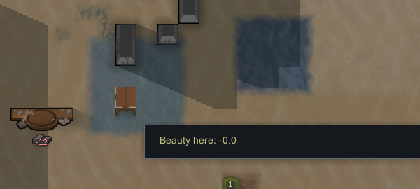
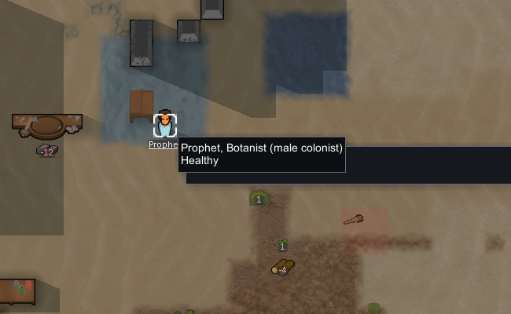
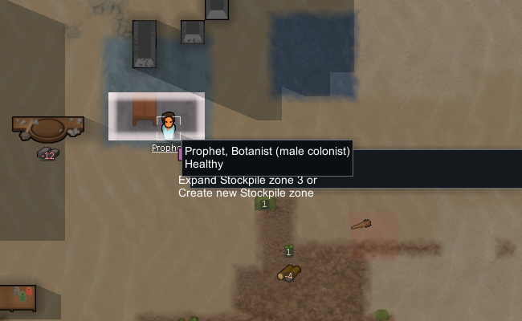
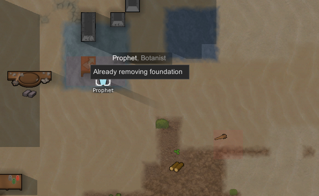
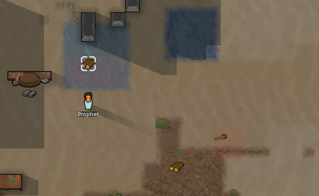
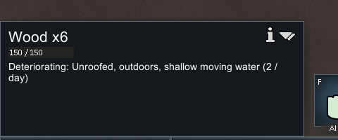

# 原版实机：浅水施工、仓储与拆桥

更新：2026-11-04。实机使用 RimWorld **1.7.4980 rev60，Core + Odyssey**。结果支持“桥保留下方水、浅水可涉水/仓储、普通拆桥恢复水并留下实物”的机制闭环，不把数值拟合作为本轮目标。静态规则见 [126](126-river-bridge-mechanisms.md)，Web 适配见 [127](127-river-bridge-gameplay.md)。

## 隔离与准备

本次只启动一个原版进程 **PID 32188**，保存目录是忽略路径 `.local-research/runtime/profile-river-bridge-20261104`。从此前生产输出实验的已准备营地复制原样 baseline，SHA-256 为 `ab629e9b0d24252991f47d2c57149ad29c8152db24b1c004b5659a74862620cd`；继承此前开发者准备状态。

**场地准备使用了开发者菜单 Set terrain (rect)**：把营地旁两小块分别设置为 WaterMovingShallow、WaterDeep。God mode 保持关闭，没有注入代码、写存档 XML、生成额外试验材料或操作用户正常存档。准备完成后的桥规划、优先施工、征召移动、仓储拖拽、拆桥和保存均通过普通 UI。

工具使用限定进程和 profile 的 Win32 输入/截图，配合只读原生 save XML 和静态证据，所以这不是纯看屏幕实验，也不是 REA runtime capture 的结果。开发者 rectangle 需要两次点击；最初拖拽只选中了起点，随后通过第二次点击完成。IME、菜单和镜头边缘滚动的尝试保留在原始台账中。

## 实际结果

| 阶段 | tick | 原生保存中的结果 |
|---|---:|---|
| 复制 baseline | 80254 | 尚未进行本次水域准备 |
| New Arrivals1 | 80255 | 水域准备完成，没有桥 foundation |
| New Arrivals2 | 84585 | 普通搬料、施工后，在 `(117,0,139)` 完成唯一一格桥 |
| New Arrivals3 | 85370 | Prophet 站在浅水 `(118,0,138)`；新 stockpile zone 4 共 8 格，含桥格 |
| New Arrivals4 | 85982 | 普通拆桥完成；foundation 为空；原桥格留下 WoodLog185345 ×6，health 150 |

深水的普通 Bridge 规划被拒绝，提示 `Bridge requires terrain that supports: Bridgeable`。


浅水接受蓝图，人物的普通右键菜单提供优先施工。过程中确实发生一次施工失败并浪费资源，随后继续搬木料完成桥。因此不能把这一段说成只花了 12 木材，也不能把请求的加速秒数当成原版精确工时。







征召后，Prophet 实际走到浅水。普通仓储拖拽产生 zone 4；八个 cell 的底层均是准备的浅水，其中七个未盖桥。





普通 Remove foundation 成功标记桥；解除征召后人物已自动选取该工作，右键显示 `Already removing foundation`。短暂运行后桥消失，木材实物留在水上。







信息栏中的 `2/day` 是当时计算的 deterioration 提示，未等待一天测量损伤；save 中 health 仍为 150。

## 地层与实物证据

按已留存的 MapExposeUtility / MapSerializeUtility 格式，只读解码 `topGridDeflate`、`underGridDeflate`、`foundationGridDeflate`：raw Deflate、little-endian ushort、250×250、每层 125000 字节，索引 `x + z*250`。

在同一 `(117,0,139)`：

| 状态 | top shortHash | under | foundation |
|---|---:|---:|---:|
| 准备后 | 26324 | 0 | 0 |
| 桥完工 | 26324 | 0 | 6727 |
| 仓储完成 | 26324 | 0 | 6727 |
| 拆桥完成 | 26324 | 0 | 0 |

四个阶段的**完整 topGrid 和 underGrid 解码哈希一致**，不只是单格数值相等。桥完工和仓储完成各只有一格非零 foundation；拆桥后完全为零。26324/6727 的身份来自可见场地准备、桥施工和同格变化，不声称是跨版本/mod 的通用 Def 编码。

zone 4 覆盖 `(116..119,0,138..139)` 共 8 格。拆桥后原生 raw Thing 正向记录 `WoodLog185345`、`stackCount=6`、`pos=(117,0,139)`、`spawnedTick=85684`，与截图一致。这证明该次拆除实际留下散货，不需要通过“全存档没有某对象”来推断结果。

## 明确未覆盖的边界

- 水域是开发者准备，本次没有验证自然河流生成、地表高度关系或流体流动。
- `052-deep-walk-rejected.png` 的文件名不准确：右键深水实际给出了附近可通行格 `(126,0,141)` 的 Goto。没有得到显式红字拒绝，也没有证明人物走入深水。
- 墙菜单尝试期间发生边缘滚屏，未完成木/石墙或机器承载的实机矩阵；这些仍属 126 静态证据。
- 没有完成建桥后的原版读档往返、桥毁坏坍塌、重型桥、物品漂流、长时间腐坏、洪水或冲刷试验。
- 78 份已完成输入/截图回执记录的是输入意图；实际 simulation 时间以存档 tick 为准。它们不是 TPS 性能测量。

## 退出与复核

最后通过普通主菜单 **Quit to OS** 退出。第 079 次退出点击后游戏窗口关闭，尾随截图的前台检查失败，因此没有虚构 079 截图或输入回执。`2026-11-04T13:31:42.1985391Z` 的新 CIM 查询确认 **PID 32188 不存在，RimWorld 进程列表为空**。未终止其他窗口、服务或浏览器预览。

[机器可读记录](evidence/river-bridge-native-runtime.json) 包含 baseline +4 份原生保存的哈希和有限投影、9 张裁剪图的源图/裁剪哈希、78 份输入/截图台账及正常退出记录。完整截图和存档留在忽略目录；公开裁剪排除了账户和无关通知。

```powershell
pwsh -NoProfile -File scripts/research/collect-native-river-bridge-runtime.ps1 -Check
```

此命令只复读文件，不启动或控制游戏；验证基础层变化、完整底层一致、浅水区域、人物位置与拆除实物，并逐一比对证据记录。
