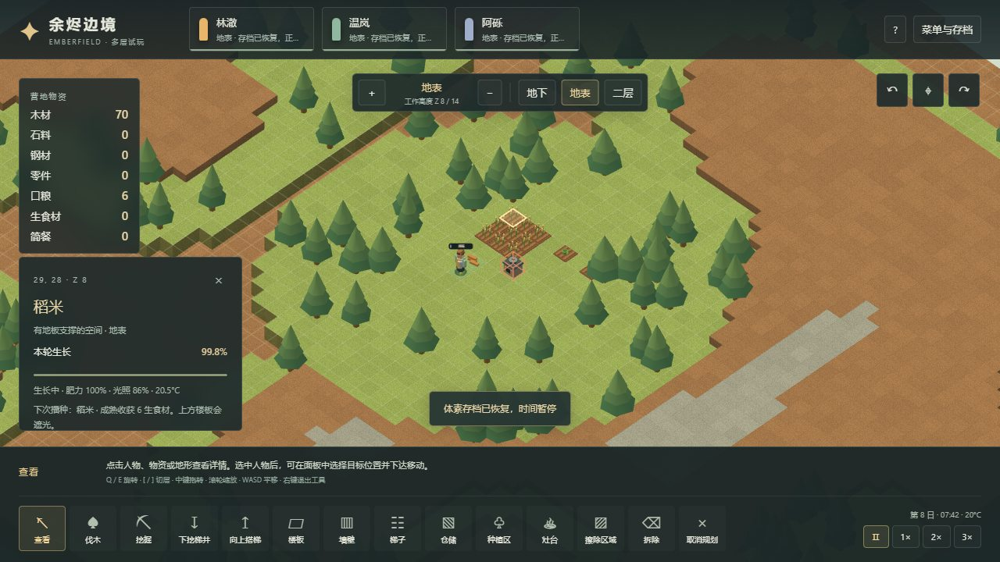
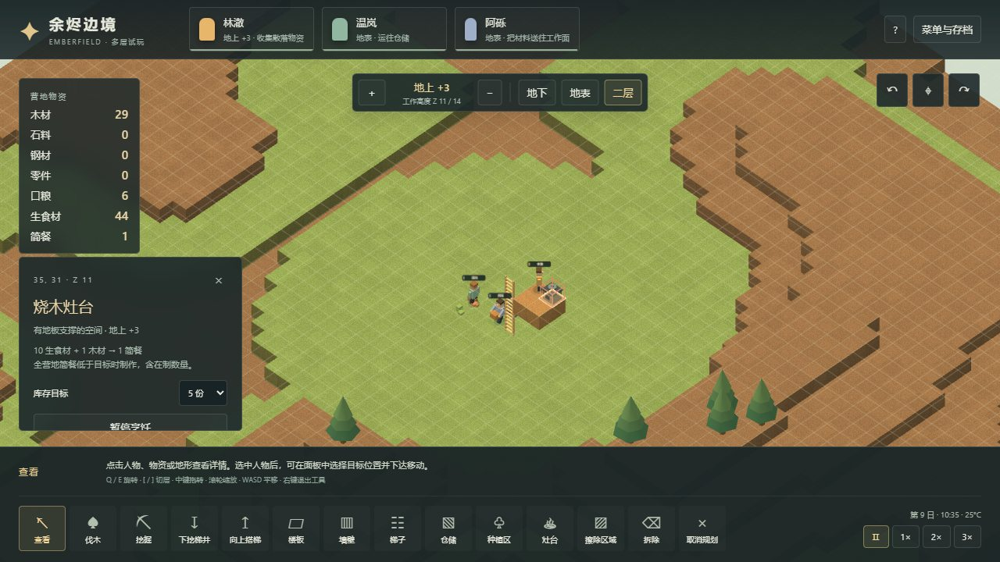

# 13 体素营地的食物循环：实现与验收

入口：[多层体素试玩](https://sqchenxiyuan.github.io/emberfield-web/?world=voxel)。本轮在11章施工与物流基础上补齐种植、收获、搬运、烹饪和进食；原版字段与推导见[12食物规则](12-farming-cooking-food.md)。本章的模拟/浏览器结果属于 Emberfield，不能当成 RimWorld 实机数值结果。

## 怎么操作

1. 在地表选择「种植区」，选择稻米、土豆或玉米，拖动划田。需要土壤支撑和两格净空，不能与仓储重叠；单次最多128格，总种植区最多512格。
2. 点击田地可见生长百分比、肥力、光照、温度和暂停原因。改作物在下一次播种生效；「擦除区域」会清除作物，没有收成。
3. 建「灶台」（20木材）。点击灶台选择简餐库存目标，默认10份；可暂停/恢复。工人会实际搬来生食材与木材，做完后生成餐食物堆。
4. 三人营地建议110–128格稻米，并继续伐木补燃料。常速1日10分钟，稻米首收约8日，可使用3倍速。初始60份口粮是首轮生产的缓冲，不是永久产粮。

楼上楼板、岩层等会遮住下面植物的天空。切换显示层只改变画面，不能让地下田凭空获得阳光。灶台是实际占位的设施，人物从相邻工作面操作；食材和燃料可以沿真实梯子跨层搬运。

## 数值及明确简化

| 项目 | 本轮实现 | 来源/边界 |
|---|---|---|
| 稻米/土豆/玉米 | 累计满速生长3/5.8/11.3日；成熟产6/11/22份生食材 | 参考Core声明；收获合并为同一 `grain` 资源，尚未区分原料种类和品质 |
| 生长 | 土壤肥力1，光照0.51到1线性，温度0/6/42/58分段，6–19.2时允许生长 | 因子与休眠参考原版；地图没有贫瘠/肥沃土壤变种、季节或天气 |
| 天光 | 6–18时 `min(1, 2*sin((hour-6)*π/12))`，垂直整列有挡则0 | 自定饱和天光；没有复刻原版纬度/季节/天气天文模型，也无人工生长灯 |
| 环境温度 | 每日按正弦在14–28°C变化 | 全图自定天气值，不是房间或地下温度模拟 |
| 工作量 | 播种57、成熟收获67、烹饪100 tick | 从170/200/300按20/60近似换算工作秒；不含路途、取料和等待 |
| 烹饪 | 10生食材 + 1木材 → 1简餐，单份工作5秒 | 原料营养0.5→餐食0.9参考原版；每餐1木材为本项目设计，没有燃料槽 |
| 饱食 | 普通成人每日基础消耗1.6营养；低于30%找食物，24%以下消耗×0.5，12%以下×0.25，0时消耗0 | 阈值/倍率参考原版；本轮没有饥荒伤害、死亡或心情，0消耗不代表原版可无食物生存 |
| 进食 | 随身食品可直接吃；寻找时优先简餐、口粮、再生食材；整份餐食消耗，超过100%的营养截掉 | 无进食劳动时间、用餐位置、厌恶生食、食物中毒或腐坏 |
| 自动收获 | 生长达到1时派工，成功后按固定产量落地，再自动补种 | 未实现原版0.999成熟边界、提前采收、植株HP、采收失败和技能产量修正 |

天长保持12000 tick，作物时长按**游戏日**映射；劳动按**现实秒**近似映射。二者有意采用不同换算，不宣称20 TPS数值与原版60 TPS逐tick等价。

## 物资、预定与存档

所有食物都存在于物堆、人物携带或工作面已送材料中。库存只是汇总，不另造一份全局食物。任务成本和已送材料现为按资源分类的数量表，烹饪能同时持有原料与燃料。工人到达物堆才领取，分配和领取在同一权威线程中依次执行。

建造完工如果会封住散落物，会把物堆顶到同层相邻的合法空位并合并同类资源；没有邻近空位则等待清理，不消耗材料，也不远距转移到仓储。这是本项目明确的施工处理规则，防止收获物先落在蓝图格上、随后被灶台或墙封在内部。

灶台目标按全营地简餐存量计算，已排队的产出也计入，避免多个灶台各自补满相同库存。暂停账单会取消该灶台未完成烹饪并退还已送物资；携带物仍在人物手中，随后搬回。饥饿可中断普通工作，已送原料与进度保留；路径和任务拥有者释放，不能把中断当作产出。

体素存档升为v2，保存种植区、植株、灶台、营养和分类材料。导入旧v1时保留地形、物资、人物及施工进度，将数字木材成本转为分类表，再补齐新增字段。导入重新建立路径与任务预定；验证失败不会替换当前世界。二维存档格式未改变。

实现入口：[world.ts](../../../src/voxel/world.ts)、[farming.ts](../../../src/voxel/farming.ts)、[renderer.ts](../../../src/voxel/renderer.ts)、[main.tsx](../../../src/voxel/main.tsx)。空闲人物在没有可做任务、散落物流或饥饿需求时跳过整图寻路；作物天空遮挡缓存会随地形/树木/设施变化失效，避免漫长生长期每tick反复遍历天柱。

## 可复现流程

```powershell
npm test
npm run test:voxel:food
npm run research:check
npm run build
# 另开终端运行 npm run preview
$env:VOXEL_TEST_URL='http://127.0.0.1:4178/?world=voxel'
npm run test:voxel:food:browser
npm run test:voxel:browser
npm run test:voxel:lifecycle
```

种子73129的正常命令流程只使用 `command/step/save/load`，不改tick、不灌物资、不注入成熟植株、不修改地形或传送人物。120格稻米在tick96129（第8.01075日）第一次收获，至第16.8704日完成两轮收成、重新播种第三轮且所有物资入库；另有一株土豆用于验证更换播种类型。全程最低饱食29.3733%，没有依靠低于24%的饥饿减耗延长库存。

结束时收成累计1451份生食材、烹饪62份简餐，已吃56餐，余口粮3、简餐6、生食材819、木材89，全部在仓储；三棵树提供81木材。每tick检查各资源 `现有+已消耗=初始+已生产`、人物合法站立和任务独占。食物**名义营养**另外把每次烹饪的+0.4计入产出，并区分吃下的营养和饱食上限溢出；不能误称物理热量守恒。生长中、烹饪中保存并回读后继续完成。

这证明该种子、120格田与补木安排下的两轮食物循环，不证明所有地块大小、种子或无限期生存。原始可复现报告在忽略目录 `test-results/voxel-food-campaign/`。浏览器验收使用实际鼠标/DOM与只读投影/状态诊断；为避免等待80分钟，临近成熟场景从正常命令及headless时间推进产生，再经实际存档导入。不能把这些场景描述成全程实时游玩或纯截图黑盒测试。

本轮共68项单测通过，其中17项为食物规则/空间占位/预定中断/存档边界。正式构建通过11组食物浏览器检查（包含真实携粮经过Z9梯井并在Z11做饭），以及此前13组施工流程回归。六次同页新开/回读空营地后，几何数量27、纹理4、chunk16和地形缓冲2,067,248字节均回到基线。这些计数不包含整个页面、GPU驱动、全部Worker或长期农业缓存，不能据此声称大地图内存已验证。

公开[本轮验收记录](evidence/voxel-food-validation.json)绑定生产源文件和实际加载的构建资产SHA-256，并记录脚本适用范围和截图。可在上述报告齐备后运行 `node scripts/research/record-voxel-food-validation.mjs` 重新生成。11章旧记录保留为施工切片的历史证据。





## 尚未完成

床与作息、食物腐坏与冷藏、季节与天气、农业技能和疾病、房间温度、电网、健康战斗仍未迁入体素入口。大地图、大人口和长期内存压力仍需单独验收。源码研究和独立规则算例不能替代这些功能。
