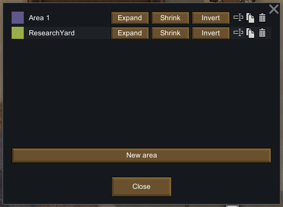
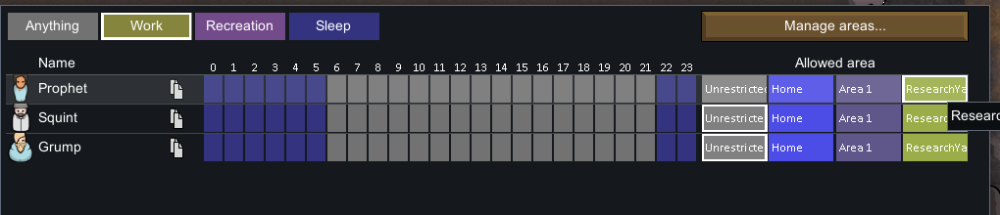
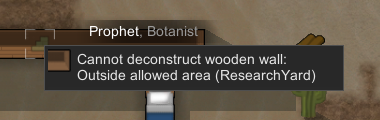
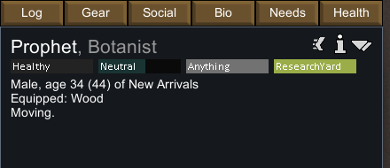
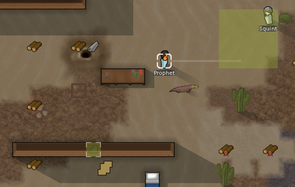
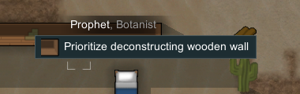
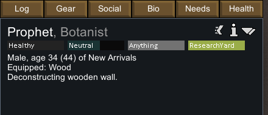
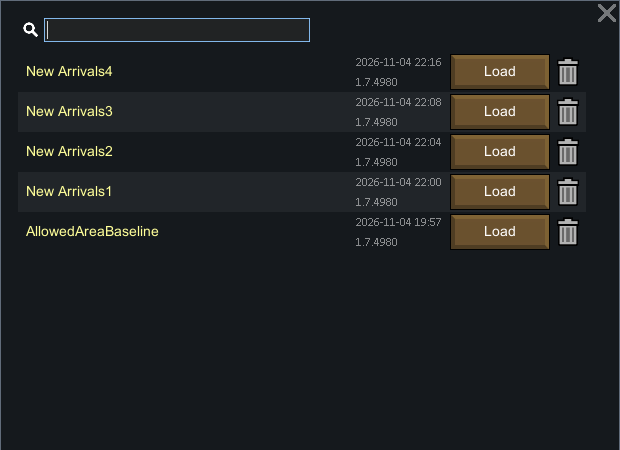

# 原版实机：允许区域、区外装备与相邻作业

更新：2026-11-04。RimWorld **1.7.4980 rev60，Core + Odyssey**。本轮通过普通 UI 完成创建、命名、绘制、居民分配、区外返区、工作拒绝、区域扩展、区外站位工作、原版保存/读取和读档后完成作业。静态机制见 [129](129-allowed-area-mechanisms.md)。

## 隔离与可复核边界

独立进程 **PID 31408**；profile 为忽略路径 `.local-research/runtime/profile-allowed-area-20261104`。从此前实验复制原样营地 `AllowedAreaBaseline.rws`，SHA-256 `ab629e9b0d24252991f47d2c57149ad29c8152db24b1c004b5659a74862620cd`。它继承先前开发者准备的营地，本轮未新增开发者地形、物品、技能或属性准备，未注入代码、改存档 XML 或操作用户正常保存。

使用限定 PID/profile 的 Win32 前台输入与截图，并只读原生 save XML，因此不是纯看屏幕实验，也不是 REA runtime capture 的结果。原始截图含账户/通知的部分不公开；入库图片为无缩放局部裁剪。UI 输入回执记录尝试，实际状态以截图与保存互证。

## 实际经过

1. Schedule → Manage areas 创建第二个区域，通过 Rename 命名 **ResearchYard**，Expand 拖出 4×4 区域，再分配给 Prophet。所有操作发生在暂停状态；第一次保存居民仍在区外。
2. 运行后 Prophet 自动到达允许区内，进入 Wait_Wander。未做征召、瞬移或存档位置修改。
3. 将营地木墙标为拆除。Prophet 右键这面区外墙时，菜单明确拒绝 `Outside allowed area (ResearchYard)`。
4. 同一居民右键区外木堆，**Equip wood** 可选；实际执行后装备 WoodLog185325，仍未征召，区域分配仍为 ResearchYard。保存 3 时已处区外并正在 Goto 返回。
5. Expand **单击仅把木墙格 `(109,0,126)` 加入允许区**，区域从 16 变为 17 格。原有 4×4 与这一个墙格不相连。右键同一墙变为 `Prioritize deconstructing wooden wall`；人物实际站在区外 `(110,0,127)` 拆墙。
6. 保存 4 后，经普通 Load game 读取该保存，另存保存 5。区域、居民分配、工作目标和 workLeft 保留；读档保存 tick 增加 1。之后运行完成拆墙，保存 6 中墙已消失，人物站在现在开放的原墙格。

















## 原生保存的正向证据

| 保存 | tick | 允许格数 | Prophet 坐标 | 当前作业 | 关键结果 |
|---|---:|---:|---|---|---|
| New Arrivals1 | 80255 | 16 | `(105,0,131)` | Wait_Wander | 已分配区域，仍在区外 |
| New Arrivals2 | 81041 | 16 | `(118,0,133)` | Wait_Wander | 自主返回区内 |
| New Arrivals3 | 81420 | 16 | `(114,0,132)` | Goto | 区外持有已装备木头，目标 `(119,0,132)` |
| New Arrivals4 | 81571 | 17 | `(110,0,127)` | Deconstruct | 相邻站位区外，目标 Wall77942 在区内 |
| New Arrivals5 | 81572 | 17 | `(110,0,127)` | Deconstruct | 原版读档保留工作和区域 |
| New Arrivals6 | 86506 | 17 | `(109,0,126)` | Wait_Wander | 原墙已拆除，人物在开放的墙格 |

六份保存都明确存储 `Area_5_Named_ResearchYard`，居民未征召。保存 4/5 的 `targetA=Thing_Wall77942`、`workLeft=72.6975098`、`totalNeededWork=94.5`；curJob XML、居民位置及区域解码哈希一致。curDriver XML 的唯一差异是 `ticksLeftThisToil` 从 `-24` 变为 `-25`，与这两次保存之间 tick 增加 1 的观察相符；driver 类型、作业阶段、开始 tick 和工量都保留。机器证据保留两份原始 XML/hash，并精确验证这一处差异，不把整份 driver 描述为字节相等。此处工量只用于证明同一个中途作业被保留，不作为 Web 数值目标。

允许区域按 `BoolGrid`/`DataExposeUtility` 格式只读解码：raw Deflate → 7813 字节 → 每字节最低位优先 → 索引 `x + z*250`。校验逐格核对 trueCount、人物是否在区域内、墙是否在区内；不只信任一个计数字段。最终墙消失同时有截图、人物站入原墙格与后续 Wait_Wander 支持，未用无关全文件搜索代替状态核对。

## 尝试和限制

- 033 未显示菜单，**034** 才是实际拒绝截图；023 无可执行 bench 选项，不能当作区域拒绝证据。
- 046 的第二次拖拽没有加入预期墙片段，049 仍被拒绝；054 的普通单击才加入一个墙格。没有把失败输入意图当作执行结果。
- 072 的时间输入发生在菜单覆盖状态，075 没有保存；之后菜单关闭造成额外运行。077 才观察到读档后拆墙完成，081 保存为 New Arrivals6。**不以请求 pulse 秒数推断 TPS、返区速度或施工工时。**
- 本轮没有实机测试清空/删除区域、征召/精神状态例外、床/食物过滤及全部工作种类。相邻区外拆墙支持目标与站位分离，但不能泛称每个工作种类都已测试。
- 本轮没有量化“优先区内路线”的偏好强度；600 仅来自静态寻路代码。原版读档不是全保存字节一致，tick 增加 1 已保留。

## 正常退出与校验

最终普通菜单点击 **Quit to OS**。第 082 次点击后窗口已退出，尾随截图的前台检查失败，因此只有 **81 份完成的输入/截图回执**；不虚构 082 图片。新 CIM 查询确认 PID 31408 不存在、RimWorld 进程列表为空。未停止用户预览进程。

[机器可读证据](evidence/allowed-area-native-runtime.json)保留原样 baseline、六份保存、逐格区域投影、工作 XML 摘录、9 张裁剪、81 份输入/截图哈希与退出回执。完整截图和 save 留在忽略目录。

```powershell
pwsh -NoProfile -File scripts/research/collect-native-allowed-area-runtime.ps1 -Check
```

该命令只复读既有文件，不启动游戏、不输入、不改原生保存。
