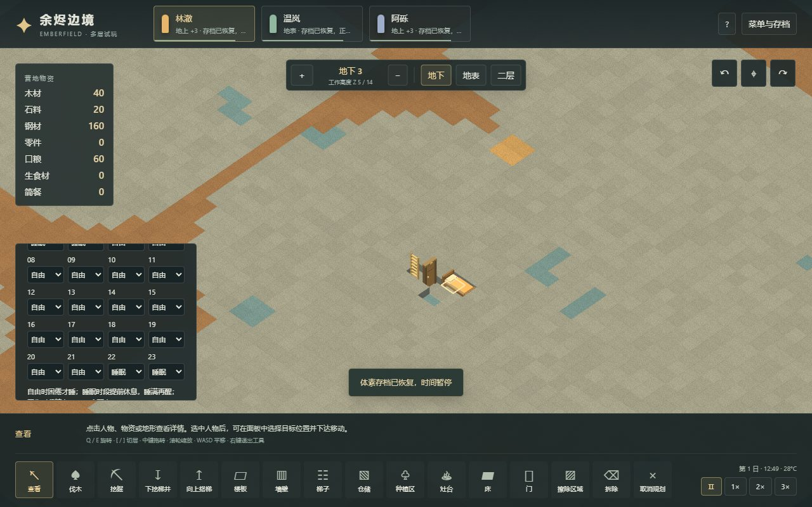
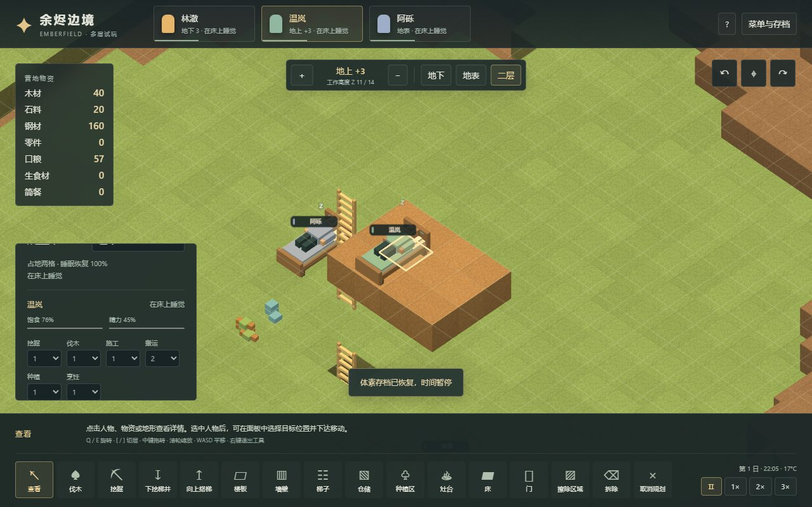

# 15 多层住房、床位、作息与门

更新：2026-11-03。入口：[多层体素试玩](https://sqchenxiyuan.github.io/emberfield-web/?world=voxel)。原版证据见[14章](14-sleep-housing-mechanisms.md)。本章是 Emberfield 的实现与验证，不能作为原版运行证据或完整机制等价声明。

## 操作

「床」每次放一张，占两个水平格，消耗45木材；R或工具说明中的朝向按钮在X/Y之间切换。床头是点击格，床尾沿正轴延伸。选床可以分配主人；未分配的床由首先选择它的殖民者认领。一人一个归属床位，睡眠中的床也有独立预定，不能同时睡两人。床可以放在地下或楼上，但必须有地板、两格净空及可走通的真实梯子路线。

选中人物，展开「24小时作息」为每小时设置自由、工作或睡眠。默认22–06睡眠，其余自由。精力低于75%时也可以按「现在去睡觉」。没有可达床时会在地面睡眠，恢复较慢；待机不再自动补精力。施工中去睡觉会保留施工进度和已送材料，把随身物资放在当前格，再步行去床。

「门」消耗25木材，占一格地面、两格高度。可选自动开关、保持敞开或锁定；锁定会让寻路改道或显示不可达，门口有人或物堆时拒绝锁定。普通门口有人/物资时不会自动关门。门的朝向目前只影响画面，四个水平侧面都可通行。

选中空间或床能查看封闭/室外、体积、可站立地面格数和Z范围。仅拉四面墙而没有顶板，仍会连通室外；显示剖切不会改变真实屋顶。地下通道留一格门后，可以形成独立卧室。

## 数值与取舍

| 项目 | 本项目规则 | 来源及边界 |
|---|---|---|
| 基础精力下降 | 每游戏日95百分点；低于28/14/1时倍率.7/.3/.6 | 来自原版Need_Rest，按游戏日映射；无个人RestFallFactor、疾病或基因修正 |
| 睡眠恢复 | 床上每游戏日228.57144百分点，地面×.8；睡觉不同时扣清醒损耗 | 参考原版基础倍率；没有品质、舒适心情、药物或RestRateMultiplier |
| 入睡 | 自由时精力<30，睡眠安排时<75；<1时无论作息都可睡 | 前两者参考原版选择/入睡阈值；极困兜底为本项目设计，不是原版倒地系统 |
| 醒来 | 精力满100；或当前安排工作且精力≥20；急饿<12且精力>14、有可达食物时去吃 | 06:00切自由不强制醒；无需原版的全ThinkTree，当前逐tick醒来判定，进食/入睡每20tick交错检查 |
| 建造工作 | 木床187tick，木门199tick，另加取料/路途 | 原版800/850基础工作×木材.7，再ceil(×20/60)；无技能、品质、失败 |
| 自动门 | 进入前等待13tick；离开后37tick关闭延迟，门口占用延长 | 木门38、关门110原tick按现实秒向上取整；画面开关为快照状态，未模拟原版连续门体开合 |
| 拆除返料 | 床22木、门12木 | 本项目固定向下取整的半数返还，不宣称复刻原版拆除产率链 |

未实现原版211tick睡眠任务重选、400tick受打扰禁睡、床的医疗/囚犯/共床/双人关系、舒适心情和室内温度对睡眠的影响。手动睡眠仍受作息醒来条件约束。

## 三维房间与内存

`src/voxel/rooms.ts`对64×64×16空气做六向连通分量。空气连接世界边缘即为室外；墙、岩层、顶板和门的脚/头格隔断组件。门打开仍保留边界，未来热交换应通过门的连接边处理。床、灶台和树不当作密封墙。

这是三维空间设计，**不是**把原版二维区域、屋顶缺失比例及房间评分照抄成三维公式。竖井会合并上下空气组件，封住井口则拆分；房间ID对同一拓扑确定，但分裂/合并后可能改变，不能拿ID当永久存档主键。

工作数组固定576 KiB：256 KiB编号、256 KiB队列、64 KiB门掩码。主线程另缓存256 KiB编号，只在拓扑变化或换世界时传输；平常快照只带摘要。地形和门位置改变才标记重建，门开关、作息、睡觉、相机和剖切不触发重算。JS摘要和传输时的暂存副本另计，以上不是整页或GPU内存测量，也没有测试4 GiB极限。

`src/voxel/world.ts`管理建造/寻路/睡眠/资源，`rest.ts`集中精力速率与作息。`sim.worker.ts`发布权威快照，Three.js渲染线程用逻辑tick驱动躺卧和睡眠符号，暂停时冻结。存档升级到v3，旧v1/v2可以迁移；床、门、归属、作息、精力、睡眠时刻和物资保存，路径/工作预定回读时重建。在床或地面已入睡者继续睡；走向床者在目标仍可达时重建路径并继续前往，路线已封闭时重新派工。原二维存档独立保留。

## 可复现验证

```sh
npm test
npm run research:check
npm run test:voxel:housing
npm run test:voxel
npm run test:voxel:food
npm run build
# 另开终端保持生产预览；浏览器脚本支持 VOXEL_TEST_URL 指向该地址
npm run test:voxel:housing:browser
```

住房流程只使用公开`command/step/save/load`，不注入地形、物资、精力、成熟状态或时间：六棵树供材；下挖梯井；挖出地下六格卧室；建床和门；上行搭梯，铺12格平台；再建地表/楼上床；分配三人；自然等到睡眠时段；睡中存档回读；醒来通过门和梯井返回地表；锁门后唯一入口不可达，解锁恢复。每tick校验资源账目、支撑和床位预定。地下卧室12空气体素为封闭空间，楼上平台为室外。

该固定种子流程在tick2413完成三张床，tick7049三人都已在床上睡觉，tick9979全部恢复并醒来，tick10013通过门与梯井返回地表。没有宣称三人在早上6点仍睡：这个场景中他们在6点前已恢复。06:00不强制醒的边界另由隔离单测验证。

食物回归在新增睡眠需求下仍完成120格稻米两轮收获、第三轮补种及实体烹饪；到tick206726（17.227日）库存6口粮、911生食材、6简餐，54份简餐制作、48份吃掉，最低饱食12.273%。这些是当前规则的正常时间推进结果，和13章发布时尚无真实睡眠需求的历史结果不混用；不证明无限期可持续或饥荒健康系统完整。

浏览器验证使用真实鼠标、DOM及正常流程生成的导入存档；近睡眠存档由无渲染模拟推进时间，不能描述为数小时实机游玩。最终报告、源文件/构建哈希和截图摘要记录在`evidence/voxel-housing-validation.json`。

本次最终构建通过110条单测（新增房间19、住房23）、住房正常流程、两轮食物流程和11项食物浏览器回归。住房浏览器在Worker和主线程兼容模式各11项通过、无控制台错误；实际覆盖两轴建造、床主独占转移、门模式、全部24小时作息、手动存读档、房间切层、三层睡姿、暂停像素及继续恢复。900×700逐项检查38个控件的命中点，修复了提示条遮挡作息控件的问题。

同一页面6次保存/新建/回读的空营地资源计数回到相同值：27几何、4纹理、16地形块、2,067,248字节地形缓冲。该测试没有把空营地循环等同于已建成住房的长期内存测试。





下一阶段是房间热交换与用电，再逐步把战斗健康、生产品质、叙事贸易等已有研究接入体素世界。本轮没有实现温度网络、坍塌、流体、野生动物生态或多人口扩展。
