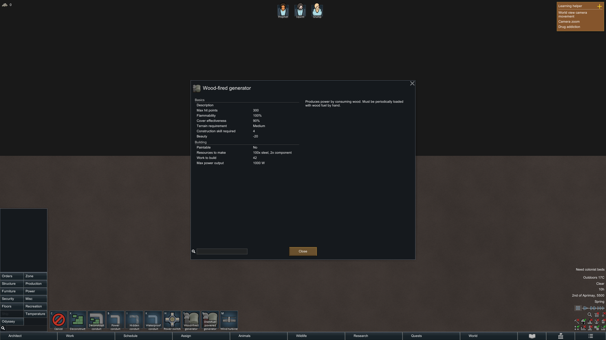

# 16 电网、燃料、太阳能与房间温控

核验日期：2026-11-03；本地版本：**RimWorld 1.7.4980 rev60**。本章补齐 [03-rooms-temperature-power.md](03-rooms-temperature-power.md) 未追踪的电网拓扑、发电与补燃料、实际温度调度、门/通风口调用、房间重建和温度存读链路；门与住房基础见 [14-sleep-housing-mechanisms.md](14-sleep-housing-mechanisms.md)。

可直接用于下一里程碑的基准是：木发电机 **1000 W、75 木材燃料槽、22 木材/游戏日**；太阳能 **1700 W 峰值、4×4 占地、按天空光和未盖顶面积比例输出**；电池 **600 Wd、50% 充电效率、5 W 自耗**；加热器 **175 W/+21 热单位每标称秒**，冷气机 **200 W/−21 热单位每标称秒**。电网连通、设备开启、燃料存在、发电输出和温控工作状态需要分别表示。

## 1. 证据与适用范围

| 文件 | 本次覆盖 |
|---|---|
| [energy-manifest.json](evidence/energy-manifest.json)、[energy-types.json](evidence/energy-types.json) | 新提取 31 类；另复用 environment/housing/food/generation/work 的 19 类 |
| [energy-xml.json](evidence/energy-xml.json) | 6 个 Core XML 文件、14 个声明、135 个叶字段、24 个带属性节点、24 个选定字段缺省记录 |
| [energy-claims.json](evidence/energy-claims.json) | EN01–EN25；82 个代码行范围引用、31 个 XML 引用 |
| [energy-cases.json](evidence/energy-cases.json) | 15 个独立解析模型、186 个断言 |
| [energy-runtime.json](evidence/energy-runtime.json) | 隔离研究实例的木发电机信息界面旁证 |
| [energy-validation.json](evidence/energy-validation.json) | 原 DLL/XML、派生文件、声明字段、解析模型与截图完整性核验 |

程序集 SHA256：`eff7d97949f919fb2b151ebfb906e9be749b63410b7dbda78eeebb7972b245c3`。ILSpy `11.2.0.10050`，SHA256：`587a18e18e13acfc7fd8783a44c24c7da0781dadf6b9fb9dd5e2e38a9cdfae78`。完整派生 C# 保留在忽略目录 `.local-research/energy/`，已有分组保持原哈希，不重复提取。

下文 EN 引用为静态代码/XML证据。XML 是选择性直接声明，保留继承父名、组件 Class 属性和所选字段的缺省情况；没有加载 DLC/模组/补丁后的完整生效 Def 数据库。解析案例不执行游戏类。唯一实机旁证是 **Core+Odyssey 隔离实例的定义信息 UI**，没有完成正常施工、补燃料、发电或温度曲线的实机测量。

“每标称秒”指原版 60 tick 所对应的模拟时间，便于和项目 20 TPS 比较。倍速、暂停和性能不足会改变真实墙钟耗时，不能直接把热量参数当真实焦耳/秒或实际帧计时结果。

## 2. 建筑、成本与工量

来源 EN01。工量为原始 `WorkToBuild`；表中项目换算只是假设工人速率为 1、按常速秒数保持的 `ceil(原工量×20/60)`，不包括搬运、技能、工具、失败或实际施工验证。

| 建筑 | 原版二维占地 | 材料 | 原始工量 | 项目建议工作 tick |
|---|---|---|---:|---:|
| PowerConduit 电线 | 1×1 | 钢 1 | 35 | 12 |
| WoodFiredGenerator 木发电机 | 2×2 | 钢 100、工业零部件 2 | 2500 | 834 |
| SolarGenerator 太阳能 | **4×4** | 钢 100、工业零部件 3 | 2500 | 834 |
| Battery 电池 | 1×2 | 钢 70、工业零部件 2 | 800 | 267 |
| Heater 加热器 | 1×1 | 钢 50、工业零部件 1 | 1000 | 334 |
| Cooler 冷气机 | 1×1 | 钢 90、工业零部件 3 | 1600 | 534 |
| Vent 通风口 | 1×1 | 钢 30 | 400 | 134 |

未直接声明 size 的设备继承至 `BuildingBase` 仍无覆盖，`ThingDef.size` 类默认 `IntVec2.One`。太阳能 4×4 是当前本地版本声明，不应套用其他版本资料中的旧占地。

快照也保留了研究和建造技能要求。例如木发电机建造技能 4；加热器/冷气机 5；太阳能 6。三维高度、墙体安装方式、跨层电线和放置净空没有原版物理高度可照搬，需要项目定义。

## 3. 电网拓扑与设备接线

来源 EN02–EN05。

### 3.1 两种角色

| 角色 | 本章设备 | 连通方式 |
|---|---|---|
| transmitter，传输节点 | 电线、木发电机、太阳能、电池 | 建筑占地与其他传输节点四邻边相接，组成电网 |
| connector，用电连接设备 | 加热器、冷气机 | 附着到附近一个 transmitter，归属其电网 |

`ThingDef.ConnectToPower` 先排除自身就是 transmitter 的物体，之后识别普通 trader/battery 连接设备。`Building.TransmitsPowerNow` 对普通建筑直接读取组件传输属性；**木机缺燃料、太阳能夜间输出 0，不会因此自动切断它的传输拓扑**。特殊电力开关可有自己的覆盖行为，不应把这个结论泛化到所有建筑子类。

`PowerNetMaker` 对当前可传输建筑做四邻接遍历；对多格设备使用整块占地周边，单纯斜角不相连。`PowerNetGrid` 将整个 transmitter 占地登记为该网络的格子。

### 3.2 连接距离的真实含义

由设备主动找网络时，`BestTransmitterForConnector` 在连接点四周扩展 6 格的 **13×13 方形区域** 中查找，再按水平距离平方选择最近有效 transmitter。过滤条件包括存在、可传输、允许接线、不在禁止网络列表中。

这条路径没有“欧式距离 ≤6”的二次裁剪，也没有墙体视线检测。例如偏移 `(6,6)` 仍在候选框内，尽管距离约 8.49；`(7,0)` 不在框内。壁挂设备使用其附着墙位置作为找线锚点。

新 transmitter 接入时还有另一条路径：枚举其**占地扩展 6 格**内尚未连接的设备并接上。它不要求所有设备重新选择全局最近节点，多个候选网络的归属可能受遍历/重建顺序影响。不能把“永远连接最近一根电线”当成全部场景的保证。

原版搜索使用同一 Map 的 x/z，构造坐标的 y 为 0。项目的同层自动接线、竖线连接或显式层间接头都是三维扩展，应分别测试；“球形六格无线覆盖”不是这段原版规则。

### 3.3 断线、重建与存读

`PowerNetManager` 将 transmitter/connector 的增加、移除、状态变化放入延迟队列。处理时先移除受影响电网并重置传输字段，再从原位置与邻接处重建网络，最后接回连接设备。传输节点移除时会解除子设备的 parent、将 trader 关断并请求重连。

`CompPower` 从自身 `transNet` 或 `connectParent.transNet` 获取网络；连接 parent 被保存，读档后重连。电池储能属于电池组件，网络拆分时不能把它平均复制到每个新电网。拓扑变化和电力结算是不同调度阶段，测试应包含一次更新前后，而不是只检查摆放瞬间的 UI。

## 4. 木发电机与真实补燃料物流

来源 EN06–EN09、EN13。

### 4.1 输出和燃料

XML 的 `basePowerConsumption=-1000` 由 `CompPowerPlant` 转为 **+1000 W** 期望输出。故障、没有燃料、开关关闭、自动开关条件失败、特定污染组件阻断或 `!PowerOn` 时实际输出为 0。选择的木机没有研究功率升级列表；通用属性类允许其他设备按已完成研究乘升级因子。

| 燃料参数 | 当前 Core 基准 |
|---|---:|
| 类型 | WoodLog |
| 容量/默认目标 | 75 |
| 初始燃料 | 0，来自类默认比例 0 |
| 开启时消耗 | 22/游戏日，原版每 tick 为 22/60000 |
| 物品→燃料换算 | 默认 1 木材→1 燃料单位 |
| 自动补充开始阈值 | 剩余/目标 ≤.3，即目标 75 时 ≤22.5 |
| 满槽连续理想运行时长 | 75/22≈3.409 游戏日 |

木机 XML 未设置 `consumeFuelOnlyWhenUsed` 或 `consumeFuelOnlyWhenPowered`。因此在这些默认条件下，开关打开就走持续燃料消耗分支，**不会根据负载下降而节省燃料**。该分支也没有直接检查故障；设备故障可能让输出为 0 而仍继续消耗，不能把“发电为 0”统一作为停燃条件。

`HasFuel` 要求燃料严格大于 0，且达到 minimumFueledThreshold；后者默认 0。消耗到负数时截到 0 并广播耗尽信号。额外雨中耗燃字段在该木机声明中未设置，默认 0。

### 4.2 自动补充与作业中断

自动补充需要：不满、目标大于 0、达到百分比阈值，且不是着火、开关已关闭、等待切换开关或等待拆除状态。WorkGiver 还检查自动补充开关、阵营、机器预约、燃料可达/可预约/未禁用和滤器许可。强制任务可以绕过部分自动选择门槛，不会绕过物资实际消耗。

标准流程：

```text
找到机器与可用木材
→ 预约机器、预约木材
→ 走到木材、实际搬起
→ 走到机器旁
→ 等待 240 原版 tick（4 个标称秒）
→ 从携带物资 SplitOff 并销毁所用份额
→ 对燃料槽增加单位燃料，最大截到容量
```

开始作业后检查的是 `ShouldAutoRefuelNowIgnoringFuelPct`，不会因为燃料百分比暂时变化就重复按 30% 门槛取消。任务仍会因目标/物品消失或禁用、触及失败、自动补充被关闭等终止。

目标数量为 `max(ceil((目标−当前燃料)/倍率),1)`。例如剩余 22.5、目标 75，需要搬入 53 木材；75.5 截到 75，会损失 .5 的分数燃料。没有足量木材时普通非原子补充可利用较小堆叠，不应要求每次必须一次搬满整个槽。完成补充前不能直接从全局库存遥扣木材。

**部分补充有完整的调用链依据。** 木机 `atomicFueling` 默认 false，普通作业只要求存在一堆合适燃料；只有 atomic 分支才先查找足量总数。`StartCarryThing` 的 `failIfStackCountLessThanJobCount` 默认 false，实际取请求数量、携带空间和堆叠数量三者的最小值。之后若 8 格搜索找到额外合适堆叠才继续捡，没有就前往机器。最终 `CompRefuelable.Refuel` 对普通机器消耗已送到的数量，不要求达到完整目标。

因此剩余 22.5 时只送来 44 木材，完成等待后可补到 66.5；不会为了再等 9 木材而把 44 留成不可用的待收集材料。空槽只有 1 木材也能补到 1，满足 HasFuel，但是否实际发电仍由开关、故障和电网启停决定。E02 的部分补充算例忽略等待期间的并发耗燃；实际燃料量会随作业耗时略减。

### 4.3 额外发热

木机还带 `CompHeatPusherPowered`，声明 **6 热单位/标称秒**。Normal ticking 每 60 tick 的散列时点推热；必须满足存在、温度范围、开关、PowerOn、燃料和无故障等条件。电功率 1000 W 与热量 6 是两个不同游戏参数，不能按真实能量守恒直接相互换算。

## 5. 太阳能、天空光与遮挡

来源 EN10–EN12。

发电组件的核心公式为：

```text
Pdesired = Lerp(0, 1700, CurSkyGlow)
           × 未盖顶占地格数 / 总占地格数
```

4×4 总共 16 格。天空光为 1 时，无顶 1700 W；4 格盖顶 1275 W；8 格盖顶 850 W；全部盖顶 0 W。天空光 .5、全部无顶时为 850 W。随后仍需通过一般发电机的故障、开关、PowerOn 等实际输出门槛。

此处读取 `skyManager.CurSkyGlow` 和 `roofGrid.Roofed`，没有读取人工灯的 GlowGrid，也没有在该公式中对附近树木或高墙做太阳射线投影。项目要实现三维高楼阴影，就应注明新增遮挡模型；不能把原版 roof 比例说成完整日照追踪。

### 5.1 天空光不是简单的固定日内正弦

`GenCelestial` 根据纬度、年份中的日、日内时刻产生太阳向量，包括季节偏移和纬度相关角度修正；最终：

```text
CelestialGlow = clamp01(dot(地表法线, 修正后的太阳方向) / .7)
WeatherGlow = min(CelestialGlow, WeatherDef.maxGlow)
```

SkyManager 再混合前后天气，并叠加游戏条件、天气事件和影响天空的物体。普通 `SkyTarget.Lerp` 对 glow 线性插值；`LerpDarken` 只朝更暗目标插值。固定 6–18 点、正午达峰的正弦可以作为项目近似，不能称作完整原版天体模型。

### 5.2 不要自行给普通雨天加太阳能惩罚

`WeatherDef.maxGlow` 类默认是 1。当前 Core **Clear、Rain、Fog、SnowHard** 均没有直接覆盖此字段，已将缺省状态纳入 XML 验证。天气色彩看起来暗不等于 glow 下降；没有额外游戏条件时，不能仅因“雨天”给太阳能再乘 .5。日食、其他条件或 DLC/模组修改需要按生效链另核验。

本次没有实测一整天的太阳能产能；1700 W 是峰值而非日均值。案例只核验给定天空光和屋顶比例时的静态乘法，以及最终 glow 算子，不提供未验证的每日 Wd 保证。

## 6. 电量结算与电池

来源 EN24、EN25，完整启停细节延用 03。

原版每 tick 电量近似 `PowerOutput/60000`，单位为 **Wd，瓦·游戏日**。正为发电，负为用电。600 Wd 不是 600 Wh，项目采用 12000 tick/日后应改为 `PowerOutput/12000`，仍保留同样的日尺度储能。

电池容量 600 Wd，接受输入的充电效率 .5，放电直接扣储能，不再乘一次 .5。每 tick 还有 5 W 对应自耗；故障信号会清空储能。EMP 在“可接收充电”“当前总可用能量”“放电候选列表”中的过滤并不完全相同，此边界本章仍未实机复核，不概括为所有路径彻底隔离。

给定无其他修正的理想连续场景：1000 W 富余给一块空电池充电，净储能为 `1000×.5−5=495 Wd/日`，约 1.212 日充满。满电池单独供应 400 W 负载，含自耗的理想时长 `600/(400+5)≈1.481 日`。实际启停缓冲、离散顺序和故障会改变结果。

网络短缺时按每 20 原版 tick、随机尝试约 5% 负功率设备、至少 1 个来逐步关闭；启动采用 `max(30,floor(200/等待数))` 间隔并检查电池缓冲。随机抽样可重复，不保证每次关闭固定数量的不同设备；本链没有“医院优先”的分级规则。初版可以选择更易理解的确定性负载策略，但要登记偏离点。

### 6.1 实时发电充足也可能等待启动缓冲

令 `s` 为电池可用 Wd 总量，`g` 为已经 PowerOn 的设备每 tick 净发电量。正常供电分支先检查 `s+g>=−1e−7`，然后启动新设备之前还要求：

```text
buffered = 存在电池且 s>=.1 ? s−5 : s
buffered+g >= 0
```

这个条件没有“只有实时发电不足才检查”的例外。已开启 1000 W 发电、等待启动 175 W 加热器时，原版 `g=1000/60000`，有电池且 `s>=.1` 的分支约需 `s>=4.983333 Wd`；若项目仅把日长度换为 12000 tick，约需 `s>=4.916667 Wd`。两者在储能 .1 或 4.9 时都被挡住；4.92 时项目映射可通过而原版仍等待。储能低于 .1 时不减 5，又可能通过，存在明确的不连续边界。

5 Wd 是**比较余量，启动不会实际扣掉这 5 Wd**。进入候选启动阶段后，具体设备另用未扣余量的 `s+g` 检查是否够付该设备的每 tick 负耗电；随后累计新负载。`CanPowerNow` 也只检查这条未扣余量的可负担条件，不能替代 `PowerNetTick` 的完整启动规则。即使暂不启动负载，正常分支末尾仍对 `g` 执行充电结算。

E15 分开检查缓冲门槛和候选可负担性；不模拟随机选择、时点或浮点位级差异。如果项目选择“实时发电足够就直接启动”，应把它写成明确的体验调整，不能标为原版规则等价。

## 7. 温度的实际调度顺序

来源 EN14、EN15。

普通 `TickManager.DoSingleTick` 的重要阶段：

```text
MapPreTick（温度等）
→ 游戏 tick 计数递增
→ Normal / Rare / Long 的物体更新
→ 其他全局系统
→ MapPostTick（电网结算等）
```

`MapTemperatureTick` 在当前 tick `%120 == 7` 时遍历所有房间并调用 `EqualizeTemperature`。这是已经追到的真实调用条件，补上 03 仅有常量与公式的边界。调试 `fastEcology` 会改变调用和计数，不能把其结果当普通游戏速度。

物体 Rare 周期为 **250 tick**，通过桶分散到不同 tick，最终由 `Thing.DoTick` 调用 `TickRare`。加热器、冷气机和通风口均是 Rare；设备的 `4.1666665` 热量乘数就是 250/60。

`MapUpdate` 则更新天空、处理待办电网拓扑、区域与房间重建。不要把这些更新全改成同一循环后仍声称顺序完全等价；尤其停电、温控改变功耗、拆墙重建同时发生时，应测试一个更新周期内的顺序。

## 8. 房间分裂、合并与温度存读

来源 EN16、EN17。

区域失效前，`RegionDirtyer` 在受影响格记录旧房间 ID、**旧房间完整 CellCount**、温度和真空值。新房间从自身格里读取缓存，将遇到的旧 room ID 去重，再按每个旧房间的完整面积加权：

```text
Tnew = Σ(ToldRoom × oldRoom.CellCount) / Σ(oldRoom.CellCount)
```

权重不是新房间与旧房间的重叠格数。如果新区域只接触旧 A 的少量缓存，但 A 原来面积 100、温度 0，另接触旧 B 面积 20、温度 30，这条缓存均值是 5°C；按重叠 1:20 算会得到约 28.57°C，那是另一种算法。实际是否遇到两个缓存还取决于区域失效、旧 Room 重用和新 Room 创建路径，不能把上述算例当已测布局结果。

被重用的旧 Room 主要通知形状变化，继续使用其温度跟踪器；新 Room 才应用缓存均值。新跟踪器构造时温度先取室外温度，没有缓存的普通新房间可保留该初值。屋顶与形状变更还会重新计算屋顶比例和墙体交换候选。

存档另外使用逐格温度 ushort 网格。温度先截到 `[-273.15,1000]`，乘 16 后向零截断并偏移 32768；读回除以 16，因此分辨率约 1/16°C。加载对每个 Region 取一个代表格赋给所属 Room，没有在此重新求解物理能量守恒。

项目采用三维重叠空气体积加权、热量守恒或其他迁移方案均可，但必须独立说明；原版二维缓存方案不能证明三维算法正确。拆墙合并、补墙分裂、楼板开洞、楼梯连通、保存恢复要分别验收。

## 9. 门与通风口的换热调用

来源 EN18–EN20。

| 设备状态 | 实际调用 | 默认参数 |
|---|---|---|
| 闭门 | Normal tick 的散列间隔 | 每 375 tick，rate=1，twoWay=false |
| 开门 | tick+物体散列偏移的模间隔 | 每 34 tick，rate=1，twoWay=false |
| 打开通风口 | 每次 Rare，且 WantsToBeOn | 每 250 tick，rate=14，twoWay=true |
| 关闭通风口 | 不调用该换热路径 | 本选择的通风口不耗电 |

门的 twoWay=false 会检查每个占地格的四邻接；通风口 twoWay=true 只检查旋转朝向及其反向两侧。不同 Room 去重，先求**不按面积加权的温度算术平均**，然后各房间按 `rate/CellCount` 改变温度。所有室内房间共享一个缩放因子，防止小房间单次越过平均目标。热学室外房间作为固定温度源，不执行同样的室内温度增加；真空降温另有 .1 系数。

例如 10 格 0°C 和 100 格 30°C 两间普通室内房，平均目标 15°C：rate=1 时得到 1.5°C/29.85°C；rate=14 时，小房间限制共同倍率为 10/14，得到 15°C/28.5°C。这里的 14 是**每次调用的交换参数**，不能直接当作“每秒 14”。

建筑自身占用 Room 的温度还会被设为上述平均值。门保持 Portal 边界，开门不合并两边的 Room；温度交互和空间身份分区仍是不同机制。三维六向墙体边界、竖直热交换和空气体积模型属于项目设计，不等价于原版二维边界抽样。

## 10. 恒温设备的完整控制要点

来源 EN21–EN23。

普通室内热容量为 `CellCount`：`PushHeat(E)` 增加 `E/CellCount`；采用室外温度的房间拒绝普通推热。受控温度变化同样先按面积分摊，再裁到目标温差，且不让加热器反向制冷或冷气机反向加热。通用温控默认目标 21°C、调节范围 −50..50°C、低功耗倍率 .1。

### 加热器

当 T≤20°C，效率为 1；20–120°C 线性下降至 0；高于 120°C 为 0。每次 Rare 可用热量 `21×效率×250/60`，再按目标温度裁剪。只要裁剪后的温度变化非零，该轮使用 175 W；无变化则 17.5 W 待机。不是到达目标就完全断电，也不是根据接近目标的比例线性降低功率。

### 冷气机

相对其旋转，South 侧是冷端，North 侧是排热端；两个出风格任一个不可通行时不进行温控，并进入 20 W 待机。令热端 H、冷端 C：

```text
效率 = max(0, 1 − (H − min(C,40))/130)
可用冷量 E = −21 × 效率 × 250/60
冷端 ΔT = 朝目标裁剪(E / 冷端房间面积)
若 ΔT 非零：热端请求 PushHeat(−E×1.25)，功耗 200 W
否则：功耗 20 W
```

效率没有显式封顶 1，热端比冷端低温时可能超过 1。排热用本轮**未按冷端目标裁剪的 E**：25 格冷室 10°C、热端 40°C 时，一轮可降约 2.692°C，排热约 84.135；若目标仅 9.9°C，只降 .1°C，仍请求同样排热。热端若是室外，普通 PushHeat 还可能拒绝改变室外温度。不能用理想热泵守恒式替换这些游戏规则后称完全复刻。

## 11. 三维项目的映射合同

以下为当前选择的**设计合同**，不是本章已经验证的实现状态。原版 60 TPS/60000 tick 每日，项目 20 TPS/12000 tick 每日；常速分别为 1000 与 600 标称秒/游戏日。

| 项目 | 项目规则 | 与原版的关系 |
|---|---|---|
| 电力 | W 作为功率，`W/12000` 每 tick 转 Wd | 保游戏日储能平衡 |
| 木材燃料 | 22/12000 每 tick，上限 75，阈值≤22.5 | 保游戏日燃料平衡 |
| 补燃料 | 实际木材预约、搬运、消耗；240/60×20=80 tick 操作等待 | 保标称秒数；需真实物流验收 |
| 热量 | 加热/制冷基准 ±21/20 每 tick | 保标称秒数；每游戏日总热量会变化 |
| 热容量 | 房间空气体积/2 | 自定义：两格高房间回到与地面面积相同的数值 |
| 墙体传热 | 显式六向边界 | 自定义三维算法，不能标为旧二维抽样的等价实现 |
| 房间迁移 | 按实现明确选定的体积/重叠规则 | 不自动继承原版旧 Room 完整面积缓存权重 |
| 跨层电网 | 显式规定同层连接与竖直连接方式 | 自定义；原版这里只处理二维 Map |
| 太阳能遮挡 | 至少说明天空光来源、占地分摊与上层遮挡判定 | roof 比例可借鉴，三维阴影额外设计 |

例如空气体积 50，等效热容量 25，21 热单位/标称秒在 20 TPS 下每 tick 推入 1.05，未裁剪时升 .042°C。原版和项目都按相同标称秒推热，但原版一日 1000 秒、项目一日 600 秒，单机一日热量从 21000 变成 12600；电能和木材却维持 1000 Wd/日及 22 木材/日。这个混合尺度是明确选择，应在平衡测试中观察。

若仍以低频批量更新温度，应根据**真实经过的模拟 tick /20**计算热量。把原版 Rare 250 tick 向上换算为 84 tick 后，间隔是 4.2 秒，不能继续不加说明地固定使用 87.5 热量。自然散热、门、通风口的 rate 也需要按所选时间策略标定，否则设备保秒数而散热保日数会悄悄改变平衡。

## 12. 原版 UI 旁证



ER01：已存在的隔离研究进程 PID 29920，保存目录 `.local-research/runtime/profile-20261102`，当前 activeMods 为 Core 与 Odyssey。操作为截图确认当前殖民地、打开 Architect/Power、选择木发电机图标、打开信息，随后关闭信息并取消设计器。本次没有放置、施工、加载其他存档或使用开发者造物。

界面显示 **1000 W 最大输出、100 钢、2 工业零部件、建造技能 4、Work to build 显示 42**。42 是界面显示值，原始 XML 工量为 2500；本轮没有把这个显示值当实测施工 tick 或墙钟秒数。截图证明定义 UI 展示，与实际机器已建成、已装燃料、已向电网输出是不同证据。

太阳能、电池和温控设备的本章数值仍来自静态/XML；没有对上述四类设备逐项实机搭建测量。特别不能把 Core+Odyssey 的一张 UI 图标成“纯 Core 全机制实测”。

## 13. 实现验收与仍未知的部分

建议用能观察资源和状态变化的场景验收，而不仅检查设备出现：

1. **两张独立电网**：一边发电、一边用电；远处设备不能因全局功率充足而被供电。补上连接线后合网，拆线后分网。
2. **非圆形连接框和拓扑角色**：二维参考下 `(6,6)` 可成为候选、`(7,0)` 不可；关闭/缺燃木机仍能作为传输节点。三维同层/跨层规则单独列出。
3. **正常补燃料**：从可见木堆预约→搬运→等待→库存减少→燃料槽增加；无木、路阻、取消、拆机和读档都不能复制或遥扣资源。
4. **发电与耗燃分离**：空槽不发电；补后发电；低负载持续耗燃；关开关停燃。是否采用原版故障仍耗燃的规则需显式决定。
5. **太阳能**：给定天空光，同一机组依次覆盖 0/4/8/16 个占地上方格；相应输出符合选择的映射。人工灯不应提高天空光输入。
6. **电池**：富余充电需体现 .5 损失，自耗和放电只扣一次；拆网或读档保留各电池自身电量，容量不能重复分配。
7. **温控与待机**：达到目标后的低功耗、恢复工作、断电、开门泄热、拆顶、同房多个设备共同作用均可观察。
8. **冷气机方向**：冷/热两侧、旋转、出风阻塞、热端室外和接近目标的排热都需有定量断言。
9. **三维房间变化**：拆墙合并、补墙分裂、楼板开洞、门边界和温度保存恢复；避免重建使房间温度凭空归零。
10. **长期平衡**：20 TPS/12000 tick 一日，连续数日看木材消耗、充放电、日夜太阳能和冷库保温，单独列出环境/天气假设。

尚未实机验证：拓扑/房间重建的复杂顺序效应、EMP 电池边界、太阳能完整日/季曲线、DLC 补丁生效差异、故障与短路概率、长期温控稳定性。未覆盖真实三维流体、热对流和跨层电磁机制；项目不需要先实现它们才能形成可玩的电力—冷藏循环。

## 14. 重提取与核验

在 `experiments/rimworld-like` 目录执行：

```powershell
./scripts/research/extract-energy.ps1 `
  -GameRoot 'F:/SteamLibrary/steamapps/common/RimWorld' `
  -DecompilerPath '../../tools/ilspy/lib/netstandard2.0/ICSharpCode.Decompiler.dll'

./scripts/research/collect-energy-xml.ps1 `
  -GameRoot 'F:/SteamLibrary/steamapps/common/RimWorld'

node scripts/research/verify-energy-evidence.mjs
node scripts/research/verify-energy-evidence.mjs --local

./scripts/research/verify-energy-evidence.ps1 `
  -GameRoot 'F:/SteamLibrary/steamapps/common/RimWorld'
```

默认便携验证检查记录身份、类型/行号/XML引用、关键模型输入与声明绑定、15 个解析案例和截图哈希；不需要原游戏与完整派生 C#。`--local` 增加 50 个本地派生文件校验。PowerShell 进一步核对原 DLL/版本、6 个原 XML 文件及 135 字段、24 个属性节点、24 个缺省记录，再调用同一个解析模型。

校验通过表示所选来源匹配、证据包一致、独立模型符合记录预期；不表示原版运行时动力学或三维复刻实现已经通过上述行为验收。
