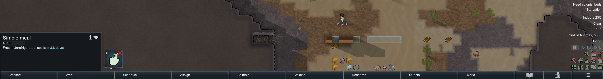
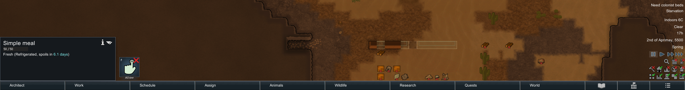
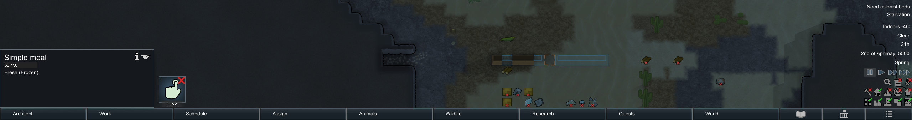
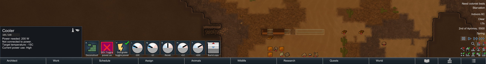

# 18 · 原版保鲜实机：暖存放、降温与冻结端点

本轮在原版 **RimWorld 1.7.4980 rev60** 中，以同一份简餐实际推进游戏时间，观察到了 **Unrefrigerated → Refrigerated → Frozen** 的界面转换，以及腐坏进度增长随降温明显减慢。**没有独立证实整段持续冻结时腐坏零增长**：最后两次端点虽均显示 Frozen，区间内仍增加了 197.7813 腐坏进度。以下保留这一限制，不把端点标签当成连续温度曲线。

## 1. 实验身份与干预

- 已有进程 PID **29920**，`F:/SteamLibrary/steamapps/common/RimWorld/RimWorld.exe`；使用独立 `-savedatafolder=…/experiments/rimworld-like/.local-research/runtime/profile-20261102`。
- 原程序集 SHA256：`eff7d97949f919fb2b151ebfb906e9be749b63410b7dbda78eeebb7972b245c3`。
- 原存档元数据确认启用 **Core + Odyssey**，不能标成纯 Core 实测。
- 通过原版 Options 开启开发模式，使用 `Make empty room (rect)` 建造有顶木屋、生成两份 Simple meal；两份都通过 UI 设为禁止使用。
- 通过 God mode 在北墙直接放置原版 Cooler，冷端朝南、热端朝北。随后点击 `DEV: Toggle power on`，设目标 5°C，再设 −15°C。**冷气机未连接正常电网**；本轮没有证明发电、布线、正常建造或燃料循环。
- 推进方式是原版速度 3 与显式暂停按钮；没有调用 IncrementTime、注入代码、改存档或加载新 Mod。每段运行约 7–10 秒墙钟时间，真实推进量以原版存档 tick 为准。

准备阶段曾有一次开发菜单导航落空，键盘快捷键意外推进时间。物品于 tick 10459 生成，正式采样从 tick 21141 开始；**10459–21141 不参与速率结论**，已有年龄没有清零。最初研究档的备份仍保留在忽略目录，名称与哈希在证据 JSON 中。

## 2. 五份原版存档

室内样本始终为 `MealSimple42000`，位置 `(104,0,142)`、数量 1、耐久 50、禁止使用。室外对照为 `MealSimple42001`，位置 `(114,0,137)`。表中 `rotProg` 是原版写出的累计腐坏进度，不是剩余保鲜秒数。

| 存档后缀 | tick | 室内 rotProg | UI 温度 | 存档温度缓存 °C | UI 状态 | 室外对照 |
|---|---:|---:|---:|---:|---|---|
| warm-0 | 21141 | 10750 | 22°C | 21.75 | 此帧选中冷气机，仅取温度 | 存在，rotProg 10750 |
| warm-1 | 24136 | 13750 | 23°C | 22.8125 | Unrefrigerated，剩余 3.8 days | 存在，rotProg 13750 |
| chilled-0 | 29977 | 19081.332 | 6°C | 5.8125 | Refrigerated，剩余 6.1 days | 已不存在 |
| frozen-0 | 35825 | 21392.3535 | −0°C | −0.125 | Frozen | 已不存在 |
| frozen-1 | 39868 | 21590.1348 | −4°C | −4.25 | Frozen | 已不存在 |

完整文件名为 `preservation-<后缀>.rws`。每份原版存档的 SHA256、长度、模组、位置、数量与字段抽取值都记录在 [native-preservation-runtime.json](evidence/native-preservation-runtime.json)。完整 `.rws` 不发布。

室外样本在 warm-1 后、chilled-0 前消失；检索完整 XML 中的物品 ID 也未发现它。**消失原因没有被观察确认**，不能归因为腐坏、殖民者进食或动物吞食；之后三个冷段都不再具有有效室外食物对照。JSON 中保留该地格温度，但它不是仍然存在的食物读数。

## 3. 区间结果与结论边界

| 区间 | Δtick | 室内 ΔrotProg | 平均增长 / tick | 室外 ΔrotProg |
|---|---:|---:|---:|---:|
| warm-0 → warm-1 | 2995 | 3000 | 1.00167 | 3000 |
| warm-1 → chilled-0 | 5841 | 5331.332 | 0.91274 | 无有效对照 |
| chilled-0 → frozen-0 | 5848 | 2311.0215 | 0.39518 | 无有效对照 |
| frozen-0 → frozen-1 | 4043 | 197.7813 | 0.04892 | 无有效对照 |

暖区间增长 3000 而时间只推进 2995，与原版 250 tick 批量更新相容；这不是逐 tick 连续采样测得的精确速率。降温区间包含温度过渡，不能把 0.91274 或 0.39518 当成恒定 5°C 的腐坏倍率。

最后区间两端保存的温度缓存均低于 0°C，且两端 UI 显示 Frozen，但没有记录中间每次腐坏更新所用温度。因此只能确认 **4043 tick 内增长较暖区间显著减缓**，不能证明该段始终低于零度，也不能宣称这次运行直接证明了冻结零增长。画面中有人畜进出门；室温交换、开门变化、UI 取整等是可能解释，**都没有被本实验分离成已测得的根因**。静态机制依据见 [19 · 保鲜机制](19-preservation-mechanisms.md)。

初始准备阶段 UI 还显示过 17°C、Unrefrigerated、4 days；正式暖样本已经有年龄，因此 3.8 days 与原版 4 天总阈值不冲突。食物耐久变化与腐坏进度属于不同机制，不能互相代替。

## 4. 可视证据

下面均为原版窗口的未缩放裁剪，裁剪坐标、原图 SHA256 和输出 SHA256 均可复核。









## 5. 温度缓存的只读解释

原版存档 `maps/li/temperatureCache/temperaturesDeflate` 是 Base64 包装的原始 DEFLATE 字节流。读取顺序来自本机程序集静态重建：`MapSerializeUtility`、`DataSerializeUtility`、`CellIndicesUtility`、`DataExposeUtility` 与 `CompressUtility`，另复用第16章的 `TemperatureVacuumSaveLoad`。新增 6 个类型的哈希和行数在 [preservation-runtime-manifest.json](evidence/preservation-runtime-manifest.json)，具体引用范围在运行证据 JSON。

解压后为 250 × 250 × 2 = 125000 字节，按 `z * sizeX + x` 索引读取小端 ushort，再以 `(value − 32768) / 16` 还原。保存前截断到 1/16°C，所以表格是**保存时的量化室温缓存**，不是完整精度的现场传感器记录，也不代表整个区间平均值。静态派生代码留在忽略目录，不随文档分发。

## 6. 独立复核与保留状态

在本项目目录运行：

```powershell
# 便携复核：摘要结构、区间算术、7张裁剪、114条UI动作、来源引用
node scripts/research/verify-native-preservation-runtime.mjs

# 本机深复核：再读原版5份存档、原始截图及派生文件，核对哈希和抽取值
node scripts/research/verify-native-preservation-runtime.mjs --local

# 单独只读抽取：只向stdout输出JSON，不操作原版或改写文件
./scripts/research/read-native-preservation-saves.ps1

# 从现有本地记录重建摘要和裁剪；只写研究输出，不推进原版
./scripts/research/collect-native-preservation-runtime.ps1
```

UI 输入辅助脚本为 `preservation-runtime-input.ps1`，每次检查 PID、可执行文件、独立 profile 和前台窗口；`save-preservation-runtime.ps1` 只通过 UI 写入新的 `preservation-*` 存档并拒绝覆盖。它们依赖本次窗口布局与英文输入状态，**不是适用于任意存档的无人值守通用实验入口**。研究命令不会自动调用它们。

原版最终保持**暂停**，停在 frozen-1；独立 profile 的开发模式与 God mode 仍开启、冷气机目标 −15°C。未触及普通玩家存档、未安装 Mod、未修改游戏文件。便携验证能证明已提交证据之间的一致性；只有拥有本地原始记录的 `--local` 复核才重新读取五份原版存档，两者均不宣称重新执行了实验。
