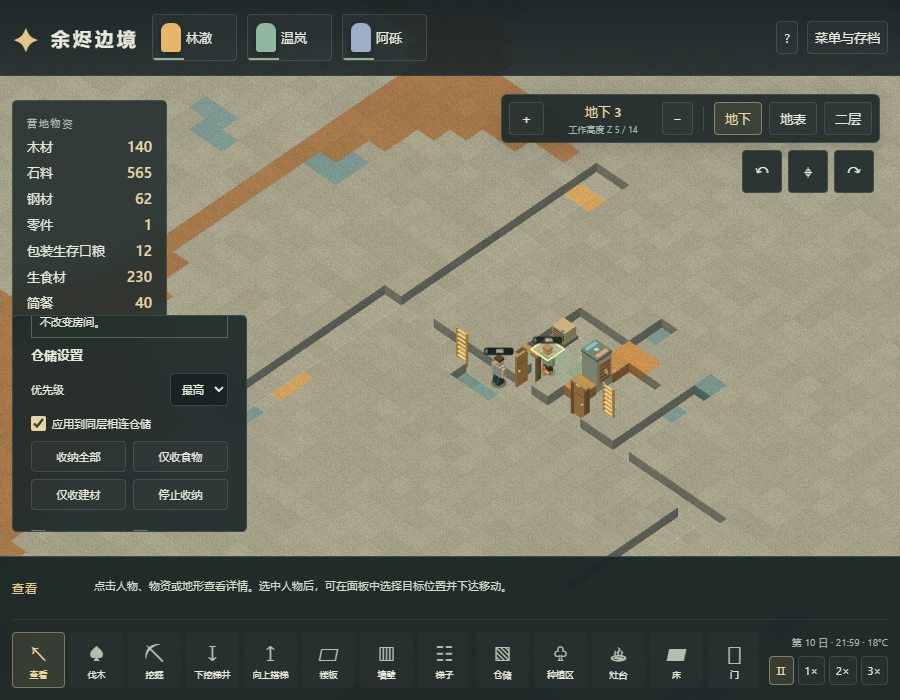
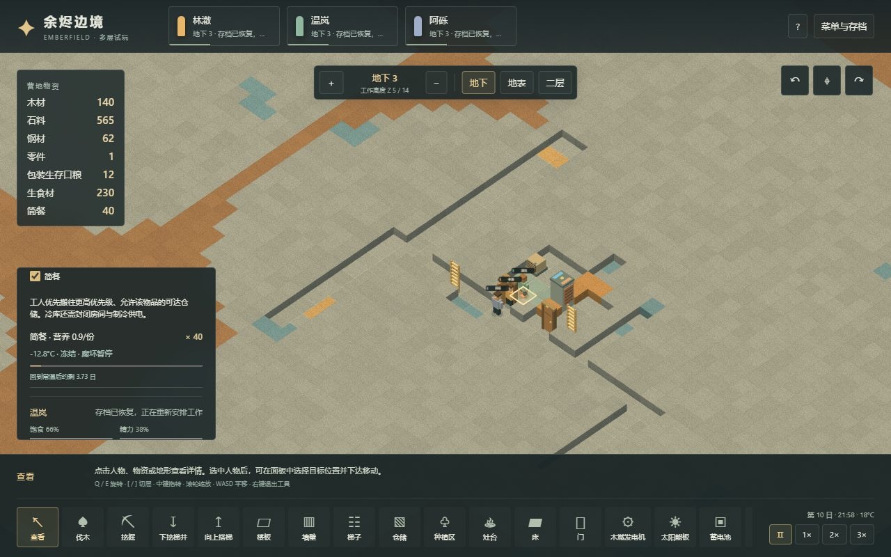

# 20 食物腐坏、冷库与仓储优先级

更新：2026-11-03。[在线体素试玩](https://sqchenxiyuan.github.io/emberfield-web/?world=voxel)。原版规则见[19章](19-preservation-mechanisms.md)，原版独立实机实验见[18章](18-native-preservation-runtime.md)。本章是 Emberfield 三维实现与验收，不把自编公式测试当作原版运行数据。

历史版本说明：本章记录v5保鲜里程碑，截图、数量与原始证据保持不变。当前v6已加入一格一堆和有限容量，新的分堆保鲜回归、旧档迁移与仓储操作见[23章](23-voxel-logistics-implementation.md)。

## 玩家操作

在封闭房间内建冷气机，把蓝侧朝向冷库、橙侧通向可排热空间，并接通电源。冷气机装在墙口，两侧必须有空气。目标设成负温后，应检查实际室温；目标数值本身不保证房间已经冻结。

拖出仓储区，点击任一仓储格，在检查面板设置“仅收食物”和“最高”优先级。默认设置应用到同层四向相连的仓储，取消勾选可只改当前一格。也可分别勾选口粮、生食材、简餐或建材。工人将低优先级仓储中的合格物资搬到更高优先级的可达仓储；相同优先级之间不会来回搬运。停止收纳不会删除现场物品。

点击食品可以看到稻米/土豆/玉米种类、数量、腐坏进度、所在温度，以及按当前温度推算的剩余时间。人物携带的食物、灶台已配送的原料也显示保存状态。剩余时间随温度变化，不能当作锁定的过期日期。营地概览另列累计腐坏损失。

以下是正式构建的浏览器截图。第一张显示900×700窗口中的仓储设置，详情面板可滚动；第二张显示正常生产并搬入地下冷库的40份简餐，其已有腐坏进度没有被清零。





## 原版规则的时间映射

| 食物 | 10°C及以上的基准保存期 | 本项目身份 |
|---|---:|---|
| 稻米 | 40日 | grain / rice |
| 土豆 | 30日 | grain / potato |
| 玉米 | 60日 | grain / corn |
| 简餐 | 4日 | meal |
| 初始口粮 | 无腐坏组件 | food，明确映射包装生存口粮 |

温度因子为 `T <= 0 ? 0 : T >= 10 ? 1 : T / 10`，高于10°C不再继续加快。这不是户外耐久损耗：原版包装口粮仍有DeteriorationRate等耐久机制，本项目尚未实现淋雨/露天磨损。

原版腐坏进度的单位是原版tick，每日60000；本项目每日12000tick，保留保存天数，年龄每tick增加当前温度因子。原版普通食品经Rare tick门控分段更新，本项目每逻辑tick更新。这是调度适配，不能将20TPS称为原版60TPS。

同资源且同作物品种可以合堆；接收堆数量为n、进度a，转入k份、进度b时，新进度为`(n*a+k*b)/(n+k)`。拆分出的份额完整继承原进度。达到腐坏阈值后整堆销毁，不能再被吃掉或作为原料。新烹饪完成的简餐从0进度开始，原料必须在完成前仍然存在且未腐坏。

## 三类实体容器与账本

腐坏覆盖地上物品、人物背包、配送到工作面的食品。温度分别取物品所在格、人物所在格、工位所在格的实际室温。爬楼、睡眠放下食物、任务中断、取消退料、施工挪物、合堆与回读均保留品种和进度。

烹饪工位保留`deliveredFood`批次，不把已配送原料压成失去年龄的总数。批次数量必须与`delivered.grain/meal`一致。原料在工位腐坏后，从配送量中扣除并清零工作进度，任务重新等待原料；剩余木材和未腐坏食材不凭空消失。

损失独立记入`stats.spoiled`。对每种资源始终检查：

```text
现有物资 + 累计消耗 + 累计腐坏 = 初始物资 + 累计产出
```

食物营养账另计腐坏营养，烹饪仍按“10×0.05 → 0.9”的游戏配方产生0.4名义营养增益；不声称物理热量守恒。腐坏不能被伪装成殖民者进食、建筑耗材或普通库存减少。

## 仓储、存档和工程边界

仓储每格保存优先级0～3和七种资源的允许集合。目的地优先按较高优先级、再按可达距离选择。没有额外的冷库瞬移或跨层无线搬运：物资必须沿人物实际可走的道路、梯子和门移动。修改设置后重新检查正在搬运的目的地。

存档升至v5，保留食品品种、年龄、三类容器批次、仓储设置和腐坏账本。v1～v4逐级迁移；旧版合并的grain无法恢复真实作物来源，按稻米迁移，旧食品因没有年龄记录按新鲜迁移。该兼容选择只在旧版本入口发生，v5缺失或伪造必要食品数据会拒绝载入。

不支持食品中毒、尸体腐烂、露天耐久、病菌、食品品质、禁止食用策略或真正的空气对流。没有增加新的世界尺寸，仍为64×64×16。食品年龄和品种附在已有实体上；仓储搜索仍是小地图的遍历方案，大人口或大仓库需要另做基准，不能据此宣称4GiB极限已验收。

库存仍沿用现有的一格可放多种物品、同类数量合并且没有原版单堆数量上限的简化；原版农产品75、餐食10的堆叠上限尚未迁入。因此本章40份简餐会形成一个共享年龄的堆，不能将其具体过期时点视为原版四个餐堆的等价结果。有限仓位、物品堆叠上限与容器容量仍是后续物流模块的待办。这里已实现的是批次年龄流转和温度腐坏链。

## 正常流程证据

`npm run test:voxel:preservation`先执行独立的电力建造流程分支：开局通过普通命令划120格稻田，避免先做工业建设错过第一轮食物供应。接着真实伐木、采有限矿、建设地下房间、电源和竖井线路。流程不注入食物、年龄、温度、燃料、能量、人物位置或时间。

完成电力流程后，工人开凿排热室的通天竖井，使冷气机热端通向室外。太阳能和电池使冷库降至零下；种植和烹饪按日夜自然运行，到tick114885取得40份简餐。创建地下食物仓储并提高优先级后，tick114985全部简餐已实际搬入，原有加权腐坏进度3184.5794tick仍保留，室温约−12.80°C。

随后从同一存档建立两个分支，仅在一侧正常关闭冷气机。44996tick后，冷库约−9.65°C，仍有19份简餐；关闭制冷的一侧约23.83°C，19份剩余简餐全部腐坏。两侧其他21份餐都由人物真实吃掉，两个分支各自满足资源账本。整个流程最低饱食约15.87%，没有把饥荒停摆当作保鲜成功。

浏览器验证从该正常流程保存的检查点导入，通过DOM、鼠标、键盘和文件选择器操作；只读API用于投影、快照和导出断言。覆盖真实拖仓储、区域/单格设置、搬入冷库、已存在年龄继续保存、实际运行时冻结、自然腐坏销毁、v5读写，以及900×700控件可达性。Worker和主线程路径分别验证，最终计数、源码与生产资产哈希见[evidence/voxel-preservation-validation.json](evidence/voxel-preservation-validation.json)。

上述Node流程是加速计算游戏tick，浏览器验收使用正常流程产生的时间检查点；它们不是连续数小时的原版实机实验。原版运行证据单列18章。

本阶段211项单元测试通过，其中20项新增保鲜规则/集成测试。Worker和主线程渲染各9组保鲜浏览器检查，窄屏覆盖13项仓储控件。既有三层施工、住房、电力、17.23日两轮稻米流程及相应食品/住房/电力浏览器回归通过；所有浏览器使用的资产逐字节核对生产构建。
