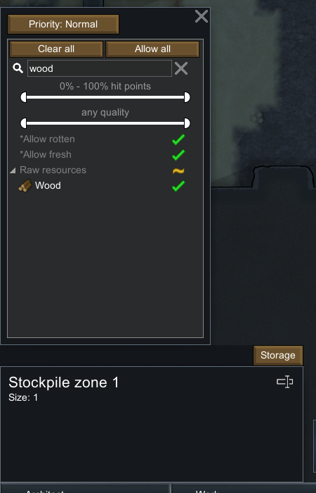
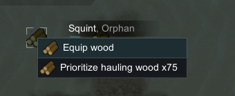
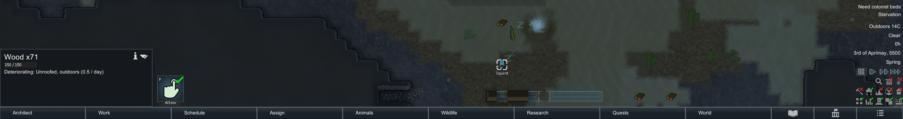
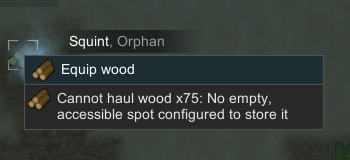

# 22 · 原版普通地面仓储：有界搬运对照

本轮在原版独立研究档中确认：**1格普通仓储可以设置为只接收木材；通过正常殖民者的“优先搬运”任务，75木材中的71被搬进仓储，4留在原地。** 对另一堆75木材，界面随后提示没有可用的仓储位置。

这次运行**没有证明“堆满75后拒绝”的边界，也没有完成同类合堆或扩容后恢复搬运**。仓内实际只有71；一次扩格操作没有生效。原始数量、拒绝提示和未完成边界全部保留，不用静态上限代替实测结果。

## 1. 身份与准备

运行沿用 PID **29920**，可执行文件为 `F:/SteamLibrary/steamapps/common/RimWorld/RimWorld.exe`，启动参数包含独立 `-savedatafolder=…/experiments/rimworld-like/.local-research/runtime/profile-20261102`。开始与结束均暂停，版本 **1.7.4980 rev60**、**Core + Odyssey**，原程序集 SHA256 为 `eff7d97949f919fb2b151ebfb906e9be749b63410b7dbda78eeebb7972b245c3`。

开始前将已有研究存档 `preservation-frozen-1.rws` 复制为 `.local-research/runtime/logistics-before-20261102-185110.rws`。普通玩家存档、游戏文件和 Mod 均未改动。此前保鲜研究留下的开发模式、God mode、木屋与冷气机仍在，本轮没有重建干净开局。

实验步骤：

1. 用普通 Architect → Zone → Stockpile 创建1格室外仓储，Clear all 后只允许 Wood，优先级 Normal。
2. 最初尝试操作已有零散木材，没有取得明确搬运结果；背景已是夜间，殖民者陆续睡觉。
3. 使用开发工具 `Spawn full thing stack → WoodLog` 生成两堆75。菜单退出时镜头有移动，两堆实际位于仓储外；最终坐标由原版存档确认。
4. 选中 Squint，右键第一堆，点击原版 `Prioritize hauling wood x75`。实际推进游戏，随后显式暂停；这一步执行正常殖民者搬运任务，没有直接生成或传送到仓储。
5. 记录仓内71、源地余4，以及第二堆的拒绝提示。只做一次扩格拖拽尝试；最终存档证实仓储仍为1格，随后保存并结束。

交互与保存记录时间为 **2026-11-02 18:51:15–19:04:11 UTC**。中间只有两次有界实际运行，总游戏时间由39868推进至46372，即6504 tick。后续整理与复核都是只读，不再推进原版。

## 2. 原版存档中的结果

最终 `logistics-final.rws`：tick **46372**，唯一仓储 `Stockpile zone 1` / ID 0，只含 `(105,0,129)`，过滤器仅有 `WoodLog`。

| 原版物品 ID | 最终位置 | 数量 | 解释 |
|---|---|---:|---|
| WoodLog42138 | `(105,0,133)` | 4 | 第一堆75的源地余量 |
| WoodLog42142 | `(105,0,129)` | 71 | 搬运后出现在仓储的拆分堆 |
| WoodLog42139 | `(108,0,133)` | 75 | 第二堆，仍在仓储外 |

三堆合计 **150 = 4 + 71 + 75**，与两次开发生成的总数一致。原版记录两份源堆的生成 tick 为43177，仓内拆分堆为43635。没有中途保存第一堆生成后、搬运前的存档，所以“初始75 → 最终71+4”的证据由生成界面、任务指令、动作日志和最终存档共同组成。

| 存档 | tick | SHA256 |
|---|---:|---|
| logistics-before-20261102-185110.rws | 39868 | `d842a7fece16db3fa82aaf4c50cf5f96c030a3acc20681af950125633a48466c` |
| logistics-final.rws | 46372 | `a3ef544f9c1641b30624eb8894b07f6fdc45ecce3bd668edf6a9b716ed5359ae` |

## 3. 不能忽略的干扰与失败

对第二堆的原版提示为：**“Cannot haul wood x75: No empty, accessible spot configured to store it”**。这是真实 UI 观察；但仓内为71而非75，因此不能把拒绝直接归因于木材达到堆叠上限。

最终存档同时显示：Squint / `Human961` 正在 `(105,0,129)` 执行 `LayDown`，任务开始于43638，携带容器为空；该格被他的睡眠任务 `Job_32618` 预留。它解释了“当时并非没有其他任务状态干扰”，但本轮**没有分离验证睡眠、格子预留、搬运容量或路径判断分别对拒绝产生了什么影响**。71的形成原因也未作因果实验。

扩格操作后提示相同，但最终 XML 仍只包含原来1格；所以这是**扩格操作未生效**，不构成“扩大仓储仍不能搬运”的反例。此次没有重新导航或追加实验来凑齐成功结果。

木材 `stackLimit=75`、普通无建筑地格最多1堆、同类未满堆允许合并等规则，另由 [21 · 仓储与搬运机制](21-storage-logistics-mechanisms.md) 的静态证据核对。本篇运行仅覆盖生成75、配置1格仓储、正常搬运71以及受干扰状态下的拒绝提示；二者证据层级分开。

## 4. 截图与独立复核









完整摘要为 [native-logistics-runtime.json](evidence/native-logistics-runtime.json)，包含前后存档抽取、7张未缩放裁剪的坐标/原图与裁剪哈希、52条动作记录、明确的成功与未证实标记。完整截图和 `.rws` 留在忽略目录，不发布原始存档。

```powershell
# 便携复核：字段、数量守恒、截图哈希、动作记录及限制标记
node scripts/research/verify-logistics-runtime.mjs

# 本机复核：再读前后两份原版存档与完整原始截图
node scripts/research/verify-logistics-runtime.mjs --local

# 单独读取最终存档，只输出JSON
./scripts/research/read-logistics-runtime-save.ps1

# 从已有记录重建研究摘要/裁剪；不会输入或启动原版
./scripts/research/collect-logistics-runtime.ps1
```

`save-logistics-runtime.ps1` 复用此前带进程/profile/前台守卫的 UI 输入辅助脚本，保存时拒绝覆盖已有实验档；本轮唯一拖拽复用 `native-window.ps1` 并记录完整起止坐标。输入工具依赖当前布局，不是通用无人值守实验入口。便携校验核对已提交摘要的一致性；`--local` 才重新读原始存档，均不声称重新运行游戏。

结束状态：原版保持**暂停**，开发模式与 God mode 保持此前状态，研究档为 `logistics-final.rws`。未演示的同类合堆、满75拒绝与扩容继续搬运，均明确留作未完成边界。
