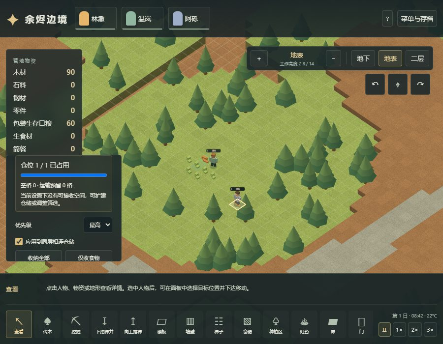
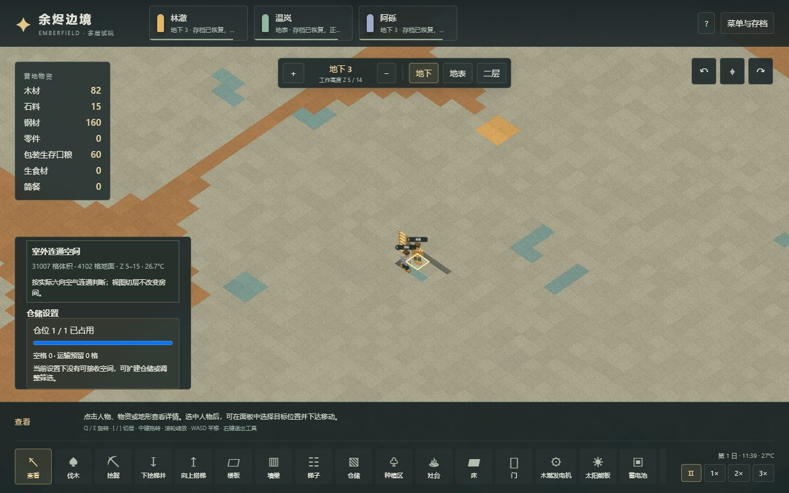

# 23 有限仓位、实体搬运与旧存档迁移

更新：2026-11-03。[体素试玩](https://sqchenxiyuan.github.io/emberfield-web/?world=voxel)。本章记录 Emberfield 实现；原版规则、来源与独立算例见[21章](21-storage-logistics-mechanisms.md)，有干扰的原版搬运实测见[22章](22-native-storage-runtime.md)。20章和其证据保留为先前 v5 阶段的历史记录。

本章现在保留为 v6 阶段记录。当前 v7 已把天然石开凿改为概率产岩块，再经切石台加工石砖，新增岩块上限1和v6迁移；见[26章](26-voxel-stonecutting-implementation.md)。以下“缺少切石流程”等表述描述历史版本，不覆盖当前实现。

## 玩家能看到的变化

地面每格只放一堆。木材、石材、钢材和谷物每堆最多75，零件50，简餐和包装生存口粮10；搬运者一次也不能超过对应上限。谷物按稻米、土豆、玉米分别合堆，实际转移数量决定食品年龄的加权值。

点击物品可看单堆上限和剩余数量空间；点击仓储可看已占仓位、空格和运输预留格数。占用2/2不一定等于满仓：例如75木材与15木材仍有60木材空间。显示的是过滤后物理容量，工人还需有真实可达通路，界面对此明确提示。可按同层相连仓储或当前单格调整筛选和优先级。

初始90木材分两堆，60包装口粮分六堆。开局仓储只有两格，建议先拖出更大的仓储区。两轮农业流程使用20格额外仓储；冷库验收在避开加热器的11格仓储内实际存放四堆简餐及谷物。仓库可以穿行，但建筑完成前必须能搬走占地物资。

没有可用仓位时，搬运者等待；扩大仓储或腾出空间后自动恢复。生产和退料遇到周围满地时也会等待，并保留物资，不会把多个资源强塞进同一格。取消后尚不能退回的已配送材料仍留在被取消的原作业内，稍后自动退回；它受原配方数量上限约束，食品继续腐坏，不是额外无限仓库。





## 实现与原版的对应

| 规则 | 当前实现 | 明确边界 |
|---|---|---|
| 普通地面容量 | 一格一堆，7资源分别限量 | 未做货架、多堆建筑容器或商队负重 |
| 石材 | 对应可用建材 BlocksGranite，75/堆 | 原版原始岩块 ChunkGranite 为1；当前挖矿直接产抽象石材，缺少岩块→切石流程 |
| 手持 | `min(75, stackLimit)` | 没有原版体型、受伤和操作能力的完整搬运 StatWorker |
| 预约 | 源物和目的地按数量保留容量，防止多人超配 | 原版普通 HaulToCell 对源堆/格子独占；数量共享是本项目适配 |
| 寻路 | 目的地必须有三维步行路径，沿梯子实物搬运 | 未复刻原版完整区域/危险/禁区系统 |
| 设置变更 | 过滤或优先级变化后重选目的地和预约 | 原版优先级变化不保证所有在途任务立即改道 |
| 满地放置 | 先试放全部结果，再提交；不足则保留源和输入 | 原版 Direct 可能先部分转移后返回false，本项目使用原子放置适配 |
| 中断与取消 | 无处卸货时保留随身物，退料可延后 | 不采用原版某些极端失败分支的销毁兜底 |

普通输出、卸货和退料只在真实可走的3步近邻内寻找位置，不能隔墙或隔层瞬移。施工挪物只尝试同层相邻格。新堆仅保存物品字段，不能复制人物的任务、作息或路径；当前版本加载也拒绝这些额外字段。

代码入口为 `src/voxel/logistics.ts` 的资源上限、`world.ts` 的放置事务/寻路/预约/迁移，以及 `main.tsx` 的容量检查面板。`storageCapacity` 描述物理容量，`storageDestination` 再按具体搬运者检查路径。预约不写作实物库存，读档时按现有任务重新建立。

## v6存档

新存档版本为6，保留有限堆、食品年龄、取消待退料状态与资源账本，并严格验证字段。v1～v5逐级迁移；从v5迁入时，将超限或同格多堆的旧物品确定性拆到最多12步、真实可达的合法空地。数量及食品数量加权年龄保持一致，空间不足则拒绝整个加载，不提交半个世界。旧版缺失品种或年龄的更早迁移约定仍见20章。

迁移可能把食品放到冷库之外，因此导入后暂停并提醒检查冷库，不能承诺旧存档所有食物仍处在相同温度。用于验收的 [v5冷库存档](../../../tests/fixtures/voxel-v5-cold-store.json) 原样来自已发布保鲜流程，SHA256为 `0f239085ebd34f8ff6f17da4716cc875e908255f82d527746847f28f543a9f20`。其40餐单堆和230谷物可正常迁移；数量和加权年龄没有丢失。来源说明见[fixture说明](../../../tests/fixtures/README.md)，不是通过当前v6实现倒造的旧档，也不是原版RimWorld存档。

## 验收结果

237项单元测试通过，新增26项物流测试，覆盖七资源手持上限、最后5容量的多人竞争、异种争格、满仓扩容、途中过滤变化、不可达高优先仓、腐坏腾位、运输中回读、满地睡眠/进食、取消待退料、烹饪/80钢产出原子回滚、年龄回滚、旧档拆分与v6字段拒绝。

正常物流流程只用公开命令、step、save和load，不注入资源、地形或人物位置。12组检查在tick1826完成：单格入75并让15留在外面、满仓240tick稳定、改过滤不覆盖原物、扩容恢复、开凿三层竖井、开采清运矿料、搬木下梯、途中回读继续运输，以及真实v5存档迁移。每步核对：

```text
现有物资（地面+携带+配送）+累计消耗+累计腐坏 = 初始物资+累计产出
```

浏览器使用正式构建，在Worker和主线程渲染各验证9组：真实鼠标划仓储、满75容量显示、等待稳定、900×700面板可达、扩容实际搬运、单格拒收不覆盖、DOM保存读取、文件选择器导入历史v5档、地下仓位检查。只读API用于投影和断言，没有隐藏修改世界。

有限容量下重新通过三层施工、住房、供电和两轮农业流程；农业跑到17.2755游戏日，资源及营养账本一致。冷库流程正常种植、烹饪40餐并分堆搬入地下，从同一检查点做断电对照，最终持续制冷侧有16餐、零腐坏；断电侧16餐腐坏、余量零。两侧其余餐由人物实际吃掉。保鲜浏览器同样在两种渲染路径各检查9组。

生产资产、源文件哈希、正式浏览器与回归结果见 [voxel-logistics-validation.json](evidence/voxel-logistics-validation.json)。截图来自实际浏览器验收。Node推进的是游戏tick，浏览器导入正常流程检查点，不能把这些测试称作原版连续实机游玩或大规模性能测量。

```powershell
npm test
npm run test:voxel:logistics
npm run test:voxel:preservation
npm run build
# 另一个终端运行正式preview；按本机地址覆盖
$env:VOXEL_TEST_URL='http://127.0.0.1:4178/?world=voxel'
npm run test:voxel:logistics:browser
npm run test:voxel:preservation:browser
npm run research:check
```

地图仍为64×64×16、三名初始人物。没有本轮大人口、4GiB上限或超大仓储基准；健康战斗、季节、切石加工、货架和食物中毒仍未迁入。原版71木材搬运与拒绝提示是22章的局部观测，不是本章满75/扩容测试在原版中也通过的证据。
