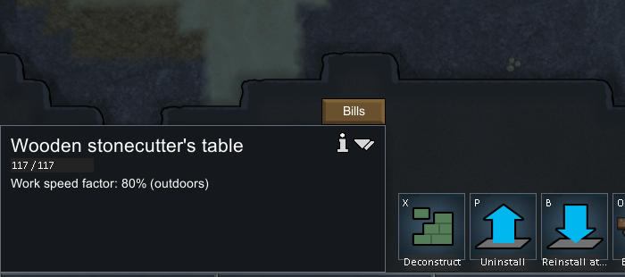
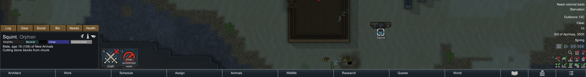
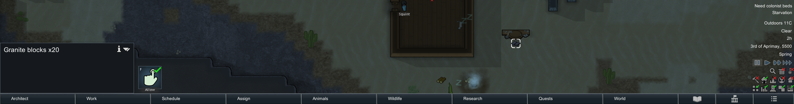

# 25. 原版切石运行证据：一块花岗岩块到二十块石砖

2026-11-03（北京时间）在原版 RimWorld **1.7.4980 rev60、Core + Odyssey** 的隔离研究存档中，Squint 正常执行切石任务，使用 **1 个 ChunkGranite，产出 20 个 BlocksGranite**。中途暂停游戏时钟并保存，再继续游戏后完成。这次没有暂停账单，也没有读档，不能据此声称验证了这两种恢复行为。

## 环境与准备边界

- 复用原版进程 PID `29920`，程序 `F:\SteamLibrary\steamapps\common\RimWorld\RimWorld.exe`。程序集 SHA256 为 `eff7d97949f919fb2b151ebfb906e9be749b63410b7dbda78eeebb7972b245c3`。
- 原版使用 `-savedatafolder=...\experiments\rimworld-like\.local-research\runtime\profile-20261102`；沿用此前物流实验的地图，以 `stonecutting-*` 新文件名保存。备份是此前 `logistics-final.rws` 的完整副本，哈希见 [JSON](evidence/native-stonecutting-runtime.json)。未覆盖玩家正常存档。
- 开发者模式与 God mode 原已开启。本次通过 Needs 面板开发者 `+` 把 Squint 的 Food/Rest 加到 1；God mode 放置木制切石台；开发者 Spawn thing 放置一个 `ChunkGranite`。**采矿取得材料、普通施工耗材、需求自然恢复均不属于本次证据。**
- 切石台在室外，UI 明示 `Work speed factor: 80% (outdoors)`。Squint 仍有 `WakeUpAddiction` 和 `Malnutrition`，因此不把完成用时当成所有人物的固定常数。
- 最初右键任务被拒绝：`Not assigned to crafting`。打开 Work → Craft 后，右键 `Prioritize cutting stone blocks` 成功。它是正常 `DoBill`，但由玩家指定优先执行，不是自主选工作的证明。



## 存档时间线与材料证据

准备工作始终暂停，两个正式运行窗口分别以速度 3 开始，工具等待设为 1.8 秒和 8 秒，再显式点击暂停。工具本身有输入、截图和调度耗时，因此这两个等待参数不等同于精确运行墙钟时长。UI 操作从 19:30 UTC 到 19:52 UTC；最终留下暂停的原版窗口。

| 存档 | 游戏 tick | 可直接提取的状态 |
|---|---:|---|
| `stonecutting-start` | 46372 | 准备前，无本次切石台；Squint 正在睡觉 |
| `stonecutting-ready` | 46372 | `TableStonecutter42144`，木材质，位置 `(113,0,138)`；花岗岩账单次数 1；Food/Rest 都为 1 |
| `stonecutting-working` | 47518 | Squint 执行 `DoBill36124`，`DoBillsStonecut`；任务 count=1，目标 `ChunkGranite42145`；`workLeft=1195.07764`，`ticksSpentDoingRecipeWork=666` |
| `stonecutting-final` | 50881 | 生成 `BlocksGranite42147`，`stackCount=20`，位置 `(113,0,137)`；账单剩余次数为默认 0；Squint 转去散步 |

处理中存档同时包含这些相互对应的字段：

- `targetA=Thing_TableStonecutter42144`，`targetB=Thing_ChunkGranite42145`，`count=1`。
- `placedThings` 指向同一个 `ChunkGranite42145`，物品已在切石台 `(113,0,138)`，搬运已结束。
- `JobDriver_DoBill` 的 `billStartTick=46854`，当前剩余工作量为 `1195.07764`。
- 完成存档中的 `BlocksGranite42147.stackCount=20`，`spawnedTick=49485`；UI 同时出现 `Bill complete: Make granite blocks.`，点选产物显示 `Granite blocks x20`。

`stackCount` 对数量 1 的输入在原版 XML 中省略；摘要保留 `stack_count_explicit=false`，按默认 1 解读，同时有任务显式 `count=1` 交叉核实。完成账单的 `repeatCount` 同样省略，摘要同时保留省略标记及默认值 0。

**不能把普通 XML 查询结果当作全地图物品清单。** `ready` 有 `compressedThingMapDeflate`，普通显式节点查询未找到岩块；本次不解码该结构，因此不声称准备存档“没有岩块”。输入数量依据处理中显式对象和正常任务；输出依据完成存档和 UI。也不根据最终普通节点缺少输入，就声称扫描过地图所有压缩物品。






## 对机制与设计文档的约束

1. **生产输入与产出有运行证据。** 原版实际表现支持 1 岩块 → 20 石砖，不只是从配方填写一个预期数值。切石台正常执行搬料与加工后，产物落在交互位置。
2. **Craft 工作开关确实阻挡执行。** 第一次右键拒绝、打开后可执行提供了 UI 证据；这不等同于制作技能等级决定速度。工作速度公式与配方 workAmount 见[第 24 章本地定义/方法证据](24-stonecutting-mechanisms.md)。
3. **1600 是配方工作量，不是本次固定耗时。** 本次从 `billStartTick=46854` 到产物 `spawnedTick=49485` 相差 2631 ticks。这个观察包括室外和人物状态影响，不能外推为无修正的标准切石时间。
4. **本次验证游戏时钟暂停后续作完成。** `working` 保存了加工中 `workLeft`，继续游戏后产物出现；没有加载该保存，也没有按下账单暂停按钮。账单暂停导致的取消/重启、重启后的进度、存档读回连续性，应分别验证。
5. **没有验证石砖入库。** 当前仓储沿用此前仅收 Wood 的设置，最终石砖位于切石台交互格。不要把完成加工写成完整的入库流程证据。

## 可复查材料

- [四份存档的结构化摘要、哈希、结果边界](evidence/native-stonecutting-runtime.json)
- [72 条顺序 UI 操作记录](evidence/native-stonecutting-actions.jsonl)
- [只读存档提取器](../../../scripts/research/read-stonecutting-runtime-save.ps1)
- [证据重建脚本](../../../scripts/research/collect-stonecutting-runtime.ps1)
- [独立校验器](../../../scripts/research/verify-stonecutting-runtime.mjs)

在本项目根目录运行：

```powershell
node scripts/research/verify-stonecutting-runtime.mjs
node scripts/research/verify-stonecutting-runtime.mjs --local
```

portable 模式校验提交摘要、8 张截图裁片、操作记录、数量与时间关系；local 模式额外重新读取原版存档、核对原截图与备份哈希。二者均不重新运行游戏，也不加载游戏程序集。完整 `.rws`、完整截图及反编译文件仅保留在忽略的本地研究目录。

UI 实验结束时原版暂停，开发者模式和 God mode 仍开启；未修改原版游戏文件，未安装 mod，未改正常玩家存档。
