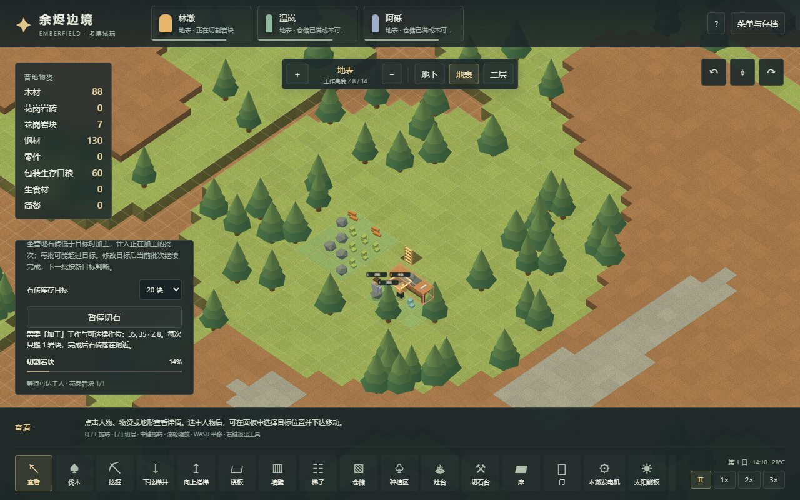
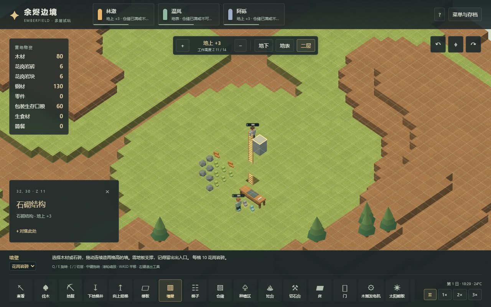
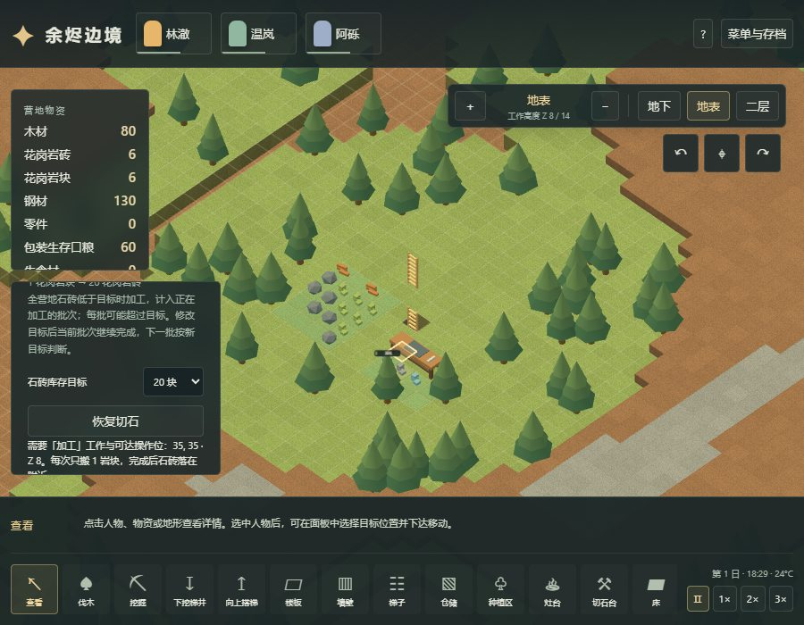

# 26 岩块、切石账单与多层石砖施工

更新：2026-11-03。[体素试玩](https://sqchenxiyuan.github.io/emberfield-web/?world=voxel)。本章说明 Emberfield 的实现与验证；原版静态规则见[24章](24-stonecutting-mechanisms.md)，有界原版操作记录见[25章](25-native-stonecutting-runtime.md)。[23章](23-voxel-logistics-implementation.md)和其 v6 验证记录保留为历史证据。

## 从开凿到施工

天然花岗岩现在可能掉落单个岩块，不直接产出可施工石砖。先扩仓并开凿，工人沿梯子把岩块运到地面；用75木材和30钢材建一座3×1木制切石台，留出金色标记的操作位。R旋转工作台，角色的「加工」岗位决定是否接手切石。

每批投入1花岗岩块，劳动完成后产出20花岗岩砖。点击切石台设置库存目标或暂停；目标统计全营地石砖，并计入已创建加工任务的预计产出，所以完整批次可超过目标。升高或降低目标保留当前批次，下一批按新目标判断；手动暂停账单则取消当前工作并退回岩块，再恢复需重新劳动。单纯暂停游戏和正常保存/回读会保留工作进度。

墙与楼板工具新增材料选择。石砖楼板消耗4砖，两格高石砖墙消耗10砖；工人需要真实配送到楼层，石墙不能直接消耗未加工岩块。拆除返回石砖，不能变成木材。台面可见送达的岩块、人物挥动工具与加工粒子；游戏暂停后劳动画面冻结。





## 数值来源与适配

| 规则 | 本轮实现 | 来源与边界 |
|---|---|---|
| 天然岩石掉落 | 每个实际移除的自然石体素有25%概率产1岩块 | 借用原版普通难度下天然花岗岩参数；以种子和坐标固定抽样，不能用满地重试/读档刷概率，不复现原版全局随机流 |
| 两格高开凿 | 分别检查上下两个物理体素 | 三维扩展，一次采矿任务不等于原版一个岩实体；钢矿、机械矿维持已有矿物规则 |
| 堆叠与手持 | 岩块1，石砖75 | 对应 ChunkGranite / BlocksGranite；未加入搬运能力、体型与受伤修正 |
| 木切石台 | 3×1；75木材+30钢材；467工作tick | 原版2000基础施工工作×木材0.7，再按60→20 TPS向上取整；原版材料可选范围更广，本轮仅木台 |
| 加工 | 1岩块→20石砖；534工作tick | 原版1600工作量，以劳动者和工作台速度均为1换算；本轮没有技能、房间角色、室内外温度速度乘数或经验系统 |
| 石砖墙 | 高2体素；10砖；634工作tick | 原版每墙5砖、花岗岩工作量950；两格高扩展为两份成本/工作，不是原版直接数值 |
| 石砖楼板 | 4砖；367工作tick | 借用 TileGranite 的4砖/1100工作；把铺地转为真实承重楼板是三维适配 |
| 拆石结构 | 每体素返2砖；整墙4，楼板2 | 固定回收适配；原版墙5×0.5随机取整为2或3，花岗岩地砖返2 |
| 拆工作台 | 37木材、15钢材；已送岩块另行退回 | 成本一半向下取整；不复现原版随机取整 |
| 目标库存 | 地面+携带+配送石砖，另计在途加工批次 | 原版指定石料账单主要计仓储与玩家人物携带；项目没有完整 ResourceCounter 范围和通用石材账单 |
| 研究门槛 | 切石默认解锁 | 体素研究系统尚未迁入，不能理解为原版无需 Stonecutting 科技 |

当前仍为20 TPS，以上工作时间按现实时间基线换算并向上取整：534tick约26.7秒。原版实际工时还受工作速度等条件影响；这里不承诺原版室外木台也在26.7秒完成。游戏日仍是12000tick/10分钟，未进行全局60 TPS迁移。既有木墙6木/80tick、木楼板3木/45tick维持早期调参，不能与本轮石材来源混为同一套原版施工平衡。

原版25%×1岩块×20砖的长期期望是每岩实体5砖。旧版固定直产5石材只保留了这个均值，缺少概率、岩块占格和加工劳动；新链条把这些环节加入。短程可能岩块不足，必须继续开凿，不能保证每四块石头恰好掉一块岩块。

## 事务与存档

岩块只能一块一堆，采矿、成品放置、退料和台体拆除沿用有限物流的原子放置。周围无合法位置时保留原方块、原料或已取消待退料作业，稍后重试。台体三格都需要支撑和净空；建造、取消与拆除不能绕过已有设备、物资或人物检查。加工必须抵达旋转后的指定工作位，不能从背面隔墙操作。

v7增加 `chunk`、`craft`、`stonecutters`、`Job.material` 和 `Block.Masonry`。旧 `stone` 保持可用石砖身份和数量，原木墙/楼板任务按木材迁入，新增加工优先级默认1。**旧仓储过滤保持原样，不自动加入岩块**；从v6载入后暂停并提醒检查过滤，更早版本继续提示先检查迁移后的冷库位置。新划定的普通仓储包含岩块，可手动调整。

兼容验证使用已发布 v6 的[原始流程存档](../../../tests/fixtures/voxel-v6-logistics.json)，保留其15石材为15石砖，没有补发岩块或重造旧存档。其来源和固定哈希见[fixture说明](../../../tests/fixtures/README.md)。v5冷库原始 fixture 与历史验证记录也保留不变。

## 验证方式

[本轮验收记录](evidence/voxel-stonecutting-validation.json)保存源码、测试脚本、构建资源及截图哈希，并区分合成单元场景、正常指令流程和真实浏览器操作。

本轮264项单元测试通过，其中26项专门覆盖切石链。正常切石流程20项检查在tick10801完成，累计加工4岩块为80砖；花14砖建楼板和墙、拆墙返4砖，最终70砖。浏览器两种渲染路径各11项检查；具体资源字节与回归检查保存在记录中。

正常流程从种子73129开局，仅用公开命令、step、save/load：砍三棵树，挖梯井，开采钢矿，开凿天然岩层，携带岩块上梯，建台并加工，向上搭梯并配送石砖修建楼板/墙。第一片矿室产出不足，流程实际继续开凿。另验暂停退料、目标升降不中断、目标降到0后完成当前批次但不再开工、加工途中回读、目标补产、拆墙回收和旧档迁移。每步检查物品上限、单格唯一堆、人物支撑与八类物资账本：

```text
现有物资（地面+携带+配送）+累计消耗+累计腐坏 = 初始物资+累计产出
```

Chrome 使用实际鼠标、键盘、DOM和文件选择器，分别验证渲染 Worker 与主线程兼容模式。只读调试接口用于快照、坐标投影与存档导出；没有隐藏写入。检查岩块选择、旋转工作台、目标设置、暂停退料、工作画面变化/暂停稳定、DOM保存读取、真正上层石砖施工、900像素窗口控件可达以及v6迁移。普通农业两轮、三层施工、住房、电力、保鲜及有限物流均单列回归，不把Node逻辑通过当作浏览器画面验证。

回归中旧工业营地曾因岩块占位更多而在封墙时等待清场。验收流程改为先划90个真实仓位、将边界散落物搬走后封墙，未删除物品或增发资源。最终正常保鲜流程再次完成40餐烹饪和跨层入库，同一存档分支对照通过。矮窗口资源列表新增滚动上限，避免新增第8类物资覆盖详情面板；900像素窗口同时检查面板不重叠和最后一行可滚动查看。



复现命令（生产预览另开终端，本文本机端口5183）：

```powershell
npm test
npm run test:voxel:stonecutting
npm run build
$env:VOXEL_TEST_URL='http://127.0.0.1:5183/?world=voxel'
npm run test:voxel:stonecutting:browser
npm run research:check
```

源码入口：`src/voxel/crafting.ts` 定义成本和随机掉落，`world.ts` 负责工作/物流/迁移，`main.tsx` 提供账单与材料控制，`renderer.ts` 绘制岩块、石砖和台面劳动。正常流程脚本为 `scripts/voxel-stonecutting-campaign-verify.mjs`，浏览器脚本为同目录 `voxel-stonecutting-browser-verify.mjs`。

本轮没有完成多种岩性、碎石再利用、货架、完整制造品质/技能、世界生成、生物群系、战斗或健康迁移，也未验证大地图、大人口或4 GiB上限。原版运行证据只支持25章明确记录的观察，不把Web测试与静态算例称为原版实测。
