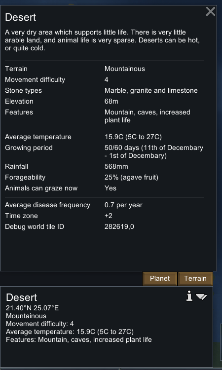
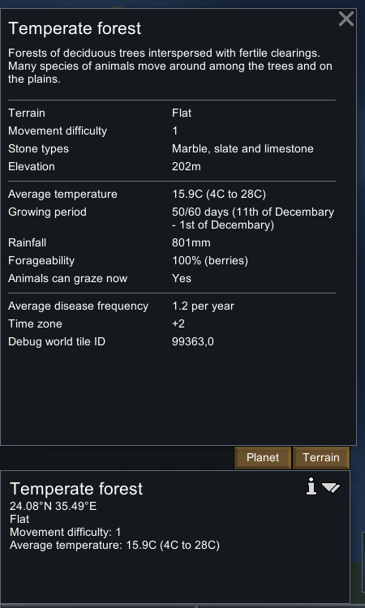
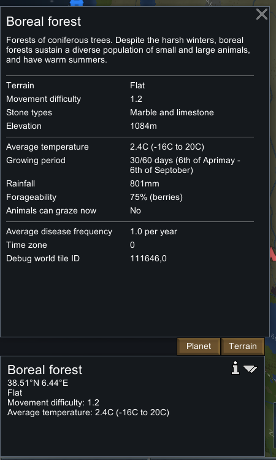
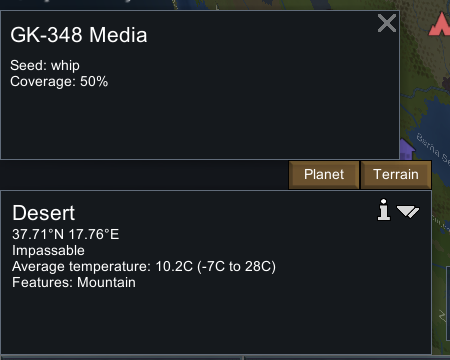

# 28. 原版世界选址运行观察：生态区、气候与地形

2026-11-03 北京时间，在原版 **RimWorld 1.7.4980 rev60，Core + Odyssey** 的现存世界实际选择了五个陆地格点，覆盖 **Desert、Temperate forest、Boreal forest**，并打开 Terrain 面板记录气候、地形、石种与生长季。Planet 面板显示世界 `GK-348 Media`，种子 `whip`，覆盖率 `50%`，与存档世界参数一致。

这份记录证明原版选址界面的实际内容与所选地点差异；**没有重新生成世界，没有验证噪声函数、同种子逐格等价或局部殖民地地图的生成结果**。

## 实际操作与环境

复用进程 PID `29920`，重新核对可执行文件为 `F:\SteamLibrary\steamapps\common\RimWorld\RimWorld.exe`，命令行仍指定本项目 `.local-research/runtime/profile-20261102`。原版程序集位于安装根目录 `Assembly-CSharp.dll`，SHA256 为 `eff7d97949f919fb2b151ebfb906e9be749b63410b7dbda78eeebb7972b245c3`。最初按常见 Unity 子目录查找 DLL 失败，随后通过实际文件列表找到安装根目录中的文件；没有将查询失败当成程序集不存在。

操作从 20:14 UTC 开始，进入世界地图、点击格点、打开 Terrain、缩放并向北移动，再打开 Planet。主要五个格点截图在 **20:15:53–20:19:26 UTC** 取得，之后返回殖民地。世界观察未使用 `Generate map`、`Generate settlement` 等开发者按钮；原已开启的 developer mode 只让面板额外显示 Debug world tile ID。初次落点是海洋，保留在操作日志但不计入陆地样本。

本次没有打开新建世界设置，也没有创建新世界。Small hills / Large hills 两类没有采到；尝试寻找丘陵时实际选中的是 Mountainous 与 Impassable，应按真实标签记录。

## 五个原版格点的观测值

以下数值逐项来自 UI 截图人工转录；tile ID 后的 `,0` 是界面显示的层编号。气温区间按 UI 显示取整，平均气温保留一位小数。不是把生成器中的预期数值填入观察表。

| tile / layer | 生态区 | Terrain | 平均温度（区间） | 降雨 | 生长季 | 海拔 |
|---|---|---|---|---:|---:|---:|
| 282619 / 0 | Desert | Mountainous | 15.9°C（5–27°C） | 568 mm | 50/60 天 | 68 m |
| 99363 / 0 | Temperate forest | Flat | 15.9°C（4–28°C） | 801 mm | 50/60 天 | 202 m |
| 111646 / 0 | Boreal forest | Flat | 2.4°C（−16–20°C） | 801 mm | 30/60 天 | 1084 m |
| 118124 / 0 | Desert | Impassable | 10.2°C（−7–28°C） | 333 mm | 35/60 天 | 274 m |
| 176455 / 0 | Desert | Mountainous、Creek | 7.9°C（−11–27°C） | 506 mm | 30/60 天 | 307 m |

| tile | 石种 | 移动难度 | UI Features |
|---|---|---:|---|
| 282619 | Marble、granite、limestone | 4 | Mountain, caves, increased plant life |
| 99363 | Marble、slate、limestone | 1 | 该行未显示 |
| 111646 | Marble、limestone | 1.2 | 该行未显示 |
| 118124 | Marble、slate、limestone | 该行未显示 | Mountain |
| 176455 | Sandstone、limestone、slate | 4.1 | Mountain, caves, creek |

温带森林和本次第一处沙漠的平均气温同为 15.9°C，生态区却不同；温带森林和针叶林的降雨同为 801 mm，气温与生长季不同。因此这些样本支持“选址同时呈现多个维度”，不能据此反推单个气温或降雨阈值的完整分类公式。







两处 50/60 天的 UI 生长季字符串都是 `11th of Decembary - 1st of Decembary`，按原文保留；没有按日期直觉改写。针叶林显示 `6th of Aprimay - 6th of Septober`，当前 `Animals can graze now: No`。完整记录还包含坐标、可采食比例/食物、疾病频率及时区。`not displayed` 只表示本次面板没有展示那一行，不是底层字段不存在的断言。

## 世界参数交叉核对



只读提取原有 `stonecutting-final.rws` 及本次四份新存档的 `world/info`，得到：

- 名称 `GK-348 Media`，`seedString=whip`，`planetCoverage=0.5`，与 Planet UI 的 50% 一致。
- `overallRainfall=Normal`，`overallTemperature=Normal`，`initialMapSize=(250, 1, 250)`。这些是**存档字段证据**，没有声称在本次新世界参数 UI 中看到。
- 五份存档的 `world/info` 和 `world/grid` 序列化 XML 哈希分别完全相同。该结果说明本实验记录期间这些世界数据未变化，不证明重新生成会得到相同结果。
- 提取器未解码 world grid 的 tile 数组；五点气候表来自实际 UI，不来自空 XPath 查询或自动推测。

## 误续跑与最终暂停核验

返回殖民地后，20:20:18 UTC 冗余点击了当时已暂停的暂停按钮，实际把时间切到运行；保存菜单没有永久保持暂停。最初文件名 `biomes-final`、`biomes-confirm-paused` 没有证明暂停，第二次读存档发现 tick 持续增加后立即按 Space 停止。以下保存顺序如实保留：

| 保存 | tick | 用途 |
|---|---:|---|
| 原 `stonecutting-final` | 50881 | 开始前保留的基线文件 |
| `biomes-final` | 51440 | 初次以为已停；实际较基线增加 559 |
| `biomes-confirm-paused` | 115245 | 发现仍在续跑的失败核验 |
| `biomes-stopped-a` | 134003 | 按 Space 后第一次保存 |
| `biomes-stopped-b` | 134003 | 返回地图后再次保存，tick 相同 |

**隔离研究殖民地总计向前运行了 83,122 ticks，不能称作只增加 559 ticks或全程暂停。** 最后出现殖民者倒地、医疗警报等状态变化；这些不是生态区或世界生成实验结论。五处选址面板是在误续跑之前取得的，但没有为每次选点保存精确 tick，故不给它们编造同一 tick 编号。

20:24:08 UTC 的 Space 后，20:24:39 与 20:24:49 保存出的两个 tick 都为 134003，最后于 20:24:51 UTC 返回暂停地图，结束 UI 操作。此后以 `biomes-stopped-b.rws` 作为本轮最终研究存档；没有继续修复、回滚或重做实验。

原 `stonecutting-final.rws` 未覆盖，哈希仍为 `2af1ff41a338adbb9fdc458b01433acceae8f90ef323f5f71e5ee0929494dc6a`。正常玩家 profile 未触碰；未修改游戏文件，未安装 mod。开发者模式与 God mode 仍保留原状态。

## 证据与复查

- [结构化观察、五份存档摘要与哈希](evidence/native-biomes-runtime.json)
- [41 条实际 UI 操作](evidence/native-biomes-actions.jsonl)
- [只读提取器](../../../scripts/research/read-biomes-runtime-save.ps1)、[证据重建脚本](../../../scripts/research/collect-biomes-runtime.ps1)、[独立校验器](../../../scripts/research/verify-biomes-runtime.mjs)

```powershell
node scripts/research/verify-biomes-runtime.mjs
node scripts/research/verify-biomes-runtime.mjs --local
```

portable 模式检查五个观察记录、三种生态区、三类 Terrain、五份存档摘要、八张截图裁片、41 条操作记录及明确的未验证边界。local 模式额外重新提取原存档并核对原始截图哈希。校验器不做 OCR、不重新运行原版，也不将记录完整性冒充噪声/种子生成等价证明。
