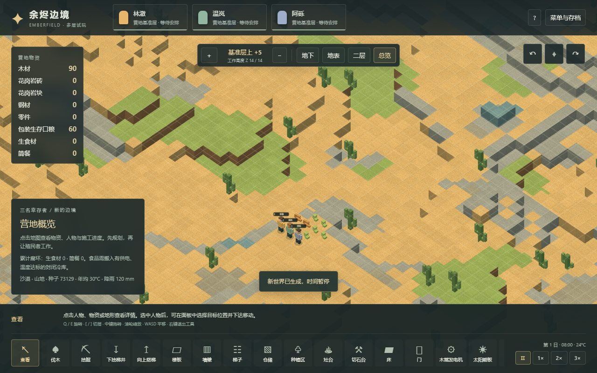
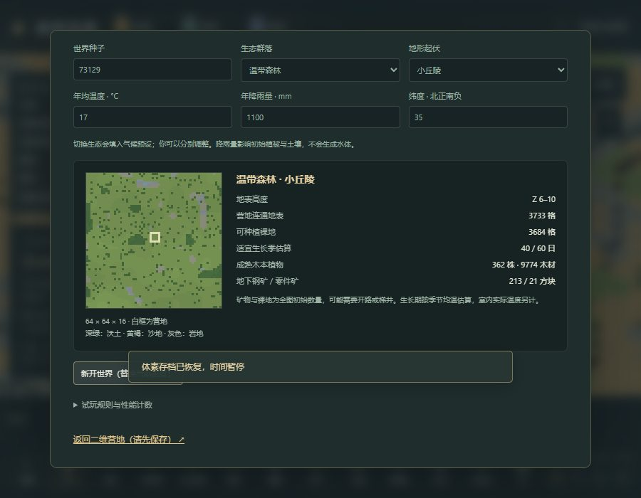

# 29 体素世界生成：生态、起伏、土壤与气候

更新：2026-11-03。入口为[多层体素试玩](https://sqchenxiyuan.github.io/emberfield-web/?world=voxel)的「菜单与存档 → 选择落脚之地」。原版静态规则见[27章](27-biomes-terrain-generation.md)，实际世界地图观察见[28章](28-native-world-generation-runtime.md)。本章记录 Emberfield 的生成器2，不能用同一个种子复现原版地图。

## 创建与游玩

玩家可以选择种子、温带森林/寒带森林/沙漠，以及平原/小丘陵/大丘陵/山地；年均温度、年降雨量、纬度可以分别修改。切换生态会填入气候预设，起伏保持当前选择。预览通过模拟 Worker 生成独立缓冲区，不改变正在游玩的营地、时间或任务；只有点击新开世界才替换进度。非法种子或超出范围的气候参数会禁用创建。

预览显示实际地表、木本植物、出生点、高程、矿物方块数量、可种植裸地和适宜生长期估算。矿量为整张初始地图的有限储量，不保证营地附近可直接获得；连通地表数只计地表一格高差通行，不是地下/设施寻路承诺。

新地图仍是64×64×16，坐标Z表示人物脚部高度。生成器在中央附近寻找较平缓地点，只整平3×3落脚区，不再制造半径13格的平坦圆盘。三名人物、90木材、60包装口粮属于明确的开局补给；没有固定树木或钢矿保底。地下矿簇在三个维度有限延伸，可实际挖完。世界之外、基岩底层与最高可用层维持原有边界。

返回营地、层高快捷键和新手定位会使用真实出生点。「总览」可查看完整起伏，再切到对应工作层施工。白杨、松树、巨柱仙人掌有各自的程序模型，点击可看产量；土壤详情显示肥力。施工仍要满足两格净空、实际支撑、材料可达和已有占位规则。

## 原版参数与自定生成规则

| 项目 | 当前实现 | 来源及边界 |
|---|---|---|
| 肥力 | 普通土壤1、沃土1.4、砾石0.7、沙地0.1 | 原版 TerrainDef 数值；普通三种作物最低肥力0.7，不把噪声值当作最终肥力 |
| 木本植物 | 白杨/松树27木，巨柱仙人掌15木 | 对应原版成熟基础产量；砍伐仍用原型60工作tick，无原版物种工时差异、树龄、生长、自然再生与采收能力修正 |
| 生态植物选择 | 每种生态一种主要木本植物 | 简化群落，没有草、灌木、物种竞争及完整 wildPlants 权重；原版0.65/0.40/0.05野生植物密度不能当成树覆盖率 |
| 高度 | 平原7–8，小丘陵5–10，大丘陵3–12，山地理论2–14再限到3–13 | 两个平滑值噪声混合、取整、局部找出生点；范围是配置上界，不保证每张图都达到极值 |
| 地表 | 独立湿度/岩地噪声，叠加坡度和降雨偏移 | 借用0.87沃土/0.80沙漠转土参考阈值；整个三维算法和雨量偏移是项目设计，非原版 GenStep 复制 |
| 初始树覆盖系数 | 温带0.065、寒带0.085、沙漠0.014 | 再乘局部场、雨量及肥力因素；这是树木子集的调参，不是原版总植物密度 |
| 矿簇尝试 | 平原20、小丘陵32、大丘陵44、山地60次 | 每8次之一为零件矿，其余钢矿；随机游走只替换自然岩石，交叠和撞边会减小实际储量，非原版二维密度原样移植 |
| 日温度 | 季节均温加7°C日正弦 | 保留项目08:00开局和固定昼夜节律；没有随机日温噪声、天气温差或纬度昼长 |
| 地下温度 | 原有导热地温常数保持不变 | 本轮把室外气候接入房间边界；没有地热、海拔递减或地下季节滞后模型 |

气候预设为：温带17°C/1100mm/北纬35°，寒带3°C/850mm/北纬60°，沙漠30°C/120mm/北纬25°。这些是本项目开局配置，不是原版生态区的唯一气候。支持均温−30～45°C、雨量0～4000mm、纬度−90～90°。

## 季节真正影响模拟

一年60日，每季15日。季节振幅横坐标使用 `abs(sin(latitude))`，经过折线 `(0,3)、(0.1,4)、(1,28)`；北半球年内第20日为暖峰、第50日为冷峰，南半球反向。45°的振幅约20.19°C，不是用45/90推导的14.67°C。

室外气温实际进入作物温度曲线、房间导热和各食物容器的腐坏速率。气候与生态名称独立：同温度/纬度下，单改生态名称不会改温度。植物在寒冷时暂停生长，食品在0°C以下暂停腐坏；封闭房间仍可用既有设备调温。

「适宜生长季估算」按12个五日段、每段120次季节温度采样的均值是否在闭区间[6,42]内计算，以五日为单位。它不是当前小时能否生长，也不包含日温变化或室内供暖，不保证在显示天数内获得一次收成。当前温带与寒带预设分别为40/60日和30/60日。原版实际植物生长还有不同的最低/最高温判断，详见27章。

## v8与历史营地

v8记录 `generator`、完整 `settings` 和 `spawn`，保存物理体素，不靠重新生成还原已挖矿脉。新增方块编号为沃土8、沙地9、砾石10；树木携带species。加载严格检查元数据、方块范围和树种，不对损坏存档偷偷夹值。

v1～v7继续保留原来的地图、已有物资和21±7°C日温规则，迁入后仍标为generator1；旧树木映射为白杨。对旧营地保存成v8，再读回也不会获得新季节或重刷矿物。迁移验证使用[真正的v7原始开局存档](../../../tests/fixtures/README.md)，不是新生成器伪装出来的旧档。

旧坐标固定的农业、住房、电力、保鲜、物流和切石回归现在显式导入该历史开局，并记录 `baseline.generator=1`。这些检查证明旧营地可以继续玩；生成器2有独立的真实开局流程，不以旧坐标测试限制新地形。

## 验证与复现

[本轮验证记录](evidence/voxel-worldgen-validation.json)单列单元场景、三种生态的正常指令流程、浏览器实际输入、回归报告与构建资源哈希。

新增27项单元检查覆盖确定性、种子/配置差异、独立预览缓冲、三生态×四档起伏的正常伐木开局、新土壤开挖/肥力、真实作物/房间/食物气候影响、季节与生长季，以及v8验证/旧档迁移。合成测试明确设置几何和时点的部分不冒充正常玩家流程。

三局正常流程分别为温带/小丘陵种子73129、寒带/大丘陵种子2718、沙漠/山地种子42。只读检查生成地形和路径来选址，公开command/step/save/load完成：伐三株实际植物并入库、播种四块真实可种土壤、从实际矿脉旁开凿三层梯井、采钢并搬回地表、存档回读、向上搭梯和建设承重楼板。没有注入材料、人物位置、成熟作物或进度。最终tick分别为1381、1516、1611，沙漠另验证普通作物不能种在沙地；这是有界开局验证，不代表寒带/沙漠长期生存已平衡。

浏览器使用实际按钮、输入框、地图点击和文件导入，在渲染Worker和主线程两条路径检查：预览不修改当前营地、非法输入拒绝、三生态真实生成和外观、同种子换配置、仙人掌选择和15木材产出、手动保存回读、900×700控件可达、原始v7迁移。只读快照/投影用于判断结果，无隐藏写入。

最终291项单元测试通过，三局新开局共22项检查；新世界浏览器两种路径各11项。六次不刷新页面的“保存→新世界→回读”循环也通过，每次恢复后的27个几何对象、4张纹理、16个地形块和2,008,968字节地形网格都返回基线；这是有界生命周期检查，不代表整页内存或长期无泄漏。农业、住房、电力、保鲜、物流、切石及三层施工另列旧营地回归。





```powershell
npm test
npm run test:voxel:worldgen
npm run build
# 另一个终端启动生产预览；本机验证复用5183
$env:VOXEL_TEST_URL='http://127.0.0.1:5183/?world=voxel'
npm run test:voxel:worldgen:browser
npm run research:check
```

源码入口：`worldgen.ts`生成与预览，`climate.ts`季节，`world.ts`物理模拟与迁移，`WorldSetup.tsx`创建界面，`renderer.ts`地表与物种绘制。

没有加入行星六边形世界图、选址旅行、多地图、洞穴、河海、降水天气、积雪、树木再生、完整物种群落或水流。仍未验证大地图、大人口、4GiB总内存或原版同种子等价。原版28章还明确披露研究档误续跑和最终暂停核验；该异常不被当作世界生成机制证据。
