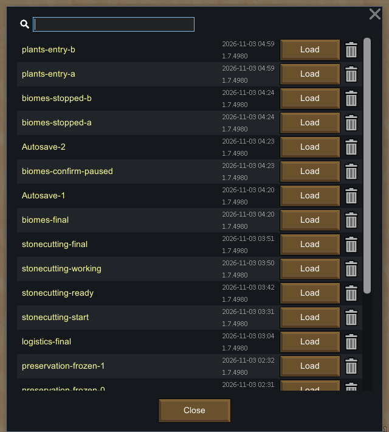
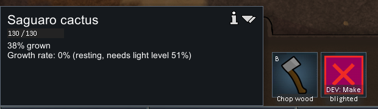
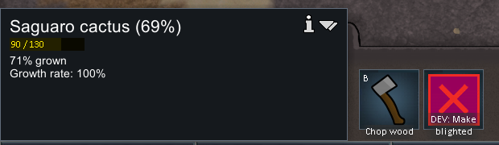
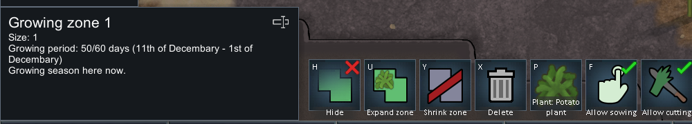
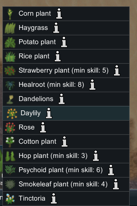
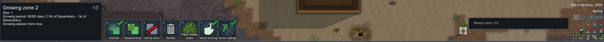
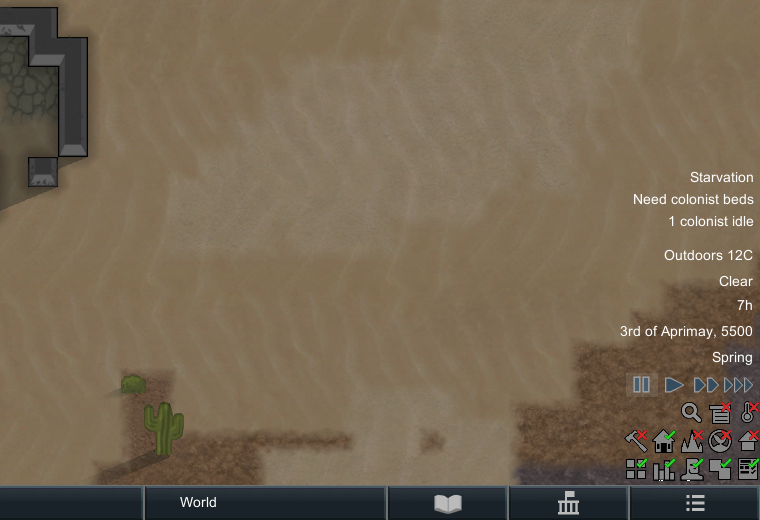

# 31. 原版植物 UI 观察：生长、生命、种植区与未完成的砍伐尝试

本章记录一次有界的原版 UI 观察。实际看到了两株自然 Saguaro cactus 的生长状态、`Chop wood` 按钮，以及种植区的 14 项作物菜单；**没有完成砍树或播种，也没有验证采伐产量、工时、树木播种资格或跨季节生长**。完整生命周期规则的静态来源见 [第 30 章](30-plants-lifecycle-forestry-regrowth.md)，本章不把静态结论冒充运行实测。

## 身份、方法与隔离

- 时间：2026-11-02 20:57:32–21:15:21 UTC，约 18 分钟，含读档、存档和暂停核对。
- 原版：`F:\SteamLibrary\steamapps\common\RimWorld\RimWorld.exe`，PID `29920`，版本 `1.7.4980 rev60`；活动内容为 Core 与 Odyssey。
- 安装根目录 `Assembly-CSharp.dll` 的 SHA-256：`eff7d97949f919fb2b151ebfb906e9be749b63410b7dbda78eeebb7972b245c3`。
- 专用参数：`-savedatafolder=<project>/.local-research/runtime/profile-20261102`。没有接触正常玩家档、修改游戏文件或安装 Mod。
- 已按 reverse-engineer-anything skill v42 检查 REA 6.7.0；其 native UI provider 在本机返回 `unsupported_host: native macOS utilities require macOS`，会话未打开。因此鼠标、键盘、截图使用项目已有的 guarded Windows 前台输入 helper；**并非 REA native UI 执行结果**。
- Developer mode 与 God mode 从既有实验继承。本轮没有使用开发者功能添加植物、改技能或完成研究；但基线包含更早的无关开发者准备，不能称为纯正常游玩档。

观察结论由截图人工阅读；存档 XML 是事后只读补充，未用来代替 UI 操作。摘要包含保存时刻的研究进度、种植区、两株记录对象、显式木材堆、殖民者技能及当前工作、designation；没有解码压缩地图或执行目标程序集。

## 读档与时间偏差

入口仍在上一次世界地图观察后的 `tick 134003` 分支。先连续另存 `plants-entry-a/b` 验证当时暂停，再通过原版 Load 对话框载入完整的 `stonecutting-final`，基线 `tick 50881`，SHA-256 为 `2af1ff41a338adbb9fdc458b01433acceae8f90ef323f5f71e5ee0929494dc6a`。入口分支不是本次植物观察的基线。



**读档后原版自动以正常速度继续计时，最初没有及时发现。** `plants-start` 已到 `55840`；21:06:18 UTC 发送一次 Space 后，连续 `plants-ready-a/b` 均为 `64249`。相对于载入基线，有 `13368` tick 的非计划推进。本轮没有发送三倍速键或开发者时间推进指令。这段时间不构成受控生长实验，也不能拿它估计生长速率或自然损伤原因。

| 保存点 | tick | 用途 |
|---|---:|---|
| stonecutting-final | 50881 | 未修改的载入基线 |
| plants-entry-a / b | 134003 / 134003 | 旧分支的入口暂停核对 |
| plants-start | 55840 | 读档后首次保存；已发生推进 |
| plants-ready-a / b | 64249 / 64249 | Space 后暂停核对 |
| plants-stopped-a / b | 64249 / 64249 | 结束双档核对 |

已确认暂停的阶段从 ready 到 stopped，tick 差为 `0`。最后规范保存点为 `plants-stopped-b.rws`。21:15:21 UTC 后未再发送游戏输入。

## 两株仙人掌：生命百分比不等于生长百分比

第一株 UI 在 21:04:31 UTC 显示：生命 `130/130`、`38% grown`、`Growth rate: 0% (resting, needs light level 51%)`，并有 `Chop wood` 按钮。当时尚未可靠暂停。



第二株在暂停后 21:07:09 UTC 显示：标题 `Saguaro cactus (69%)`，生命 `90/130`、`71% grown`、`Growth rate: 100%`。其中标题的 `69%` 对应 `90/130` 的生命比例，生长进度是另列的 `71%`。



这是**不同自然植物在不同时刻的两个样本**，不是同株从 38% 长到 71% 的时间序列。没有覆盖所有树种、成熟后的收获状态、枯死、季节变化或再生。

最终 XML 记录了以下两个对象，作为存档上下文：

| 对象 ID | 位置 | 生命 | growth 原值 |
|---|---|---:|---:|
| Plant_SaguaroCactus38625 | (75, 0, 158) | 130 | 0.396612734 |
| Plant_SaguaroCactus39903 | (123, 0, 133) | 90 | 0.715002835 |

第二株的位置另由后续误建的种植区交叉定位。第一株 UI 与对象 ID 的对应主要依赖画面位置，不能提升为独立验证过的对象身份；第一张截图的 38% 也不等于稍后最终档的 39.66%。

## 种植区和作物菜单

暂停期间通过正常建区操作创建了 `Growing zone 1`，面积 1 格，位置 `(89, 0, 138)`，默认 Potato。UI 显示 `Growing period: 50/60 days (11th of Decembary - 1st of Decembary)`、`Growing season here now`，以及 Allow sowing / Allow cutting 控制。



打开选择菜单后，看到 14 项：

| 作物 | 可见最低技能标签 |
|---|---:|
| Corn plant | 未显示 |
| Haygrass | 未显示 |
| Potato plant | 未显示 |
| Rice plant | 未显示 |
| Strawberry plant | 5 |
| Healroot | 8 |
| Dandelions | 未显示 |
| Daylily | 未显示 |
| Rose | 未显示 |
| Cotton plant | 未显示 |
| Hop plant | 3 |
| Psychoid plant | 6 |
| Smokeleaf plant | 4 |
| Tinctoria | 未显示 |



菜单内滚动一次后没有看到额外条目。没有选择树种，也没有看到针对树种的禁用原因提示。最终存档中 TreeSowing 研究进度为 `0`；Prophet、Squint、Grump 的 Plants 等级分别为 `10/3/0`。这些是状态上下文，**不能由树种未出现直接认定唯一原因是研究或技能**。

TreeSowing、Plants 6、biome 条件及八邻域间距的代码依据见 [第 30 章](30-plants-lifecycle-forestry-regrowth.md)。本轮未通过改变单一条件的对照操作独立验证它们。

## 砍伐尝试没有成功下达

关闭菜单后，种植区绘制工具仍然激活。随后本想选择仙人掌、点击 Chop wood、选工人并打开右键菜单，实际结果是：在 `(123, 0, 133)` 又创建了一格 `Growing zone 2`，将它隐藏，并继续选中了种植区。



原始截图 `plants-019-select-for-chop`、`020-chop-designation`、`021-select-worker`、`022-chop-menu` 的文件名只表达操作意图；画面和最终 XML 并不支持成功选中工人或下达砍伐。最终两个区均为 Potato，第二个 `hidden=True`，`designations=[]`。暂停阶段的显式木材、两株对象及殖民者当前工作均未变化，没有执行正常砍树或播种工作。

因此本轮不能给出砍伐收益、耗时、工作优先级、工人技能资格或树木重新播种的运行结论。实验结束于这一操作偏差，没有为扩大覆盖继续读档重试。



## 证据与复核

- [结构化摘要](evidence/native-plants-runtime.json)：8 个存档快照、8 张裁图、明确的成功与未证实字段。
- [输入账本](evidence/native-plants-actions.jsonl)：65 条 guarded 输入记录，含 PID、隔离路径、时间和操作；23 条编号观察操作，42 条保存辅助操作。
- [只读 XML 摘要器](../../../scripts/research/read-plants-runtime-save.ps1)、[证据收集器](../../../scripts/research/collect-plants-runtime.ps1)、[完整性验证器](../../../scripts/research/verify-plants-runtime.mjs)。
- [另存辅助脚本](../../../scripts/research/save-plants-runtime.ps1)会向原版发送输入，仅接受 `plants-*` 名称并拒绝覆盖。复核本章无需再次执行它。

在项目根目录运行：

```powershell
node scripts/research/verify-plants-runtime.mjs
node scripts/research/verify-plants-runtime.mjs --local
```

两种模式均已通过：`saveSnapshots=8`、`crops=8`、`actions=65`、`visibleCropOptions=14`、`finalPauseVerified=true`；砍伐、播种、收获产量和受控生长的 demonstrated 字段均为 `false`。15 个相对 Markdown 链接已核对，关键的植物、菜单、误操作和结束裁图已人工检查可读性。

Portable 模式检查已记录的身份、数据关系、观察边界、裁图 PNG 尺寸/哈希、输入账本顺序/哈希及暂停关系；不需要原版安装或忽略目录。Local 模式额外读取本机 8 份原始存档，重新提取 XML 摘要并逐项核对，同时核对 8 张原始截图的哈希与尺寸。两种模式都不会控制游戏、OCR 或重新运行玩法。通过校验说明记录自洽、文件匹配，不能把未完成的砍伐与播种变成成功机制证明。
