# 34. 原版受控实机：倒地救援、医疗床、医生分配与实体喂食

这次实际完成了 **Prophet 救援 Grump 到医疗床，再搬来一份 Packaged survival meal 并喂食**。喂食前病人 Food 为 0，结束时存档为 `0.6504004`，UI 显示 `65%`；中间存档保留了 `FeedPatient`、病人目标与工人手里的独立食物实体。营养不良数值在之后的观察点下降，但未完全消失，病人也仍受麻醉影响倒地。

**倒地由开发者注入 Anesthetic 准备，木床由既有 God mode 即时建造。** 医疗用途切换、解禁原有食品、工作分配、Rescue 与 FeedPatient 都通过正常 UI 和正常游戏工作完成。不能将这次实验描述成自然饥饿导致倒地，也未进行失温或中暑实机测试。相应静态机制另见 [第 33 章](33-survival-health-mechanisms.md)。

## 身份与实验边界

- 操作时间：2026-11-02 21:40:21–22:01:27 UTC，约 21 分钟，大部分处于暂停状态。
- 可执行文件：`F:\SteamLibrary\steamapps\common\RimWorld\RimWorld.exe`；PID `29920`；窗口句柄 `988850`；版本 `1.7.4980 rev60`，Core + Odyssey。
- 专用参数：`-savedatafolder=<project>/.local-research/runtime/profile-20261102`。
- `Assembly-CSharp.dll` 身份沿用本次版本已核对的 SHA-256：`eff7d97949f919fb2b151ebfb906e9be749b63410b7dbda78eeebb7972b245c3`。
- 应用 reverse-engineer-anything skill v42 的证据分层；REA native UI 在这台 Windows 上的 unsupported 限制已在此前记录。本轮不重复配置探测，实际输入由已有 guarded Windows 前台鼠标键盘 helper 执行，不能称作 REA native UI 执行。
- 本轮独占原版前台输入；仅操作这个隔离进程。未修改正常玩家档、原版游戏文件，未安装 Mod。

进入时先只读核对进程参数、窗口和截图，再另存 `survival-entry-a/b`。二者均为 `64249`，与完整的 `plants-stopped-b` 基线相同；**没有读档、没有盲按 Space**。基线 SHA-256 为 `bfe8a18d28aebe8b1bf3b7fbebae2d7ded44068bddcc12320cad2a5b7bbabf03`，保持未修改。

## 准备与正常操作分开记录

| 类型 | 操作及实际结果 |
|---|---|
| 继承状态 | Grump 已有 minor Malnutrition，Food 0；另有旧 Bite scar；已有食品堆处于 forbidden |
| Dev 准备 | 只对 Grump 使用 Health → Dev tool → Add hediff → Anesthetic → no body part；severity 1，tick 64249 |
| God 准备 | 即时放置一张 Normal 木床 `Bed77946`，位置 `(113,0,124)`，HP 91/91，spawned tick 64249 |
| 正常床设置 | 选择木床，点击 Medical，将普通木床设为医疗用途；未造 Hospital bed |
| 正常食品设置 | 原有 `MealSurvivalPack41855`，10 份，位置 `(105,0,123)`；点击 Allow 解禁 |
| 正常工作 | Prophet 右键 Grump → Rescue；之后正常勾选 Doctor，再右键 Prioritize feeding |

没有注入 Food、Malnutrition、研究或技能，也没有直接瞬移病人、补满需求或消除疾病。

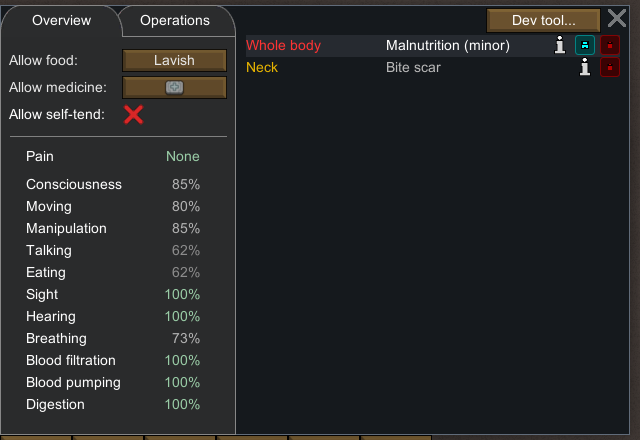

准备前健康 UI 显示 Consciousness 85%、Moving 80%、Eating 62%。注入 Anesthetic 后显示 Consciousness 1%、Moving 0%、Eating 0%，并出现 `Colonist needs rescue`。因此本次倒地原因不能归结为自然营养不良。

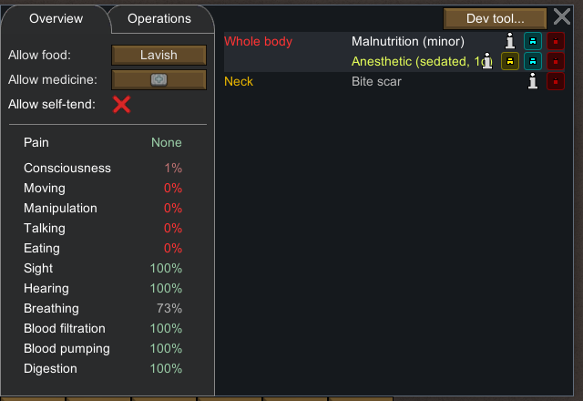

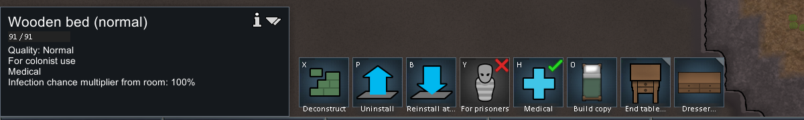

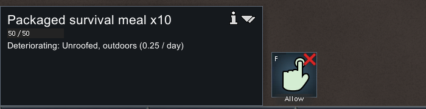

## 正常救援确实完成

选择 Prophet 后右键地上的 Grump，菜单出现 `Rescue Grump`。点击后暂停画面显示 `Rescuing Grump`；`survival-ready` 的工作为 `Rescue`，目标 A 为 `Thing_Human965`，目标 B 为 `Thing_Bed77946`。

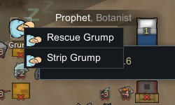

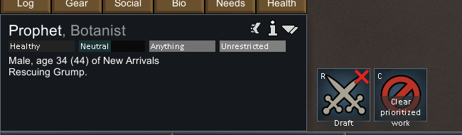

第一段正常速度运行后立即点击明确的暂停按钮。`survival-rescued` 为 `tick 64609`：Grump 从 `(107,0,124)` 移到床所在的 `(113,0,124)`，当前工作 `LayDown` 的 target A 指向 `Thing_Bed77946`，driver 的 startTick 为 `64555`。UI 中病人已躺进床，needs rescue 警报消失。存档新增 `RescuedMe` 记忆，otherPawn 为 Prophet，opinionOffset 为 `15`。

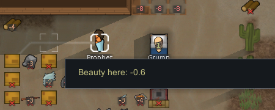

这证明本次同地图救援完成，不证明跨地图或跨层救援。`360` tick 是这一观察窗口的总推进量，包含救援后工人的其他活动，不能用作精确搬运工时。

## Doctor 分配的前后对照

救援后 Prophet 自动准备自己进食。暂停中右键床上的 Grump，实际显示：`Cannot feed Grump, Blaster: Not assigned to doctoring`。

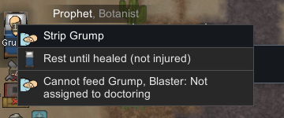

在 Work 中只勾选 Prophet 的 Doctor，再打开同一患者菜单，变为 `Prioritize feeding Grump, Blaster`。两个保存点均为 `64609`，这段对照没有推进时间。存档工作优先级数组只记录一个位置由 0 到 3；Doctor 的语义来自可见 UI，不凭数组索引猜测。

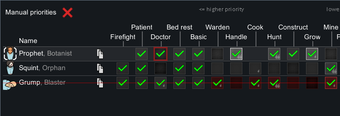

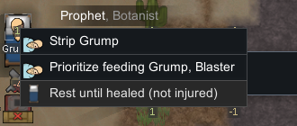

`survival-feed-ready` 中实际工作变为 `FeedPatient`，target A 为食品堆 `Thing_MealSurvivalPack41855`，target B 为病人 `Thing_Human965`。本例 Food 0，低于静态章节中的门槛；本轮没有在门槛两侧逐点测试，也没有独立调用 `ShouldSeekMedicalRest`。

## 搬运实体食品、床边喂食与结束状态

第二段短运行之后，`survival-feeding` 为 `64888`：

- Prophet 工作为 `FeedPatient`，driver 为 `JobDriver_FoodFeedPatient`；目标 A 换成拆分出的 `MealSurvivalPack77949`，目标 B 仍是 Grump。
- carryTracker 中存在这份食品实体，数量 `1`；原地堆从 `10` 变为 `9`，全存档食品数量仍是 `62`，这是搬运而非此刻已消费的证据。
- curToilIndex 为 `14`、ticksLeftThisToil 为 `691`；病人 Food 仍是 `0`。
- UI 显示 `Carrying: Packaged survival meal` 和 `Feeding packaged survival meal to Grump.`，工人在病床旁。

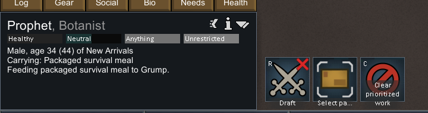

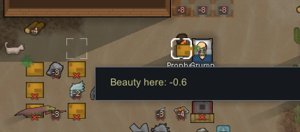

继续一个正常速度窗口和一个 speed3 窗口后，Prophet 已结束 FeedPatient 转为 GoForWalk，手中食品为空，`MealSurvivalPack77949` 不再出现。Grump 仍在医疗床上，Food 为 `0.6504004`，可见提示为 `Food: 65% (0.65 / 1)`；Starvation 警报消失。

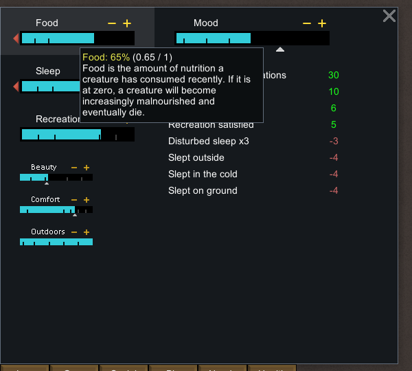

最终全存档食品数量为 `59`，原来解禁的堆剩 `7`。其他殖民者也在这些窗口内进食，**不能把总共少掉的 3 份都归因于病人**；本次喂食的依据是明确的目标、携带实体、床边工作、该实体消失和病人 Food 上升的连贯证据。

Malnutrition severity 从喂食中保存点的 `0.336355537` 降到最终的 `0.311128825`，是喂食后观察到的数值下降。健康 UI 仍为 minor，Anesthetic severity 仍为 `0.928000391`，病人仍是 `Down`、Consciousness 1%、Moving 0%。没有观察到完全康复，也没有独立分离时间、床和食物的作用，不能据此拟合恢复速度或声称单独验证了因果。


## 时间边界与最终暂停

准备和 UI 下单在暂停中完成。每次推进均发送明确的速度键，并在同一顺序脚本内点击固定暂停按钮 `(2441,1305)`，没有切换式 Space 输入。时间如下，秒数是输入时刻而非精确游戏计时边界：

| 窗口 | 开始输入 UTC | 暂停输入 UTC | 速度 | 保存的 tick 边界 |
|---|---|---|---:|---|
| 救援 | 21:49:15.087 | 21:49:21.229 | 1 | 64249 → 64609 |
| 搬餐到床边 | 21:54:27.605 | 21:54:32.286 | 1 | 64609 → 64888 |
| 继续喂食 | 21:56:40.906 | 21:56:50.053 | 1 | 64888 → 未单独保存 |
| 喂完及后续观察 | 21:59:05.347 | 21:59:16.574 | 3 | 未单独保存 → 69526 |

后两段之间没有单独存档，只能确认合计推进 `4638` tick；全轮 `5277` tick。最后 `survival-stopped-a/b` 都是 `69526`，病人、工人、食品快照相同；结束输入为 22:01:27 UTC 的保存返回截图。此后没有原版输入。

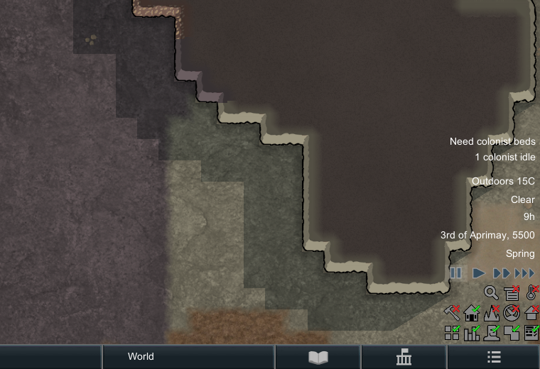

静态章节给出的基础喂食等待与倍率来自代码，不是本章墙钟实测。中间 `691` 是一刻的剩余 toil 时间，没有截获准确结束 tick，不能宣称测出了完整工时。实验中也没有人为提高仿真 tick，speed3 是原版可见速度控制。

## 复核入口与未证实范围

- [结构化摘要](evidence/native-survival-runtime.json)：9 份保存摘要、15 张裁图、准备/正常操作与结论边界。
- [输入账本](evidence/native-survival-actions.jsonl)：88 条记录，包括 40 条编号动作和 48 条另存辅助动作。
- [只读摘要器](../../../scripts/research/read-survival-runtime-save.ps1)、[只读收集器](../../../scripts/research/collect-survival-runtime.ps1)、[验证器](../../../scripts/research/verify-survival-runtime.mjs)。
- [另存脚本](../../../scripts/research/save-survival-runtime.ps1)会控制原版，限制 `survival-*` 名称并拒绝覆盖；复核不必执行它。

```powershell
node scripts/research/verify-survival-runtime.mjs
node scripts/research/verify-survival-runtime.mjs --local
```

Portable 检查记录关系、身份、PNG 尺寸/哈希、账本顺序/哈希、准备与完成状态以及未证实字段；local 额外重新提取 9 份原始 XML，并核对原始截图。Food 为 0 时保存文件省略 curLevel，摘要显式记录 `food_field_present=false` 并按数值零默认读取。未将未解码的 records 或工作数组索引解释成机制。两种校验都不重新运行游戏，也不进行 OCR。

运行证据支持一条救援和一条喂食链、普通床切医疗、Doctor 分配阻止原因的前后对照及喂食后状态变化。自然断粮到倒地、失温、中暑、医疗床是否为所有救援的必要条件、自动调度、精确工作/恢复速度、完全康复和跨层搬运均未在本轮独立验证。
