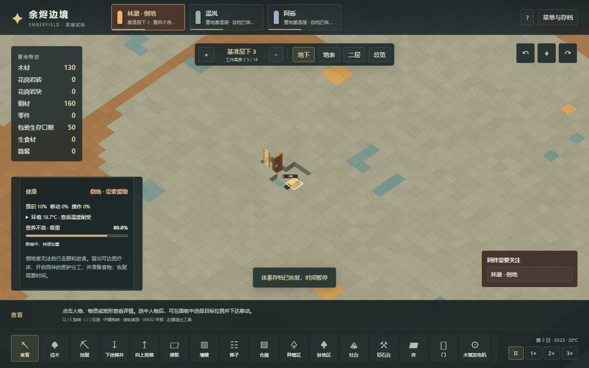
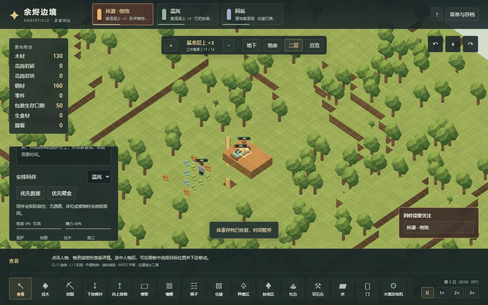
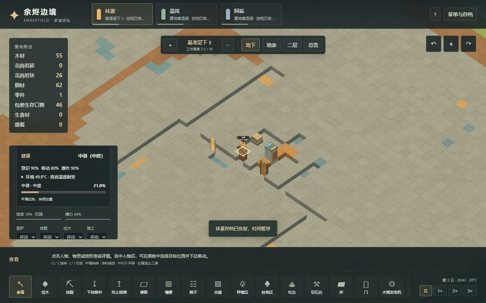

# 体素生存、医疗床与跨层救援

本章记录 Emberfield 多层体素分支的独立实现。原版静态与 XML 依据见 [33 生存健康机制](33-survival-health-mechanisms.md)，原版实际救援和喂食操作见 [34 实机观察](34-native-survival-runtime.md)。这里只实现营养不良、失温、中暑及其能力后果，尚不是完整战斗医疗系统。

## 玩家操作

断粮后会逐渐营养不良；低温与高温也会累积健康损害，降低意识、移动或操作能力，严重时倒地，继续恶化会死亡。选中人物可查看病情、严重度、变化原因与当前环境温度。右下健康警报可定位需要援助的同伴。

1. 建造普通双格木床，在床的检查面板将用途切换为「医疗床」。不需要另造一种床；医疗床不分配固定主人，也不会被普通睡眠占用。
2. 保留可通行的门、梯子与床旁位置，为至少一名健康同伴启用「医护」分工。自动医护会优先寻找倒地者，实际走近、抱起，再通过楼梯井送到医疗床。
3. 准备可达的食物。患者饱食度不高于 26% 时，同伴取走真实食物，带到床边完成喂食；食物离开原堆，最终进入营养与消耗账本。
4. 也可选中倒地人物，在「安排同伴」选择帮助者，点击「优先救援」或「优先喂食」。失败会说明条件；手动安排可覆盖帮助者的医护禁用，但仍检查床位、食物、通路与预定。
5. 喂食不能立刻清除营养不良。温度病要改变实际环境：保持房间封闭、供电正常，并把冷暖设备设在适合恢复的温度，例如 21°C。

当前人物按**裸身耐受**计算，舒适范围 16～26°C，安全范围 6～36°C，衣物保温尚未接入。建议先用温带营地体验；极端寒热地图尚无完整的开局保护与生存平衡。医疗床本身不提供温度保护。



## 原版参数与项目适配

项目仍为 20 TPS、每日 12000 tick。原版日历为每日 60000 tick；本轮生理周期按游戏日乘 `12000/60000`，**这不是实时 TPS 的 20/60 比例**。选择的是相同游戏日内的健康变化量，不宣称真实秒数完全一致。

| 机制 | 原版依据 | 本项目 |
|---|---|---|
| 营养不良更新 | 每 150 tick，固定个人因子 U(0.8,1.2) | 每 30 tick；个人因子由种子与人物 ID 固定生成并保存 |
| 营养不良变化 | 每次 ±0.0011325×个人因子，日变化 ±0.453×因子 | 饱食度为 0 才增加，任意正值开始恢复；并保留阶段饥饿倍率 1.5/1.6 |
| 营养不良阶段 | 0、0.2、0.4、0.6、0.8 | 极重阶段意识上限 10%；严重度到 1 死亡 |
| 温度损伤周期 | 每 60 tick | 每 12 tick，读取人物实际所在三维房间温度 |
| 失温增长 | 温度低于安全下限；`max((下限−T)×0.0000645,0.00075)` | 同公式；裸身下限 6°C |
| 中暑增长 | 温度高于安全上限；超温量先经过分段曲线 | 同曲线与 `max(curve×0.0000645,0.000375)`；裸身上限 36°C |
| 温度病恢复 | 每次减 `clamp(severity×0.027,0.0015,0.015)` | 失温需严格高于 16°C，中暑需严格低于 26°C；安全与舒适区间之间可以停滞 |
| 温度病阶段 | 0、0.04、0.2、0.35、0.62 | 极重阶段意识上限 10%；到 1 死亡 |
| 倒地判定 | 意识、移动等能力后果 | 本切片取意识低于 30% 或移动不高于 15%，不能自行工作、走路或进食 |
| 患者喂食阈值 | WantEat 0.3 与 Hungry 0.24+0.02 共同限制 | 26%；不是 32% |
| 喂食工作 | 所选包装口粮基准 500×1.5=750 原版 tick | 150 项目工作量，按帮助者操作能力推进；统一食物工时与操作能力乘数属于项目适配 |

能力计算先叠加痛觉与意识损失，再算移动、操作，并舍入到百分位；没有引入完整身体部位、基因、特性、衣物、技能和器官系统。原版喂食等待不取患者 Eating 能力，不能用患者 0% Eating 来解释或缩短喂食时长。三种环境/营养问题都不是可用药品包扎直接治好的可护理伤口，本版没有添加“药品瞬间治愈”。

## 三维救援与资源约束

救援包括接近、抱起、跨层移动、放上床四个实际过程；喂食包括预留食物数量、取物、送到床旁、完成工作与消耗。一个患者只能有一名正在照料的同伴，医疗床不能同时被多个救援目标占用；其他搬运与进食不能取走预留部分。

手动改路、床改用途、拆床、断路、帮助者倒地、患者恢复或死亡都会解除相关工作。搬运中的患者落在帮助者当前合法位置，随身物品保留。地面满堆导致无法卸货时，帮助者不能通过丢弃货物来开始救援。食物在路上或床边仍会按所在温度腐坏；没有新增隐藏食物库存。

死亡不可逆，人物实体和随身货物留在地图；释放床位归属和任务，但遗体占用的床不会被当作空床。当前尚无搬尸、埋葬、继任者或重新招募。所有人死亡后会显示营地无人存活，可从菜单读取较早存档或新开世界。

角色倒地/死亡改为水平姿态，抱起时跟随帮助者插值位置，床边喂食有手臂动作；医疗床带颜色标记。画面使用程序生成几何，不加载原版美术。



## v10 存档

保存健康严重度、个人饥荒因子、倒地/死亡原因、医疗床用途、双方搬运关系、患者目标、食物预留与喂食进度。回读会重建路径、工作说明和移动节奏；不要求这些瞬时字段逐字一致。中断存档不能复制食物、复活人物或重置病情。

v1～v9 迁移添加健康初值与默认医护，保留地形、物品、树木、历史环境规则和既有生产链。旧档没有永久温度/饥荒豁免，加载后继续承受真实环境后果。真实 v9 fixture 在修改前从已发布源码 `3aa423b7e93e79a019c3d7fffabd160d600fe304` 捕获，SHA-256 为 `662e24d8e4e87cf193cd74fac196e15e3ede787f5fcff29dfdc15ae1c687a0a7`；邻接 provenance 记录了生成方式与源码身份。

## 正常流程与浏览器验证

```powershell
npm test -- --silent --maxWorkers=2
npm run test:voxel:power
npm run test:voxel:survival
npm run build
# 在另一个终端运行生产预览，例如 npx vite preview --port 5183 --strictPort
npm run test:voxel:survival:browser
npm run research:check
```

温度流程依赖电力流程生成的真实设施存档，因此先执行 power。模拟流程只调用公开命令、step、save/load，时间正常推进，不直接注入食物、病情、温度、地形或人物需求。单元测试中的有界状态机夹具则可以直接构造边界状态，两者不会混称。

全量 **331/331** 单元测试通过，其中新增生存测试 **17** 项：包含恢复边界、叠加能力、跨层搬运、预留竞争、满地无法卸货、床改变、患者死亡/帮助者倒地、喂食断路、暂停命令不推进生理、遗体占床、真实 v9 迁移以及伪造关系拒绝。

自然饥荒流程通过 **20** 项检查。由真实历史营地采木、挖地下隔离房、建门、上层平台和医疗床，再用锁门造成断粮：tick 30210 自然倒地，30263 被抱起，30325 抵达上层床，30539 消耗一份实际口粮完成喂食，30840 恢复站立，49980 营养不良清零。跨层轨迹覆盖 Z5→Z8→Z11，三人存活，木材/食物账本闭合；包含搬运和喂食中的存取。

温度流程通过 **16** 项检查。已经实际建成并供电的房间先造成超过 20% 的失温或中暑；随后调整设备至 21°C，让人物自然恢复并通过真实梯子离开。另两条新世界无庇护分支观察持续极端气候的后果：−30°C 均温分支 tick 5688 全员失温死亡，45°C 分支 tick 18624 全员中暑死亡。具体时间只属于这两个种子/配置/操作分支；回读再走 1200 tick 仍保持死亡与物资，不是所有地图固定生存时限。



生产构建的浏览器检查在 **Worker 与主线程各通过 13 项**，实际操作文件导入、人物/床检查、用途切换、手动安排救援、抱起与上层到床、喂食、保存回读、恢复/失温/中暑/死亡显示及 900×700 控件。截图与请求到的 JS/CSS 均记录哈希，校验与当前生产构建一致；浏览器只读观察内部状态，不调用内部命令替代点击。

既有三层施工、农业、住房、电力、冷库、有限物流、切石、世界生成与林业流程全部通过，另外复跑世界生成与林业的两种渲染页面检查。同一页面六轮保存→新世界→读取检查跟踪到的几何、纹理与地形缓冲区回归，不将主页面堆或这些资源计数解释为浏览器总内存、长期无泄漏或 4 GiB 容量证明。

冻结报告见 [voxel-survival-validation.json](evidence/voxel-survival-validation.json)。`record-voxel-survival-validation.mjs` 校验当前测试报告/产物再生成证据；`verify-voxel-survival-validation.mjs` 可脱离原版游戏复核历史快照、图片与真实旧档。历史源码和构建哈希表示当时身份，不要求未来源码永远不变。

## 原版实测边界与下一步

34 章实际观察到原版把 Grump 救援至医疗床、启用 Prophet 的 Doctor 分工、取一份包装生存口粮并喂食。Food 从 0 增到 0.6504004，喂食结束后保存仍有轻微营养不良与麻醉，不能称为完全康复。倒地由开发菜单加入 Anesthetic 准备，床沿用开发建造；实际路径、抱起与喂食由正常操作完成。原版没有完成独立寒热对照、营养不良速率或精确工时测量，不能用本章 Web 测试补成原版运行证据。

下一阶段需先补衣物与保温、基础制作链和可持续的气候开局，再接战斗伤口、流血、药物护理、感染等完整医疗内容。当前也不包含完整尸体系统、痛觉耐受特性、疾病传播和大人口压力测试。
