# 37 — 原版实机：穿脱外套、布料制帽与正常穿戴

本轮完成了三段可追溯的原版操作：**同一件 Parka 正常脱下再穿回；手工裁缝台正常消耗 20 Cloth 制作 Tuque；工人正常穿戴自己制作的 Tuque。** 裁缝分工门槛、未完成品、订单结束和舒适温度变化均有截图及存档支持。

这不是棉花种植、科研解锁或工作台建造的完整原版生存流程：外套、工作台、布料通过 Dev/God 准备，后续操作走普通游戏 UI。长期耐久、季节温度、冷热疾病和自动换装策略没有在本轮实测。规则推导见 [36 — 衣物与裁缝机制](36-apparel-tailoring-mechanisms.md)。

## 环境、对象与边界

| 项目 | 本轮记录 |
|---|---|
| 原版 | RimWorld `1.7.4980 rev60`，Core + Odyssey |
| 进程 | `RimWorld.exe`，PID `29920`，窗口句柄 `988850` |
| 安装路径 | `F:\SteamLibrary\steamapps\common\RimWorld` |
| Assembly-CSharp SHA-256 | `eff7d97949f919fb2b151ebfb906e9be749b63410b7dbda78eeebb7972b245c3` |
| 独立研究 profile | `.local-research/runtime/profile-20261102` |
| 起始基线 | `survival-stopped-b.rws`，tick `69526` |
| 基线 SHA-256 | `eadbe4c34b54e2c4b29283bb5d5e8676074853d0b9363d5e7f2f32b7b97832fa` |
| 工人 | `Human961`，Squint，Crafting 3 |
| 操作窗口 | 2026-11-02 22:29–23:00 UTC，即北京时间 11 月 3 日 06:29–07:00 |
| 结束 | `apparel-stopped-a/b.rws` 均为 tick `75374`，已暂停 |

采用已读取的 REA skill v42 的证据分层方法。前轮已经确认 REA native UI provider 在本机 Windows 不支持；本轮使用带 exe/profile/前台窗口校验的 Windows 输入与截图脚本，**没有把它描述为 REA native UI 执行**。未重新诊断 provider，没有改动游戏安装文件、普通用户 profile 或加载原存档；没有安装 Mod，也没有修改技能。

Squint 的人物摘要显示 Healthy，Health 页面 Moving/Manipulation 等为 100%，但存档和 Health 页面仍有继承的 `WakeUpAddiction`。因此这里只表示他能完成此次任务，不能声称完全没有健康状况。Grump 仍受上一实验的麻醉影响，没有被选作裁缝工人。

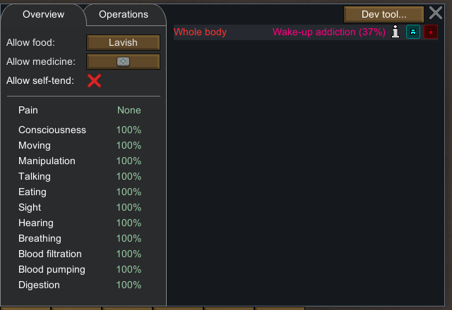

## 一、同一件外套正常脱下并穿回

起始穿戴为 Normal Synthread button-down shirt `Apparel_CollarShirt963`（129 HP）和 Normal Synthread pants `Apparel_Pants962`（130 HP），没有头部衣物和 Shell 外套；Gear 舒适温度为 **6°C～30°C**。

通过 Gear → Dev tool → Wear → `Apparel_Parka` 准备了一件外套。该工具实际生成的是 **Normal Thrumbofur parka**，实体 `Apparel_Parka77997`、材质 `Leather_Thrumbo`、360 HP，不能将它当作 Cloth Parka。初始生成及穿上属于开发者准备；没有正常制造这件 Parka。

随后点击普通 Gear 的 Drop 箭头，出现 `Removing thrumbofur parka (normal).`。放行一个有界运行窗口后明确点击暂停，外套出现在地面。再右键地面同一实体，选择普通 `Force wear thrumbofur parka (normal)`，运行后暂停。存档证明该物品从穿戴容器到地面、再回到穿戴容器；Gear 显示 `forced`。

| 阶段 / 存档 | Tick | 同一实体的位置 | UI 舒适温度 |
|---|---:|---|---|
| `apparel-entry-a/b` | 69526 | 尚未生成 | 6°C～30°C |
| `apparel-parka-prepared` | 69526 | Squint 穿戴，Dev 准备 | −62°C～30°C |
| `apparel-parka-dropped` | 69834 | 地面 `(106, 0, 124)` | 6°C～30°C |
| `apparel-parka-reworn` | 70420 | Squint 穿戴，普通 Force wear | −62°C～30°C |

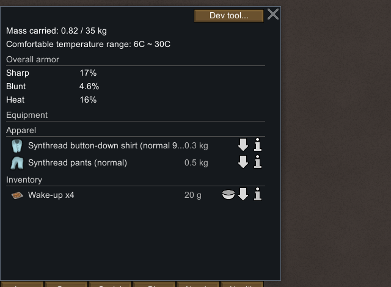
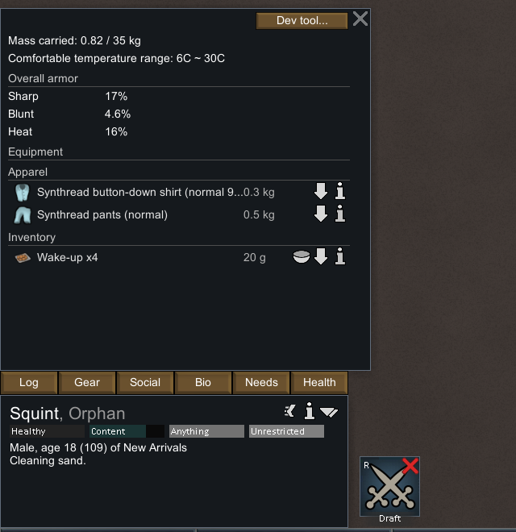
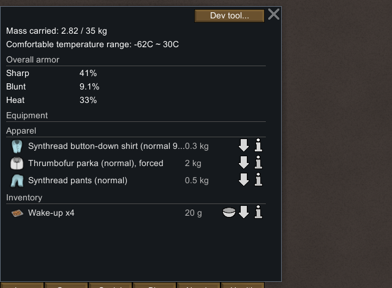

这里实测的 **68°C 下限差值属于该 Normal Thrumbofur Parka**，不能转写成所有 Parka 或 Cloth Parka 的固定加成。第 36 章的 Cloth 数值另有静态来源。手动 Force wear 是正常玩家指令，不代表自动服装策略已通过测试。

## 二、普通裁缝分工与 Cloth Tuque 生产

### 准备与分工门槛

在暂停状态下，通过继承的 God mode 放置木制手工裁缝台 `HandTailoringBench78002`，117/117 HP，位置 `(111, 0, 131)`、`spawnedTick=70420`。台子在室外，UI 显示 **Work speed factor: 40% (outdoors)**。没有做室内外对照或正常建造试验。

通过 Dev `Spawn full thing stack` 生成 `Cloth78003`，75 单位、80/80 HP；此前快照没有 Cloth。随后普通 Bills → Add bill → Make tuque，Do 1x。订单保持默认允许的多种纺织材料，实际选用 Cloth；没有将筛选器限定为唯一 Cloth。

Squint 首次右键工作台时提示 **Not assigned to tailoring**。在普通 Work 面板勾选 Squint 的 Tailor 后，同一右键操作变为 **Prioritize tailoring at wooden hand tailor bench**，下达后存档为 `DoBill`，目标工作台及 Cloth，数量 20。存档工作优先级向量仅索引 14 从 0 变成 3；索引本身不用于推断工作名称，Tailor 名称来自截图。

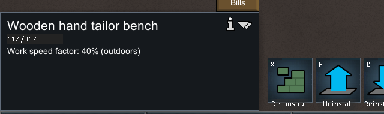
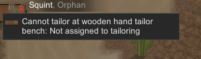
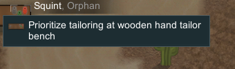

### 中间产物与完成结果

| 阶段 | Tick | 可见结果 / 存档字段 |
|---|---:|---|
| `apparel-tailor-ready` | 70420 | `DoBill` → `HandTailoringBench78002` / `Cloth78003`，订单计数 1，Cloth 75 |
| `apparel-tailor-progress` | 72130 | UI `Making tuque.`；`JobDriver_DoBill`；未完成品 `UnfinishedApparel78009`，`workLeft=621.603027` |
| 同一中间快照 | 72130 | 未完成品的 creator 是 Squint；内含 `Cloth78008 ×20`，地面原 Cloth 堆剩 55；此时总 Cloth 仍是 75 |
| `apparel-tailor-finished` | 74055 | UI `Bill complete: Make tuque.`；未完成品消失；订单计数归零；地面出现 `Apparel_Tuque78023` |
| 完成品 | 74055 | **Normal Cloth Tuque**，80 HP；`spawnedTick=73683`；剩余 Cloth 总计 55 |

20 单位 Cloth 在加工中保存在未完成品里，不能在中间阶段重复记作已经消耗。完成后，55 布料余额、消失的未完成品、归零的订单和新成品形成完整证据链。订单 `repeatCount` 在完成存档中省略，读取器按数值零默认解释，并保留字段存在性。

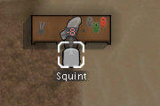

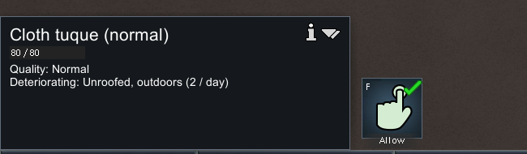

Normal 品质是这一次正常生产的结果，没有调用设品质工具。单个 Crafting 3 样本不能证明品质分布。存档 `spawnedTick=73683` 是成品字段，不应冒充连续观测到的精确工时或墙钟完成时刻。

## 三、正常穿戴新产出的布帽

完成时 Tuque 在地面 `(111, 0, 130)`，Squint 已转去进食，未自动穿戴。右键菜单同时显示没有可用服装仓储位置，因此本轮没有证明成品入库。

选 Squint → 右键成品 → 普通 `Force wear cloth tuque (normal)`，经过有界运行后暂停。Gear 显示布帽 `forced`，原来的 Parka、衬衫和裤子保留。最终存档中的 `Apparel_Tuque78023` 从地面移到 `apparel/wornApparel/innerList/li`，强制穿戴引用包含 Parka 和 Tuque；帽子 `despawnedTick=74318`。

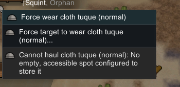
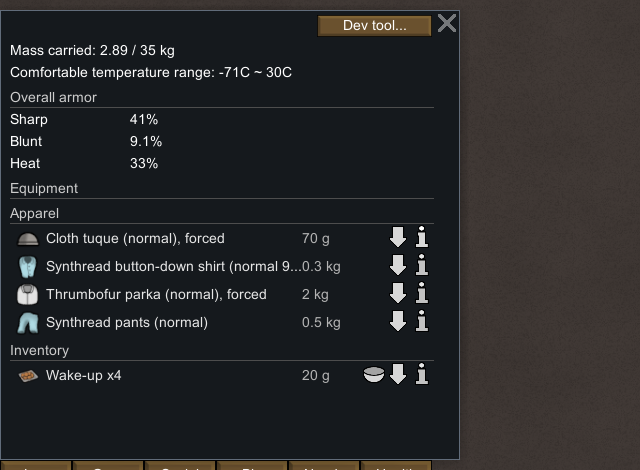

舒适温度从 **−62°C～30°C → −71°C～30°C**：该 Normal Cloth Tuque 在本次穿戴中额外降低了 9°C 舒适下限，上限不变；头部衣物和 Shell 外套确实并存。这个结果与第 36 章 Normal Cloth Tuque 的静态 9°C 冷绝缘数值一致。

舒适温度范围不是生存保证。外界温度在此次短运行中约 16～19°C，没有进行严寒或酷暑暴露；衣物长期磨损、冻伤/中暑、季节过冬和健康恢复仍未测试。短期 HP 未变化不能推出衣物永不损耗。

## 时间控制与复核

所有准备、分工及命令均在暂停时完成。只用了下表五个有界运行窗口，各窗口后明确点击暂停按钮 `(2441,1305)`，没有使用 Space 切换，也没有重新加载存档。截图等待时间不等于游戏动作工时，窗口还包含移动、任务切换及截图开销。

| 窗口 | 速度键 | 请求截图等待 | 前后存档 Tick |
|---|---:|---:|---|
| 正常脱 Parka | 1 | 3500 ms | 69526 → 69834 |
| 正常穿回 Parka | 1 | 8000 ms | 69834 → 70420 |
| 裁缝到中间阶段 | 3 | 3500 ms | 70420 → 72130 |
| 裁缝完成 | 3 | 4000 ms | 72130 → 74055 |
| 穿上新 Tuque | 3 | 2500 ms | 74055 → 75374 |

累计推进 5848 tick。结束双档均为 75374，工人、布料、工作台订单和地面衣物摘要相同；最后一次原版输入结束于 `2026-11-02T23:00:31Z`，随后只做离线整理。

| 交付物 | 作用 |
|---|---|
| [native-apparel-runtime.json](evidence/native-apparel-runtime.json) | 11 份存档摘要、20 个截图裁剪和来源哈希、准备步骤、观察值及限制 |
| [native-apparel-actions.jsonl](evidence/native-apparel-actions.jsonl) | 111 条带进程/profile、动作参数与时间的输入记录 |
| [read-apparel-runtime-save.ps1](../../../scripts/research/read-apparel-runtime-save.ps1) | 只读原版 XML 存档，不执行程序集 |
| [collect-apparel-runtime.ps1](../../../scripts/research/collect-apparel-runtime.ps1) | 从保留原始文件重建摘要、裁剪和输入索引 |
| [verify-native-apparel-runtime.mjs](../../../scripts/research/verify-native-apparel-runtime.mjs) | portable / `--local` 验证 |
| [test-native-apparel-runtime.mjs](../../../scripts/research/test-native-apparel-runtime.mjs) | 在独立临时目录破坏结论、快照、操作记录、PNG 的四项拒绝测试 |

在项目目录运行：

```powershell
node scripts/research/verify-native-apparel-runtime.mjs
node scripts/research/verify-native-apparel-runtime.mjs --local
node scripts/research/test-native-apparel-runtime.mjs
```

Portable 模式校验被检视的快照摘要指纹、原版身份、实体流转、材料守恒、操作记录与 PNG 哈希和尺寸、五个运行/暂停窗口及结论边界。Local 模式还重新读取 11 份原始存档和原始截图、捕获时间。二者都不重新执行游戏，也不自动 OCR；可见 UI 文字经人工图像检查。

原始 `.rws` 与完整屏幕截图在忽略目录中保留，提交的是必要摘要及裁剪，不是完整商业游戏内容。

## 对复刻设计的含义

1. **服装必须是可转移实体。** 脱下、地面存放、穿回应保留身份、材质、品质和耐久，穿戴位置决定其当前容器。
2. **裁缝链需要工作分工与中间态。** 有材料和订单仍可能被分工阻挡；材料进入未完成品后仍应可解释，完成时才转换为成品并减少订单次数。
3. **材质、部位与温度效果需要分别展示。** 同名 Parka 不代表固定冷绝缘；帽子与外套能够叠加，界面应显示最终舒适上下限。
4. **完成制作、存入仓库与穿戴是三个状态。** 本轮成品停在地上，普通 Force wear 才让它进入衣物栏；不能用“订单完成”代替“工人已经装备”。

这些是本轮原版证据支持的设计依据，不等于复刻已经覆盖品质分布、自动换装、长期耐久和季节性健康风险。
