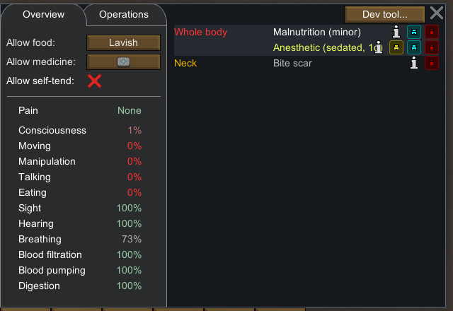
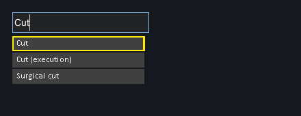
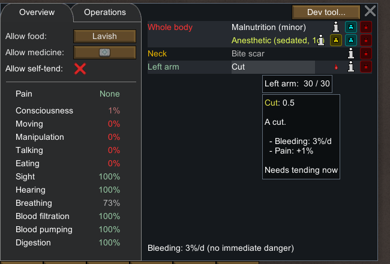
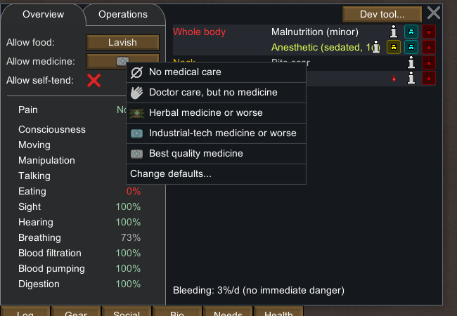
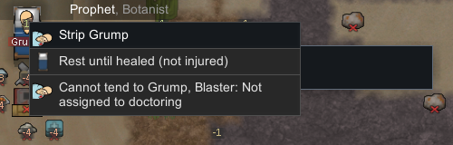
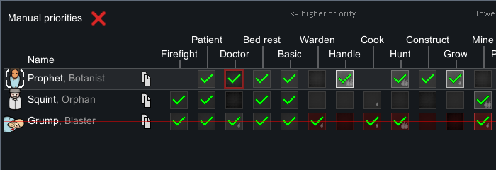
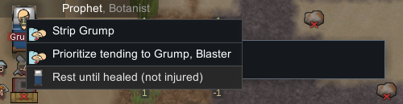
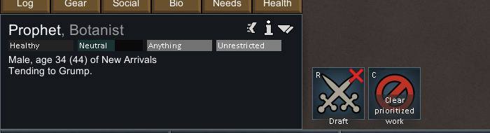
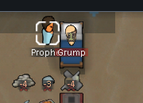
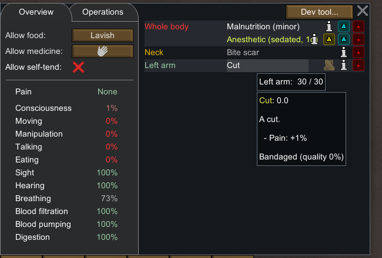

# 40 — 原版实机：新鲜伤口、医生分工与无药护理

本轮实际完成了 **Prophet 走到 Grump 的医疗床旁，正常执行无药 TendPatient，使同一个左臂 Cut 显示 Bandaged（quality 0%）且不再显示流血**。有护理前、等待中、完成后的原版存档与 UI 裁片。工作分配的阻止原因也做了同一医生、同一伤者的前后对照。

**新鲜 Cut 由 Dev Add hediff 准备，病人倒地麻醉和 God 建造的普通木制医疗床继承自第 34 章。** 本次不是自然战斗致伤、自然失血倒地或正常建床流程。伤口没有完全愈合，病人仍处于麻醉倒地状态。对应静态规则与数值见 [39 — 伤口与医疗机制](39-injuries-medicine-mechanisms.md)。

## 环境与保全

| 项目                    | 实时核对结果                                                                               |
| ----------------------- | ------------------------------------------------------------------------------------------ |
| 原版                    | RimWorld `1.7.4980 rev60`，Core + Odyssey                                                  |
| 目标进程                | `F:\SteamLibrary\steamapps\common\RimWorld\RimWorld.exe`，PID `29920`，HWND `988850`       |
| 独立 profile            | `.local-research/runtime/profile-20261102`，进程启动参数与每次输入守卫均校验               |
| Assembly-CSharp SHA-256 | `eff7d97949f919fb2b151ebfb906e9be749b63410b7dbda78eeebb7972b245c3`                         |
| 起始基线                | `apparel-stopped-b.rws`，tick `75374`                                                      |
| 基线 SHA-256            | `a52de787f59a254793359992f9208c6b123cd54dc2ace4d95488c1fc44bfb3ae`，与前章记录一致，未覆盖 |
| 本轮操作                | 2026-11-02 23:28–23:39 UTC，即北京时间 11 月 3 日 07:28–07:39                              |
| 结束                    | `injuries-stopped-a/b.rws` 均为 tick `77192`，保持暂停                                     |

应用 reverse-engineer-anything skill v42 的证据分层方法。复用 [既有 Windows provider 边界记录](evidence/native-plants-runtime.json)：`unsupported_host: native macOS utilities require macOS`。实际操作使用带 exe/profile/前台窗口校验的 Windows helper，**没有宣称 REA native UI 在 Windows 上执行成功**，也没有重复修复 provider。

进入时先截图、核对进程，再通过普通 Save as 保存 `injuries-entry-a/b`，二者均为 `75374`。没有加载存档、编辑存档 XML、修改游戏安装、安装 Mod 或改动正常玩家 profile。所有新存档均使用拒绝覆盖的 `injuries-*` 命名。

## 准备：继承疤痕不充当新鲜伤口

初始 Grump（`Human965`）只有 permanent Bite 疤痕、Malnutrition 和上一轮准备的 Anesthetic；Prophet（`Human958`）只有 permanent Stab 疤痕和轻度 Malnutrition。现有疤痕不能作为这次普通新鲜伤口护理的对象。

暂停中，通过 Grump → Health → Dev tool → Add hediff → Cut → Left arm，准备一个非 permanent 的 **Cut `loadID=83`、severity `0.5`、body part index `25`、tickAdded `75374`**。没有调用伤害攻击、增加技能、直接护理或设置护理品质。





准备后的普通 Health tooltip 显示 `Cut: 0.5`、`Bleeding: 3%/d`、`Pain: +1%`、`Needs tending now`；左臂血条显示 `30 / 30`，不能据此把小数伤害误读成没有伤口。全局流血行显示 `3%/d (no immediate danger)`。



病人仍躺在原有 `Bed77946`（`(113,0,124)`、Medical、spawnedTick `64249`）。这张床是前轮 God 准备的普通木床，不是 Hospital bed，也没有做床型对照。

## 普通医疗策略与 Doctor 工作门槛

通过普通 Health → Allow medicine 选择 **Doctor care, but no medicine**。保存为 `medCare=NoMeds`，不使用“无医疗护理”选项。



Prophet 的 Doctor 工作原本从前轮继承为开启。这次先在正常 Work 面板取消勾选，再选 Prophet、右键 Grump，菜单明确显示：

`Cannot tend to Grump, Blaster: Not assigned to doctoring`



随后在 Work 面板重新勾选 Doctor，同一目标菜单出现 `Prioritize tending to Grump, Blaster`。点击该普通选项后，UI 显示 `Tending to Grump.`，`injuries-tend-ready` 的原版工作是 `TendPatient`，target A 为 `Thing_Human965`、`playerForced=True`。





以上都发生在 tick `75374`。工作优先级数组只有一个位置在 `3→0→3` 间变化；Doctor 的含义由可见 UI 确认，不凭数组索引猜测。医生 Medicine 等级为 0（存档 level 省略，按零默认读取），没有人为提高。他还继承轻度 Malnutrition，UI Manipulation 为 95%，所以本样本不能用于拟合纯技能护理速度。

## 实际走到病床旁，护理等待持续推进

放行第一个正常速度窗口后，Prophet 从原位置走到病人床旁。截图显示 `Tending to Grump.`；原版存档保留 `JobDriver_TendPatient`，target A 仍为病人，药物 target B 省略，carryTracker 为空。





| 保存点                    | 游戏 tick | 护理 driver / 剩余 tick          | 同一 Cut 的 severity | 护理标记          |
| ------------------------- | --------: | -------------------------------- | -------------------: | ----------------- |
| `injuries-prepared`       |     75374 | 尚未下单                         |                  0.5 | 未护理            |
| `injuries-doctor-blocked` |     75374 | Doctor 被正常取消                |                  0.5 | 未护理            |
| `injuries-tend-ready`     |     75374 | `TendPatient`，尚未开始推进      |                  0.5 | 未护理            |
| `injuries-tending`        |     75699 | toil `3`，剩余 `1389`            |                  0.5 | 未护理            |
| `injuries-tending-wait`   |     76102 | toil `3`，剩余 `986`             |          0.340000004 | 未护理            |
| `injuries-stopped-a/b`    |     77192 | 护理结束，医生已转 `FeedPatient` |         0.0200000107 | `tendTicksLeft=1` |

两个中间快照之间推进 `403` 游戏 tick，护理等待恰好减少 `403`。这是对工作持续推进的直接观察；没有测得完整护理工时。第一段包括寻路，最后一段还包含后续工作，不能把总观察窗口当作纯护理耗时。

需要区分伤口自行恢复与护理效果：**尚未完成护理时，severity 已从 0.5 下降到 0.340000004。** 因此最终 severity 的下降不能全部归因于包扎。

## 完成：0% 品质包扎，流血提示消失，但尚未完全愈合

第三个有界运行窗口后，医生离开床边。病人左臂仍是同一个 Cut `83`，UI 显示 **Bandaged (quality 0%)**，原先红色流血图标和流血速率行均消失。



UI 将伤口显示为 `Cut: 0.0`，但 XML 实际 severity 为 **`0.0200000107`**，伤口实体仍存在。这里是显示精度问题，不能声称完全愈合。病人依然 `Down`，Anesthetic severity 为 `0.826667607`，并未恢复意识。

最终 `tendQuality` 在 XML 中省略。第 39 章的静态证据确认其序列化默认值为 0，且 UI 独立显示 0%。`tendTicksLeft=1` 对普通 Cut 表示永久护理标记；这是代码和 Def 支持的解释，**不代表只剩一个 tick 就失效**。护理结论来自普通任务链、稳定伤口 ID、保存的护理标记和可见 Bandaged 提示，而不是只凭缺省字段。

本次正常 NoMeds 策略、护理中的空药物目标与空携带容器，以及三组原有药品数量保持 `5+25` Industrial、`4` Ultratech，共同支持无药护理。药品原本全部 forbidden，本轮没有解除，因此不能单独证明是 NoMeds 策略排除了这些药物；也未验证草药搬运、消耗和品质差异。

医生 Medicine 经验从省略的 0 增至 `87.5`，等级仍为 0。单次结果不是护理品质分布。结束存档的医生已转 `FeedPatient`，startTick 为 `77089`；本轮没有另下喂食命令，也没有验证这次后续喂食完成，不把该字段当作连续实测的精确包扎结束 tick。

## 时间控制、交付物与复核

所有准备与下单都在暂停时进行。仅使用下表三段运行，每段都在同一顺序脚本中发送速度键并明确点击暂停按钮 `(2441,1305)`，没有 Space 切换。

| 窗口                   | 速度键 | 请求截图等待 | 前后存档 tick |
| ---------------------- | -----: | -----------: | ------------- |
| 行走与进入护理等待     |      1 |      4000 ms | 75374 → 75699 |
| 继续护理等待           |      1 |      5000 ms | 75699 → 76102 |
| 完成护理及短暂后续活动 |      3 |      1700 ms | 76102 → 77192 |

等待参数不是原版动作工时，实际还包含输入与截图开销。累计推进 `1818` tick。最后输入结束于 `2026-11-02T23:39:22Z`；之后只做离线整理。结束双档病人、医生与药品摘要相同，旧基线哈希仍与前章一致。

| 文件                                                                                               | 用途                                                     |
| -------------------------------------------------------------------------------------------------- | -------------------------------------------------------- |
| [native-injuries-runtime.json](evidence/native-injuries-runtime.json)                              | 10 份存档摘要、13 个裁片及来源哈希、准备和结论边界       |
| [native-injuries-actions.jsonl](evidence/native-injuries-actions.jsonl)                            | 85 条前台守卫输入记录，包含时间、PID、profile 和动作参数 |
| [read-injuries-runtime-save.ps1](../../../scripts/research/read-injuries-runtime-save.ps1)         | 只读 XML 摘要，保留关键数值字段的存在性                  |
| [collect-injuries-runtime.ps1](../../../scripts/research/collect-injuries-runtime.ps1)             | 从保留存档、截图重建摘要与裁片，不操作原版               |
| [verify-native-injuries-runtime.mjs](../../../scripts/research/verify-native-injuries-runtime.mjs) | Portable / local 完整性与结论边界校验                    |
| [save-injuries-runtime.ps1](../../../scripts/research/save-injuries-runtime.ps1)                   | 原版 UI 另存工具，拒绝覆盖；复核不必执行                 |

```powershell
node scripts/research/verify-native-injuries-runtime.mjs
node scripts/research/verify-native-injuries-runtime.mjs --local
```

Portable 检查保留摘要及其固定哈希、伤口身份、任务关系、时间窗口、PNG 哈希/尺寸和输入账本。Local 额外逐份读取 10 个原始 XML 并核对原始截图；两者都不重新运行游戏，也不做 OCR。

已完成：普通 Doctor 门槛、普通 NoMeds 护理、床边等待推进和一次品质 0% 的包扎结果。未实测：自然战斗致伤、失血疾病进展、感染/免疫、草药与其他药物、品质分布、重复护理、长期完全愈合、床型因素和自动调度策略。
