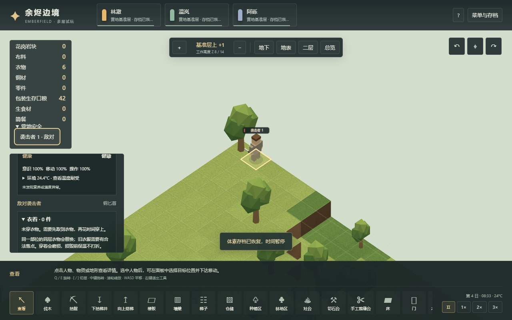
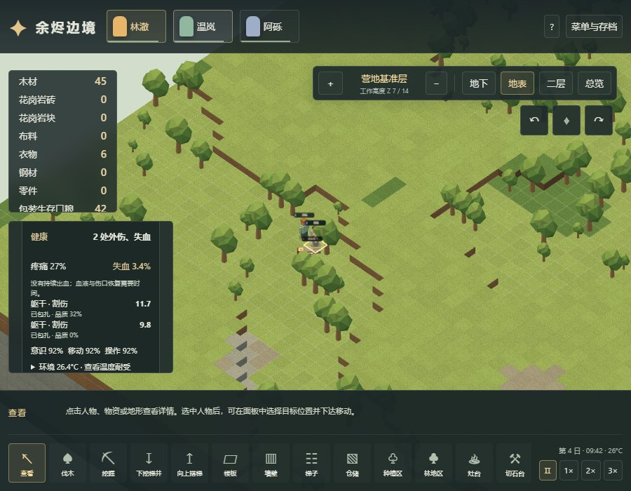

# 体素征召、近战外伤与无药护理

本章描述独立 Web 实现。原版静态证据见 [39章](39-injuries-medicine-mechanisms.md)，真实原版护理实验见 [40章](40-native-injuries-runtime.md)。七区人体、袭击调度、撤退与命中率属于本项目当前适配，不构成完整 RimWorld 战斗或医疗复刻。

## 玩家操作与实际流程

菜单与存档中的「允许袭击」默认关闭，旧营地也保持关闭。开启后有三游戏日准备；此后每五日尝试一次单人袭击。已有活动敌人时延后一天，没有可达边缘入口时延后四分之一日。入口必须距离可行动殖民者至少16格，并能通往至少一名殖民者。关闭设置只取消未来事件，不移除到场敌人。此固定节奏不是原版故事叙述者或财富预算。

点击殖民者「征召」后停止普通工作、睡眠与进食，仍会消耗需求。可指定格移动、下达近战攻击，或在原地自动反击相邻敌人。明确移动优先于自动反击，允许脱离接触；攻击需通过三维通路接近同层相邻格，不能隔墙或跨层直接命中。敌人选择有可达相邻位置的目标。优先级和作息可以调整，但不覆盖征召指令。

敌人携带普通钢匕首，殖民者起初徒手；装备以人物持久字段记录，遗体保留原装备信息。本轮尚无武器制作、拾取、换装和缴械，不能把这部分称作已完成实体武器物流。被击倒的袭击者若恢复行动，会沿可达路径撤离地图；路被堵住则等待。这是项目明确的败退规则，不宣称覆盖原版派系士气和俘虏行为。人物及遗体总数上限64，达到上限会停用新袭击，不删除已有遗体。

受伤者详情显示部位、伤情、严重度、包扎品质、疼痛、出血速度与失血。未征召同伴的医护开启后会接近并逐处包扎，也可以指定同伴「优先包扎（无药）」。病人留在实际位置等待，医生有赶路和护理动作。包扎不消耗虚构药品或布料；每次只护理一处，品质可以为0，仍会止血。伤口继续自然及护理恢复，失血另行恢复。严重疼痛或失血可导致倒地，沿用既有医疗床、跨层救援及喂食；破坏核心部位或失血达到1会死亡。

## 数值与适配边界

| 项目 | 当前实现 |
|---|---|
| 徒手 | 健康基准拳伤8.2，2秒冷却；不把牙齿chanceFactor当咬击概率 |
| 普通钢匕首 | 健康七候选算例：刀刃割伤75%、刀尖刺伤6.25%、刀柄瘀伤6.25%、两拳瘀伤合计12.5%；基准伤害12/13/9/8.2，冷却1.5/2/2/2秒 |
| 伤害浮动 | 基准×[0.8,1.2]，项目按最近整数舍入；采用确定性种子采样 |
| 命中 | 项目固定基准0.75×操作能力，下限操作参与值0.1；没有完整技能、闪避、环境、护甲和穿透管线 |
| 外伤 | 瘀伤无外部流血；割/刺/咬伤系数0.06，疼痛系数0.0125 |
| 无药护理 | 健康基准200个项目tick（原版600/60×20）；按操作能力累积工作，无药药效0.3，品质上限0.7，最终逐伤情±0.25；医生质量基准固定0.75，非医疗技能复刻 |
| 血损与恢复 | 按60000原版tick/日至12000项目tick/日换算；出血阈值、共享恢复预算、当前严重度决定伤龄止血见39章 |

当前身体仅有躯干、头、颈、左右臂、左右腿七区，沿用对应原版部位HP和流血倍率，命中权重与成对肢体能力平均是项目选择。肢体损毁会保留永久功能损失，不会因伤口愈合自动长回；没有完整层级人体、内脏、缺失部位残端出血、伤害传播、殖民者即死保护、感染、免疫、药物选择、手术或义体。普通伤口本身的算法也不能证明完整原版拳伤永不出血，原版钝伤有内部传播分支。衰弱时仍沿用上述健康工具分布，未重算原版候选分组。

普通床的自然恢复预算为8+卧倒4+床4点/日；自然与护理恢复各自随机选一个伤口分配预算，不能把整份恢复量发给每个伤口。饥饿时停止伤口恢复。时间缩放、品质扰动和测试读取接口均在源码中明确，不与原版实际观察混用。

## 存档与验收

v12增加外伤、失血、永久部位损伤、阵营、征召、攻击目标/冷却、败退和袭击日程。加载不执行攻击，不消耗护理工作，也不重发开局物品。真正修改前捕获的 [v11历史存档](../../../tests/fixtures/voxel-v11-start.json) 用于迁移验证；旧版本的地形、衣物、需求和资源保留。

正常经营验证脚本只创建世界、发出玩家命令、推进时间与存读档：实际建医疗床，等待三天袭击，三人征召迎战，产生外伤后逐处包扎，再经营一日观察恢复。没有注入伤口、敌人、材料、时钟或需求。浏览器从这些普通经营存档继续，通过真实按钮、下拉框和文件选择器测试，调试接口仅用于读取状态与导出保存；不是屏幕专用 Agent 评测。

关键回归覆盖多人互相护理的活锁、征召撤退被反击覆盖、敌人卡在不可达目标、首位殖民者封闭导致袭击入口误判、伤口身份与命令合法性、护理中断、读档冷却与旧营地迁移。原始结果保存在忽略目录 `test-results/`，发布前的摘要与源码哈希见 `evidence/voxel-injuries-validation.json`。

2026-11-03最终本地验收：381项单元测试通过，其中12项战斗/护理集成、18项外伤规则。正常经营流程通过11项检查，推进到tick 48849（约4.07日），三名殖民者存活。此种子下敌人被击杀，因此这一经营流程没有实际观察“存活敌人恢复并撤离”；另一个明确使用人工伤口/几何准备的集成测试验证倒地→自然恢复→出口受阻等待→读档→通路打开后步行离场。

Chrome生产构建在Worker和主线程回退中各通过8项检查，包括真实v11导入、正常菜单开关、敌人查看、征召攻击、优先包扎、护理中存读档、止血后保留伤口和900×700窗口。原有跨层施工、住房、生存冷热、衣物生产与冷热对照，以及生存和衣物浏览器脚本共8个回归脚本通过。静态证据和原版存档/截图哈希分别通过本地复核；原版开发准备的护理样本没有被当作自然战斗验证。





```sh
npm test -- --maxWorkers=2
npm run test:voxel:injuries
npm run build
npm run test:voxel:injuries:browser
npm run research:check
```

后续仍需完整人体与护甲、武器实物物流、药草/药物与感染护理、敌方群体策略、俘虏、遗体处理，以及动物生态和狩猎。当前阶段通过不代表这些系统完成。
