# 43 — 原版实机：木棒制作、武器换装与主动丢弃

本轮在原版中实际完成了 **Squint 装备现有塑钢匕首 → 用现场木材正常制作木棒 → 换上木棒 → 主动丢弃木棒**。中途存档保留真实 `DoBill` 和 `UnfinishedWeapon`，物品身份贯穿地面与装备容器，最终木材总量减少 40。

**本轮关闭了继承的 God mode，没有 Dev 生成新武器或材料，没有编辑存档、提高技能或修改研究。** 殖民地、衣物、材料库存继承自前轮，不能把整个场景称为纯自然开局。武器配方、材料倍率、品质组件、装备与丢弃代码的静态证据见 [42 — 武器制作、装备与掉落机制](42-weapons-crafting-equipment-mechanisms.md)。本章补充运行结果，不代替静态规则，也不代表做过战斗测试。

## 环境、起点与结束状态

| 项目           | 核对结果                                                                             |
| -------------- | ------------------------------------------------------------------------------------ |
| 原版           | RimWorld `1.7.4980 rev60`，Core + Odyssey                                            |
| 进程           | `F:\SteamLibrary\steamapps\common\RimWorld\RimWorld.exe`；PID `29920`；HWND `988850` |
| 独立 profile   | `.local-research/runtime/profile-20261102`；每次输入均校验 exe、启动参数及前台窗口   |
| 程序集 SHA-256 | `eff7d97949f919fb2b151ebfb906e9be749b63410b7dbda78eeebb7972b245c3`                   |
| 原始基线       | `injuries-stopped-b.rws`，tick `77192`                                               |
| 基线 SHA-256   | `2ed58c52089a455d700a0e2f43105e731f6ddb5d94f1666356df479bfd2dcf97`，保留未覆盖       |
| 操作时间       | 2026-11-03 00:17–00:37 UTC，即北京时间 08:17–08:37                                   |
| 结束存档       | `weapons-stopped-a/b.rws`，均为 tick `81128`，暂停                                   |
| 结束 b SHA-256 | `2699fc8b81d98ecf94b2839a928804b964498165fdec94120e42164778197edf`                   |

采用 reverse-engineer-anything skill v42 的证据分层方法。复用 [既有 Windows provider 边界](evidence/native-plants-runtime.json)：`unsupported_host: native macOS utilities require macOS`。实际输入与截图由带守卫的 Windows helper 执行，**没有宣称 REA native UI 在 Windows 上执行成功**，也未重复修复该 provider。

入口与出口各保存两个不同名称的存档，入口二者都是 `77192`，出口二者都是 `81128`。六个运行窗口均通过数字速度键启动、显式点击暂停按钮结束；没有盲按 Space、读档重试或覆盖旧样本。最后一次本作者原版操作为 00:37:35 UTC，此后仅离线整理。

## 初始装备与普通 Equip

工作者是 Squint，实体 `Human961`，Crafting 等级 3，初始经验 `105.001068`。其装备容器为空；原有衣服与 `WakeUp964×4` 背包物品保留。衣服包含前轮 Dev 准备的敲击兽皮派克大衣，不属于本次正常制作成果。

当前地图原有三件地面武器：塑钢匕首 `MeleeWeapon_Knife38570`、栓动步枪 `Gun_BoltActionRifle38568`、左轮 `Gun_Revolver38569`。三者起初均为 forbidden。读取范围限定当前地图及其容器，未将世界人物装备误算为殖民地库存。

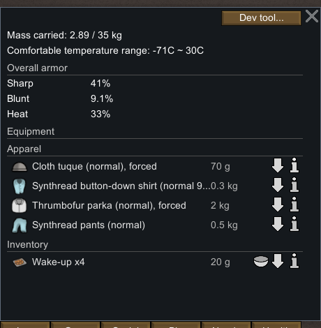


选择 Squint 后右键现有匕首，普通菜单提供 `Equip plasteel knife (normal 99%)`。下单存档是 `Equip`、target A 为 `Thing_MeleeWeapon_Knife38570`、`playerForced=True`。短时放行后，同一 ID 从地面进入 Squint 的 `equipment/equipment/innerList/li`，保持 Plasteel、Normal、HP 276，UI 显示重量 0.5 kg。


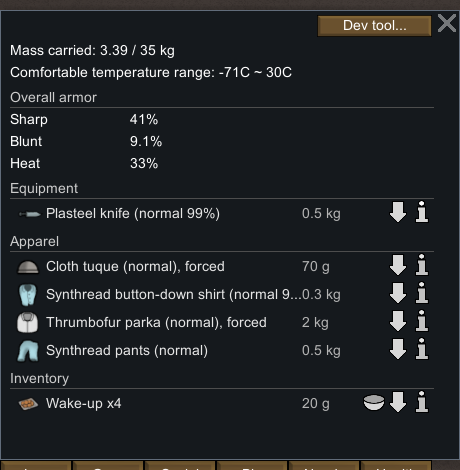

本样本说明玩家直接装备命令能够取用这件原先禁用的武器；未测试所有禁用原因、不可达目标或冲突预约情形。初次运行包含寻路与后续闲逛，不能把 `77192→78093` 的 901 tick 当成装备动作耗时。

## 普通制作点与木材过滤

God mode 关闭后，从 Architect → Production 正常放置制作点 `CraftingSpot78052`，位置 `(108,0,130)`，spawnedTick `78093`。基线和装备匕首后的存档都没有制作点，后续只存在这一座。零建造工作量与第 42 章静态定义相符，但本轮没有验证锻造台的建造劳动。

UI 显示 `Work speed factor: 40% (outdoors)`。通过 Bills → Add bill → Make club 创建普通 Do 1x 订单，再 Clear all 并只勾选 Wood。保留 Any worker、技能区间 0–20、无限取料半径和 Take to best stockpile。

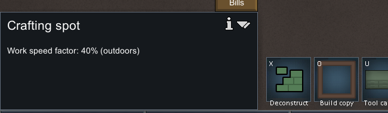

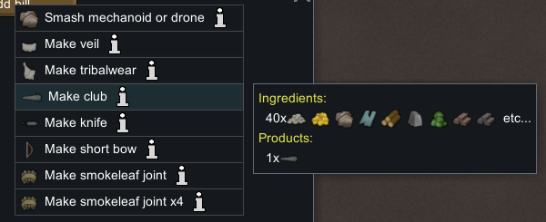

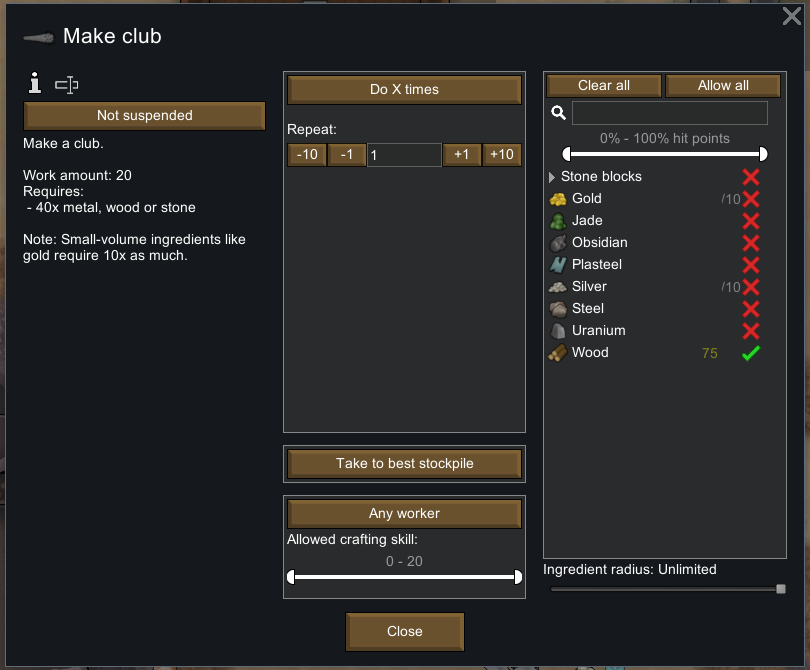

配方 UI 基础 `Work amount: 20`，要求 `40x metal, wood or stone`，还提示金等小体积材料需要十倍数量。这不是木制成品的实际室外耗时。第 42 章静态定义给出的基准是 `1200 × 木材0.7 = 840` 工作量；加工还要受人物与最终工位速度影响。

Squint 的 Crafting 工作分配已经开启，右键制作点直接出现 `Prioritize crafting at crafting spot`。本轮没有修改工作分配，也未做“未分配→阻止→开启”的对照实验。下单保存 `DoBill`、工位 target A、木材 target B `Thing_WoodLog42142`、count 40、订单 `Bill_Make_MeleeWeapon_Club_2`。


## 40 木材进入半成品，完成时才消耗

原木堆 `WoodLog42142` 起初有 75。加工中，它剩 35；分出的 `WoodLog78055×40` 已进入 `UnfinishedWeapon78056.ingredients`，不是直接凭空消失，也没有同时保留在地面。半成品保存 WoodLog 材料、作者 `Human961`、配方、订单绑定、位置和 `workLeft`。

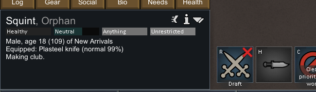

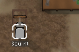

| 快照                        |  tick | 工作 / 状态               |   剩余工作 | 累计配方工作 tick | 当前地图木材总数 |
| --------------------------- | ----: | ------------------------- | ---------: | ----------------: | ---------------: |
| `weapons-craft-ready`       | 78093 | DoBill，准备取料          | 尚未初始化 |                 0 |              427 |
| `weapons-crafting`          | 79302 | DoBill，toil 14；有半成品 | 471.596252 |               921 |              427 |
| `weapons-crafting-progress` | 79865 | 同一个 DoBill 与半成品    | 247.194092 |              1482 |              427 |
| `weapons-crafted`           | 80782 | 订单完成，已转普通搬运    |   无半成品 |            不适用 |              387 |

两次中间保存间游戏推进 563 tick，存档的 `ticksSpentDoingRecipeWork` 增加 561，剩余工作减少 `224.402160`。按这 561 个记录的加工 tick 计算，每 tick 约 0.4 工作量，与 40% 工位显示相符。**不能把所有经过的游戏 tick 都当成加工 tick，也未逐帧解释这 2 tick 的差额。** `840 − 921×0.4 ≈ 471.6` 和 `840 − 1482×0.4 ≈ 247.2` 提供了与静态工作量的交叉核对，浮点累计存在小误差。

材料总数包括禁用的原有木材、散落木材及半成品内部材料。加工中仍为 427；完成后为 387，因此实际消耗 40。成品后源堆又变为 71，其他 32 与 4 的小堆消失，符合随后搬运合并；这不改变全地图净消耗。**HUD 的 75、35、71 是仓储口径，不能作为全图木材总量。**

本轮木材均来自已有场景，未执行砍伐，不声称验证了自然采集链。原有 forbidden 木材六堆数量、位置和禁用状态保持不变。

## 成品是无品质的 65 HP 木棒

UI 出现 `Bill complete: Make club.`，生成 `MeleeWeapon_Club78067`，WoodLog、HP 65、地面位置 `(108,0,129)`、spawnedTick `80481`。订单 `repeatCount` 省略，按零读取，`boundUft=null`；原半成品及其中 40 木材不再存在。


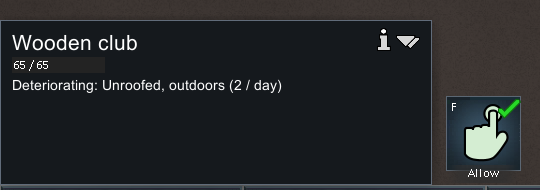

成品标签为 **Wooden club**，`65 / 65`，没有品质后缀；XML 没有 `quality` 字段。结合第 42 章确认的 Club 无 CompQuality，不能将缺省字段解释为“普通品质”。同轮现有匕首明确保存 `quality=Normal`，两者读取逻辑需要区分。

Crafting 仍为 3，经验自然增加到 `178.499756`。这是一次制作结果，不是品质分布、经验增长公式或技能效率曲线的样本集。

订单选择了 BestStockpile，但成品停在地面。普通右键菜单说明没有空的、可达且配置为存放该物品的储存位置。因此未宣称成功完成武器入库。

## 换装保留旧武器身份，主动丢弃另设禁用

选 Squint 对成品下普通 `Equip wooden club`。下单快照仍携带原匕首；完成后新木棒进入装备容器，原匕首以原 ID 落在 `(108,0,129)`，HP 276、Normal、Plasteel 不变。新木棒 `despawnedTick=80937` 与旧匕首 `spawnedTick=80937` 一致。匕首落地 **forbidden=false**，未被放入背包。

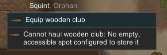

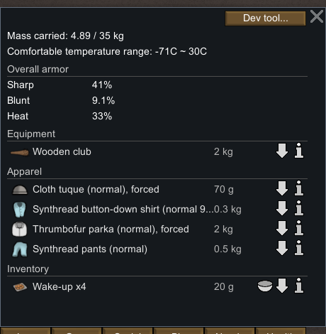

随后通过 Gear 中木棒右侧的普通向下箭头下达 Drop。UI 显示 `Dropping wooden club.`，暂停下单存档明确记录 `JobDriver_DropEquipment`、target A 为同一木棒、`ticksLeftThisToil=30`、startTick `81017`。

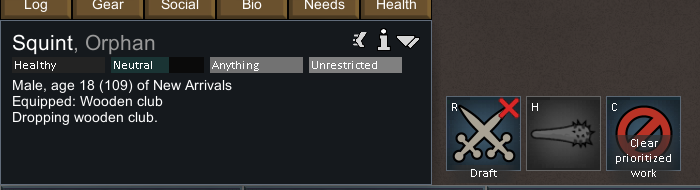

放行短窗口并暂停后，装备容器为空，同一木棒落在 `(104,0,127)`，65 HP 保持，**forbidden=true**；UI Allow 图标变为红叉。木棒未进入背包，地图与装备间不存在重复实体。旧匕首仍在原位置且允许搬运。


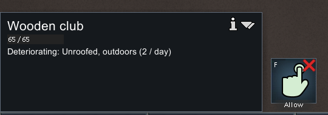

| 行为              | 原物品归属变化                           | 地面物品禁用状态               |
| ----------------- | ---------------------------------------- | ------------------------------ |
| 直接装备原匕首    | 地面 → Squint 装备                       | 初始禁用未阻止本次玩家直接命令 |
| 用木棒替换匕首    | 木棒：地面 → 装备；同一匕首：装备 → 地面 | 旧匕首 false                   |
| Gear 主动丢弃木棒 | 同一木棒：装备 → 地面                    | 木棒 true                      |

丢弃后的木棒保存 `spawnedTick=81047`，与命令起始 `81017` 差 30，且下单时 driver 剩余 30；这与第 42 章静态等待值相符。完整运行窗口是 111 tick，包含后续工作，不能说丢弃实际耗时 111 tick；也未用逐帧捕获量测 0.5 秒墙钟时间。装备过程同样未测额外等待。

## 对 Web 实现的直接约束与未覆盖项

1. **材料归属要可追踪。** 地面、搬运、未完成物品、成品是不同归属；进入半成品时不应既减少总库存又保留另一份材料。完成才消费原料。
2. **武器要有稳定 ID 与单一所属容器。** 换装和丢弃移动同一件物品，保留材料、HP、品质资格；不要只给角色存武器名称后重新生成。
3. **没有品质与普通品质分开。** Club 是无品质，Knife 的 Normal 是实际品质值。界面及存档迁移都应保留这个区别。
4. **玩家主动丢弃与换装掉旧武器分别处理。** 本样本的 forbidden 分别为 true 和 false；统一“掉地即禁用”会丢失原版差异。
5. **制作可完成不等于能够入库。** 成品、订单完成、储存可达性分别表示；无储存目标不能让成品消失。

未覆盖攻击动作、命中、伤害、DPS、护甲穿透、远程弹道、品质分布、研究解锁、锻造台建设/燃料、电力供给、半成品取消回收或长期耐久衰减。UI 的 `Deteriorating: Unroofed, outdoors (2/day)` 仅作当时显示，未实测一天的损耗。场景还包含此前准备的医疗床、衣物与健康状态，本轮未将这些继承状态作为武器机制的因果证据。

## 仓库证据与只读复核

- [结构化证据](evidence/native-weapons-runtime.json)：15 个存档快照，18 张裁片，各自原始来源与 SHA-256，六个运行窗口及限制。
- [动作流水](evidence/native-weapons-actions.jsonl)：130 条守卫输入，包含无效点击、重复放置拒绝、菜单与保存操作，没有删去不成功尝试。
- [存档只读提取器](../../../scripts/research/read-weapons-runtime-save.ps1)：仅当前地图，明确区分装备、背包、搬运与半成品内部材料。
- [离线收集器](../../../scripts/research/collect-weapons-runtime.ps1)：从保留的原版存档/截图生成摘要和裁片，不运行游戏。
- [证据校验器](../../../scripts/research/verify-native-weapons-runtime.mjs)：检查来源哈希、物品唯一归属、材料守恒、进度、品质缺省语义、动作顺序与暂停。
- [拒绝覆盖的保存助手](../../../scripts/research/save-weapons-runtime.ps1)：需要明确暂停、无模态窗口的原版现场；仅采集时使用。

```powershell
# 仓库内保留证据校验，不需要安装原版
node scripts/research/verify-native-weapons-runtime.mjs

# 本机再核对原始 XML、原始截图及捕获元数据；不会向游戏发输入
node scripts/research/verify-native-weapons-runtime.mjs --local
```

完整原版存档、完整截图及派生代码保留在忽略的 `.local-research/`，仓库仅沉淀必要摘要与 UI 裁片。结束双存档证明当时暂停，验证器校验的是保留证据，不是再次重演原版流程。

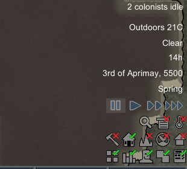
