# 46 — 原版实机：制作经验、单件品质与订单技能范围

本轮用 Squint 的 **Crafting 3、无热情**，在已有制作点正常制作了一把钢刀。中途存档显示经验在加工时已经增长；完成后得到 **Poor 品质、100 HP** 的钢刀，地图钢材总量净减少 30。随后只改订单的允许技能范围，观察到同一个工人在 4–20 时被拒绝、恢复 0–20 后可接单。

这是 **一名工人、一件产品、一个玩家订单范围对照**。它不验证品质概率分布，也没有升级、衰退、饱和、灵感或配方自身最低技能要求的实验。静态规则及独立算例见 [45 — 技能、学习与制造品质](45-skills-learning-quality-mechanisms.md)；武器、制作点与容器身份的前轮运行证据见 [43 — 武器制作与换装](43-native-weapons-runtime.md)。

## 环境与保存边界

| 项目           | 核对结果                                                                                 |
| -------------- | ---------------------------------------------------------------------------------------- |
| 原版           | RimWorld `1.7.4980 rev60`，Core + Odyssey                                                |
| 进程           | `F:\SteamLibrary\steamapps\common\RimWorld\RimWorld.exe`；PID `29920`；HWND `988850`     |
| 独立 profile   | `.local-research/runtime/profile-20261102`，输入 helper 校验 exe、profile 参数和前台窗口 |
| 程序集 SHA-256 | `eff7d97949f919fb2b151ebfb906e9be749b63410b7dbda78eeebb7972b245c3`                       |
| 保留基线       | `weapons-stopped-b.rws`，tick `81128`                                                    |
| 基线 SHA-256   | `2699fc8b81d98ecf94b2839a928804b964498165fdec94120e42164778197edf`                       |
| 入口双存档     | `skills-entry-a/b.rws`，均 tick `81128`                                                  |
| 本作者操作时间 | 2026-11-03 `01:26:57–01:52:44 UTC`，即北京时间 `09:26:57–09:52:44`                       |
| 结束双存档     | `skills-stopped-a/b.rws`，均 tick `86183`，暂停                                          |
| 结束 a SHA-256 | `6d3f703778f6caa9f61811f3e6185d44a2955c13fb0b439039a305c42193ffa1`                       |
| 结束 b SHA-256 | `a1198e345bc9a6af03d46decd2a557aaf1bbc0f7ad1f8431fc9c10a46f157d33`                       |

采用 reverse-engineer-anything skill v42 的证据分层方法，复用 [既有 Windows provider 边界](evidence/native-plants-runtime.json)。REA native provider 此前返回 `unsupported_host: native macOS utilities require macOS`；本轮的实际输入与截图来自带守卫的 Windows helper，没有宣称 REA native UI 在 Windows 成功执行。

**God mode 继承为关闭，全程未开启；Developer mode 继承为开启。** 本轮没有 Dev 生成物品或材料，没有修改技能、研究、工作分配或存档 XML，没有安装 Mod。场景继承前轮 Dev 派克大衣和 God 建造医疗床，不能称整个场景为自然开局。使用的制作点是在第 43 章普通 Architect 操作中放置，钢材来自既有现场库存。


## 同一工人的技能与热情显示

工作者为 Makar “Squint” McCall，实体 `Human961`。Crafting 等级 3；原始 XML 没有 `passion` 字段，按 None 记录，同时保留字段缺省标记。特性为 `BodyPurist`，有继承的 `WakeUpAddiction`；UI 活动栏显示 Healthy。装备容器为空，背包保留 `WakeUp964×4`。各存档 `inspirationHandler.curState` 均 `IsNull=True`。

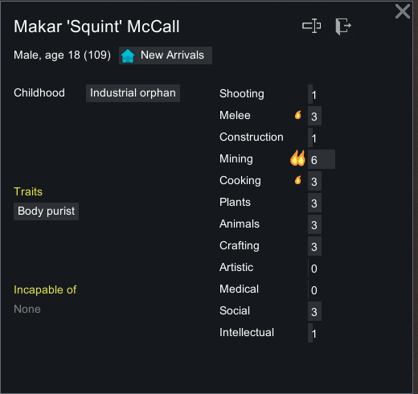

普通 Bio 悬停显示：

| 技能     | 等级 | 热情  | UI 当前经验 / 下级需求 |                    UI 学习速度 |
| -------- | ---: | ----- | ---------------------: | -----------------------------: |
| Crafting |    3 | None  |           `178 / 4000` |   `35% = 基础100% × 无热情35%` |
| Cooking  |    3 | Minor |             `0 / 4000` |   `100% = 基础100% × 热情100%` |
| Mining   |    6 | Major |           `557 / 7000` | `150% = 基础100% × 大热情150%` |


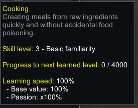

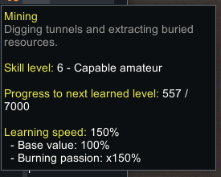

这些是同一人物三个不同技能的**显示取样**。本轮只训练 Crafting None，没有让 Minor、Major 工人各自制作同一物品，因此不能把此表称为三种热情的受控经验对比。UI 显示舍入值；后面的经验表使用存档浮点数。

## 现有钢材与普通制作订单

原有 `Steel38585` 位于 `(99,0,120)`，数量 66，初始 forbidden。通过普通 Allow 切换启用这一堆；其他 20 堆钢材仍保持原数量、位置和禁用状态。初始当前地图共有 21 堆钢材、总量 1170。本轮没有采矿，不推断这些既有材料的生成来源。

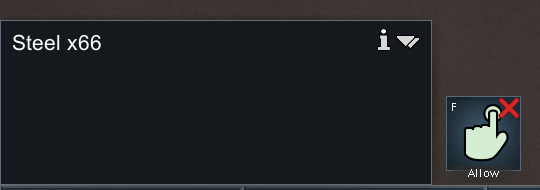

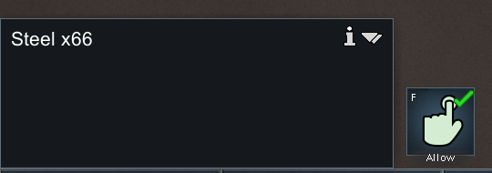

制作点 `CraftingSpot78052` 位于 `(108,0,130)`，spawnedTick `78093`，UI 显示 `Work speed factor: 40% (outdoors)`。新订单为 `Make_MeleeWeapon_Knife`，loadID 3，普通 Do 1x，Clear all 后只允许 Steel。Any worker、允许技能 0–20、无限取料半径和 Take to best stockpile 保持默认。原木棒订单 loadID 2 继续为 0。

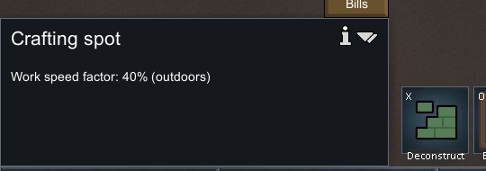

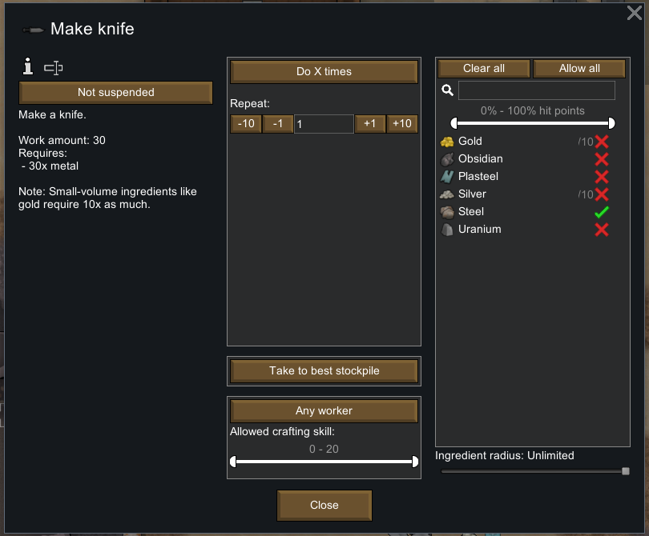

配方界面显示基础 `Work amount: 30`、`30x metal`。该 30 是工作量的 UI 表示，不等于在当前工位实际耗时 30 秒。第 42/45 章的静态基准为钢刀 1800 工作量；人物 `GeneralLaborSpeed` 与工位效率还会影响完成时间，Crafting 等级不直接乘入 GeneralLaborSpeed。

选择 Squint，普通右键提供 `Prioritize crafting at crafting spot`。`skills-knife-ready` 保存真实 `DoBill`：工位为 target A，`Thing_Steel38585` 为 target B，count 30，订单 `Bill_Make_MeleeWeapon_Knife_3`，`playerForced=True`。本轮没有改工作分配，也未做禁用工作类型的对照。


## 半成品阶段已经获得经验

开始加工后，源堆从 66 变为 36；`Steel78070×30` 进入 `UnfinishedWeapon78071.ingredients`。半成品记录 Steel、作者 `Thing_Human961`、同一刀配方与订单，spawnedTick `81492`。材料在当前地图中仍存在，直到完工后才净消耗。

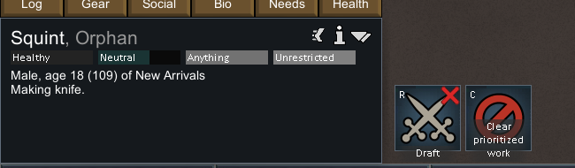

| 快照                       |  tick | Crafting XP | 今日 Crafting XP |   剩余工作 | 记录的配方工作 tick | 地图钢材 |
| -------------------------- | ----: | ----------: | ---------------: | ---------: | ------------------: | -------: |
| `skills-knife-ready`       | 81128 |  178.499756 |       178.499756 | 尚未初始化 |                   0 |     1170 |
| `skills-crafting`          | 82773 |  223.437927 |       223.437927 |  1286.4209 |                1284 |     1170 |
| `skills-crafting-progress` | 84455 |  282.239349 |       282.239349 | 614.427368 |                2964 |     1170 |
| `skills-crafted`           | 86183 |  336.109985 |       336.109985 |     已完成 |              不适用 |     1140 |

两个中间快照都是真实 `DoBill`、toil index 14，且保留同一半成品。`workLeft` 同时出现在 job driver 和半成品里，二者相同。因此“未完工就能获得经验”有保存状态和 UI 的双重证据。

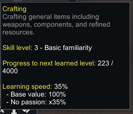

两次中间快照之间：

- 地图经过 `84455 − 82773 = 1682` tick。
- `ticksSpentDoingRecipeWork` 增加 `2964 − 1284 = 1680`。
- XP 增加 `282.239349 − 223.437927 = 58.801422`，接近静态公式 `1680 × 0.1 × 0.35 = 58.8`。
- 剩余工作减少 `1286.4209 − 614.427368 = 671.993532`，接近 `1680 × 0.4 = 672`。

**地图 tick 与记录的工作 tick 相差 2，不应混用。** 本轮没有逐帧采样，也未隔离解释这 2 tick 的原因。该片段支持与学习率、40% 工位效率的近似一致，不能宣称逐 tick 完全精确。

整件产品的实测 XP 增量为 **157.610229**。静态理想算式 `1800 / 0.4 × 0.1 × 0.35 = 157.5` 与之相差 **0.110229**；未通过本轮实验确认差异来自浮点累计、工作阶段边界还是其他细节。证据与校验保留实际值，没有强行把结果取整为 157.5。

Crafting 全程保持 3，结束进度 336.109985，远未达到下级所需 4000。今日 XP 与当前等级 XP 在这些快照中相同，`lastXpSinceMidnightResetTimestamp=45039` 保持不变。没有跨午夜重置、每日饱和或高等级衰退的运行验证。

## 成品身份、材料消耗和单次 Poor 品质

原版出现 `Bill complete: Make knife.`。新产品 **`MeleeWeapon_Knife78091`** 在 tick `86049` 生成，材料 Steel，品质字段明确为 Poor，HP 100，位置 `(109,0,129)`，forbidden 为 false。原有 `MeleeWeapon_Knife38570` 是另一件 Plasteel/Normal、HP 276 的刀；木棒 `MeleeWeapon_Club78067` 也保持不变，不能把它们当成新成品。


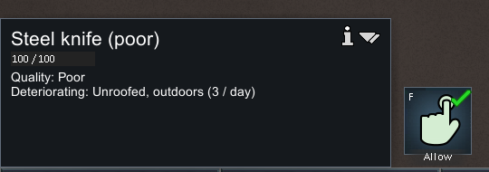


完成后半成品和其中 30 钢材消失，当前地图钢材 `1170→1140`，源堆剩 36。总数包括禁用堆与半成品容器；HUD 的仓储资源数字不是这一口径。刀订单次数自动降至 0，Squint 回到普通 `HaulToCell`。刀仍在地面，本轮未装备，也没有成功把武器搬入仓库的结论。

第 45 章的独立概率模型给 Crafting 3、无灵感的 Poor 概率约 50.7503%，但本轮只有 **一个 Poor 样本**。它仅证明这一普通制作流程产出了带品质的物品，不能验证概率、随机数序列或“等级 3 必出 Poor”。存档中没有灵感，不等于完成了灵感的对照实验。

## 玩家配置的技能范围：阻止与恢复

完工后保持暂停，在同一订单把次数临时加回 1，并用普通滑块把允许 Crafting 区间改为 **4–20**。选择同一位 Crafting 3 的 Squint，右键同一制作点，原版显示：

`Cannot make knife: Under allowed skill 4`

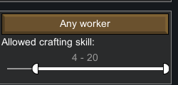


`skills-gate-blocked` 保存范围 `4~20`、次数 1。随后普通滑块恢复 **0–20**，右键又显示 `Prioritize crafting at crafting spot`。只观察菜单，没有点击这次制作选项；`skills-gate-allowed` 保存范围 `0~20`、次数仍为 1。

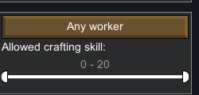


这两个快照都为 tick `86183`，人物 XP、job、钢材与成品身份完全相同。唯一相关配置对照是订单允许区间。**这不是“匕首配方要求 Crafting 4”**；配方自身最低技能是另一套条件，静态章节记录匕首没有该最低要求。本轮未尝试长剑等有最低要求的配方。

最后点击普通减号，将刀订单恢复 0 次；没有生成第二把刀。一次在订单已完成为 0 时的无效右键尝试 `skills-030-completed-bill-menu.png` 保留在台账中，未把它写成成功的门槛证据。

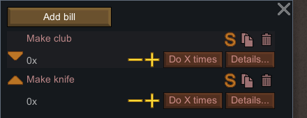

## 时间控制与可复核材料

| 数字速度键运行 / 显式暂停             | 起点 tick | 终点 tick | 请求截图前等待 |
| ------------------------------------- | --------: | --------: | -------------: |
| `020-run-craft → 021-pause-craft`     |     81128 |     82773 |        3500 ms |
| `023-run-work → 024-pause-work`       |     82773 |     84455 |        3500 ms |
| `025-run-finish → 026-pause-finished` |     84455 |     86183 |        3500 ms |

仅这三个窗口按数字 3 放行，随后显式点击暂停 `(2441,1305)`，总共推进 5055 tick。3500 ms 是输入 helper 请求的截图前等待，不是精确动作耗时；运行还包括行走、取料、截图与完成后的搬运。没有 Space、读档重试、覆盖旧存档或运行中的长时间观察。

结束双存档都在 tick `86183`，截图的暂停控制处于选中。最后一次本作者原版输入于 `01:52:44 UTC` 完成，此后只离线整理；原版控制已交回主线。

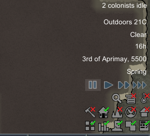

保留的证据：

- [运行摘要](evidence/native-skills-runtime.json)：11 个存档摘要（含前轮基线）、版本/哈希、12 技能字段、材料容器、工作阶段、订单范围、21 张裁图及来源元数据。
- [110 条动作台账](evidence/native-skills-actions.jsonl)：包括普通输入、保存与无效尝试，按实际时间排列。
- [只读存档提取器](../../../scripts/research/read-skills-runtime-save.ps1)：复用 [第 43 章容器提取器](../../../scripts/research/read-weapons-runtime-save.ps1)，增加技能字段存在性、热情、今日经验、灵感和当前地图 Steel 范围；不会运行程序集。
- [双存档 helper](../../../scripts/research/save-skills-runtime.ps1)：仅允许 `skills-*` 文件名且拒绝覆盖；实际使用普通菜单保存。
- [离线证据收集器](../../../scripts/research/collect-skills-runtime.ps1)：从本地原始保存与截图重建摘要、台账、裁图，不执行游戏输入。
- [独立核验器](../../../scripts/research/verify-native-skills-runtime.mjs)：校验源快照固定摘要、物品唯一身份、材料守恒、技能范围对照、经验数值、PNG/hash 和时间台账。

在 `experiments/rimworld-like` 下运行：

```powershell
# 仓库内证据，不依赖本地游戏或未提交的原始存档
node scripts/research/verify-native-skills-runtime.mjs

# 本机额外重提取全部原版 XML，并核对原始截图和捕获元数据
node scripts/research/verify-native-skills-runtime.mjs --local

# 如需重建证据，只读取 .local-research 内已有取证文件
pwsh -NoProfile -File scripts/research/collect-skills-runtime.ps1
```

portable 与 local 均只核验证据一致性，**不会重新执行游戏，也不使用 OCR 自动解释画面**。local 依赖本地 `.local-research` 原始保存与截图；完整原版资源、程序集、存档和全屏截图不作为此章提交内容。21 张裁图已人工目视核对。

## 对 Web 实现的设计约束

经验应随真实工作的阶段产生；对于有半成品的武器配方，不能只在成品出现时一次结算所有经验。移动、等待与搬运不能当作制造工作 tick。需要区分人物学习倍率、人物工作速度、工位效率与配方工作量；本样本里 Crafting 等级不直接增加 GeneralLaborSpeed。

品质应在成功完工时生成并写入成品，之后移动、保存、展示都使用同一结果。不能按等级固定映射品质，也不能把无品质组件的木棒补成 Normal。半成品应保留材料与工人/订单绑定，既避免重复扣料，也方便中断恢复。

配方最低技能和玩家订单允许范围应分别检查、分别说明拒绝原因。本次运行验证的是后者。Web 的品质概率、升级、技能衰退和每日饱和仍需依据第 45 章静态规则与各自测试，不能用本章的单件实验扩大完成声明。
