# 49 — 原版实机：研究台、智识经验与项目切换

本轮通过普通操作建成一张木制简易研究台，由已有 Research 工作许可的 Prophet 自动研究 Battery，再切换 Solar panel、切回 Battery，最后停止研究。存档确认：**研究点按项目分别保存，切换不清零；暂停冻结进度；停止后地图继续运行 681 tick，研究点与智识经验仍不增长。**

这是一张简易台、一名 Intellectual 3 无热情人物、两项科技的部分进度实验。**没有完成任何科技**，因此不把解锁建筑、完成通知、多个研究者协作、高级台供电或设施门槛写成运行结论。静态公式、科技前置和环境规则见 [48 — 研究、科技门槛与科研台](48-research-technology-mechanisms.md)；前轮技能基线见 [46 — 制作经验与技能范围](46-native-skills-runtime.md)。

## 环境、基线与取证边界

| 项目           | 核对结果                                                                                 |
| -------------- | ---------------------------------------------------------------------------------------- |
| 游戏           | RimWorld `1.7.4980 rev60`，Core + Odyssey                                                |
| 进程           | `F:\SteamLibrary\steamapps\common\RimWorld\RimWorld.exe`；PID `29920`；HWND `988850`     |
| 独立 profile   | `.local-research/runtime/profile-20261102`，输入 helper 校验 exe、profile 参数及前台窗口 |
| 程序集 SHA-256 | `eff7d97949f919fb2b151ebfb906e9be749b63410b7dbda78eeebb7972b245c3`                       |
| 基线           | `skills-stopped-b.rws`，tick `86183`                                                     |
| 基线 SHA-256   | `a1198e345bc9a6af03d46decd2a557aaf1bbc0f7ad1f8431fc9c10a46f157d33`                       |
| 入口双存档     | `research-entry-a/b.rws`，均 tick `86183`                                                |
| 本作者操作时间 | 2026-11-03 `02:31:37–02:59:42 UTC`，北京时间 `10:31:37–10:59:42`                         |
| 结束双存档     | `research-stopped-a/b.rws`，均 tick `94520`                                              |
| 结束 a SHA-256 | `52ff07816a794f6de4d18e659f59829ef0a664c46f19ea7f9d64eba85811209f`                       |
| 结束 b SHA-256 | `01e8033f0c7a1b7d7cf9e96839e81f13168bbdfb2cf3d247898590f6eecbf6db`                       |

采用 reverse-engineer-anything skill v42 的证据分层方法，复用 [此前 Windows provider 边界](evidence/native-plants-runtime.json)。REA native provider 此前返回 `unsupported_host: native macOS utilities require macOS`；本轮实际输入与截图来自带守卫的 Windows helper，不表示 REA native UI 已在 Windows 成功执行。

**Developer mode 继承开启；God mode 继承关闭并保持关闭。** 本轮未 Dev 生成材料或物品，未修改技能、研究数值、存档 XML 或工作分配，没有点击 `Debug: Finish now`。既有场景包含早期 Dev 派克大衣和 God 建造医疗床，不能把这组实验说成未准备过的自然开局。原版游戏文件与日常 profile 未修改。


## 初始科技与没有研究台时的选择

初始存档的研究进度字典有 **86 项**，其中只有以下 7 项非零；`currentProj` 字段缺省。其值与第 48 章 ClassicStart 集合一致，但本轮是继承现场，不是新建殖民地实验。

| DefName          | 初始进度 |
| ---------------- | -------: |
| ComplexFurniture |      300 |
| PassiveCooler    |      400 |
| Stonecutting     |      300 |
| ComplexClothing  |      600 |
| Electricity      |     1600 |
| NutrientPaste    |      400 |
| AirConditioning  |      500 |

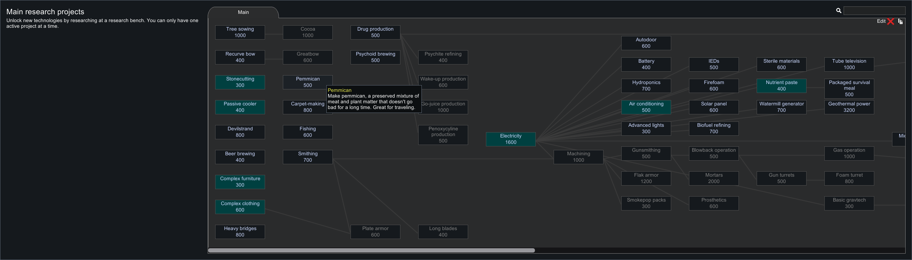

现场没有研究台，已有裁缝台和制作点不计入研究台。点击 Battery，界面显示成本 **400**，Electricity 前置为绿色，普通 `Research` 按钮可用。点击后，`research-selected` 在同一 tick `86183` 保存 `currentProj=Batteries`，进度仍为 0；原版随后提示 `Need research bench`。

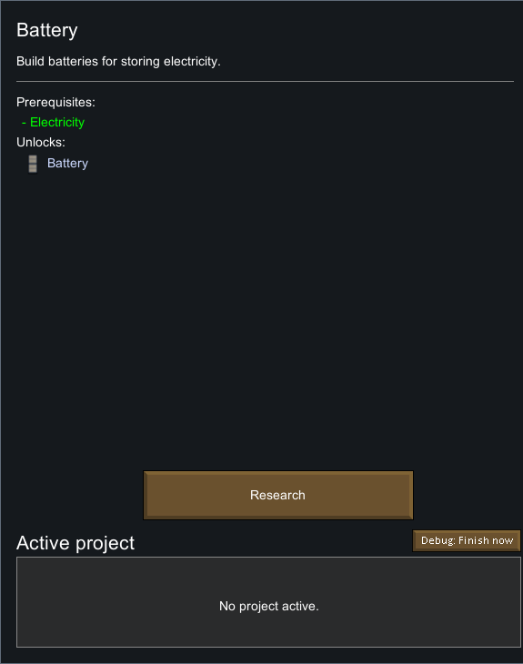

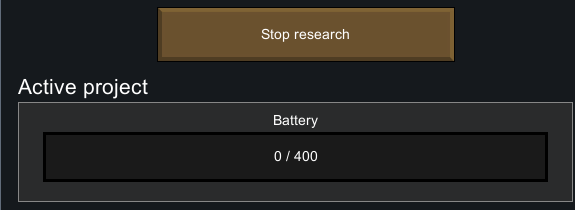


因此早期项目的**合法选择**与**能否安排劳动**是两个步骤。不能把“尚未建台”统一写成所有科技都不可点击，也不能在选中项目时就按时间自动产点。本轮没有验证需要特定高级台的项目是否能选。

## 普通建造、材料容器和误放蓝图

普通 Architect → Production → Wooden simple research bench 显示成本 **75 Wood +25 Steel**。现场已经允许使用的木材共 87，钢材 `Steel38585` 共 36，足够建设；没有新增 Allow 操作、砍树、采矿或材料生成。当前地图全部木材为 387、钢材为 1140，该口径包括 forbidden 堆及施工容器，不等同于 HUD 仓储数字。

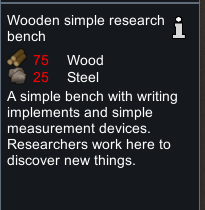

目标蓝图为 `Blueprint_SimpleResearchBench78092`，位置 `(115,0,133)`。选择 Prophet，普通右键提供 `Prioritize working on wooden simple research bench (blueprint)`。`research-build-ready` 保存 `HaulToContainer`，目标为这张蓝图，`playerForced=True`。

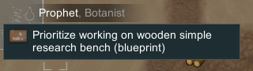

退出放置及点击人物头像过程中曾误放第二张蓝图 **`Blueprint_SimpleResearchBench78093`**，位置 `(104,0,154)`，两张均生成于 tick `86183`。早期人物选择/右键也有无效尝试，全部保留在动作台账中，未用重试覆盖证据。

第一次运行暂停在 tick `87466`：目标已变为 `Frame_SimpleResearchBench78099`，spawnedTick `86860`，HP 41，`workDone=312.69342`。Prophet 正在 `FinishFrame`，框架内有 `Steel78096×25` 与 `WoodLog78100×75`，地图材料总量仍为 387 木/1140 钢。

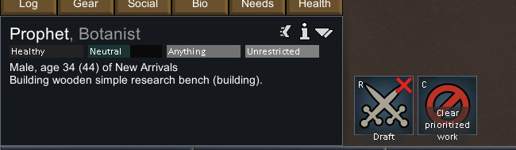

额外蓝图此时仍空，UI 明确显示 `Steel: 0 / 25`、`Wood: 0 / 75`。暂停下移动镜头找到它，用普通 Cancel 取消，再移回镜头。`research-extra-cancelled` 仍为 tick `87466`，额外蓝图消失，主框架、材料容器和人物状态与取消前相同；没有额外材料损失。

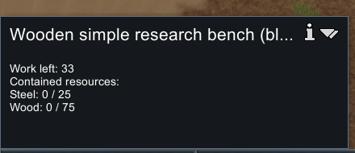

第二次运行后，目标建筑 **`SimpleResearchBench78107`** 完工，spawnedTick `89191`，WoodLog，位置 `(115,0,133)`，HP **162**。框架及容器消失，当前地图木材 **387→312**、钢材 **1140→1115**，净消耗精确为 **75/25**。钢材源堆剩 11；所有 forbidden 材料堆的身份、数量、位置与状态保持基线不变。

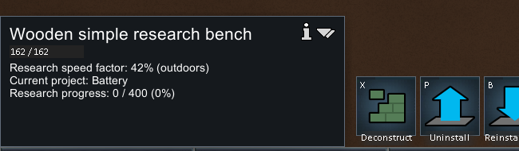

UI 显示 `Research speed factor: 42% (outdoors)`。第 48 章静态解释的常温室外简易台是 `.75基础 × .75户外 × .75 roomless卫生 = .421875`；本轮截图直接证明的是**舍入的 42% 显示**，没有运行房间、卫生或温度的分别对照。

## 工作分配、人物与自动研究

三名人物初始 Intellectual 分别为 Prophet 3、Squint 1、Grump 11，热情字段均缺省，按 None 记录并保留缺省标记。普通 Work 页面中 Manual priorities 关闭，**仅 Prophet 的 Research 勾选**。整轮三名人物的工作优先级向量与基线一致，没有修改勾选或开启数字优先级。

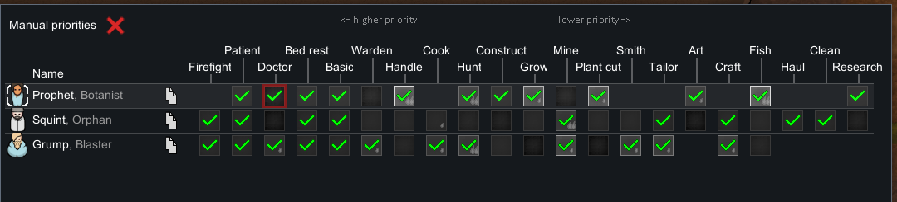

Prophet 是 `Human958`，人物界面显示 Intellectual 3、无热情，学习倍率 **35%=基础100%×无热情35%**，下一级需求 **4000 XP**。第一次截取时显示 `5 /4000`，对应保存精确值 `4.62000036`。人物继承 Pyromaniac、NaturalMood degree1（UI Optimist）及永久 Stab severity2；不能只凭 UI 的 Healthy 就认定所有健康因素恒为 1。

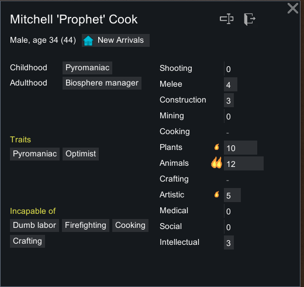

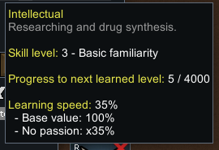

建成后 Prophet 自动进入 `Research`，首次 job loadID **78274**，startTick **89194**，workGiver `Research`，target A 为 `Thing_SimpleResearchBench78107`，`playerForced=False`，driver `JobDriver_Research`。这是自动调度研究；先前强制的是建造，并未把建造的 playerForced 标志误记到研究上。

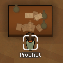

对当前 Prophet 普通右键，显示 `Already researching at wooden simple research bench`。选择未启用 Research 的 Squint 再右键，在该次截图中没有出现菜单；这只保留为一次未得到菜单的观察，不推出“任何研究都不能手动优先”等一般规则。


## 各项目进度与智识经验的精确记录

下表使用原始存档浮点数。入口 a/b、前轮基线、选择项目及建造前快照均为零；全体 16 份摘要见 [运行证据](evidence/native-research-runtime.json)。当前阵营 `PlayerColony`、难度 `Rough`，依第 48 章静态映射，本组研究的成本因子与难度倍率都为 1。

| 快照                              | 地图 tick | 当前项目    |     Battery |      Solar | Prophet 智识 XP | Research toil 剩余 tick |
| --------------------------------- | --------: | ----------- | ----------: | ---------: | --------------: | ----------------------: |
| research-selected                 |     86183 | Batteries   |           0 |          0 |               0 |                尚未研究 |
| research-constructing             |     87466 | Batteries   |           0 |          0 |               0 |                尚未研究 |
| research-bench-built              |     89361 | Batteries   | 0.195254251 |          0 |      4.62000036 |                    3868 |
| research-battery-progress         |     90998 | Batteries   |  2.61819053 |          0 |      61.9497681 |                    2231 |
| research-battery-paused           |     90998 | Batteries   |  2.61819053 |          0 |      61.9497681 |                    2231 |
| research-switched-solar           |     90998 | SolarPanels |  2.61819053 |          0 |      61.9497681 |                    2231 |
| research-solar-progress           |     92765 | SolarPanels |  2.61819053 | 2.60951614 |      123.796669 |                     464 |
| research-resumed-battery          |     92765 | Batteries   |  2.61819053 | 2.60951614 |      123.796669 |                     464 |
| research-battery-resumed-progress |     93839 | Batteries   |   4.0841136 | 2.60951614 |      161.175461 |            3393，新 job |
| research-stopped-a/b              |     94520 | 无          |   4.0841136 | 2.60951614 |      161.175461 |              GotoWander |

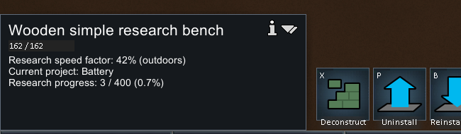

界面把 `2.61819053` 显示为 `3 /400`，研究台显示约 `0.7%`；Solar `2.60951614` 显示为 `3 /600`。不要从取整截图反推每 tick 数值，也不能因为初期显示 `0 /400` 就断言内部进度严格为零。

从 built 到 battery，地图经过 **1637 tick**，同一研究 toil 的剩余时间也减少 1637；XP 增加 **57.32976774**，更接近 `1638×.1×.35=57.33`，与 `1637×.035=57.295` 相差约 .03477。下一个 Solar 片段经过 **1767 tick**，XP 增加 **61.8469009**，接近 `1767×.035=61.845`。

这组数据支持实际研究时持续学习，但**地图 tick、toil 计时变化与每次奖励的 sourceWorkTicks 不应未经验证就画等号**。本轮未逐 tick 隔离批处理、浮点累计与阶段边界，校验器保留第一段差异而不强行改成 1637 次奖励。智识等级始终为 3，今日经验与等级内经验在本组记录中相同，`lastXpSinceMidnightResetTimestamp=45181` 不变。

静态健康 L3 的基础 ResearchSpeed 为 `.08+.115×3=.425`，理想室外台单工作 tick 点数为 `.425×.421875×.00825=.00147919921875`。这是用于理解量级的**条件算式**，并非本轮逐 tick 测得的恒定速率；实际人物继承健康状态，日照也随时间变化，完整速度因子未逐帧采集。

## 暂停、切换和停止的对照

### 全局暂停

`research-battery-progress` 保存后保持暂停，随后再保存 `research-battery-paused`。两次保存截图时间分别为 `02:48:35.3804925Z` 和 `02:50:55.0275283Z`，相隔 **139.6470358 秒**。两份均为 tick `90998`，研究管理器、三个人物提取状态、研究台与材料完全相同；中间只有离线读取和普通保存菜单操作，没有放行模拟。


### Battery → Solar → Battery

暂停下通过普通 Research 面板选择 Solar panel：同一 tick `90998`，只改变当前项目，Battery 的 `2.61819053` 保留，Solar 从 0 开始。再运行至 tick `92765`，Solar 增到 `2.60951614`，Battery 仍为 `2.61819053`。


暂停下切回 Battery，两个项目的保存进度均不变，UI 恢复 `3 /400`。再运行至 `93839`，Battery 增到 `4.0841136`，Solar 保持 `2.60951614`。

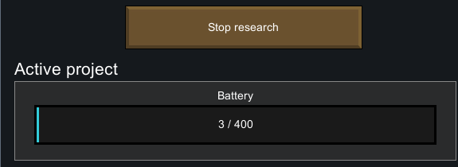

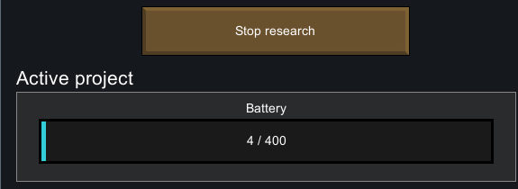

首次 job **78274** 在两次项目切换前后保持相同，没有因切换项目重建 job；这与静态研究 toil 每次读取全局当前项目的机制一致。到 `93839` 时已换成 job **81517**，startTick `93232`，仍在同一台研究。保存支持会话续接，但没有逐帧隔离第 48 章的 4000 tick 会话及后续 Wait2、通用调度等待，不能宣称完整测出各段等待长度。

### 普通 Stop research

在 tick `93839` 点击普通 `Stop research`，界面变为 `No project active.`；再放行地图 **681 tick**，停止到 `94520`。结束两份存档的 `currentProj` 字段均缺省，两个项目进度和智识经验仍等于停止前值，Prophet 已为 `GotoWander`。

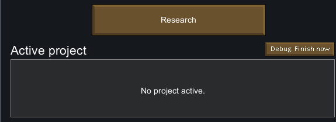

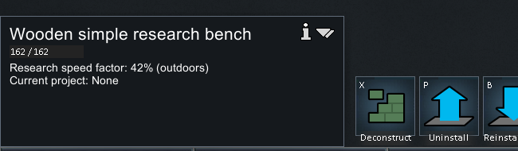

最终 Battery 约完成 **1.02%**、Solar 约 **0.435%**，均未完成；没有测试科技完成后的自动清空、建筑解锁、下一科技选择或溢出点数行为。停止对照与全局暂停对照不同：前者地图继续运行而研究不再发生，后者整张地图冻结。

## 时间控制与可复核材料

| 数字速度键运行 → 显式暂停                           | 起点 tick | 终点 tick | helper 请求截图前等待 |
| --------------------------------------------------- | --------: | --------: | --------------------: |
| 016-run-build → 017-pause-build                     |     86183 |     87466 |               2500 ms |
| 022-run-build-finish → 023-pause-build-finish       |     87466 |     89361 |               4000 ms |
| 035-run-battery → 036-pause-battery                 |     89361 |     90998 |               3500 ms |
| 041-run-solar → 042-pause-solar                     |     90998 |     92765 |               3500 ms |
| 047-run-battery-resumed → 048-pause-battery-resumed |     92765 |     93839 |               1500 ms |
| 052-run-after-stop → 053-pause-after-stop           |     93839 |     94520 |                500 ms |

仅这 6 个窗口按数字 3 放行，随后显式点击暂停 `(2441,1305)`，总共推进 **8337 tick**。请求等待不是精确动作耗时；区间包含建造、行走、研究、会话续接与停止后普通活动，不能拿来换算原版墙钟吞吐。没有 Space、读档重试或覆盖旧存档。

最终截图暂停控件选中，两份 stopped 保存的全部相关提取状态一致。最后一次本作者输入于 `02:59:42.3547438 UTC` 结束，原版控制已释放，此后只做离线整理。

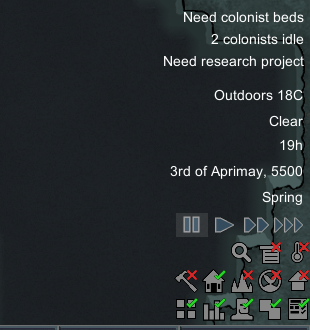

仓库保留：

- [运行摘要](evidence/native-research-runtime.json)：16 份存档摘要，86 项研究进度、三名人物技能与工作向量、研究 job、施工容器、地图材料、24 张裁图的来源与 SHA。
- [143 条动作台账](evidence/native-research-actions.jsonl)：包括普通保存、无效右键及误放/取消操作，按实际时间排序。
- [只读提取器](../../../scripts/research/read-research-runtime-save.ps1)：独立解析原版 XML，区分数值为零与字段缺省；只取当前地图人物及材料，排除世界人物库存。
- [普通保存 helper](../../../scripts/research/save-research-runtime.ps1)：只允许 `research-*` 名称，拒绝覆盖已有保存。
- [离线收集器](../../../scripts/research/collect-research-runtime.ps1)：从已有本地存档与截图重建摘要、台账和裁图，不发送游戏输入。
- [独立核验器](../../../scripts/research/verify-native-research-runtime.mjs)：固定已审阅快照 SHA，检查材料守恒、实体身份、工作许可、进度与经验、切换/暂停/停止、PNG 和动作时间；导出 `verifyNativeResearchRuntime`。

在 `experiments/rimworld-like` 下运行：

```powershell
# 只核对已提交证据，不依赖本机原版
node scripts/research/verify-native-research-runtime.mjs

# 重提取本机 16 份原始保存，并核对原始截图及捕获元数据
node scripts/research/verify-native-research-runtime.mjs --local

# 从已存在的取证文件重建；不重做原版实验
pwsh -NoProfile -File scripts/research/collect-research-runtime.ps1
```

portable 与 local 都不会执行游戏或 OCR；local 依赖 `.local-research` 中的原始文件。24 张裁图已人工逐张核对。完整原版资源、程序集、原始存档和全屏截图不随此章提交。

## 对 Web 实现的约束

项目选择、人物工作调度和研究点结算需要分开。选择合法科技后可以等待研究台建成；只有实际研究工作阶段才能增加研究点和智识经验。人物许可、预约和可达性仍由工作系统负责，不能把选择项目等同于给所有人物派工。

当前项目与各项目历史进度应分开持久化。切换只改 current，停止清空 current，二者保留 progress；研究 job 在下一次工作更新读取当前项目，避免把已经切换的旧科技继续加点。存档必须保留浮点进度，UI 舍入仅用于展示。

原版当前样本的研究点增量、XP、台效率与 sourceWorkTicks 属于不同量。Web 的 20 TPS 映射、会话等待及未实现的房间/卫生因素应按第 48 章和实现章明确说明，不能用本轮一个室外样本代替全部原版环境、供电、设施和完成事件验证。
