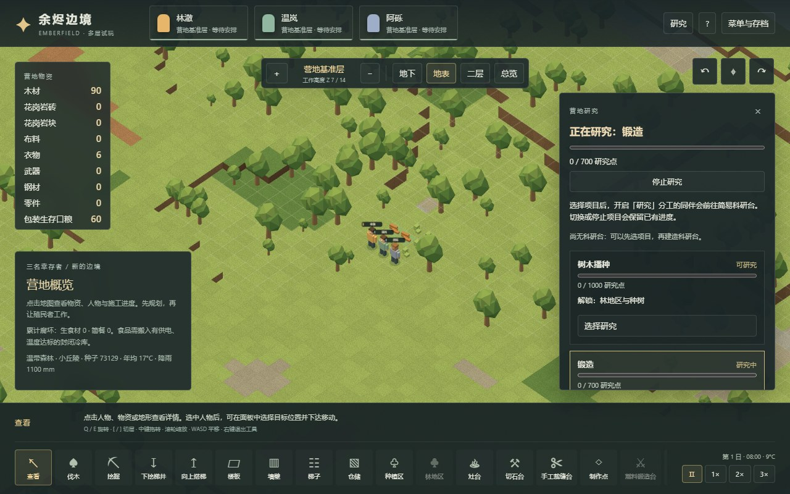
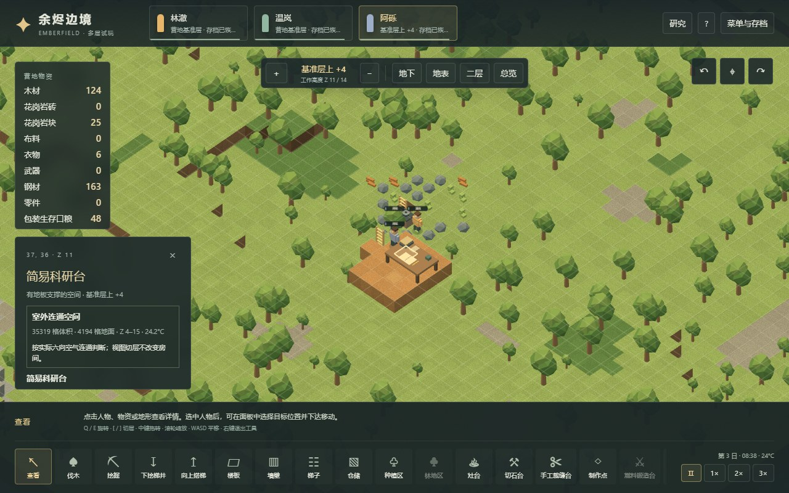

# 体素研究、智识与科技解锁

2026-11-03。本章记录 Emberfield v15 的实现；[48 原版规则](48-research-technology-mechanisms.md)与[49 原版实机](49-native-research-runtime.md)分别保存静态来源和真实运行证据，不能把 Web 测试计数当成原版覆盖率。

## 可玩的流程

新营地仍是工业文明起点，已有复杂家具、被动式冷却、切石、复杂衣物、电力、营养膏和空调七项知识。新增五项可研究科技：树木播种 1000、锻造 700、长刃武器 400、蓄电池 400、太阳能 600。长刃需要锻造，蓄电池和太阳能需要电力；这些数值来自所选 Core Def。

右上「研究」选择全营地项目。可以在没有科研台时先选项目；此时不会产生研究点或经验。简易科研台需要 **75 木材、25 钢材、3×2 地板和两格净空**，R 切换朝向。台前必须留操作位与通路，在地下和上层同样需要实际走到现场。模型显示纸张与书本；研究时使用书写动作，暂停后动作随模拟时钟停止。





研究是独立分工，默认优先级 4，0 为禁用。三名初始人物的智识分别是 6/8/4，热情为无/有/无；这是项目角色配置，不是原版随机开局算法。智识遵循既有热情、经验、升级和衰退规则。研究员会吃饭、休息、接受救护、响应征召和其他工作，不能靠打开面板或切换项目获得点数。

进度保存在营地项目中，多台工作时共同增加一项进度。停止、切换、拆台、堵路、禁用分工和回读不会清除已取得的知识。完成时钳制到成本值、结束所有研究工作，不自动开始下一项。台的拆除沿用本项目一般拆除规则，返还 37 木材与 12 钢材；不是原版完整材质/拆除产率模型。

## 算法和调度映射

本版仍为 20 TPS、12000 tick/日。一次实际研究 tick 的点数为：

```
researchSpeed = max(0.1, (0.08 + 0.115 × Intellectual)
                         × (0.5 + 0.5 × min(manipulation, 1.1)))
points = 0.02475 × researchSpeed × benchFactor
raw Intellectual XP = 0.3
```

先按现有技能计算研究点，再获得经验。`.02475` 和 `.3` 分别是原版 `.00825` 和 `.1` 的三倍，按 60→20 TPS 保持实际劳动秒数。工业派系研究所选科技的原版 CostFactor 都为 1。视力、全局研究速度和难度因子固定为 1；现有健康模型提供 manipulation。项目日历仍较原版压缩，不能同时宣称保持原版每日研究量。

简易台基础效率 `.75`。室内暂按清洁中性房间处理；露天乘户外 `.75` 和无完整房间统计时的 roomlessScore `.75`，常温结果 `.421875`，UI 约为 42.2%。低于 9°C 或高于 35°C 另乘 `.7`，最后最低 `.25`。六向体素房间的 `outdoor` 映射不等于原版所有 `ProperRoom`/心理户外判定；未实现实验室房间角色、实际污渍清洁度、书架、全局 Stat 修正和高级电力科研台。这些缺口明确保留，不凭空给室内附加原版实验室标签。

建台工作量 `ceil(2800/3)=934`，每次研究工作段 `ceil(4000/3)=1334` 个实际劳动 tick。段结束重新调度，生产扫描最多等待 20 个项目 tick；不是原版 2 tick 等待加通用姿态等待的逐 tick 复现。每 10 tick 检查更高或相同优先级的可执行非研究工作，材料、路径、技能和燃料均需满足；缺燃料锻造不能反复打断研究。吃饭、睡眠、救护等沿用现有需求调度。

## 科技门槛与存档

林地区需要树木播种，燃料锻造台需要锻造，钢长剑配方还需要长刃武器及工艺 5 级。太阳能板与电池分别需要对应科技；发电机、电线、加热器需要电力，冷气机需要空调。初始已知的切石、裁缝、床也保留各自门槛。工具面板显示锁定原因，模拟命令再次验证，不依赖按钮禁用来保证规则。

v15 保存十二项进度、当前项目、研究来源、科研台以及第八项智识技能。真实 v14 起始样本在编辑 v15 源码前保存，附来源提交和 SHA-256；测试不以当前存档修改版本号来冒充旧档。v1–v14 迁移为 `legacy-unlocked`，保留以前已开放的能力，原七项技能的经验/热情和物资、装备、地形不被重建。新增智识不追溯发放旧劳动经验。未知科技、非有限/负数/超成本进度、违反前置、完成但仍为当前项目、重复台/任务、越界或重叠占地均被拒绝。

## 验证与复现

`tests/voxel-research.test.ts` 包含公式、占地旋转、无台选择、到位后才加点/经验、多人共研、有限工作段、抢占、无燃料例外、征召/禁工、拆除、完成一次、解锁与非法存档测试。受控地形和近完成进度只用于边界测试，不能证明普通开局能完成科技。

普通研究流程由 `scripts/voxel-research-campaign-verify.mjs` 从全新工业营地运行：伐木、开三层矿井、有限矿脉取钢、搭梯铺楼板、把材料运到上层科研台、研究锻造、切换/停止/续作、种粮做饭和正常睡眠，最后实际建出解锁后的锻造台。使用普通命令、推进模拟及保存/回读，选址允许只读地形和寻路查询；没有注入地形、物资、知识、经验或时间。25 项流程检查通过，最终 tick 148174；188 钢产出、125 钢消耗，研究员智识 8→9。这里只证明一个种子的有界流程，不代表长期平衡或大人口性能。

武器/技能、林业的全新开局回归也通过同一普通研究准备流程取得必要知识；历史存档回归保持其迁移后的已掌握状态。浏览器脚本分别操作 Worker 与主线程渲染，检查科技选择/停止、真实 v14 导入、上层台选择、劳动与暂停、解锁及独立长剑配方锁、900×700 布局。浏览器允许只读快照和投影辅助，不是只看截图的输入实验。

最终单元测试、普通流程、页面结果、截图和源文件指纹保存在 [冻结验收报告](evidence/voxel-research-validation.json)。原始运行输出在忽略的 `test-results/`，可使用以下命令重建：

```powershell
npm test -- --maxWorkers=2
npm run research:check
npm run test:voxel:research
npm run build
# 已运行 5183 端口的 vite preview 时：
npm run test:voxel:research:browser
```

此轮未实现部落开局、整棵原版科技树、高级台、科技印记、设施连线门槛、研究队列、科研书籍、社会关系、远程武器或完整身体与护甲；后续模块继续以独立证据和可玩流程推进。
