# 52 — 原版实机：部位损伤、能力下降与新鲜缺失护理

本轮在原版完成了两条不同的证据链：**左眼从累积损伤到新鲜缺失，再由普通无药护理止血；右手直接缺失后，存档自动生成五根手指的缺失记录。** 左眼剩 5/10 HP 时 Sight 为 86%，左眼缺失后为 75%；单只右手缺失后的 Manipulation 为 50%。这些结果说明，身体部位不能合成一个全身血条，眼与手也不能共用一个简单的能力平均公式。

伤势由明确记录的 **Dev Add hediff** 操作准备，**不是自然战斗、武器命中或护甲实验**。护理通过正常的医疗策略、工作许可、休息与优先护理命令完成，没有 Dev 治疗。静态公式及完整 Human 身体树见 [51 — 身体结构与能力机制](51-anatomy-capacity-mechanisms.md)，Web 实现见 [53 — 身体模型实现](53-voxel-anatomy-implementation.md)。

## 环境与实验边界

| 项目           | 记录                                                                                            |
| -------------- | ----------------------------------------------------------------------------------------------- |
| 原版           | RimWorld `1.7.4980 rev60`，Core + Odyssey                                                       |
| 进程           | `F:\SteamLibrary\steamapps\common\RimWorld\RimWorld.exe`，PID `29920`，HWND `988850`            |
| 实验 profile   | `.local-research/runtime/profile-20261102`；输入 helper 检查 exe、命令行 profile 和前台窗口     |
| 程序集 SHA-256 | `eff7d97949f919fb2b151ebfb906e9be749b63410b7dbda78eeebb7972b245c3`                              |
| 基线           | `research-stopped-b.rws`，tick `94520`，沿用 [第 49 章](49-native-research-runtime.md) 暂停现场 |
| 基线 SHA-256   | `01e8033f0c7a1b7d7cf9e96839e81f13168bbdfb2cf3d247898590f6eecbf6db`                              |
| 入口保存       | `anatomy-entry-a/b`，均 tick `94520`，提取状态与基线相同                                        |
| 实际操作时段   | 2026-11-03 `03:35:45–04:16:45 UTC`，北京时间 `11:35:45–12:16:45`                                |
| 病人           | Prophet，`Human958`；原有永久 Torso Stab 2、LowPain，以及 Optimist/Pyromaniac 特质              |
| 医生           | Squint，`Human961`；Medicine 0、None 热情，初始 Doctor 工作关闭                                 |
| 医疗床         | 继承的 `Bed77946`，位置 `(113, 0, 124)`，此前轮次通过 God 准备；本轮未新建或生成床              |
| 结束保存       | `anatomy-stopped-a/b`，均 tick `98320`，相关提取状态完全相同                                    |
| 结束 a SHA-256 | `20456eda41273e42faf9880b741ade79c7f94c86c71a18af502328ece1794ce6`                              |
| 结束 b SHA-256 | `76023aaf663c6cf1c4ffb05647d58cc59aada4932ee36a3cfa7c2df5a422634a`                              |

沿用 reverse-engineer-anything skill v42 的分层取证规则及 [既有 Windows provider 边界](evidence/native-plants-runtime.json)：REA native provider 的 macOS 工具此前在 Windows 不受支持，本轮真正的输入、截图来自有守卫的 Windows helper，不能描述为 REA native UI 在 Windows 已成功执行。存档只读解析，未修改 XML；游戏安装、日常 profile 均未修改，没有安装 mod。

Developer mode 继承开启，**God mode、Fast research、Fast learning 均关闭**。仅临时打开后关闭 Hediff debug tooltips；未调整技能、使用 Dev tending/healing，也未生成物品。初始场景还包含早期 Dev 衣物，不能称为未经准备的自然殖民地。

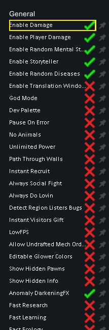

## 1. 左眼累积损伤与四舍五入边界

始终选中 Prophet，在 Health → Dev tool → Add hediff → Cut → Left eye 中添加伤势。每次默认 severity `0.5`，19 次成功添加均发生在暂停的 **tick 94520**。Cut 不合并：存档留下独立记录，而 UI 把它们合成 `Cut ×10` 等显示。

| 阶段               | 存档 Cut 条数 / 合计 severity |           左眼 HP（UI） | Sight | Consciousness | Manipulation | 出血（UI） |
| ------------------ | ----------------------------: | ----------------------: | ----: | ------------: | -----------: | ---------: |
| 原始状态           |                         0 / 0 | 本轮未单独悬停正常眼 HP |  100% |          100% |         100% |         无 |
| 第 1 次            |                       1 / 0.5 |                   10/10 |  100% |          100% |         100% |       3%/d |
| 第 2 次，只有截图  |                         2 / 1 |          9/10，效率 89% |   97% |          100% |         100% |       6%/d |
| 第 10 次           |                        10 / 5 |                    5/10 |   86% |          100% |         100% |      30%/d |
| 第 18 次           |                        18 / 9 |                    1/10 |   75% |           99% |          99% |      54%/d |
| 第 19 次，触发缺失 |            0；19 条伤势被替换 |           0/10，效率 0% |   75% |           98% |          98% |     120%/d |

第 2 次没有独立保存，因此只用截图支持其 9/10、89%、97% 等 UI 值，不把它包装成读取到的中间存档。第 1、10、18 次的存档分别含 Cut ID `84`、`84–93`、`84–101`，全部指向 `body=Human, part/index=16`，每条 `0.5`，没有 combatLogEntry。

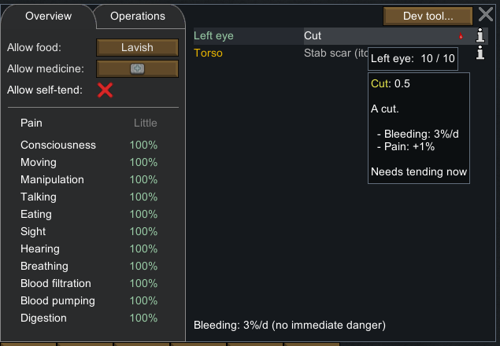


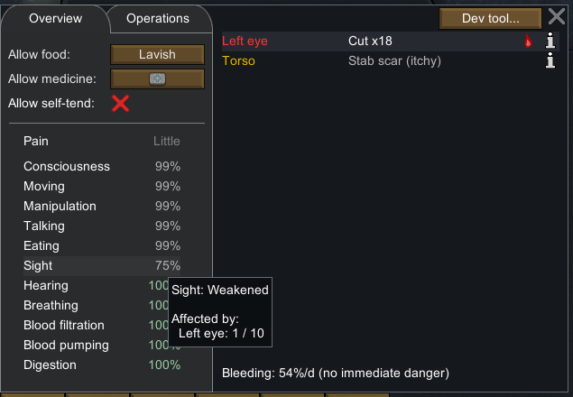

需要把运行事实与公式解释分开：

- **运行事实**：第一条 0.5 伤势仍显示 10/10；第 18 条后显示 1/10；第 19 条添加后，原版产生部位缺失。
- **第 51 章静态解释**：GetPartHealth 对最终剩余 HP 使用 `Mathf.RoundToInt`；对于可毁坏的非核心外部部位，效率再应用 10% 阈值映射。因而 HP 1/10 的眼虽然尚未缺失，功能已经为 0。
- **能力聚合**：Sight 的较好眼权重为 0.75，另一眼为 0.25。左眼 5/10 对应约 0.444 的部位效率，再得 Sight 0.86；单眼失去功能则为 0.75。效率公式来自静态代码，5/10 与 86% 来自截图。

这也解释了一个容易忽略的设计细节：**“剩 1 HP”和“已经缺失”可以有相同的 Sight，但存储、出血、疼痛、后续护理和修复语义不同。** 此样本原有躯干永久伤，Consciousness 99%/98% 不能直接当作纯眼伤的通用常数。

## 2. 第十九次添加触发真正的新鲜缺失

第十九次是又一次 `Cut 0.5`，不是直接添加 MissingBodyPart。此前合计为 9，加入后理论累积 9.5，原版健康系统在同一暂停 tick 中把左眼转换为缺失，旧的 Cut 记录从存档消失。

| `anatomy-left-eye-fresh` 原始字段 | 值                                                        |
| --------------------------------- | --------------------------------------------------------- |
| ID / Class / Def                  | `103` / `Hediff_MissingPart` / `MissingBodyPart`          |
| body / part index                 | `Human` / `16`，由冻结身体表映射为 `left-eye`             |
| tickAdded                         | `94520`                                                   |
| isFresh                           | `True`，字段明确存在                                      |
| lastInjury                        | `Cut`                                                     |
| severity                          | `0.5`，缺失 Hediff 的序列化值，不是剩余 HP 或原来伤势合计 |
| 原有躯干伤                        | ID `10` Stab 2 保留                                       |
| 左眼 Cut                          | 0 条                                                      |

界面显示 `Left eye — Cut out (fresh)`、0/10、效率 0%、`Needs tending now`、出血 **120%/d**、疼痛 **+13%**；预计死亡时间显示 20 小时。这是预测文字，**没有实际运行到死亡**。

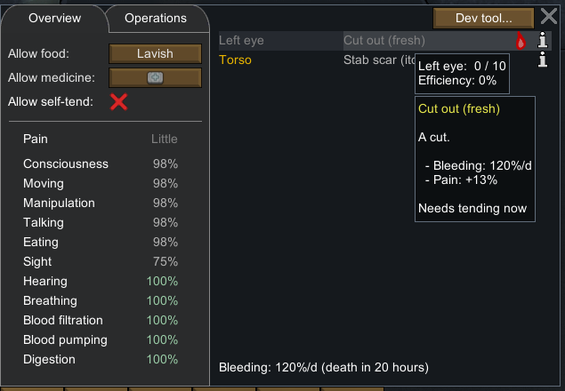

## 3. 普通无药护理：止血但不长回眼睛

通过普通 Allow medicine 下拉菜单将 Prophet 从 `Best` 改为 `Doctor care, but no medicine`（存档 `NoMeds`），然后右键医疗床选择 `Rest until healed`。`anatomy-care-ready` 保存强制 LayDown 任务；推进后 `anatomy-at-bed` 显示 Prophet 已在医疗床位置。

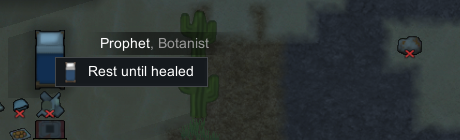

Squint 初次右键病人显示 `Cannot tend ... Not assigned to doctoring`。在正常 Work 界面勾选 Squint 的 Doctor 后，右键出现 `Prioritize tending to Prophet`，据此下达普通优先护理任务。没有改变 Manual priorities。

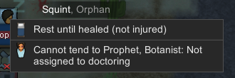

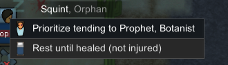

| 保存阶段             |  tick | Squint 任务                      | 左眼缺失                                |
| -------------------- | ----: | -------------------------------- | --------------------------------------- |
| `anatomy-tend-ready` | 95213 | TendPatient `82353`，toil 0      | ID 103，fresh true                      |
| `anatomy-tending`    | 95837 | 同任务，toil 0，走向病人         | 同上                                    |
| `anatomy-tend-wait`  | 96395 | 同任务，toil 3，ticksLeft `1350` | 同上，仍出血                            |
| `anatomy-eye-tended` | 98320 | 已结束护理，转 Wait_Wander       | 同一 ID 103，fresh 字段缺省，默认 false |

护理任务保存 `targetA=Thing_Human958`、`workGiverDef=DoctorTendToHumanlikes`、`playerForced=True`，`targetB` 为空，医生携带容器为空。地图上三堆药物（工业药 5+25、超凡药 4）的对象、位置、禁用标志及数量，所有保存阶段均未变，因此这次确实没有消耗药物。

结束截图保留原版漂字 `Cut out (fresh) tended / Quality 0%`。Squint 的 Medicine 仍为 0 级、None 热情，经验从 0 增至 **87.5**。这里的 0% 护理质量来自截图；MissingPart 的 `tendQuality` 在存档中缺省，不通过解析器补出的 0 单独证明它。

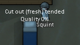

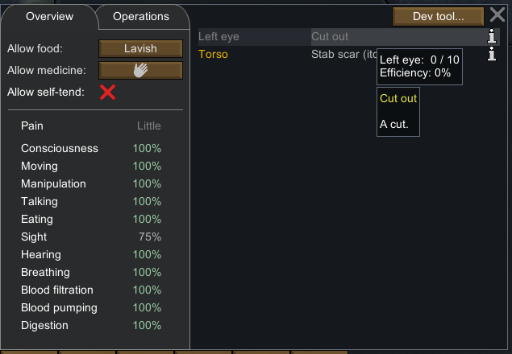

完成后左眼仍然是 `MissingBodyPart 103`、0/10、Sight **75%**；`fresh` 默认 false，`lastInjury=Cut` 和 `tickAdded=94520` 保留。界面出血图标、出血汇总和新鲜标记消失，Consciousness/Manipulation 回到 100%。这直接支持“**普通护理消除新鲜残端的出血状态，不恢复缺失部位**”。

BloodLoss 记录 ID `104` 在这段模拟期间出现，结束 severity 为 `0.0618000552`，并没有因止血而瞬间消失。结束时 MissingPart `ageTicks=3801`，而地图总推进为 3800；如实保留两者，不把它们强行改写成同一个值。90000 tick 自然失去新鲜状态的规则本轮没有等待验证。

## 4. 直接缺失右手：父子身体节点与 UI 汇总

护理完成并再次暂停后，单独用 Dev Add hediff → Missing body part → **Right hand** 准备缺手状态。这是直接非新鲜缺失，和前面的累积 Cut → fresh 路径分开记录。

`anatomy-right-hand-missing` 在同一 tick `98320` 新增以下 6 条 MissingBodyPart，全部 `isFresh` 缺省 false、`lastInjury` 空、`tickAdded=98320`：

| 原版 body index | 冻结表稳定 ID       | Missing Hediff ID |
| --------------: | ------------------- | ----------------: |
|              39 | right-hand          |               105 |
|              40 | right-pinky         |               106 |
|              41 | right-ring-finger   |               107 |
|              42 | right-middle-finger |               108 |
|              43 | right-index-finger  |               109 |
|              44 | right-thumb         |               110 |

名称与父子关系来自独立 [Human 64 节点表](evidence/anatomy-human.json)，body index 与 Hediff ID 来自原始存档。健康 UI 只显示 `Right hand — Gone`，没有把五根缺失手指逐条重复列出。悬停显示右手 **0/20、效率 0%**，Manipulation **50%**，Sight 仍为 **75%**，没有新鲜标记或出血。

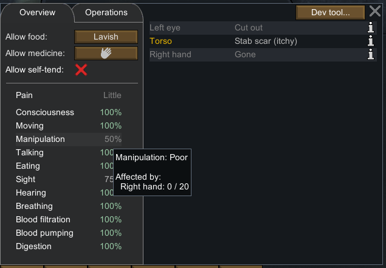

第 51 章的静态机制与此一致：操作能力对两条上肢链做平均并受意识影响，不使用 Sight 的较好眼 0.75 权重。**本轮没有损伤左手或右眼，也没有验证新鲜手部残端护理**；“另一侧对称”只属于静态结构推导，不是运行样本。

## 5. 时钟控制、失败操作和最终状态

所有伤势准备与策略调整都在暂停状态下完成；只运行以下 4 段，每段按 `3` 后立即通过固定暂停按钮结束，再普通保存。

| 段           | 起始 tick | 结束 tick | 差值 | 请求截图等待 |
| ------------ | --------: | --------: | ---: | -----------: |
| 病人入床     |     94520 |     95213 |  693 |       500 ms |
| 医生走向病人 |     95213 |     95837 |  624 |       300 ms |
| 进入护理等待 |     95837 |     96395 |  558 |       150 ms |
| 护理完成     |     96395 |     98320 | 1925 |      4000 ms |

这些等待值不包含输入 helper、截图和工具调用耗时，**不是 tick 吞吐测试或准确的护理持续时间**。本轮没有 Space 输入、读档回滚或重启原版。

失败尝试也保留在 300 条日志中：早期点错 Health 坐标导致取消选择；鼠标停得太远使浮动菜单消失；探索 Apply damage → Cut 后进入目标工具，按 Escape 未能取消。其后 `anatomy-left-eye-add-2-*` 至 `-10-*` 共 45 次预期添加操作没有造成新的伤势，不能按文件名计为成功伤害。`anatomy-033-exit-target-tool` 的右键空地才成功取消；随后 `anatomy-eye-prep-02` 至 `-19` 才是有效的后续添加，数量由中间存档核对。

可查看 [目标工具未取消截图](evidence/runtime/anatomy-failed-target-tool.png)。该探索没有对任何人物应用 TakeDamage；同期暂停存档中其他人物健康、技能、工作等字段均与基线一致。原始失败截图与 sidecar 保留在忽略目录，没有覆盖或删除。

最终将 Prophet medCare 恢复为 `Best`、Squint Doctor 恢复关闭。三个居民工作向量、医疗策略与基线相同；所有药品不变。最终暂停双存档均为 tick **98320**，保留处理后的左眼缺失与非新鲜右手缺失，输入已释放。原始基线未改动。

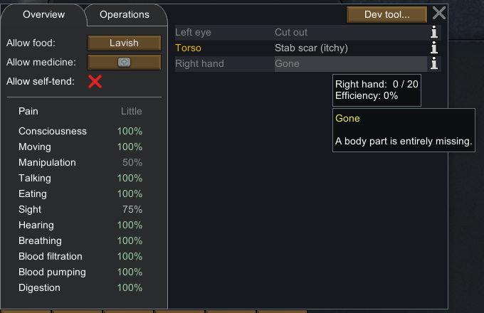

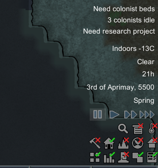

## 6. 留存文件与复核方法

- [机器可读证据](evidence/native-anatomy-runtime.json)：16 个存档摘要、字段存在标记、手工 UI 观察、24 个裁剪哈希、4 段时钟窗口、准备条件及限制。
- [完整操作日志](evidence/native-anatomy-actions.jsonl)：300 条有序输入/截图动作，包含失败尝试与所有普通保存。
- [普通保存脚本](../../../scripts/research/save-anatomy-runtime.ps1)：只接受 `anatomy-*` 新名字，拒绝覆盖已有存档；依赖指定暂停现场与界面分辨率。
- [只读存档解析器](../../../scripts/research/read-anatomy-runtime-save.ps1)：提取身份、部位索引、Hediff、任务、技能、工作向量、药物与床；不计算 HP、能力或出血。
- [离线证据收集器](../../../scripts/research/collect-anatomy-runtime.ps1)：从本地原始文件重建摘要、裁剪与日志；不发送原版输入。
- [独立验证器](../../../scripts/research/verify-native-anatomy-runtime.mjs)：锁定经过检查的存档摘要哈希、动作日志哈希，并分别验证实际语义约束。

```powershell
node scripts/research/verify-native-anatomy-runtime.mjs
node scripts/research/verify-native-anatomy-runtime.mjs --local
```

portable 模式验证仓库中的留存证据、索引、数量、伤势替换、普通护理任务、缺失子树、恢复状态和 PNG 哈希/尺寸；`--local` 还对 `.local-research/runtime/profile-20261102/Saves` 下 16 份原始 XML 重新解析，并核验源截图哈希与截图元数据。两者都不是重新执行游戏或自动 OCR。

未经本轮运行验证的范围包括：真实战斗选部位概率、护甲与伤害传播、感染、死亡、自然 90000 tick 失鲜、器官手术、义体和恢复缺失部位。后续设计可直接采用本轮证实的状态区分，但不能以这组 Dev 准备样本替代上述独立验证。
