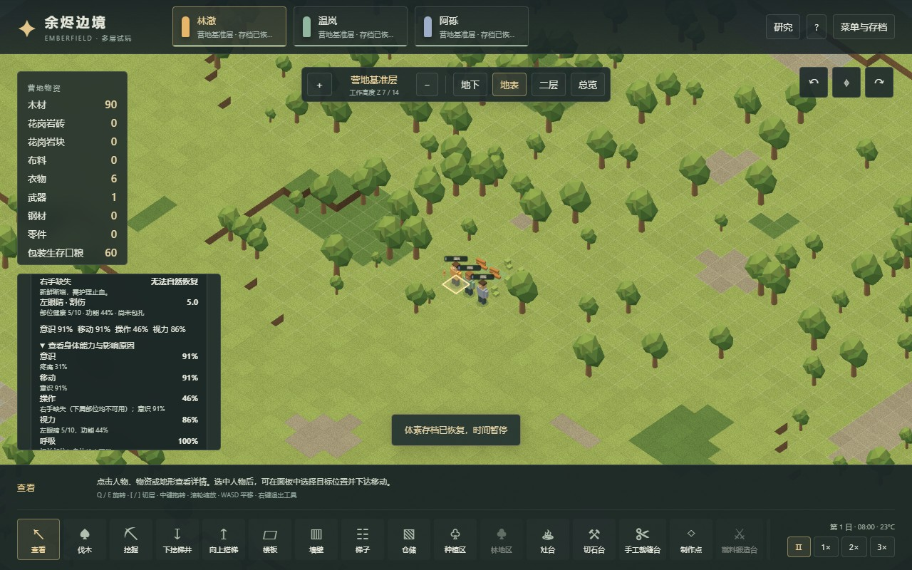
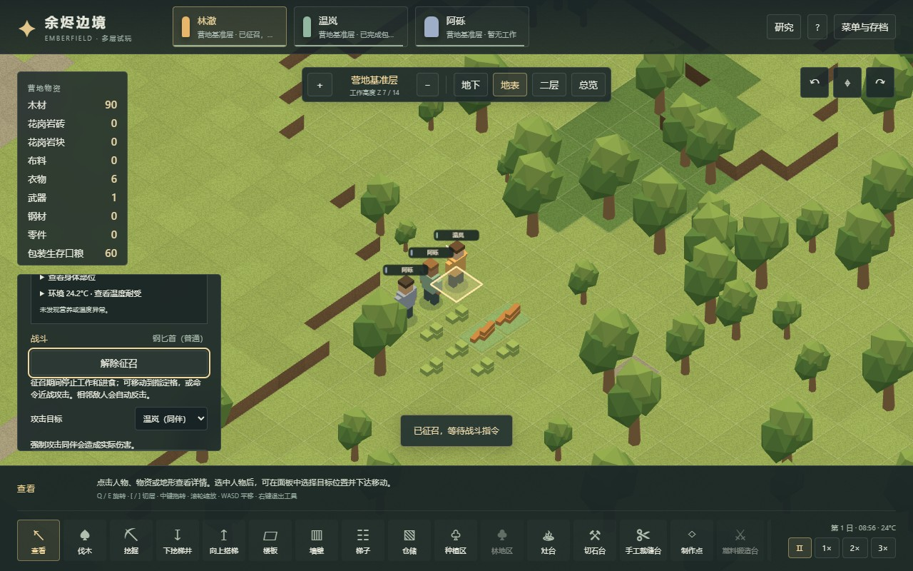

# 53 · 体素人体、能力与伤害传播

日期：2026-11-03。对应存档 v16，接续 v15 科研版本。本章说明 Web 实现；[51章](51-anatomy-capacity-mechanisms.md)记录本机原版的静态机制，[52章](52-native-anatomy-runtime.md)记录隔离原版的实际操作。三者的测试数量不能合并为原版覆盖率。

## 可玩的变化

人物现在有 Core Human 的 64 个身体部位及父子关系。健康面板可展开部位树，查看健康值、内部部位和缺失状态；另可查看意识、移动、操作、视力、呼吸、血液循环、血液过滤、代谢、听力、说话和进食共 11 项能力及其影响原因。

原先只看左右手臂的操作能力，现计入肩、臂、手、手指和相连骨骼。缺失父部位意味着整个下属部位失去功能；存档只保存最上层缺失根。单眼失去功能时通常剩余 75% 视力。视力影响实际采矿、种植、施工、烹饪、护理、研究以及近战命中/闪避数值；所选工作并未添加“失明一律不能工作”的额外门槛。

战斗继续使用现有征召、走位和近战按钮，但命中按真实部位权重和伤害类型选择目标，之后执行伤害传播。Stab/Poke 可进入直系内部部位并沿父链伤及外部；Cut 可波及相邻部位；Blunt 可造成内部骨裂及沿父部位传递的剩余伤害；Bite 保留自己的单伤路径。战斗提示列出实际新增伤口部位，未造成新伤时不会报告虚构伤口。

缺失外部软组织会产生新鲜断端，可能疼痛和流血。普通“优先包扎（无药）”会安排有操作能力的同伴前往现场，投入实际劳动。包扎可稳定断端，但不会补回部位。失去双手后立即释放不再合法的工作、搬运、医护和装备预定；武器沿现有有限地面放置流程掉落，保持物品身份。取消任务不吞掉携带材料。

三维模型隐藏缺失的头、手、臂或腿。右手不可用而左手可用时，工具和武器改挂左臂，并交换相应动作。模型仍是简化方块人，没有逐根手指、器官或血腥断面模型。

下图来自明确准备的页面夹具，仅用于检查界面和断端护理；普通袭击的独立记录见后文。





## 数值与实现入口

| 入口 | 职责 |
|---|---|
| `src/voxel/anatomy.ts` | 64 部位、32 种部位定义映射、健康四舍六入五成双、功能比例、命中权重和自然能力依赖 |
| `src/voxel/injuries.ts` | 伤口、缺失根、伤害传播、出血/护理/愈合、旧伤迁移及严格校验 |
| `src/voxel/survival.ts` | 身体能力与饥荒、冷热、疼痛、失血的组合；保留旧版健康校验公式 |
| `src/voxel/world.ts` | 普通战斗与护理、实际工作数值、任务释放、全球身份和 v16 迁移 |
| `src/voxel/skills.ts`、`research.ts` | 视力与操作能力对应的统计系数 |
| `src/voxel/SurvivalPanel.tsx`、`SkillPanel.tsx` | 能力原因、部位树、实际工作数值 |
| `src/voxel/renderer.ts` | 缺失外观、换手持械、工作与护理动作 |

采用原版成人自然 Human 数据。无伤身体复用计算结果；有伤身体仍从当前伤势推导能力。逻辑保持项目的 **20 TPS / 每天 12000 tick**，伤口与愈合等以游戏日换算，工作时间沿已有折算。项目的确定性随机流保证同一存档续行一致，并不复现 Unity 的随机序列或浮点逐位结果。

## v15 → v16 存档兼容

先用旧公式校验原存档的死亡、倒地、能力相关装备状态和护理条件，再迁移伤势，恢复实体与通路，最后按新身体规则重算健康并释放不再合法的任务。读取保持暂停，并给出迁移提示。

旧可愈合伤口的 ID、部位、严重度、年龄和包扎品质保持不变；例如旧的 29.8/30 手臂伤即使新健康显示值舍入成 0，也不会在迁移时擅自变成永久截肢。旧 `brokenParts` 则变成非新鲜缺失根，该区域已有伤口保存在 `legacyWounds` 中供查看，既不丢失历史值，也不重新触发疼痛、流血或愈合。缺失根新增 ID 来自全局 `nextId`；归档伤口同样参与全局唯一性检查。

实际 v15 外伤与上层研究存档已在改动前保存于 `tests/fixtures/voxel-v15-{trauma,research}.json`，各自附原提交、来源及 SHA-256。这些文件不会由当前代码重新生成。迁移验证检查伤口、物资、装备、技能、科研和地形保留，并检查原始输入不被修改。新规则可能改变能力、倒地与死亡判定，不承诺维持旧模型的错误结果。

## 验证分层

1. **规则与控制条件测试**：检查部位树与独立 XML 摘要一致、健康舍入、能力链、伤害传播、缺失树、断端护理、原伤兼容及非法存档拒绝；另用固定技能/能力的独立数值验证工作统计，再在实际世界任务里验证科研进度、工作取消、掉落和回读。
2. **普通战役**：`scripts/voxel-anatomy-campaign-verify.mjs` 从新营地开始，仅通过普通命令、时间推进及读档建床、等待定时袭击、防守、护理和恢复。实测伤及胸骨、肋骨和胫骨，保留战斗中、负伤、护理中、已护理及恢复存档。此战役没有发生截肢，不能用它证明正常战斗的截肢发生率。
3. **明确准备的页面夹具**：`scripts/voxel-anatomy-fixtures.mjs` 为 UI 验证直接准备右手缺失、左眼伤及一把匕首，作用仅为复现断端、换手与能力界面，不能称为正常经营所得。
4. **浏览器**：`scripts/voxel-anatomy-browser-verify.mjs` 在 Worker 与主线程两条渲染路径，用实际文件选择器、按钮、鼠标、键盘检查上述历史存档、普通战役与控制夹具。只读 snapshot/exportSave 辅助断言；这不是仅凭屏幕推理的测试。

本轮全量 **505 项测试**通过，其中人体/集成/能力统计 36 项；普通人体战役 13 项检查、Worker/主线程页面共 16 项检查、17 条完整回归流程均通过，测试进程正常退出且没有未处理错误。一次并行页面运行导致住房测试超过原有 5 秒期限及 Vitest RPC 超时，随后安静环境下全量重跑通过；没有放宽超时或删除断言。页面首次主线程启动观察到短暂空快照，已修正等待条件并完整重跑。

另在生产构建上完成同一页面内 **6 轮保存 → 新世界 → 读档**，每次恢复后均回到 27 个几何体、4 张纹理、16 个地形块和 2,008,968 字节地形缓冲；1280×720 与 900×700 控件边界和遮挡检查通过，浏览器无报错。首次脚本误把研究锁定的「林地区」当成可点击按钮，现保留布局检查并核验「需要研究『树木播种』」提示，随后全流程重跑通过。主页面 JS 堆仅作局部观察，不含 Worker、浏览器原生分配或显存；这六轮结果不能证明长期无泄漏或整体内存上限。

冻结结果见 [voxel-anatomy-validation.json](evidence/voxel-anatomy-validation.json)，含测试进程退出状态、普通战役、页面检查、回归结果、源码/产物哈希和截图。旧 41/44/47/50 章的冻结报告保留原版本结果，不改写历史计数。

```powershell
npm test -- --maxWorkers=2
npm run test:voxel:anatomy
npm run build
# 已有 5183 预览服务时运行；也可通过 VOXEL_TEST_URL 指向其他地址
npm run test:voxel:anatomy:browser
npm run research:check
```

## 未覆盖范围

完整护甲吸收、远程弹道、社交斗殴伤害限制、原版瞬杀保护、眩晕、永久瘢痕/感染、药物、疾病、义体、基因和生命阶段差异尚未接入本模块。缺失部位没有可用的手术修复流程。说话、听力等数值已计算和展示，完整社交及相关工作系统仍不存在。普通战役只证明这一条可复现流程，未验证长期战斗平衡或大人口性能。
