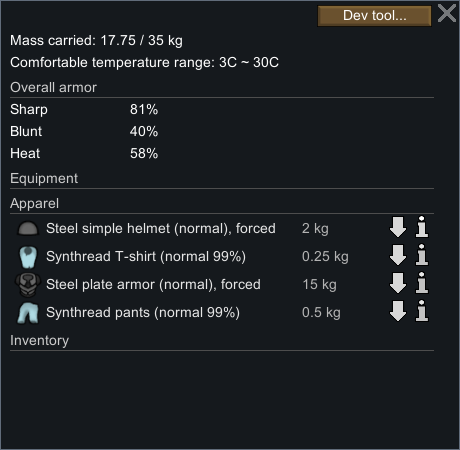
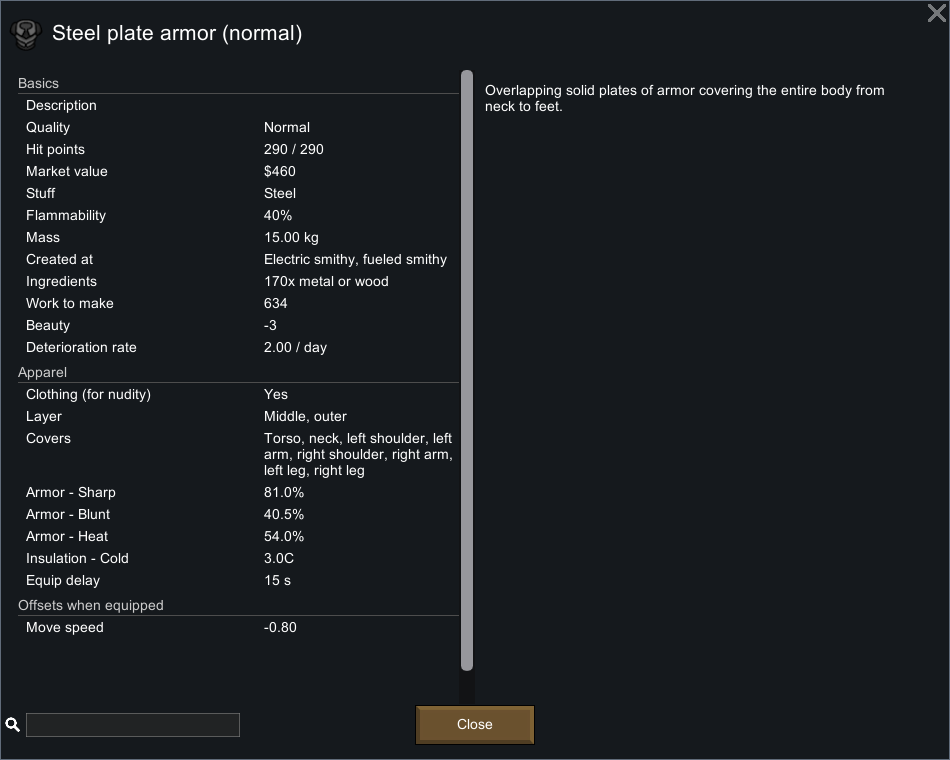
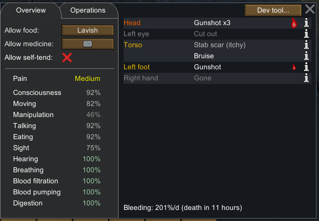
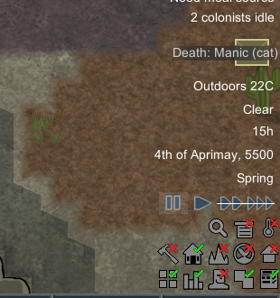

# 55｜原版护甲运行证据：真实受击、钢制防具与未覆盖部位

本章固定本机 RimWorld **1.7.4980 rev60 / Core + Odyssey**，通过现有隔离进程的界面操作、原版存档和截图验证[54 章静态护甲机制](54-armor-penetration-mechanisms.md)。共保留 **17 个存档提取、245 条输入记录、16 张裁图、5 次真实 TakeDamage**。已观察到覆盖部位全伤、钢板甲将锐伤减为钝伤、未覆盖脚部全伤；**没有观察到完全弹开，不估计随机概率**。

证据入口：[完整结构化记录](evidence/native-armor-runtime.json)、[输入账本](evidence/native-armor-actions.jsonl)、[独立验证器](../../../scripts/research/verify-native-armor-runtime.mjs)。原始大体积存档、完整截图及派生代码留在忽略目录 `.local-research/`；可移植记录不依赖游戏安装。

## 1. 版本、方法和状态边界

沿用 [52 章](52-native-anatomy-runtime.md) 的 `anatomy-stopped-b`，入口 tick **98320**。先复核已有 PID **29920**、HWND **988850**、进程路径及 `-savedatafolder=.../profile-20261102`，没有另启进程或触碰正常存档配置。程序集 SHA-256 为 `eff7d97949f919fb2b151ebfb906e9be749b63410b7dbda78eeebb7972b245c3`。

采用 REA skill v42 的证据记录方式；原生 UI provider 的既有限制见 [native-plants-runtime](evidence/native-plants-runtime.json)。本章输入由已有 Windows 前台保护脚本执行，不能称为 REA native UI 工具执行。截图人工核读，不是 OCR；存档只读提取，不执行项目模拟代码。

受试者 Prophet（`Human958`）继承永久躯干 Stab2、左眼缺失、右手及其手指缺失、BloodLoss，以及 Normal Synthread T-shirt/Pants 各 129 HP。只把本轮新增伤口与紧邻的暂停存档比较，避免把旧伤恢复算成护甲减伤。全程未改工作向量、医疗政策、技能、God Mode 或存档 XML。

## 2. 本次伤害确实走 TakeDamage

使用原版 Developer **Apply damage → Bullet → 明确身体部位**。派生 `DebugTools_Health.Options_Damage_BodyParts` 的普通入口默认 `amount=5f`，选部位后调用：

```csharp
p.TakeDamage(new DamageInfo(def, amount, 0f, -1f, null, localPart));
```

本轮输入因此是 **Bullet 5、AP 0、指定部位、无攻击者**。没有使用 `Destroy part` 的 99999 路径，也没有使用 AddHediff。选 Bullet 是为了避免把 Cut 的相邻切割或原始 Blunt worker 的溢出规则混入单次对照。Bullet 原始 worker 为 AddInjury；护甲改写 DamageDef 为 Blunt 后，本例生成 Bruise。

这仍然是开发者触发的伤害，不是自然射击：未验证命中率、射程、掩体、投射物飞行、武器 AP 或随机部位分布。5 次事件仅能证明本次观察到的路径。

## 3. 防具准备与普通穿戴

准备过程和运行过程分开记录。Developer Wear/Spawn thing 会生成随机材料或品质，过程中出现的替代物均保留，未删除或伪装成正常制作：

| 对象 | 准备过程 | 最终用途 |
|---|---|---|
| SimpleHelmet78148 | Dev Wear 生成 Plasteel Normal，280 HP | 后续普通穿钢盔时掉落，未受实验攻击 |
| SimpleHelmet78149 | Spawn 生成 Silver Awful，70 HP；Set Stuff Steel 后 100 HP；Set Quality Normal | 经普通 Force wear 穿戴，同一对象参与两次头部受击 |
| PlateArmor78159 | Spawn 生成 Gold Good，174 HP；Set Stuff Steel 后 290 HP；Set Quality Normal | 经普通 Force wear 穿戴，同一对象参与躯干受击 |

`Set Stuff` 会把本例耐久重置到新材质的上限。它属于准备操作，不能解释为修理或制作机制。头盔准备阶段分别保存 Awful 与普通穿戴订单；板甲随机生成阶段有[截图](evidence/runtime/armor-plate-generated.png)，普通穿戴订单保存了 Steel Normal 状态。

两个普通 Force wear 订单分别经过 1290 tick 和 2249 tick 的短运行完成，总受控运行 **3539 tick**。存档中的 `Wear`、`playerForced=True`、`targetA` 和最终 `wornApparel` 对象 ID 一致。头盔替换了 Plasteel 头盔；板甲与原来的贴身衣裤共存。



## 4. 品质、数值和覆盖范围

原版信息窗显示同一钢盔 Awful → Normal 的变化：

| 项目 | 钢盔 Awful | 钢盔 Normal | 钢板甲 Normal |
|---|---:|---:|---:|
| 锐器防护 | 27.0% | 45.0% | 81.0% |
| 钝器防护 | 13.5% | 22.5% | 40.5% |
| 热防护 | 18.0% | 30.0% | 54.0% |
| 耐久 | 100/100 | 100/100 | 290/290 |
| 穿戴延迟 | 1.5 秒 | 1.5 秒 | 15 秒 |
| 重量 | 2 kg | 2 kg | 15 kg |

[Awful 分解面板](evidence/runtime/armor-awful-breakdown.png)给出 `Steel90% × 材质效果50% × 品质60% = 27%`；[Normal 面板](evidence/runtime/armor-normal-helmet.png)中品质倍率为 100%，结果 45%。这证明本次 UI 与静态品质公式一致，不验证其他品质或全部材料。

钢盔覆盖 **Head、left ear、right ear**，层为 Headgear。钢板甲覆盖 **Torso、neck、左右 shoulder、左右 arm、左右 leg**，占 Middle 与 Outer，移动速度偏移 **−0.80**。本例没有覆盖手或脚。右侧描述文字虽写“from neck to feet”，不能代替具体覆盖列表。



穿戴后的整体护甲面板显示 Sharp81%、Blunt40%、Heat58%。这是汇总显示，不能拿其中的 81% 当作头部或脚部实际防护。

原版 `CompQuality.PostExposeData` 用 **Awful** 作为缺失 XML 字段的默认值，虽然构造字段初值是 Normal。本轮 Awful 钢盔的 `<quality>` 确实省略。提取器同时保留原始字符串、`quality_present` 和经审计类型的默认解释；不会把所有省略品质的装备一概视为 Awful。

## 5. 逐击对照

所有穿戴完成后的受击均在 **tick101859** 暂停时执行并立即保存；伤口时间、旧伤和服装 HP 可直接做相邻样本差分。裸头对照在 tick98320，发生在任何头盔生成之前。

| 存档阶段 | 指定部位 / index | 新伤口 / ID | 新严重度 | 钢盔 HP | 钢板甲 HP | T-shirt / Pants HP |
|---|---|---|---:|---:|---:|---:|
| bare-head-hit | Head / 13 | Gunshot111 | 5 | 尚不存在 | 尚不存在 | 129 / 129 不变 |
| head-hit-1 | Head / 13 | Gunshot112 | 5 | 100 → 98 | 290 不变 | 129 / 129 不变 |
| head-hit-2 | Head / 13 | Gunshot113 | 5 | 98 → 96 | 290 不变 | 129 / 129 不变 |
| torso-hit | Torso / 0 | Bruise114 | 3 | 96 不变 | 290 → 289 | 129 / 129 不变 |
| foot-hit | Left foot / 49 | Gunshot115 | 5 | 96 不变 | 289 不变 | 129 / 129 不变 |

头盔的两次全伤同时产生耐久损失，说明“有磨损”不等于“已成功减伤”。躯干命中把 Bullet5 变为 Bruise3，符合锐伤减半、随机取整为 3 并改为钝伤的路径。未覆盖脚部仍产生 Gunshot5，所有装备 HP 都不变，体现按部位筛选覆盖。

躯干事件的内层 T-shirt HP 没变，**不能据此断言内层被跳过**。静态代码继续逐层处理；入层伤害若为 3，`RoundRandom(3×0.25)` 可以得到 0。此处没有跟踪层内 RNG、每层调用或浮点护甲值，只报告原始存档差分。

裸头 Gunshot111 在两次穿戴运行中从 5 自然降低至 `4.28000069`，随后的四次暂停受击期间保持不变。实验结束 Health UI 把三个头部 Gunshot 合并为 `Gunshot x3`；存档仍是独立 ID111、112、113。躯干 Bruise 与原先 Stab scar 并列显示，脚部单独显示 Gunshot。



这组样本没有全挡结果。两个头部样本全伤不能用来反驳 45% 护甲，也不能估计命中概率；一个躯干样本减伤同样不能证明防护恒定。

## 6. 收尾失误、纠正和最终状态

**受控证据截止 `armor-foot-hit`，tick101859。** 在收尾检查设置后，原本已经暂停，又点击了一次暂停按钮；该按钮会切回运行。最初命名为 `armor-stopped-a/b` 的存档实际为 tick102377 / 102905，二者不相等，不能作为暂停证据。失败样本、输入时间和[截图](evidence/runtime/armor-failed-pause.png)完整保留。

发现差异后立即纠正暂停，另存 `armor-final-paused-a/b`。最终两份均为 **tick143638**，提取的全体人物、装备、药物和床状态完全相等。未覆盖旧样本、未读档回滚，也未修改 XML。最终 canonical 文件 SHA-256：

```text
6be73350fb5164652f5c66833bc0f5e785dbeb342bc2b6497ce6e6e1f3c848f3
```

误恢复运行额外推进 **41779 tick**，单列为非实验漂移，不能纳入护甲效果或普通穿戴耗时。期间出现自然治疗/愈合、营养与药物状态变化、猫被捕食的通知；这些不是受控治疗或捕食实验。受击即时存档都早于这段漂移，5 个伤害对照仍保持完整。

本章未修改临时工作/医疗设置，最终三人的这些字段与入口一致；[设置截图](evidence/runtime/armor-settings.png)确认 Enable Damage / Enable Player Damage 开启，God Mode / Fast Crafting / Fast Research / Fast Learning 关闭。最后输入完成于账本记录的 **2026-11-03 05:29:55 UTC** 附近，之后释放原版输入，所有整理与验证都离线进行。



## 7. 复核方式与复刻设计含义

```powershell
node scripts/research/verify-native-armor-runtime.mjs
node scripts/research/verify-native-armor-runtime.mjs --local
```

便携模式校验 17 个提取快照的固定摘要、相邻受击伤口差分、材料/品质/穿戴对象身份、5 次伤害结果、245 条输入账本、16 张裁图，以及失败暂停与最终等值暂停的不同证据地位。`--local` 额外重读原版存档、源截图/元数据与三个派生文件哈希。它们不重跑游戏，不从项目规则生成“原版结果”。

对 Web 复刻的直接约束是：装备实体要持有材料、品质和 HP；防护必须按命中部位与服装覆盖列表结算；伤害类型转化、整数随机取整、伤口 ID 和磨损需要分别保留。UI 应同时提供全身汇总与单件覆盖信息，避免把全身汇总解释成每个部位的防护率。原版穿戴路径与项目实现的对应关系见 [56 章](56-voxel-armor-implementation.md)。
