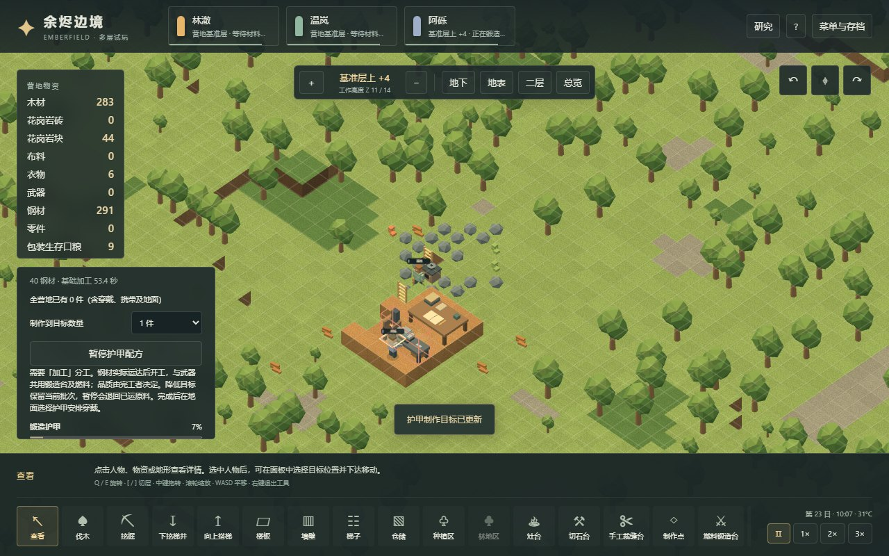
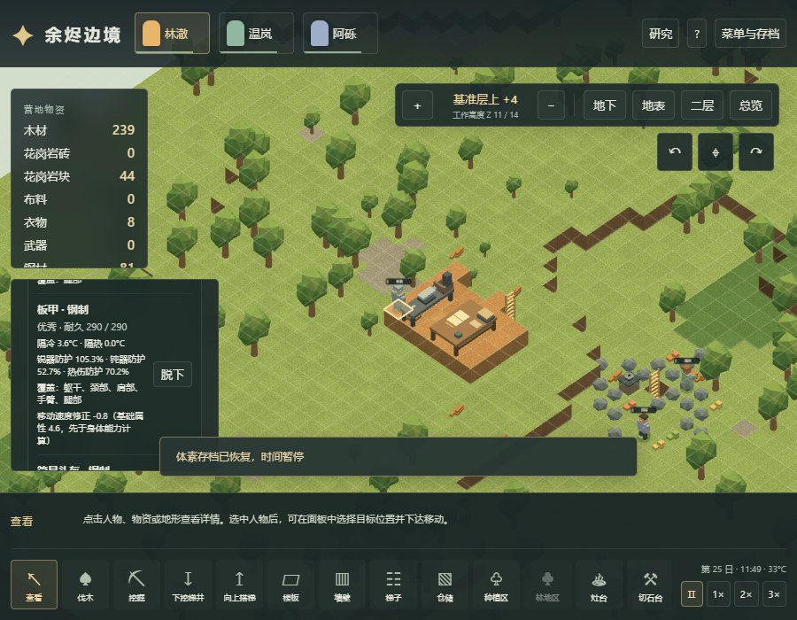

# 56 · 体素护甲、穿透与实体锻造

日期：2026-11-03。对应存档 v17，接续 v16 人体版本。原版数值与派生依据见 [54章](54-armor-penetration-mechanisms.md)，隔离原版操作见 [55章](55-native-armor-runtime.md)。本章仅描述 Web 实现与自己的验证范围。

## 可玩的变化

燃料锻造台加入简易头盔与板甲。钢头盔需要 40 钢材与锻造研究；钢板甲需要 170 钢材、板甲研究和工艺 7 级。板甲研究需 600 点，前置为锻造和复杂服装。工人沿实际楼梯搬运材料，在操作位消耗工时和木材燃料，完成后产出独立品质与耐久的实体装备。

武器和护甲共用同一锻造台，一次只执行一批。当前列表先检查未满足的武器目标，再检查护甲目标，没有可拖动的统一配方队列。降低目标保留现有批次；暂停会退回已运材料，落点已满时等待而不是销毁。成品品质仍在完工时锁定，保存、空间堵塞与重试不会重抽。

点击地面护甲可查看品质、耐久、锐器/钝器/热伤防护、覆盖位置及移动修正，再指定同伴前往穿上。替换冲突衣物时旧物真实落地。头盔与板甲可和内层布衫、长裤共存；一件板甲虽占两层，受击时仍只判定一次。当前近战已使用锐器/钝器防护，热伤防护仅列出属性，尚无相应火焰伤害玩法。

命中先选择真实身体部位，再从外到内检查覆盖它的装备。有效防护为 `max(防护值 − 穿透, 0)`，随机落入前半区间挡下，后半区间减半，其余穿透；锐器减半会把有效伤害类型转为钝器。原始伤害 worker 仍控制传播，后续装备沿用本次原始护甲属性，不能把转换后的钝器防护重新代入。传播到其他部位不再重复过甲。

每件参与判定的装备先按当前伤害的四分之一进行随机耐久取整，再判定防护。即使此次耐久归零，该次防护仍使用扣耐久前读取的属性；随后装备从穿戴列表移除，并记入损毁账本。平时磨损和受击损耗都不按耐久比例降低防护值。

三维角色以金属色头盔和板甲区分装备；锻造中的台面可见实际工件，沿用敲击与炉火动作。没有引入原版模型或贴图。

## 数值、适配与存档

| 项目 | 钢制简易头盔 | 钢制板甲 |
|---|---:|---:|
| 材料 | 40 钢材 | 170 钢材 |
| 原版基础工作量 | 3200 | 38000 |
| 项目基础工作 tick | 1067 | 12667 |
| 满耐久 | 100 | 290 |
| 普通品质锐器防护 | 45% | 81% |
| 普通品质钝器防护 | 22.5% | 40.5% |
| 普通品质热伤防护 | 30% | 54% |
| 移动属性偏移 | 0 | −0.8 |

品质护甲系数为 `0.6 / 0.8 / 1 / 1.15 / 1.3 / 1.45 / 1.8`。这些物品的品质不改变满耐久，板甲移动偏移也不随品质变化。

继续采用项目 **20 TPS、每日 12000 tick**。制作原版 60 TPS 工作量按三分之一换算并向上取整；当前每 tick 工量为 `max(0.1, Manipulation)`。工艺等级用于配方门槛和成品品质，不直接提高加工速度。原版 GeneralLaborSpeed 还含视力等因素，当前加工速率为项目简化。行走保留空手 4 tick、携带 6 tick 的项目格步基线，再除以 `max(0.15, (4.6 + 装备偏移) × Moving) / 4.6` 并向上取整。因此健康空手人物穿板甲的属性系数约 83%，实际格步从 4 tick 变为 5 tick，即 5 格/秒变为 4 格/秒；不是精确复现原版移动时间。面板分别显示系数与当前步进速度。

项目确定性随机数取值范围为 `[0,1)`，不复现原版 Verse.Rand 的序列或可取 1 的端点。穿甲改变正常战斗的随机采样次数，因此旧版本同一场战斗的后续伤口轨迹可以改变；存档在同一新版本继续运行仍需可复现。

v16 → v17 保留实体、装备、伤势、研究和正在进行的劳动；锻造台新增两个目标为零的护甲配方，板甲研究从零开始，不补发护甲。v15 及更早先执行各自历史迁移。实际 v16 衣物和创伤存档在改动前保存，来源与 SHA-256 随夹具提交；验证不会用新代码覆盖历史文件。伪装成旧版本的新护甲、账单或板甲研究字段会被拒绝。

## 验证入口与边界

- `tests/voxel-armor-rules.test.ts`：独立 XML 摘要核对、部位覆盖、顺序、穿透、耐久和锐转钝规则。
- `tests/voxel-armor-integration.test.ts`：明确控制地形与装备的世界测试，检查真实生产、材料退还、战斗损毁、装备与旧存档边界。
- `scripts/voxel-armor-campaign-verify.mjs`：从新营地出发，只用普通命令、模拟推进、保存和读取，实际开矿、研究、楼上锻造、换装及定时袭击。不注入资源、技能、伤势或护甲；单场战斗不用于估计防护概率。
- `scripts/voxel-armor-browser-verify.mjs`：生产构建的 Worker 和主线程渲染，以实际按钮、画布和文件选择器检查制作、穿戴、信息、旋转与 900×700 布局；snapshot/project/exportSave 只读辅助断言，不能称为纯屏幕测试。

本轮结果冻结在 [voxel-armor-validation.json](evidence/voxel-armor-validation.json)：全量 **539 项测试**（其中护甲规则与集成 34 项）、**48 项正常经营检查**、**17 条既有流程回归**和 **Worker/主线程各 8 项浏览器检查**全部通过。另完成同一页面内 6 轮保存、新世界和回读，几何体 27、纹理 4、地形块 16、地形缓冲 2,008,968 字节均回到相同值；不据此宣称整个浏览器无泄漏或支持任意规模。

正常经营用实际开矿产出的 416 钢材，其中科研台 25、锻造台 100、两件护甲 210，共消耗 335，剩余 81。全程推进到 tick 326168，约 27.18 项目日，头盔为普通品质，板甲为优秀品质。袭击者带来的匕首独立记录为外来物资，不能算作营地制造。

该场普通战斗没有观察到钢制护甲命中，不能证明正常战斗中的防护概率。全挡仍磨损、1 HP 护甲此次仍保护并销毁、后续连续战斗和读档一致性，来自明确控制装备/地形的集成测试。两类证据分开保留。

初期脚本分别漏建了工作台前排操作位、误要求回读后保留临时工人预定、遗漏外来武器记账，以及把截图目标投影到 HUD 下方；现分别通过正常铺地、比较持久字段、记录实际进出物品和键盘平移修正。另将重名衣物信息定位限制到地面物品面板。最终完整流程重跑通过，没有因此放宽生产校验或修改正常战斗结果。





早期人体、技能和衣物报告继续保留其发布时数据，不改写历史计数。

```powershell
npm test -- --maxWorkers=2
npm run test:voxel:research
npm run test:voxel:armor
npm run build
# 已有 5183 生产预览服务时运行，或通过 VOXEL_TEST_URL 指定地址
npm run test:voxel:armor:browser
npm run research:check
```

未覆盖：远程弹道、火焰战斗、盾牌、更多材质/护甲、完整眩晕与瞬杀保护、环境腐蚀、药物感染、手术义体、社交和交易。多层路径、楼板与矿脉是本项目扩展，不是原版 RimWorld 的三维实现。
