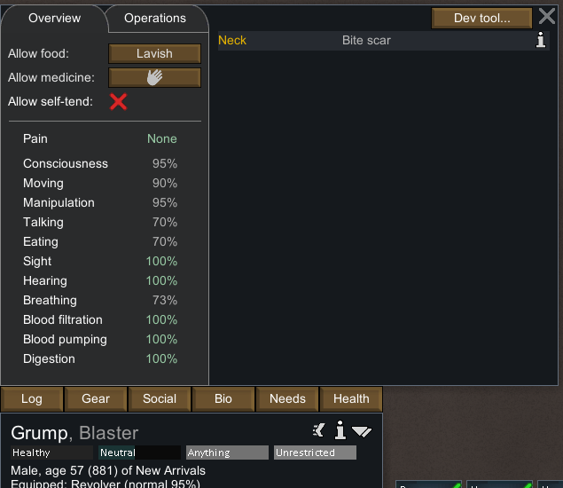
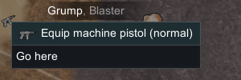
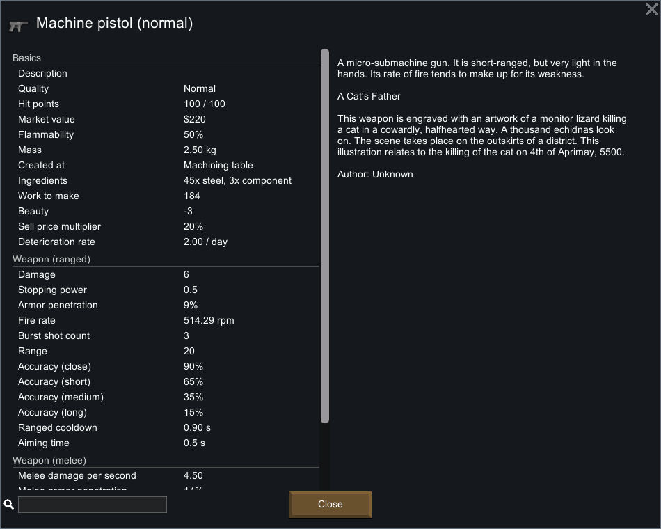
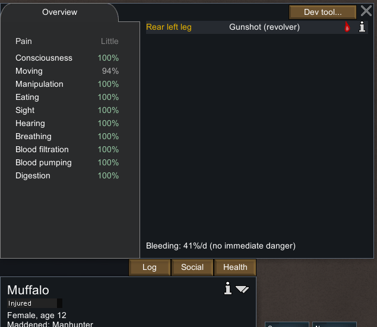
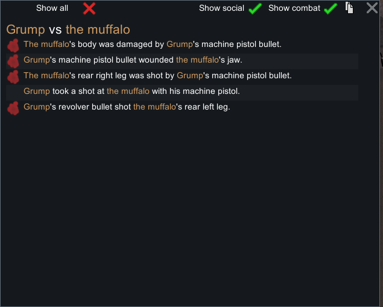

# 58｜原版远程运行证据：瞄准、弹丸飞行、三连发与枪伤

本章在 **RimWorld 1.7.4980 rev60 / Core + Odyssey** 的现有隔离进程中，完成了 **左轮 1 发 + 冲锋手枪 1 轮三连发**的普通攻击。保存的原版 XML 串起了 `AttackStatic → Stance_Warmup → Verb_Shoot → Bullet → RangedImpact → Gunshot`。4 发均在本次样本中造成枪伤，**不据此估计命中率、护甲穿透率或部位概率**。

共保留 **37 个存档提取（含入口基线）、333 条输入记录、17 张裁图、15 对等 tick 暂停存档**。13 次短运行合计推进 **775 tick**，最终停在 **144413**。与 [57 章静态远程机制](57-ranged-combat-mechanisms.md) 交叉核对后，确认三连发实际出生时间是 **144378、144384、144391**，本例间隔 **6、7 tick**，不能把 XML 的 `ticksBetweenBurstShots=7` 直接理解为每段实际间隔均为 7。

证据入口：[结构化记录](evidence/native-ranged-runtime.json)、[原始操作账本提取](evidence/native-ranged-actions.jsonl)、[独立校验器](../../../scripts/research/verify-native-ranged-runtime.mjs)。完整存档和未裁剪截图位于忽略目录 `.local-research/runtime/`，不提交游戏二进制、完整派生类或游戏存档。

## 1. 版本、进程和方法

入口采用 [55 章](55-native-armor-runtime.md) 已纠正暂停的 `armor-final-paused-b.rws`，tick **143638**，SHA-256 `6be73350fb5164652f5c66833bc0f5e785dbeb342bc2b6497ce6e6e1f3c848f3`。未使用此前不等 tick 的 `armor-stopped-a/b` 作为暂停证明。

- 既有 PID **29920**、HWND **988850**、客户端 **2560×1440**。
- 可执行文件为 `F:/SteamLibrary/steamapps/common/RimWorld/RimWorld.exe`；命令行绑定仓库下 `.local-research/runtime/profile-20261102`。
- 程序集 SHA-256：`eff7d97949f919fb2b151ebfb906e9be749b63410b7dbda78eeebb7972b245c3`。
- Developer mode 保持开启，God mode 保持关闭；没有新进程、重新加载、mod 安装、原版文件或存档 XML 编辑。
- 沿用 REA skill v42 的证据规范和 [已有 Windows provider 边界](evidence/native-plants-runtime.json)。实际键鼠由校验进程、隔离 profile 和前景窗口的 Windows 辅助脚本执行，不能写成 REA native UI provider 执行。

截图由人工核读；存档由[只读提取器](../../../scripts/research/read-ranged-runtime-save.ps1)保存字段存在性和相关原始 XML。`ticksGame` 与战斗日志的 `ticksAbs` 分开保留：本场 `gameStartAbsTick=70000`，因此 `ticksAbs=ticksGame+70000`。

每次运行从确认暂停的地图开始，通过明确的速度键启动，短暂运行后点击暂停，再连续保存两次并比较 tick 与完整提取状态。脉冲的墙钟毫秒数包含键鼠分发开销，不能当作精确模拟帧数；早期请求三倍速也没有证明实际按三倍推进。**所有时序结论以原版存档 tick 为准。**

## 2. 射手、目标及准备操作

射手为 Grump（`Human965`），Shooting **10**、Major passion。选择他以避开上一章重伤的 Prophet，但 Grump 也不是理想满状态射手：原有永久 **Bite6，Human 身体 index12 = Neck**。原版总览写着 Healthy，具体能力却是意识 95%、移动 90%、操作 95%、呼吸 73%、视力 100%。本轮未重置技能、伤口、衣物或能力；结束时仍仅有这处旧伤。



本轮准备与普通攻击明确区分：

| 对象/操作 | 来源与处理 | 证据范围 |
|---|---|---|
| `Gun_Revolver38569` | 地图既有 Normal，95/100 HP；通过普通 Equip 拾取 | 真正参加左轮普通射击 |
| `Bow_Short78309` | Dev Spawn thing 生成 Poor；Dev Set quality 改为 Normal，100 HP 保持 | 只观察信息窗；没有实际射箭 |
| `Gun_MachinePistol78310` | Dev Spawn thing 生成 Excellent，带自动生成艺术描述；Set quality 改 Normal，100 HP 保持 | 随后通过普通 Equip 拾取并三连发；艺术描述不能当成玩家制作证据 |
| `Muffalo78311` | Dev Spawn pawn 生成，雌性、12 岁，初始无 hediff，界面列出的能力均 100% | 普通攻击的目标；没有穿戴护甲 |
| Stop mental state | tick144319 用于下一轮准备；tick144413 用于清理 | 结束 Manhunter，不是自然恢复；保留枪伤、日志与干预前存档 |

初次左轮订单时射手在 `(113,0,119)`，目标在 `(124,0,114)`。冲锋手枪订单时射手在 `(116,0,119)`、目标在 `(118,0,117)`，目标已保留左轮枪伤及自然发展的 BloodLoss。**两种武器不是同距离、同健康条件的对照组。**

普通换装需要走到物品处，也可能受到尚未结束的冷却影响。本轮原始文件名中 `revolver-equipped/ready`、`machine-held/ready` 是提前命名的行走样本，实际上尚未完成拾取；没有重命名、覆盖或删去它们。以装备容器为准，完成点分别是 `ranged-revolver-held-b`（144138）和 `ranged-machine-equipped-b`（144346）。换枪时暂时关闭 Fire at will，之后仍由普通强制攻击订单开火；结束时恢复该开关并取消征召。



## 3. 原版武器信息窗与显示精度

以下是本轮实际信息窗显示值。XML 精确值与继承链见 57 章，不能把界面的整数显示重新写成底层参数。

| Normal 武器 | 伤害 | UI AP | UI 射程 | 近/短/中/远准确度 | 瞄准 | 冷却 | 连发 |
|---|---:|---:|---:|---|---:|---:|---|
| Short bow | 11 | 16% | 23 | 75/65/45/25% | 1.35s | 1.65s | 单发；本轮未射击 |
| Revolver | 12 | 18% | 26 | 80/75/55/40% | 0.30s | 1.60s | 单发；实测 1 发 |
| Machine pistol | 6 | 9% | 20 | 90/65/35/15% | 0.50s | 0.90s | 3；界面 514.29rpm |

底层射程分别 **22.9、25.9、19.9**；短弓底层 AP 为 **0.165**，界面显示 16%。射程与百分比均保留原始字段和 UI 字样，避免丢失精度。准度表是武器在指定距离节点的 stat，不是包含射手、距离、目标和掩体条件后的最终命中概率。

同一短弓 Poor → Normal 的 UI 准度由 **67/58/40/22% → 75/65/45/25%**，伤害仍显示 11，HP 仍为 100。这个样本只证实信息窗随品质改变，未对不同品质实际命中频率作实验。左轮 stopping power 为 1.0，短弓和冲锋手枪为 0.5；没有把自动手枪 Autopistol 误当成三连发枪。



另有[左轮信息窗](evidence/runtime/ranged-revolver-info.png)、[Poor 短弓](evidence/runtime/ranged-bow-poor-info.png)、[Normal 短弓](evidence/runtime/ranged-bow-normal-info.png)。制作成本、工作量只作界面参考；本轮没有普通制造过程。

## 4. 左轮：瞄准、飞行、命中是不同阶段

| 存档/事件 | ticksGame | 原始状态 |
|---|---:|---|
| `ranged-revolver-ordered` | 144138 | `AttackStatic`、`playerForced=True`、目标 Muffalo78311；尚未发射 |
| 瞄准开始 | 144141 | 后续存档 `Stance_Warmup.startedTick` |
| `ranged-revolver-warmup-b` | 144153 | Warmup 剩余 6；`lastShotTick=-999999`；没有弹丸、目标无伤 |
| 发射 | 144159 | 弹丸 `Bullet_Revolver78312.spawnedTick`；RangedFire43 的绝对 tick214159 |
| `ranged-revolver-flight-b` | 144170 | 独立弹丸仍在地图中，`ticksToImpact=16`；Cooldown 剩余85；目标仍无伤 |
| 命中 | 144186 | RangedImpact44；新 Gunshot143，后左腿 index23，severity12 |
| `ranged-revolver-impact-b` | 144201 | 弹丸已消失；枪伤12仍在；Cooldown 剩余54 |

本次瞄准开始到发射为 **18 tick**，吻合 0.30s × 60；发射到命中为 **27 tick**。144170 的冷却剩85与开始时间144159对应总96 tick，即1.60s ×60。冷却与弹丸飞行同时存在，目标不会在扣除瞄准时间后立即同步受伤。

伤口保存 `source=Gun_Revolver`、`combatLogEntry=LogEntry_214186_44`，战斗记录保存射手、目标、weaponDef、projectileDef 和损伤部位，形成相互对应的事件链。这里没有使用 Apply damage、AddHediff 或指定伤害部位工具。



目标在受击后出现原版“牦牛复仇”提示，存档确认 `MentalState_Manhunter` 与追击 Grump 的 `AttackMelee` 订单。本轮随后暂停、保留状态，并于144319结束其精神状态，以继续下一次远程实验。**本章没有让该近战订单实际造成伤害。**

## 5. 冲锋手枪：保存到三颗独立弹丸

普通攻击订单发生于144346，Warmup 开始于144348；144360 的双存档显示剩18 tick，尚无发射。144378 首发，因此本次瞄准为 **30 tick**，吻合0.50s ×60。

在144382捕获到：

```text
Verb_Shoot.state = Bursting
lastShotTick = 144378
burstShotsLeft = 2
ticksToNextBurstShot = 2
Bullet_MachinePistol78317.ticksToImpact = 13
```

在144394的双存档中，三颗弹丸同时存在；目标尚未收到本轮三连发造成的新伤。后续144413存档保存三次命中：

| 弹丸 | 出生 tick | 144394 剩余飞行 tick | 命中 tick | 新伤口/部位 | 伤害 |
|---|---:|---:|---:|---|---:|
| 78317 | 144378 | 1 | 144395 | Gunshot145，后右腿 index25 | 6 |
| 78319 | 144384 | 7 | 144401 | Gunshot146，下颌 index18 | 6 |
| 78320 | 144391 | 14 | 144408 | Gunshot147，身体 index0 | 6 |

这些是 `QuadrupedAnimalWithHooves` 的身体索引，不能套用 Human 身体表。原版健康窗与战斗文字分别确认 rear right leg、jaw、body。

三颗弹丸各飞行17 tick。最后一发之后的144394显示完整攻击后冷却 `startedTick=144391, ticksLeft=51`；在144413剩32，吻合总54 tick =0.90s ×60。连发中的短 `Stance_Cooldown` 与最后一发后的完整冷却需区分，不能见到 Cooldown 类就认定整轮攻击结束。

本轮只生成 **1 条 `RangedFire`（log45，burst=True）**，但生成 **3 条 `RangedImpact`（46–48）**和3个新枪伤。统计射击数量时不能只数 RangedFire 日志条目。

实际出生间隔6、7的解释来自57章新增的静态调用顺序证据：`Pawn.Tick` 先更新 stance，瞄准结束时立即首发；同 tick 后续 equipment → `VerbTracker.VerbsTick` → `Verb.VerbTick` 又将计数7减为6。后继弹在 VerbTick 内发出，保留下一段的7。存档证明观察时间，静态调用链解释原因；两类证据没有互相替代。



## 6. 弹丸与伤害模型的设计启示

用于 Web 复刻时，应把武器订单、瞄准、连发调度、飞行实体、命中处理和完整冷却分别表示。一次发射要记录武器和发射者身份；命中时再产生相应健康变化。这样才能表达本例“射手已经冷却中，弹丸尚未命中”“同一轮连发有三颗在途弹丸”“一条开火日志对应多次命中”。

这些阶段保留在逻辑 tick 中，渲染只读取并插值。若项目把原版60Hz规则映射到较低逻辑频率，应明确取整策略；原版观察偏移是 `[0,6,13]`，项目的具体映射由实现章节单独验证，不应宣称不同频率下所有细节完全相同。

原始 projectile 的 `origin` 保存了 **y=8.4126215**，`destination.y=0`；57章的派生代码与速度单位解释必须一并使用。本次27/17 tick是具体弹丸的观察结果，不应仅用地图二维格距倒推出一个“实测通用弹速”，也不能直接把 XML `speed=44/55` 写成44/55格每秒。

当前证据只覆盖少量无穿戴护甲动物目标。掩体拦截、视线阻挡、卧倒目标和护甲处理仍引用57章的静态机制及55章独立护甲样本。**没有执行墙/沙袋运行对照，不能把公式算例写成这些场景已经实测。**

## 7. 清理、失败记录与验证

结束时三颗冲锋手枪弹丸均已消失，目标保留枪伤12+6+6+6及BloodLoss。UI显示中度疼痛、流血82%/日；再次进入Manhunter后，在tick144413使用 Dev Stop mental state结束进一步战斗。Grump恢复Fire at will并取消征召，没有新伤、没有改工作或医疗政策；仍持有Normal冲锋手枪，左轮与短弓留在地面。

取消征召时原版创建了 `FleeAndCower` 订单；清理后它仍保留在暂停存档中，没有再运行去消除该订单，也没有用开发者治疗。后续继续研究应知道这个继承状态。两次前景保护拒绝均在输入前停止；通过既有窗口恢复捕获后继续，没有另起游戏进程。

`ranged-final-paused-a/b` 均为 **144413**，tick、人物、武器、弹丸、战斗记录和墙/沙袋提取完全相同。最终b的SHA-256为 `d6e545ae79cc6a360ee895224ccfa27730cab7e77f793072436290077a8bdb18`。本轮没有检测到类似55章清理阶段的意外长运行，也没有在已经暂停时再盲点暂停按钮。

从项目根目录执行：

```powershell
node scripts/research/verify-native-ranged-runtime.mjs
node scripts/research/verify-native-ranged-runtime.mjs --local
```

第一条不需要安装原版，校验保留数据的字段对应、等tick暂停对、原件身份、操作时间线与裁图SHA；第二条额外逐个重读37份原始存档、原始截图元数据和输入日志，与保存的提取逐项比较。两者均不发送键鼠、不重新演算随机射击、不做OCR。

[采集脚本](../../../scripts/research/collect-ranged-runtime.ps1)只读取现有证据。[输入脚本](../../../scripts/research/ranged-runtime-input.ps1)、[存档助手](../../../scripts/research/save-ranged-runtime.ps1)和[开发者菜单助手](../../../scripts/research/open-ranged-runtime-tool.ps1)是取证操作工具，不能当成无人值守重演脚本：界面前置条件、目标选择和每轮暂停必须人工/代理重新核对。

为使 Windows/Linux 检出后的辅助脚本哈希一致，取证结束后仅将开发者菜单助手第14行的 CRLF 改为 LF。结构化记录的 `sources` 保存当前仓库脚本哈希，`helper_line_ending_normalization` 单独保留转换前后的 SHA-256 和行号；校验器会按该行号还原转换前字节并验证旧哈希。原版存档、截图及原始输入账本均未修改。
