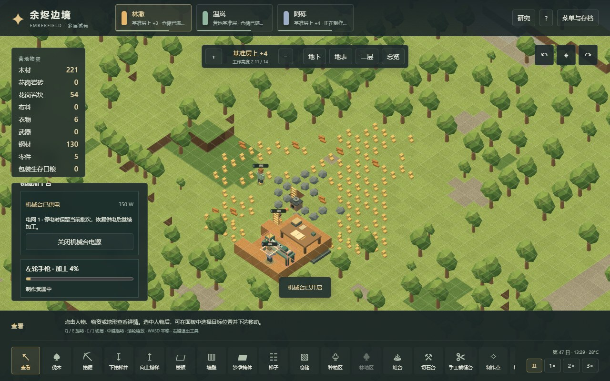
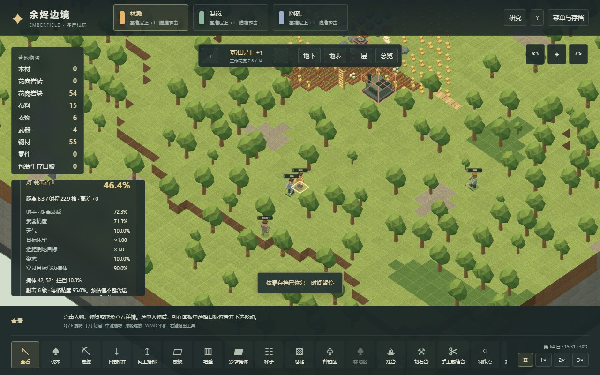

# 59 · 体素远程战斗、机械加工与掩体

日期：2026-11-03。对应存档 v18，接续 v17 护甲。原版派生证据见 [57章](57-ranged-combat-mechanisms.md)，原版运行记录见 [58章](58-native-ranged-runtime.md)。本章描述 Web 实现与明确适配；原版静态公式、原版现场与 Web 测试分别记录。

## 制造与操作

制作点和燃料锻造台可制作短弓。新增 3×1 机械加工台，需要 150 钢材、5 零件、机械加工研究和建造 4 级。其操作位必须留空，并接入本层 13×13 接线搜索范围内的真实电网；跨楼层仍须竖向电线。台子开启且供电时持续消耗 350 W，包括空闲时。关闭、断电或读档不会复制已送材料，也不会重置正在制作的进度。

| 项目 | 短弓 | 左轮 | 冲锋手枪 |
|---|---:|---:|---:|
| 原版定义 | Bow_Short | Gun_Revolver | Gun_MachinePistol |
| 材料 | 30 木材 | 30 钢材 + 2 零件 | 45 钢材 + 3 零件 |
| 基础加工 tick，20 TPS | 800 | 1334 | 3667 |
| 工艺门槛 | 2 | 3 | 4 |
| 研究 | 无 | 枪械制造 | 反冲式自动武器 |
| 普通品质伤害 | 11 箭伤 | 12 枪伤 | 每弹 6 枪伤 |
| 普通品质穿透 | 16.5% | 18% | 9% |
| 射程 | 22.9 格 | 25.9 格 | 19.9 格 |
| 瞄准 / 冷却 | 1.35 / 1.65 秒 | 0.3 / 1.6 秒 | 0.5 / 0.9 秒 |
| 每次发射 | 1 箭 | 1 弹 | 3 弹 |

机械加工研究 1000 点，前置为电力与锻造；枪械制造 500 点，前置机械加工；反冲式自动武器 500 点，前置枪械制造。研究不补发枪械。成品沿用独立身份、品质、耐久、实际取用、替换落地与死亡掉落机制。三种武器均固定材料，不把材料成本中的木材当成原版 Stuff 木质伤害倍率。没有增加原版这些普通武器所没有的弹药消耗。

机械台户外工作乘 0.8，低于 9°C 或高于 35°C 再乘 0.7。当前没有原版房间角色评分，封闭房间保守按非 Workshop 乘 0.8；不声称建了房间就自动获得完整车间加成。无电时账单停止，不把 Stat 的最低值 0.1 当成可无电制作的速度。其他既有工作台保留各自已记录的效率简化。

征召人物后选择目标即可射击。射程或视线不满足时，人物通过实际导航寻找可达射击位置。手动移动优先；切换命令取消瞄准，已开始连发的中断仍进入冷却。近身相邻敌人会触发近战，枪械和弓保留原版工具的不同攻击容量。征召人物会自动向射程内可见敌人还击。

界面显示瞄准进度、距离、武器与射手精度、体型/姿态、掩体通过率及遮挡原因。命中率是当前场景的估计值，不保证之后飞行途中没有人走入射线、目标姿态改变或掩体被拆除。枪械、弓、机械台和沙袋使用程序几何体；飞行弹丸、枪口和撞击反馈根据真实事件显示，暂停和切层使用同一模拟状态。

## 射击与弹丸

项目继续以 **20 TPS、每日 12000 tick** 模拟。原版正常目标为 60 TPS，未在本轮迁移。冲锋手枪 XML 的名义发射间隔为 7 tick，但人物先完成热身、后更新装备，首发所在 tick 已让连发倒计时减 1；本次实机捕获相对第一发 `[0,6,13]`，与调用顺序一致。本项目把这一人物热身路径按累计时间向上换算为 `[0,2,5]` 项目 tick。射击经验的原版周期公式仍用两段名义 `7/60` 秒，不能把实际调度间隔直接代入经验计算。

弹丸速度沿用原版 `speed / 100` 格/原版 tick，映射为项目每 tick 的三倍步长；飞行时间按实际起点至落点距离计算。发射不即时扣血。在每个模拟 tick 内，只检测射线新进入的格子，避免同一格在连续 tick 中重复随机拦截。这是本项目的三维离散射线适配；原版 `checkedCells` 在每次运动采样调用中清空，并非整段飞行只检查每格一次。偏射、选中掩体和正中目标使用各自真实落点。

成功指向人物的弹丸保留原版 usedTarget 身份语义：目标离开原落点格子，本身不足以躲开这颗已经发出的弹丸。到达时检查当前姿态；身份失效才进入落点候选逻辑。偏射或掩体分支缺少 IntendedTarget 标志时，不能用 NonTargetPawns 标志绕回命中原目标。其他人物可能中途拦截，包括友军，按原版距离门槛与姿态因素计算。

三维扩展采用闭体素 supercover 射线，穿过墙角、楼板、山体或关闭的门会被阻挡，不按二维水平线投射，也没有凭空增加高地伤害或命中奖励。自动门开启等待期间仍阻挡。实体地形即使在原版不检查非目标世界物体的发射分支也始终阻挡，这是明确的体素适配。当前不实现地形块、门、工作台的弹丸耐久与摧毁；弹丸命中硬地形会停止并给出反馈。

短弓 Arrow 使用 Cut 伤口、实心部位 Crack；Bullet 使用 Gunshot，包含实心骨部位。二者不借用 Stab 的强制内部传播，也不借用 Cut worker 的额外目标分伤。实际命中仍经过 v17 的逐层护甲与磨损，再进入 v16 身体部位/缺失/流血/护理流程。左轮停止力 1 可以让体型 1 的成人减速；短弓与冲锋手枪停止力 0.5 不触发。减速持续 32 项目 tick，移动系数 0.17；完全护甲挡下仍触发，沿用原版在 TakeDamage 后通知 stagger 的顺序。格步计时仍是项目离散移动模型。

射击经验在完成瞄准时按完整射击周期计算：敌对人物 170 × 周期秒数、非敌对人物 20 × 周期秒数，再走既有热情和每日学习限制。一次连发不重复授予三份经验。当前模拟成人，无儿童瞄准年龄因子、特质、基因、天气事件或难度友伤倍率；气候雨量不是当前天气，因此射击天气倍率固定为 1。

## 掩体与保存

布沙袋每格消耗 5 布料，基础建造 60 tick、300 HP、填充率 0.55。可连续拖建和跨越，进入连续沙袋区时增加 14 tick，连续沙袋间不重复收费。寻路终点、工作台操作位、护理位置和地面物品不占用沙袋；穿越途中可保存和继续。沙袋及机械台脚下的支撑受到施工保护，不能从下层直接拆空。拆除退 2 布料；击毁不返还材料。基础填充率不能当作所有射击角度下固定 55% 的免伤率。

白杨、松树填充率 0.25、满 HP 200；巨柱仙人掌填充率 0.35、满 HP 130。射击掩体率不乘成长比例，受伤从归一化树健康扣除 `伤害 / 满HP`。摧毁会清除树的碰撞与遮光并取消对应采伐任务。当前概率掩体只涵盖这三种树及布沙袋；其他设施的侧向掩体、墙旁探身、完整 LeanShootingSource 等待扩展。三维掩体高度为项目几何参数，不冒充原版二维高度数值。

v18 保存射击阶段、下一发时间、剩余发数、弹丸起终点与身份、品质导出的伤害/穿透、减速到期时间、沙袋 HP 和最多 64 条战斗事件。在飞弹丸最多 256 个；未来扩大人口时需重新评估，当前人物/遗体上限仍 64。

真实 v17 的制作中和战后存档已在改动前冻结并附 SHA-256 与来源提交。迁移保持地形、现存技能、装备、伤情、材料和制作进度，新增射击技能采用项目固定角色档案，三项新科技为零，旧工作台仅追加目标为零的短弓账单。旧格式若混入新枪械、射击字段或新研究会拒绝读取。v18 加载同时验证阶段、计时、身份、品质伤害关系与弹丸飞行长度，不把回读的射手强制改为近战寻路。

可选袭击保持第一波持刀，第二波短弓、第三波左轮、此后冲锋手枪。这个固定序列用于当前可玩的敌我射击流程，是项目事件设计，不是原版财富、威胁点数或叙事者抽样机制。

## 验证入口

- `tests/voxel-ranged-rules.test.ts`：独立原版数据对照、品质、命中、掩体、偏射、连发映射、三维射线和拦截公式。
- `tests/voxel-ranged-integration.test.ts`：明确控制地形/装备的战斗场景，验证非即时伤害、移动目标身份、连发中断与读档、误伤、摧毁和护甲减速。不是普通经营证据。
- `tests/voxel-ranged-production.test.ts`：真实 v17 字节迁移、污染拒绝，以及受控有限材料下的施工、电力消耗、断电续工和沙袋线建造。
- `scripts/voxel-ranged-campaign-verify.mjs`：从新营地出发，只用普通命令、步进和存读档，开采钢与零件、跨层研究/机械台/竖线、实际造枪和棉花沙袋、定时敌我战斗。阶段文件附哈希，失败后允许回读既有的正常经营检查点，不注入资源或跳时间。
- `scripts/voxel-ranged-browser-verify.mjs`：真实文件导入、DOM 控件与 canvas 检查；只读 snapshot/project 辅助断言不称为纯屏幕操作。

## 本轮验收

[冻结验收记录](evidence/voxel-ranged-validation.json)与[便携校验器](../../../scripts/research/verify-voxel-ranged-validation.mjs)保存本轮结果和源文件、脚本、构建资源及报告的 SHA-256。v17 及更早历史报告保持不变。

| 层次 | 实际结果 | 解释边界 |
|---|---|---|
| 全量单元/集成 | 35 文件、611 项通过；其中远程规则/集成/生产/视图共72项 | 受控场景包含人为布置的地形、材料和伤情，不能当作普通经营 |
| 新营地完整流程 | 67项检查，最终tick819790，约68.3个项目日 | 只用普通命令、step、存读档；160格粮田、地下采矿、楼上科研/机械台/竖线、自产布沙袋和两波实际战斗 |
| 浏览器 | Worker与main各12项通过，无浏览器错误，资源字节匹配本地正式构建 | 真实导入、DOM控件和canvas点击；辅助snapshot/project只读，不声称纯屏幕操作 |
| 生命周期 | 6次保存→新世界→读档、77项控件检查 | 同世界恢复时27个geometry、4个texture、16个chunk、2,008,968字节地形buffer精确回归；不含Worker/native/GPU总内存 |
| 既有流程回归 | 电力、伤情、护甲、技能、人体和核心体素6组通过 | 在最终沙袋停留/连发修正前运行；修正后全量测试及新营地流程另外通过 |
| 原版证据 | 57章394断言；58章四发普通投射物和四处枪伤样本 | 静态算例、开发准备后的原版样本和Web结果不可合并为“原版完整覆盖率” |

最终经营流程保存了实际执行的世界模块bundle，结束后重新从当前源代码打包，SHA-256仍为 `8db7ae29975d9f79c68bef687b7bcc45b39f89d10af7a51be90f4828f038219c`。浏览器使用该次流程的原始阶段存档，每次导入前校验字节哈希。飞行途中先保存再导入，人物阶段、剩余连发、弹丸和延迟命中继续正常推进；暂停时没有即时伤害。

早期规划运行失败也保留了边界：发电机候选占到梯井被正常拒绝；80格粮田无法持续供给长科研，晚补农田仍出现饥饿，最终从新营地开始规划160格粮田，没有补发食物/健康/知识。一次高并发全量测试出现旧睡眠测试的5秒超时和测试器RPC超时，降低为单测试worker后611项通过，无未处理错误；没有放宽睡眠断言或修改模拟规则来让它通过。原版连发新证据修正后，完整经营也重新从头运行。

[装备模型](evidence/voxel/ranged-weapons.jpg)、[飞行中弹丸](evidence/voxel/ranged-flight.jpg)、[900×700目标操作](evidence/voxel/ranged-compact.jpg)来自同次正式浏览器验收。截图中的原型几何体为项目自制；没有使用原版提取素材。

本章记录本地冻结验收；线上发布还须核对对应提交的GitHub Actions构建/部署和线上实际资源，不能只凭本地构建推断已经发布。当前没有爆炸、火焰、完整天气、墙旁探身、手术/义体和社交系统，仍是持续实现中的多层殖民地原型。
