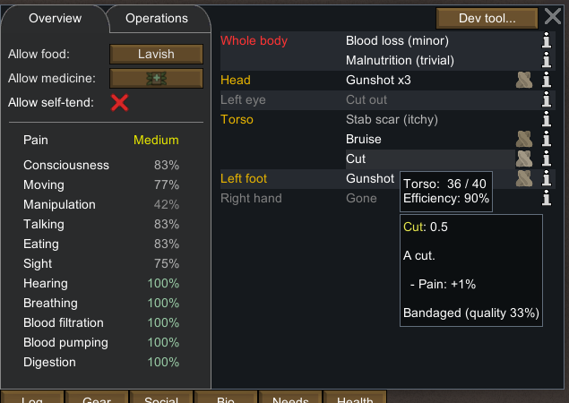
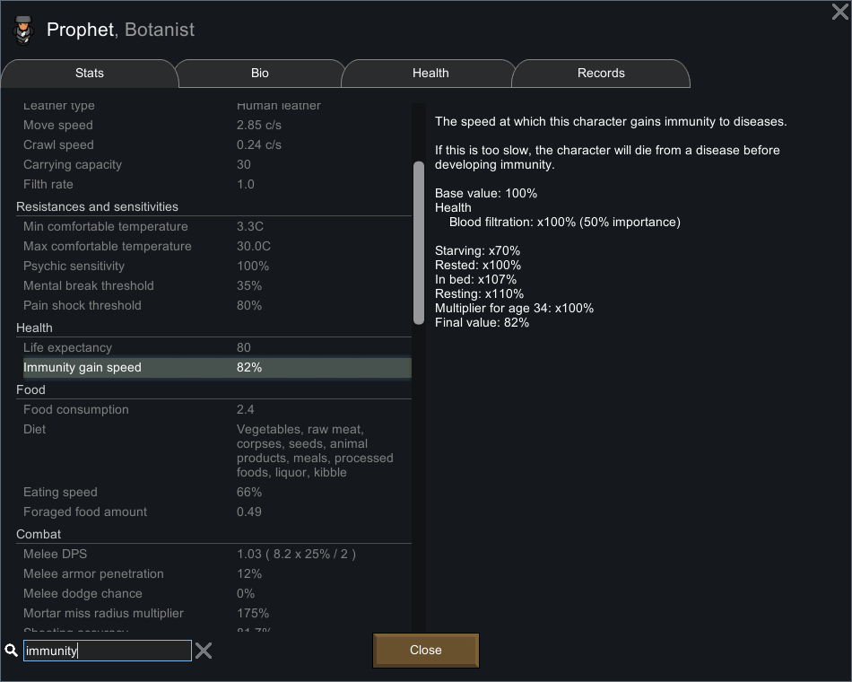
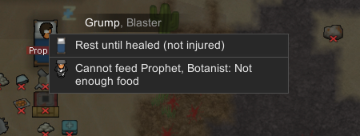
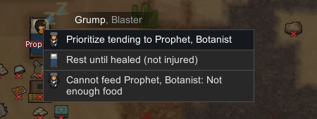
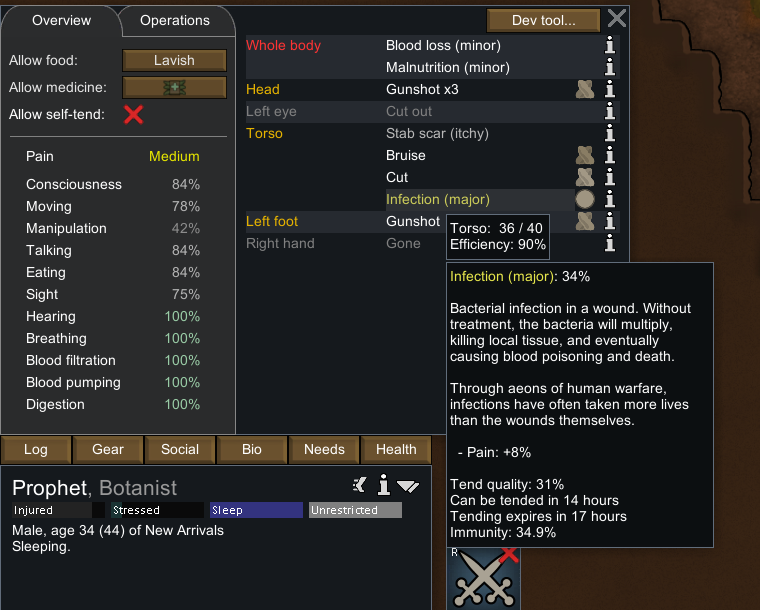
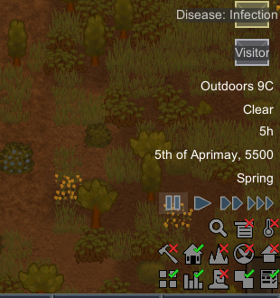

# 61｜原版医药运行证据：取药、护理质量、感染与免疫

本章使用 **RimWorld 1.7.4980 rev60 / Core + Odyssey** 的既有隔离研究进程，观察普通医疗策略、草药取用、床边护理和感染的再次护理。疾病与伤口的准备通过开发者菜单完成；随后发生的取药、护理、药物消耗和病程推进由原版正常机制执行。**开发者添加感染不能证明自然感染发生率。**

## 1. 入口与证据边界

进程名称为 `RimWorld.exe`，PID **29920**、HWND **988850**，命令行仍绑定 `.local-research/runtime/profile-20261102`。本轮没有另起进程、加载旧档、改存档 XML、安装 mod 或改动游戏文件。入口是 [58 章](58-native-ranged-runtime.md) 的 `ranged-final-paused-b`；本轮 `medicine-entry-a/b` 仍为 **tick144413**，完整提取状态相等。

沿用 REA skill v42 的证据规范；实际输入由校验进程路径、隔离 profile 和前景窗口的 Windows 助手执行，不能称为 REA native UI provider 的执行结果。原始存档、完整截图、动作账本保留在忽略目录 `.local-research/runtime/`。公开证据保留版本、哈希、有关原始 XML、人工核读的裁图和可独立执行的检查脚本。

所有运行均以明确的速度键开始、以一次暂停按钮点击结束，随后连存两份并比较完整提取状态。墙钟运行时长包含输入开销，不能代替存档的 `ticksGame`。本文的零值、缺失值和原版默认值分别表达：例如序列化没有 `tendQuality` 不能单独作为“未护理”的证明。

## 2. 患者、医生与准备

| 对象 | 本轮实际条件 |
|---|---|
| 患者 Prophet，`Human958` | 34 岁，既有伤疤、缺失部位、枪伤、血损和营养不良；初始已躺医床，未重置健康、食物或心情 |
| 医生 Grump，`Human965` | Medicine **4**、Minor passion；颈部旧伤使操作能力为95%，视力100%；未改技能或工作优先级 |
| 医床 `Bed77946` | 既有 **Normal 木床**，`medical=True`；创建来源见早期实验，本轮没有造床 |
| 新伤 `Cut148` | tick144413，通过 Health → Dev tool → Add hediff 准备；Torso / Human index0，severity **0.5** |
| 草药 | Dev Spawn thing 准备近处3份及远处1份；没有声称由玩家种植、采收或制作 |
| 感染 `WoundInfection151` | tick146173，通过同一开发者菜单明确加入 Torso；初始severity **0.00100000005** |

原有工业药有25+5份，闪耀世界药4份，原本均为禁止状态。它们不是与草药进行公平药效比较的对照组。患者的策略通过普通 Health 菜单从 **Best → HerbalOrWorse**；医生自身的 NoMeds 策略不决定给患者用什么药。

草药工具需要右键清除。第一次按 Escape 只关闭了选中面板，随后一次原计划点击面板的操作又生成了第4份草药（`MedicineHerbal78324`，远处 `(94,0,113)`）。该准备失误保留在记录中，没有删除额外物资或覆盖原始截图；近处主堆为 `MedicineHerbal78321`，初始3份，位置 `(114,0,117)`。

## 3. 草药从物资变为消耗品的完整链条

| 原版存档 | tick | 观察 |
|---|---:|---|
| `medicine-herbal-ordered-a/b` | 144413 | Grump 的普通强制 `TendPatient`，targetA=Human958、targetB=MedicineHerbal78321，`usesMedicine=True`；尚未携药 |
| `medicine-herbal-carry-a/b` | 144518 | 主堆3→2；新拆分药物 `MedicineHerbal78327` 1份进入医生 carryTracker；总药量尚未减少 |
| `medicine-herbal-bedside-a/b` | 144687 | 医生抵达 `(112,0,124)`，患者床旁；同一 TendPatient 的 toil13 剩余960 tick，仍携带药物 |
| `medicine-herbal-tending-a/b` | 146173 | 护理已完成；携药实体消失，草药总4→3；同一 Cut148 出现护理质量 **0.334181815**，UI显示 **33%** |

伤口护理后仍为severity0.5。护理、止血与恢复伤势是不同阶段，不能把一次护理完成写成“伤口已愈合”。本次 `tendTicksLeft=1` 是伤口永久护理标记；感染的护理倒计时见后文，它们不是同一种寿命。

医生信息窗实际显示 **Medical tend quality 57%**：医术4的60% × 操作95% × 视力100%。同时显示 **Medical tend speed 61%**。这两个面板值与具体伤口的33%结果分别保留；实际质量还受到药物、环境和随机项等影响。一个结果不能确定品质分布或草药对其他药品的相对收益。



## 4. 感染首次护理与免疫速度

在146173加入 Infection 后立即双存档：`WoundInfection151` 初始severity0.00100000005，尚没有该疾病的免疫record。普通订单 `medicine-infection-ordered` 指向同一患者与近处剩余草药堆。

第一次普通感染护理后的双档 `medicine-infection-first-tend-a/b` 为 **147663**：

| 字段 | 原版保存值 |
|---|---:|
| `severity` | 0.0225790143 |
| `tendQuality` | 0.464708388 |
| `totalTendQuality` | 0.464708388 |
| `tendTicksLeft` | 37403 |
| 免疫record `immunity` | 0.0156398825 |
| 草药总量 | 3→2 |

免疫record位于 `healthTracker/immunity/imList`，其 `hediffDef` 和 `source` 均为 WoundInfection；它与带身体部位和loadID的感染实例分别序列化。本轮只有一个感染实例，没有实测同疾病多部位共用免疫。

患者信息窗在该时点显示 **Immunity gain speed 82%**，完整分解为：血液过滤100%、饥饿×70%、Rested×100%、In bed×107%、Resting×110%、年龄34×100%。其中 `.7 × 1.07 × 1.1 = .8239` 与显示82%一致。普通木床的107%由 XML 父链继承，不能只看抽象默认值而写成100%。**病程样本继承了饥饿与旧伤，不能当作满状态患者的标准速度实验。**



## 5. 病程推进与再次护理

### 5.1 同一感染的连续轨迹

首次护理后进行了20次有限时长的正常运行，每次保留暂停双档。期间没有用开发者菜单改疾病严重度、护理倒计时或免疫。下表选取关键点；全部20点及其原始 healthTracker XML 均在 JSON 中。

| 存档后缀 | tick | 感染severity | 护理剩余tick | 免疫immunity | 草药总量 |
|---|---:|---:|---:|---:|---:|
| `first-tend-b` | 147663 | 0.0225790143 | 37403 | 0.0156398825 | 2 |
| `progress-05-b` | 155049 | 0.0958025977 | 30017 | 0.0932697803 | 2 |
| `progress-10-b` | 162455 | 0.169026017 | 22611 | 0.171119466 | 2 |
| `progress-15-b` | 169877 | 0.242249325 | 15189 | 0.249126807 | 2 |
| `progress-20-b` | 177073 | 0.313494116 | 7993 | 0.324769348 | 2 |
| `retend-eligible-b` | 177692 | 0.319431186 | 7374 | 0.331264704 | 2 |
| `retend-working-b` | 179177 | 0.333284348 | 5889 | 0.346872479 | 2 |
| `retend-done-b` | 179408 | 0.337512016 | 43158 | 0.349300355 | 1 |

以上后缀均以 `medicine-infection-` 开头。20次推进中，护理倒计时的减少量逐次等于存档tick差，本次品质始终为0.464708388；感染严重度和免疫均继续增加。护理有效不意味着病情立刻下降，这与第 [60章](60-medicine-infection-mechanisms.md) 的严重度与免疫双轨规则一致。数值以保存字段为准，未使用截图中的整数百分比反推完整病程。

### 5.2 再次护理的资格与实体作业

在177073（剩7993 tick）时，选中医生右击患者，普通菜单没有 **Prioritize tending**；在177692（剩7374 tick）时，该选项出现。原版窗口将资格变化夹在两次观测之间；**严格小于7500** 的精确条件来自第60章的静态证据，本轮没有实测恰好7500这一边界。





同一tick177692下达普通 `TendPatient94572`，目标仍为Human958，药物为主堆最后1份 `MedicineHerbal78321`。179177存档中该实体在医生carryTracker，医生已站在床旁，护理toil13剩118 tick。179408存档中该实体消失，草药总量2→1。远处的 `MedicineHerbal78324` 保留；工业药25+5及高级药4的数量全过程不变。

### 5.3 新护理追加时间，当前品质与累计品质分别更新

第二次感染护理后：

| 字段 | 之前 | 完成后的179408存档 |
|---|---:|---:|
| `tendQuality` | 0.464708388 | **0.31208238** |
| `totalTendQuality` | 0.464708388 | **0.776790738** |
| `tendTicksLeft`，以179177为前点 | 5889 | **43158** |
| `immunity`，以179177为前点 | 0.346872479 | **0.349300355** |

完整时间关系为：

```text
本次观察间隔 = 179408 − 179177 = 231 tick
完成后的护理剩余 = 5889 + 37500 − 231 = 43158 tick
```

这次护理在已有剩余时间上增加37500，未简单重设为37500。当前品质变为本次结果；累计品质保留两次结果之和，保存的浮点值与十进制文本直接相加有约3×10⁻⁸差异。免疫保留并继续增长，没有因为换一次绷带而归零。

UI相应显示：感染 **34%**、护理品质 **31%**、可在 **14小时**后再次护理、护理在 **17小时**后到期、免疫 **34.9%**。时间和百分比的显示舍入不能替代上述字段。



医生在实验中自然出现营养不良，重复护理前操作能力已降至85%。因此46%与31%不是相同医生状态下的受控重复试验，也不能单凭差值估算随机方差。患者和医生均未喂食或重置需求。

## 6. 失败记录和复核方式

初期存在前景保护拒绝。一次是在首个菜单点击分发后检测到焦点变化，因此该次尝试不能写成“完全未发送输入”；它没有形成完整动作记录。随后截图和入口双档确认仍停在144413。其余拒绝发生在输入前。后续助手仅补充对同一授权窗口的最小化恢复，仍保留前景检查和失败即停止；未绕过保护继续盲发输入。

本轮不观察自然感染概率、多人重复试验、药物间公平对照、医生技能曲线或感染最终康复/死亡分布。原版UI、原始存档字段、静态公式和Web实现分别提供不同证据，不能互相冒充。

### 6.1 仓库证据与可重复检查

| 文件 | 用途 |
|---|---|
| [native-medicine-runtime.json](evidence/native-medicine-runtime.json) | 65份保存摘要（含1份入口基线）、31对相等暂停档、27次运行的逐次边界、16张裁图的身份、准备/失败/最终状态 |
| [native-medicine-actions.jsonl](evidence/native-medicine-actions.jsonl) | 481条完成的受保护输入记录，保留原始UTC字符串精度；不宣称覆盖失败后中断的尝试 |
| [read-medicine-runtime-save.ps1](../../../scripts/research/read-medicine-runtime-save.ps1) | 只读提取当前地图Human、所有药物容器、床与tick；保留原始XML和字段缺失信息 |
| [collect-medicine-runtime.ps1](../../../scripts/research/collect-medicine-runtime.ps1) | 从本地既有文件生成摘要、动作集合和裁图，不执行游戏 |
| [verify-native-medicine-runtime.mjs](../../../scripts/research/verify-native-medicine-runtime.mjs) | 可移植一致性检查，以及有本地原件时逐档重新读取的检查 |

在项目目录执行：

```powershell
node scripts/research/verify-native-medicine-runtime.mjs
node scripts/research/verify-native-medicine-runtime.mjs --local
```

第一条检查保存字段与原始XML片段、版本/基线/源助手/动作/裁图哈希、暂停对、每次运行的前后动作时序、取药与耗药、护理倒计时、复护理追加时长及最终策略恢复。它读取仓库中的记录，不会重放游戏、重新计算随机品质或识别图片文字。

第二条额外检查本机65份原始存档的字节哈希并逐份重提字段，还读取原始动作账本、完整截图及捕获元数据。需要忽略目录中的原件和PowerShell7；Linux/CI可运行第一条。`sources`记录的是最终仓库助手版本，包括后补的窗口恢复与统一LF换行，不声称每次历史输入都由完全相同的脚本字节产生。

### 6.2 最终交接状态

最终暂停双档为 `medicine-final-paused-a/b`，tick **179408**，相较入口共推进 **34995 tick**。本轮完成普通护理3次：一次Cut和两次感染，合计消耗草药3份。患者医疗策略已通过普通菜单恢复为 **Best**，除此以外最终档与 `retend-done-b` 的完整提取状态相同。

canonical `medicine-final-paused-b.rws` SHA-256：

```text
4e8f66c79fbbb355705573f341e27fc4d79f65982f707791d1e371a4f954ac41
```

患者仍在既有医床睡眠，Cut148仍为0.5、感染151仍存在；当前免疫约34.93%，未观察到治愈或死亡。Grump在床旁执行普通 `Wait_Wander`，仍为NoMeds自身策略，新增营养不良保留。所有继承旧伤、缺失部位、低食物、压力和访客变化均未人为回退。原生输入已释放，游戏文件和普通用户profile未改动。


