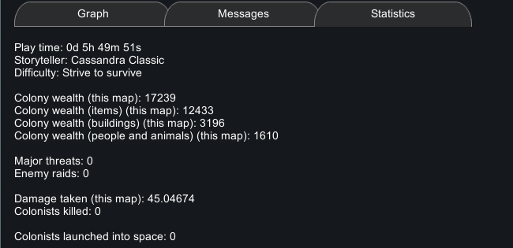
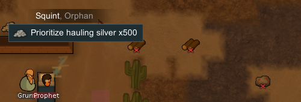
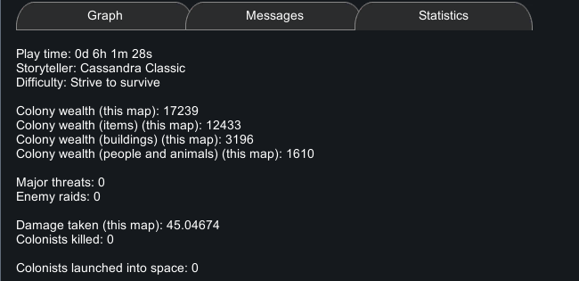

# 64｜原版财富与故事叙述者运行证据：银、禁用、搬运与历史采样

本轮在 **RimWorld 1.7.4980 rev60 / Core + Odyssey** 中完成三个紧凑实验：暂停时增加500银、切换禁用、普通搬运到储存区。结果是：增加500银使统计面板的物品财富和总财富各增加500；随后禁用、携带、入库时，这四项财富的整数显示保持一致。**这证明本次物品与状态转换的行为，不能代替全品类财富计算、难度比较或袭击概率实验。**

## 1. 入口、对象与证据层次

沿用第[61章](61-native-medicine-runtime.md)的隔离进程：`RimWorld.exe`，PID **29920**，HWND **988850**，命令行绑定 `.local-research/runtime/profile-20261102`。程序集 SHA256 为 `eff7d97949f919fb2b151ebfb906e9be749b63410b7dbda78eeebb7972b245c3`。原始版本、mod列表和每份存档的哈希随证据保存。

入口 `medicine-final-paused-b` 与 `storyteller-entry-a/b` 均为 **tick179408**，本轮读档器保留的全部状态相等。没有另起游戏、加载旧档、修改存档XML、安装mod、切换故事叙述者或修改难度。本轮继续采用 REA skill v42 的证据规范；实际输入由检查可执行文件、隔离profile及前景窗口的 Windows 助手执行，**不是 REA native UI provider 的执行结果**。

三类数值必须分开阅读：

| 证据 | 本轮保留内容 | 能说明什么 |
|---|---|---|
| 原版 Statistics 界面 | 人工核读截图中的 Total / Items / Buildings / Pawns | 当前重算后的显示值，格式为 `F0`；没有保存小数 |
| 原始存档实体 | ID、数量、位置、携带容器、作业、禁用字段及相关原始XML | 同一500银是否仍存在、在哪个容器、有没有重复计数 |
| 存档历史数组 | `records` / `recordsDeflate`原文及解码后的float32 | 固定采样时点的历史值；不是任意暂停时刻的当前财富缓存 |

第[63章](63-storyteller-wealth-mechanisms.md)记录了静态依据：`MainTabWindow_History.PostOpen` 打开时对所有地图 `ForceRecount`，Statistics 的四项财富使用 `ToString("F0")`。本轮每次比较前都关闭并重开 History，避免把旧缓存误认成状态不影响财富。常规财富属性的惰性检查条件涉及距上次计数 **大于5000 tick**；不能把它写成每5000 tick必定后台全表重算。

本轮新增银和一个普通储存区，沿用已有殖民者、伤病、建筑、食物与工作安排。开发者模式开启、God mode关闭。银由开发者工具准备，因此不是采矿、贸易或自然收入的实测。

## 2. 实验A：暂停时新增500银

在原生 Actions/tools → **Spawn full thing stack… → Silver** 中点击一次地图，生成 `Silver78580`，数量500，位置 `(111,0,127)`，`spawnedTick=179408`。随后右键清除工具；未额外生成其他银堆。

| 状态 | tick | 总财富 | 物品 | 建筑 | 人与动物 |
|---|---:|---:|---:|---:|---:|
| `storyteller-entry-a/b` | 179408 | 16739 | 11933 | 3196 | 1610 |
| `storyteller-silver-spawned-a/b` | 179408 | 17239 | 12433 | 3196 | 1610 |
| 显示差值 | 0 | **+500** | **+500** | **0** | **0** |

原有 `Silver38564` 为300、`Silver41859` 为500，两堆保持禁止状态。地图及被检查容器中的银总量由 **800→1300**。移除新增银的提取条目后，新增前后保留状态完全一致，因此没有把同tick的其他改动混入这个对照。

新增银位于普通地面，尚未位于储存区，已经出现在本次物品财富增量中。**储存区资源计数与财富统计不是同一个指标。** 本轮只对财富进行正式数值对照，没有将左上角资源计数器的显示变化作为完整资源统计规则。



对照裁图：[新增前](evidence/runtime/storyteller-baseline-wealth.png)、[Silver x500选中面板](evidence/runtime/storyteller-silver-selected.png)。

## 3. 实验B：普通禁用标志不改变本次财富显示

选中 `Silver78580`，按普通 **F** 键禁止取用，保存 `storyteller-silver-forbidden-a/b`。时间仍为179408，原始XML新增 `<forbidden>True</forbidden>`；删除这一字段后，整个提取状态与生成后相同。

重新打开 History 后仍显示 **17239 / 12433 / 3196 / 1610**。这是相同资产、相同数量、相同tick下的单变量对照。未显示该字段时，证据写为“字段缺失”，没有把缺失的序列化字段伪装成原文显式保存的 `False`。

之后再次按普通F恢复允许，以进行搬运；原有两堆银一直保持禁止。本轮实测的是该银堆的禁用开关，不能由一个样本扩展为所有派系、迷雾、地图外物品或不同持有者的财富归属规则。

裁图：[禁止状态的控件](evidence/runtime/storyteller-silver-forbidden.png)、[禁止后的财富](evidence/runtime/storyteller-forbidden-wealth.png)。

## 4. 实验C：地面→携带容器→储存区

### 4.1 普通订单的前置条件

先选择Grump右击银堆，原版菜单显示 **No empty, accessible spot configured to store it**。使用普通 Architect → Zone 新建一格储存区 `(116,0,123)`，存档中为 **ID3，Stockpile zone 2**。它是区域，不是新造的建筑。

再次以Grump尝试搬运，菜单显示 **Will never do hauling**。本轮没有修改其背景、技能或工作优先级；改选 Squint `Human961` 后，菜单出现 **Prioritize hauling silver x500**，正常点击下单。



两个被实际遇到的限制也保留：[无合适储存区](evidence/runtime/storyteller-no-storage.png)、[Grump不能搬运](evidence/runtime/storyteller-grump-incapable.png)。它们属于普通作业资格，不能通过“所有殖民者都能强制做所有工作”的简化掩盖。

### 4.2 同一个物品ID与数量跨容器守恒

订单 `HaulToCell` 的 `loadID=101033`、targetA=`Thing_Silver78580`、targetB=`(116,0,123)`、count=500、`playerForced=True`、workGiver=`HaulGeneral`。其保存的 `ignoreForbidden=True` 是普通强制订单的字段，不表示本轮注入了开发者搬运命令。

| 暂停双档后缀 | tick | 本次推进 | 银堆的位置与归属 |
|---|---:|---:|---|
| `haul-ordered-a/b` | 179408 | — | `Silver78580`500在地面，订单已建立 |
| `haul-first-a/b` | 179695 | 287 | 仍在原地；Squint向目标行进，尚未取起 |
| `haul-pickup-a/b` | 179818 | 123 | 同一ID500进入Squint `carryTracker/innerContainer/innerList`，地面对应实体消失 |
| `haul-finish-a/b` | 180004 | 186 | 同一ID500回到地图things，位于储存格 `(116,0,123)`，Squint携带容器为空 |

以上后缀均以 `storyteller-` 开头。三次速度3的有限运行分别请求650、200、400毫秒，总共实际推进 **596 tick**。每次运行均有前后存档和相同提取状态的暂停双档，墙钟时长不代替存档tick。

携带时，地面两堆旧银合计800，Squint携带500，总量仍为1300。同一订单的 `count` 已从500变为0，不能把作业剩余取物量当作实际携带量；物品本身的 `stackCount` 仍为500。`Silver78580` 的 `despawnedTick=179789`。**携带实体XML仍保存旧位置 `(111,0,127)`，不能将该字段解释成携带中的世界坐标**；此时其持有者Squint位于 `(112,0,127)`，容器关系才是准确的归属证据。

送达后，`Silver78580` 的 `spawnedTick=179940`、`despawnedTick=-1`。后续Squint自动转为普通 `Clean` 作业；没有为了试验再强制其他工作。



携带期间和入库后的统计均为 **17239 / 12433 / 3196 / 1610**。本例支持“进入殖民者携带容器并不使这笔物品财富消失”。它还要求实现层避免同时统计旧地面位置与携带容器中的同一实体。[携带现场](evidence/runtime/storyteller-carry-scene.png)和[入库统计](evidence/runtime/storyteller-stored-wealth.png)保留为独立裁图。

## 5. 当前财富与历史采样必须分开

前面的同tick增银和禁用实验都没有增加历史数组长度。入口到携带时，四条Wealth历史均为6个样本；第三次短运行跨过180000后均变为7个，原6个前缀逐项相同。

| 180000新增历史样本 | 从原始float32字节解码的值 |
|---|---:|
| Wealth_Total | 17239.404296875 |
| Wealth_Items | 12433.1123046875 |
| Wealth_Buildings | 3196.291748046875 |
| Wealth_Pawns | 1610 |
| ThreatPoints | 3.5 |

这些小数由原始存档Base64及Deflate字节还原，没有从界面整数反推。原始数组可同时采用 `records` 和 `recordsDeflate`；读档器和Node验证器分别执行解码，浮点结果逐项一致。共保留11条历史序列，包括人口、心情、Adaptation、PopAdaptation与PopIntent。

入口的最后一个Wealth_Total历史值为 **16848.32421875**，与当时Statistics显示16739不同，直接说明旧历史点不能当作当前财富。财富及ThreatPoints的静态采样频率为30000 tick，Adaptation等相关序列为60000 tick；最后一次短运行恰好跨过共有采样边界。

ThreatPoints历史worker保存的是 `DefaultThreatPointsNow / 10`，因此3.5对应该采样语义下的35点。**本轮没有打开Current threat points开发者日志，也没有新触发袭击。** 该历史值不能称为实际生成敌人的预算、兵力或伤害输出。精确预算组成、最低点数与难度倍率仍属于第63章的静态分析范围。

## 6. 故事叙述者与难度只读核对

通过普通菜单 Options → Gameplay → Storyteller 读取设置，未点击另一选项。UI显示 **Cassandra Classic / Strive to survive**；所有本轮存档中原始字段均保持：

```xml
<storyteller>
  <def>Cassandra</def>
  <difficulty>Rough</difficulty>
  <incidentQueue><queuedIncidents /></incidentQueue>
  <recentIncidentsAnomaly />
  <lastIncidentTick>150000</lastIncidentTick>
</storyteller>
```


`storyWatcher` 始终保留空 `statsRecord`、空 `watcherAdaptation` 与 `watcherPopAdaptation/adaptDays=3`。空元素不能当作每个内部默认字段都显式保存为零。地图storyState仍记录先前的VisitorGroup及lastFireTick150000；本轮没有把它解释成新袭击。

Statistics显示Major threats0、Enemy raids0、Colonists killed0、Damage taken45.04674。这是既有研究世界的有限状态观察，不是自然事件发生率；前面章节使用开发者准备的战斗和伤病也不因此“从未发生”。

## 7. 保留的偏差、最终状态与验证

第一次点击底栏时误开Factions，原文件 `storyteller-002-history.png` 名称没有重写，证据没有把它作为History观察。正式History从003开始。

最后 `storyteller-final-paused-b` 的首次保存流程中，点击Save后对话框没有打开，后续键盘输入作用于地图，镜头发生平移，助手报 **Expected original-game save was not written; inspect UI screenshots.** 该次五个已完成输入全部保留，未冒充成功存档。随后逐步核看057–062截图，成功写入最终b档。最终a、最终b与haul-finish-b的保留状态相同，tick均180004。这里的相同状态是读档器声明的研究范围，不包括镜头位置或每个全局对象。

本轮最终保留 **17份存档快照、8组暂停双档、3次运行、13张裁图、157条完整输入记录**。没有前景守卫失败，但有上述一次保存流程失败；“输入已记录”不等于“每一步UI达到预期”。原始档、全屏截图与元数据继续位于本地忽略目录，公开文件仅保留研究所需提取、裁图及哈希。

最终规范存档：`storyteller-final-paused-b.rws`，SHA256 **`90679b06fa2f74f9d78813cbd626964d50dddefb6517bb112e60277c28d2db7a`**。游戏停在tick180004，已关闭设置面板并释放原生UI输入。

| 继承状态 | 最终保存结果 |
|---|---|
| Prophet `Human958` | Best护理，继续LayDown于Bed77946 |
| WoundInfection151 | severity0.344257951，免疫0.355574995，tendQuality0.31208238，tendTicksLeft42562 |
| Cut148 | severity0.5，tendQuality0.334181815，tendTicksLeft1 |
| Grump `Human965` | 自身NoMeds未变；未改医术、背景或工作安排 |
| Squint `Human961` | 搬运完成，carry为空，转为Clean |
| 新增银与储存区 | 500银保留在 `(116,0,123)`，普通单格Stockpile zone 2保留 |

健康、需求和普通作业在596 tick中自然推进；不能声称世界所有状态在搬运期间都不变。被提取的资产是研究用子集，还包含不属于直接地图殖民者的嵌套持有物，**不能把 `tracked_entities` 全部直接求和当作原版总财富**。

可独立运行的检查：

```powershell
node scripts/research/verify-native-storyteller-runtime.mjs
node scripts/research/verify-native-storyteller-runtime.mjs --local
```

portable检查保留字段、身份与容器守恒、同tick对照、原始历史字节解码、动作时间顺序、运行tick差、截图尺寸/哈希及助手哈希。local额外在一个PowerShell进程内重新解析17份原档、检查原始截图与动作账本。两种模式都不执行游戏回放、OCR或重新模拟财富公式。

证据：[结构化记录](evidence/native-storyteller-runtime.json)、[完整动作账本](evidence/native-storyteller-actions.jsonl)。脚本：[只读提取](../../../scripts/research/read-storyteller-runtime-save.ps1)、[离线采集](../../../scripts/research/collect-storyteller-runtime.ps1)、[独立验证](../../../scripts/research/verify-native-storyteller-runtime.mjs)。本章与第63章静态机制互补；Web实现及简化边界见第[65章](65-voxel-storyteller-validation.md)。
