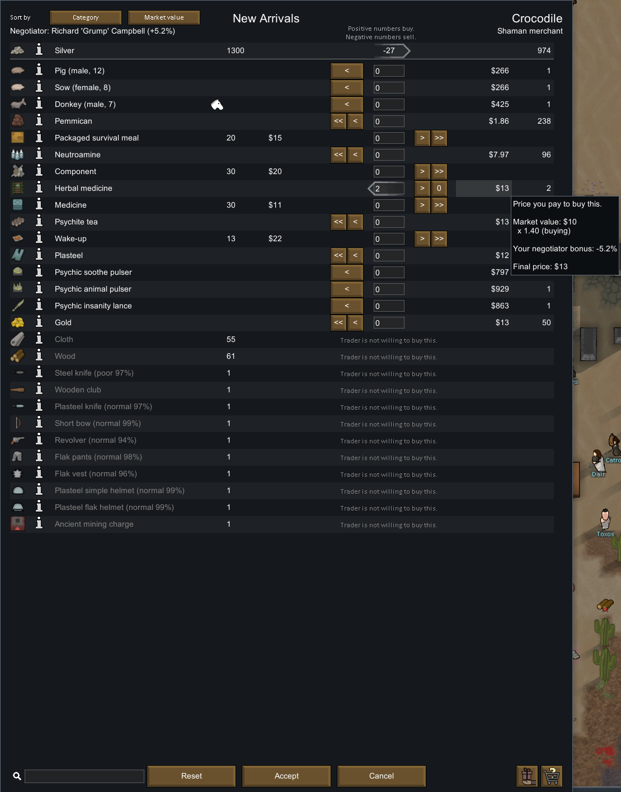
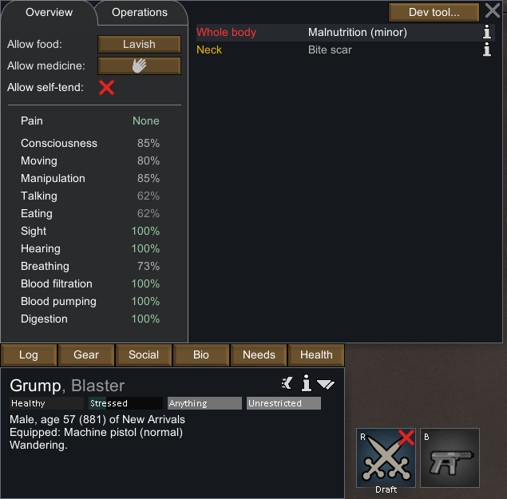

# 67 · 原版交易实机：交谈、买入与实物落地

日期：2026-11-03。目标为本地 RimWorld **1.7.4980 rev60**，使用此前建立的隔离研究档。本文保留实际机制观察，不以精确复刻全部数值作为下一阶段玩法开发的前提。

## 范围与准备

商队通过开发菜单生成，实际类型是 **Shaman merchant**（`Caravan_Neolithic_ShamanMerchant`），商人为 Crocodile / `Human78584`。这不是自然到访实验，也不是Web已实现的大宗/军火目录实测。Grump通过普通交谈指令走向商人并打开交易页；曾实际取消、重新交谈，最后买入两份草药。

早期过程存在暂停按钮理解、菜单定位、Steam通知和前台焦点干扰，失败截图、输入日志与原始存档全部保留在本地 `.local-research/runtime/`。没有把这些尝试称为受控同tick实验。

## 已观察的机制

1. 交谈者实际走到商人处后打开买卖界面。双方有独立库存；商人拒收的布、木材和所选装备在界面中显示拒绝原因。
2. 选择买入两份草药后，报价页面显示支付27银。草药单价显示13，但总额保留内部小数后结算；不能用显示标签13×2反推应付26。
3. 接受后，草药从驮兽背包落到地图地面。物品ID和数量保持，银币从殖民地实体堆转入本商队载畜库存。

## 实物前后记录

原始存档的选定字段摘要及哈希见 [native-trade-runtime.json](evidence/native-trade-runtime.json)。每个端点都有两份同tick存档，选定物品状态相同；前后端点之间经过796 tick，不能视为所有模拟量都保持不变。

| 项目 | 购买前 tick188426 | 购买后 tick189222 |
|---|---|---|
| 殖民地三个银币堆合计 | 1300 | 1273 |
| `Silver78589`，载畜 `Muffalo78602`持有 | 974 | 1001 |
| 草药 `MedicineHerbal78594` | 2份，`Muffalo78603`背包 | 2份，地面 `(122, 0, 128)` |

全存档中另有访客 `Human78393`携带218银的记录，不在上述地图物品摘要内，也不属于这次交易双方，不能加进商队资金。此次实际变化支持27银的双向转移，以及同一草药实体由载畜到地面的归属变化；没有直接读取运行中的内存。

## 能力显示的解释边界

Grump健康页显示说话62%、听觉100%，属性说明中的说话乘数显示65%，最终议价改善显示5.16%。静态规则说明65%是已换算的乘数，不应再次当原始能力代入。按显示的62%计算与5.16%的结果相符，但整数百分比标签不能证明内部说话能力恰好等于0.62。公式来源见[66章](66-trade-market-mechanisms.md)。

## 未完成的分支与终态

卖出1份工业药的尝试只到打开菜单，后续输入先被前台保护拒绝，再因目标进程不存在而拒绝。因此没有已成交的卖出证据；赠礼、商人银币不足、自然到访、完整离场和统计概率也未完成实机验证。

最后可靠暂停端点为 `trade-buy-verified-a/b`，tick189222。后续检查确认原PID29920已不存在，没有重启游戏或继续发送输入；“最后验证的暂停存档”不表示当前仍有暂停中的进程。

## 与Web实现的关系

Web沿用实际接近交谈、独立报价、确认后实物交割、有限落货与搬运的机制。当前商队种类和商品范围不同，货物放在商人容器，尚无载畜；这些差异见[68章](68-voxel-trade-implementation.md)。Web自身已通过普通生产买卖和页面操作，不用它们补充本章缺失的原版卖出证据。

本机可用 `scripts/research/collect-native-trade-runtime.ps1` 从保留文件重新生成摘要与两张裁图，不运行游戏。`node scripts/research/verify-native-trade-runtime.mjs` 核对选定转移和归档结构；加 `--local` 还核对原始文件哈希。这是有限证据复核，不是新的原版实验。
