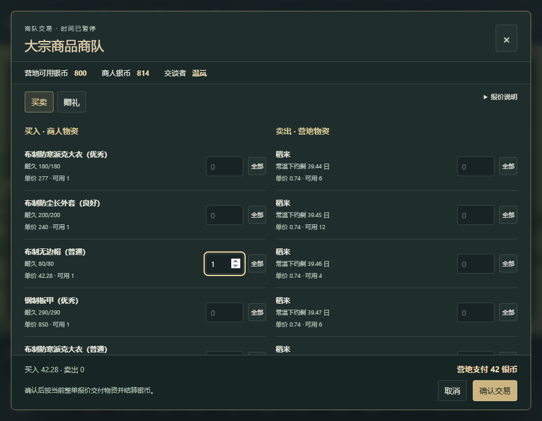

# 68 · 体素商队、银币交易与实体归属

日期：2026-11-03。存档 v21。机制来源见 [66 原版贸易规则](66-trade-market-mechanisms.md)；[67 原版运行结果](67-native-trade-runtime.md)单列，不能用本章的项目测试替代。本章记录实现合同，末尾只填写已完成的验证。

## 操作与经济闭环

新营地有真实的 800 银币，每地面堆最多 500，每次普通搬运最多 75。银币占仓位、可搬运并进入殖民地财富。旧档不补发银币，可以出售实际生产的农作物、布料、衣物或符合商人收购类别的装备积累资金。

商队沿可达地图边缘步行进场。侧栏显示本次商队、人员、状态、库存和关系；选择能够说话、未征召且未倒地的殖民者交谈。人物实际走到商人身旁，取得有效报价后界面暂停。选择数量，检查银币净额，确认后实物归属才改变。取消不会扣款。商队行进和离场途中仍可交谈，直到人物能力、敌对关系、距离或离图等条件不再允许。

买入物品放在商人附近的有限地面位置，需要殖民者实际搬走。地面没有足够空间时整笔拒绝，物资和银币均不转移。卖出的实物从殖民地地面移入商人的持有容器，不能再被殖民者同时使用。装备保留独立 ID、品质、耐久和已有禁止标记；易腐货物拆分和合堆保留年龄。

可出售物资必须在家园区域或仓储区内，并且商人能够到达；穿戴、手持、在途 cargo、施工中已交付材料不进入报价。侧栏可用两个检查位置定义家园矩形，金色边界显示选区。禁止搬运不等于禁止出售。当前项目只有武器具有通用禁止标记，没有声称所有资源都已实现原版禁止按钮。

## 数值、商队与派系范围

价格使用方向性价差、难度损耗、社交等级及实际说话/听觉能力；先处理单价 >99.5 的原版银行家舍入，最后仅对所有行的净额舍入一次。银币面额为 1。普通地面成交没有额外虚构的社交经验。商人银币不足会明确要求接受少收；拒绝时不转移货物。

原版属性说明中的 `Talking ×65%` 是已经通过 `GetFactor` 的乘数再按整数百分比显示，并非健康面板的说话能力。本轮Grump健康页显示说话62%、听觉100%，社交5级。将显示值62%代入可得到约65.263%的乘数、约5.1553%的议价改善，与属性界面显示5.16%相符；这些四舍五入的标签不能单独证明内部容量恰好等于0.62。不能把65%再次当作原始能力代入允许缺损公式，实机过程单列在67章。

只提供大宗和军火两类商队。它们的实际收购类别不同，不能无条件卖木材、草药或所有衣物。礼物同样受收购类别约束。礼物按卖出价值计算关系变化，普通交易按交易价值计算；实际提交还应用向自然关系值移动时的增幅。本项目只有一个自然关系值为 0 的简化中立派系。

日历从第 5 天的偏移开始，以 60 天周期安排 5 次机会，至少间隔 6 天；不保证第 5 天立即到访。机会仍要检查可达入口、已有商队和 64 人物/遗体上限。旧档通过确定性历史周期推进到当前时间，已经过去的机会不补发。保存读取不会重抽库存、队员或下一次机会。

原版停留时长 27000–44999 tick 按项目游戏日换算成 5400–8999 tick，从到达集合点后开始计时，严格超过才进入离场。项目每游戏日 12000 tick、逻辑 20 TPS，游戏日换算与原版 60 TPS 的实时动作换算分开。

货物放在商人的真实持有容器，尚无载畜。护卫只保留 Villager / TownGuard / Slasher / Gunner 子集，使用原版预算与重归一化后的权重。自用武器先按标签和预算筛选，再按物品价格与 commonality 选择；若本项目的小目录没有合适武器则为空，不授予不符合标签的替代武器。原版完整材质、衣物、手雷兵、精英和全部库存 Def 未实现。

商队能与袭击者交战。殖民者对中立商队造成外力伤害，按护甲处理前的伤害值扣关系；只有实际攻击目标同时敌对双方时，误伤才豁免。关系降到 -75 时转为敌对并战斗撤离。尚无完整 Lord 的短时防御/1200 tick 恢复旅行、20%损失撤退、派系关系迟滞/自然恢复、访客自带口粮与休息 AI；长时间困住或在极端气候下的访客仍可能受生存损伤。这里不称为完整原版商队复刻。

## 事务与旧档

`tradeRules.ts` 处理报价/结算，`trade.ts` 处理目录/日历，`tradeWorld.ts` 处理会话与实物事务，`tradePersistence.ts` 处理迁移/验证。界面通过和其他操作一致的普通命令 API 与模拟交互。

每份报价绑定会话 ID 和完整条款。价格、年龄、数量、资格或关系变化会使旧报价失效；成功提交结束会话，重复提交拒绝。所有落货和外部持有容器变更先规划，再一次提交；失败不消耗 ID、银币或物品。出售被另一居民预留取用的食物/药物/装备，会在同一提交中取消相应任务，避免保存悬空引用。

商队装备和 cargo 不计入殖民地库存、财富或制作目标。实际买入和卖出记入 `trade.imported/exported`；商人倒地后真正落地的库存及外国人物实际掉落的武器记为导入。没有空间时仍由原容器持有，不凭空删除。外部货物在商人身上腐坏不记为殖民地腐坏损失。交易记录最多保留 32 笔，人员、货物条目、地图和落货范围均有有限容量。

七份真实 v20 存档已冻结为 `tests/fixtures/voxel-v20-trade-*.json`，相邻 provenance 保留来源及哈希。v20 代码 bundle 是 `af30837052684b98e39f2f342386a03683ce71fd3e32acee341060467b17363a`；workspace `677e8fd`，发布 subtree `545df1c6d8891f84e5d36d164451448cea24245a`。它们不是把当前存档版本号改小生成的。

| 场景 | tick | 保存的实际状态 |
|---|---:|---|
| initial | 0 | v20 初始营地，没有银币 |
| working | 782031 | 机械加工已交付钢45、零件3 |
| carrying | 780204 | 原正式运行失败终点，实际携米和烹饪交料，保留失败来源 |
| combat | 1034800 | 真正袭击已经发生 |
| injured | 1035009 | ID364实际受伤 |
| recovered | 1042320 | 同一ID364恢复 |
| scheduled | 1034680 | 原已预约1034800袭击尚未发生 |

迁移保留物理状态、原技能和 XP、工作物料、病情、战斗与叙事日历；新增社交配置、空家园及贸易日历，新增银币账本为零。旧 v4 默认仓储的类别保持原范围，不自动增加银币。历史测试脚本中的当前输出版本断言更新为21，旧 fixture 字节和旧验收报告不修改；这些脚本更新不表示所有历史长跑都在v21重跑过。

## 本地验证与发布

所有测试、经营和浏览器验收均在本地执行。Pages 只安装锁定依赖、执行含 TypeScript 检查的生产构建、上传并部署静态页面；流水线不跑测试。

当前受控测试覆盖付款不足、库存变化、重复提交、显式少收、银币赠礼、原始伤害关系扣减、共同敌人的误伤豁免、有限落货失败回滚、预留取物取消、粮食年龄、装备身份/禁止状态、外来物资归属、库存腐败/倒地掉落、离图以及伪造存档拒绝。受控测试中的召商队、摆物品或健康/空间条件只用于边界验证，不当作普通经营证据。

43个测试文件、701/701单元测试已通过，进程退出码0；布局修复后的本地生产构建和研究证据全链检查退出码0。报告为 `test-results/v21-unit-accepted.json`、`v21-build-after-layout.log`、`v21-research-check.log`。

正式普通经营从 tick 0 开始，运行到 192872 tick（16.0727 游戏日），3名殖民者存活。19项检查、326次普通命令、13份存档通过，11个覆盖字段均为真。两次刻意重放已经成功的成交命令按预期被拒绝，不计为额外成交。未直接召唤商队、修改时间、授予资源或调整健康/技能。

第一支大宗商队 ID1334 在 tick105200 自然进场。人物正常进食、休息并实际走到商人旁后，在 tick106600 买20布和3米、卖18米，支付28银；买入的20布全部用于制作劣质无边帽 ID1386，再于 tick107461 卖出得到12银，殖民地余银784。商队在 tick111418 整体离图。第二支商队 ID1680 在 tick177200 自然到访，本轮没有与它交易；结束时两支均已离图，自己的棉田也实际收获20布。这是一种子、两次到访、只与首队成交的闭环，不是到访频率或库存分布的统计验证。

Worker/main 两条正式浏览器路径各通过17项检查，各有17次真实文件导入，覆盖7份真实v20存档、迁移后再导入和本轮正式经营存档。两种路径均通过可见控件买入原商队无边帽 ID1370，并完成第二笔粮食交易；导出存档核对殖民地银800→774、商人银814→840，装备身份和状态保留。10张截图已检查，包含1280×800与900×700；窄窗口页脚宽度问题已修复，确认按钮可见可用，控制台/页面错误0。Worker的6个及main的5个JS/CSS资产响应与本地生产构建逐字节一致。



上图直接复制自正式Worker验收截图，SHA-256为 `350779724b7e4aa3d6c693b56245021e53e38f6d35eac66fd72a8ea865b8cb58`。此刻只选入1顶帽，显示净支付42银；后续再加入卖出2米才成为记录中的41银成交，不能将截图中间状态当成最终订单。

冻结验收记录为 [voxel-trade-validation.json](evidence/voxel-trade-validation.json)。来源 bundle SHA-256 为 `9fc5f64ff61e54b9b2146f9064b8420d9e01c52c3bba58913d684133ea727935`；正式经营报告 SHA-256 为 `be906e6888f025afa37b884bf1c563dfd4b3cfd67847f6d39c62a6671d0f6256`；正式浏览器报告 SHA-256 为 `7e75691394a0c42ff3ea4107712ea6f247346632b932d2bce6f39160e1a4e118`。经营脚本、来源字节、探索试跑和失败现场均在本地保留。试跑曾因饥饿打断交谈，正式脚本等待人物正常满足需求；没有把试跑中途存档当作从头正式运行。

重新运行时使用新输出目录，避免覆盖冻结文件；先用 `node scripts/voxel-trade-campaign-verify.mjs --plan` 取得当前来源哈希，再运行：

```powershell
$env:VOXEL_TRADE_EXPECT_SOURCE = '<本次审阅的 bundle SHA-256>'
$env:VOXEL_TRADE_FINAL = '1'
$env:VOXEL_TRADE_OUT = 'test-results/voxel-trade-rerun'
npm run test:voxel:trade
# 另开终端启动生产预览，按实际地址调整下面的 URL。
$env:VOXEL_TRADE_URL = 'http://127.0.0.1:4178/?world=voxel'
$env:VOXEL_TRADE_BROWSER_OUT = 'test-results/voxel-trade-browser-rerun'
npm run test:voxel:trade:browser
```

`node scripts/research/verify-voxel-trade-validation.mjs` 核对仓库中的冻结记录；加 `--local` 还要求本机保留的实际报告、脚本、bundle、存档和截图字节匹配。它们证明上述项目场景通过，不代替67章原版实机，也不表示历史所有长跑都已用v21重跑。

v21首个代码发布为 workspace `fd5d27d` / subtree `63ae4b9828544323100b7e6abdd507c4558d7bd5`。[Pages运行41636646320](https://github.com/sqchenxiyuan/emberfield-web/actions/runs/41636646320)构建和部署均成功，实际步骤中没有测试。随后从本机对正式Pages地址运行完整浏览器脚本：Worker/main各17项、各2笔实际UI交易通过，页面/控制台错误0，6/5个资产响应与本地已验收dist逐字节一致。线上报告保存于 `test-results/voxel-trade-online/report.json`，独立于发布前的冻结验收文件；原版证据随后归档，不改变该次运行的代码身份。
